# Curso interactivo de reconstrucción de Plaguefront sobre AwesomeEngine

Construirá Plaguefront desde una copia limpia del motor original. Las catorce etapas y 32 lecciones contienen operaciones concretas, archivos resultantes, compilación y criterios de salida; las fichas A/B/C muestran cambios reales del motor y el atlas permite recorrer las llamadas visualmente. Las últimas lecciones incorporan los ajustes de paleta, ventana y presentación del juego vigente.

La interacción consiste en ejecutar puntos de control, modificar el taller y navegar entre diagramas, código y explicación. Mermaid representa procesos; no ejecuta una partida. Los enlaces Markdown sirven aunque el visor no admita enlaces de nodos. Los SVG ampliables son evidencia local opcional.

## Método y procedencia

**A** es AwesomeEngine en el commit local `19e1162fe338eb46e9dd0b2c563d3eebfb1572d9`. **C0** es Plaguefront completo antes de los ajustes posteriores de paleta y pantalla completa, conservado byte a byte. **B** son los cambios A→C0 explicados. **C1** incorpora esos ajustes iniciales. **C2** identifica aquí el juego vigente: conserva la corrección posterior del cursor al restaurar y de fullscreen por monitor, y añade la orientación del tercer mapa, follaje bajo el cursor, flechas de ruta y selector de resolución. Las etapas 0–10 reconstruyen C0, las etapas 11–12 explican C1 y la etapa 13 completa C2. Los laboratorios de catálogo parten por separado de C0. No se presentan los puntos didácticos como commits históricos.

`$ProyectoActual` es la raíz Git y de dependencias; `$Referencia` es exclusivamente el snapshot C0 de lectura; `$Taller` es la copia donde construirá A→C0→C1→C2; `$Dependencias` contiene los terceros locales bajo `$ProyectoActual`. Los archivos pequeños y el núcleo progresivo aparecen completos. Los módulos gráficos extensos tienen matriz de archivos, bloques y fuente íntegra. No necesita un Plaguefront funcionando en el taller para aprobar 0–6.

Las dependencias reales determinan el orden: serialización y fin de ronda entran como infraestructura en 3 y se profundizan en 5/9. Los servicios de ventana, entrada y capturas se incorporan juntos en 1 y se verifican en 8/9. La escena final requiere presentación, audio, gamepad y fixtures; se integran juntos en 7. Los bloques temporales están identificados y no se atribuyen al motor original ni a C.

Sólo hay dos documentos principales: este taller y la [referencia técnica](REFERENCIA_TECNICA_PLAGUEFRONT.md). El [README](../README.md) es la entrada. LICENSE conserva su contenido. Los registros y programas de build son evidencia regenerable, no un tercer manual.

El [material C0 del curso](../build/reconstruccion-C0.zip) contiene 213 archivos de código/recursos y su manifiesto, sin caché de compilador ni datos personales. SHA256 del ZIP: `24381c8387732e01864bf59502bd00158a749b5425b4d13ef3bc2b7c47d8ac28`; [verificación de 213 hashes](../build/reconstruccion-C0-zip-verificacion.json). Transporte ese ZIP junto al curso y a la [exportación local de A](../build/reconstruccion-baseline/AwesomeEngine-19e1162.zip) si el otro repositorio no tiene el commit original. Los snapshots son materiales fuente, no documentos adicionales.

## Ruta práctica

| Etapa | Resultado | Lecciones | Diagrama |
|---|---|---|---|
| [0. Preparación](#etapa-0) | Recuperar y compilar A | [1](#leccion-1), [29](#leccion-29) | [CMake](#diagrama-12) |
| [1. Motor](#etapa-1) | Servicios ampliados y Clicker | [2](#leccion-2), [3](#leccion-3), [fichas](#fichas-motor) | [arquitectura](#diagrama-1), [ciclo](#diagrama-2) |
| [2. Escena mínima](#etapa-2) | Panel propio registrado | [4](#leccion-4) | [ciclo](#diagrama-2) |
| [3. Núcleo](#etapa-3) | Mapa, movimiento y turnos | [5](#leccion-5), [6](#leccion-6), [9](#leccion-9), [10](#leccion-10), [11](#leccion-11), [13](#leccion-13) | [movimiento](#diagrama-4), [turnos](#diagrama-7) |
| [4. Combate](#etapa-4) | Daño, habilidades y muerte | [14](#leccion-14), [15](#leccion-15) | [combate](#diagrama-5) |
| [5. Estrategia](#etapa-5) | Captura, economía y ambiente | [16](#leccion-16), [17](#leccion-17), [18](#leccion-18), [19](#leccion-19) | [putrefacción](#diagrama-6), [captura](#diagrama-8) |
| [6. IA](#etapa-6) | Ejército automático | [20](#leccion-20) | [orden](#diagrama-3) |
| [7. Presentación](#etapa-7) | Cámara, sprites, HUD y audio | [7](#leccion-7), [8](#leccion-8), [21](#leccion-21), [22](#leccion-22), [23](#leccion-23) | [render](#diagrama-10) |
| [8. Controles y UX](#etapa-8) | Coordenadas y entrada | [12](#leccion-12), [24](#leccion-24) | [entrada](#diagrama-9) |
| [9. Persistencia y calidad](#etapa-9) | Guardado y nueve suites | [25](#leccion-25), [26](#leccion-26) | [save/load](#diagrama-11) |
| [10. Extensión](#etapa-10) | Reproducir y ampliar C0 | [27](#leccion-27), [28](#leccion-28), [29](#leccion-29) | [arquitectura](#diagrama-1) |
| [11. Paleta configurable](#etapa-11) | Putrefacción morada por JSON | [30](#leccion-30) | [configuración visual](#diagrama-13) |
| [12. Pantalla completa](#etapa-12) | Cursor, atajos y sincronización compartidos | [31](#leccion-31) | [secuencia de ventana](#diagrama-14) |
| [13. Presentación vigente](#etapa-13) | Perspectiva del tercer mapa, follaje al señalar, flecha legible y resolución desplegable | [32](#leccion-32) | [render](#diagrama-10), [entrada](#diagrama-9) |

En cada etapa compruebe la entrada, escriba los archivos, compile y ejecute la prueba antes de avanzar. La revisión de los métodos enlazados acompaña las transferencias de archivos grandes; no se copia el proyecto completo indiscriminadamente.

<a id="etapa-0"></a>

## Etapa 0. Recuperar AwesomeEngine y preparar el entorno

**Entrada:** Git, CMake ≥3.28, Ninja y una terminal de desarrollo MSVC x64/C++20. **Salida:** copia independiente de A y enlace original aprobado. No descargue paquetes.

~~~powershell
$ProyectoActual = (Resolve-Path 'D:\Proyectos\SFML\Plagefront').Path
$Referencia = Join-Path $ProyectoActual 'build/reconstruccion-C0'
$ArchivoC0 = Join-Path $ProyectoActual 'build/reconstruccion-C0.zip'
if (-not (Test-Path -LiteralPath $Referencia)) {
  if (-not (Test-Path -LiteralPath $ArchivoC0)) { throw 'Falta el snapshot C0 que acompaña al curso.' }
  Expand-Archive -LiteralPath $ArchivoC0 -DestinationPath $Referencia
}
$ManifestC0 = Get-Content -Raw -LiteralPath (Join-Path $Referencia 'manifest.json') | ConvertFrom-Json
foreach ($archivoC0 in $ManifestC0.files) {
  $rutaC0 = Join-Path $Referencia $archivoC0.file
  if (-not (Test-Path -LiteralPath $rutaC0)) { throw "Falta C0: $($archivoC0.file)" }
  if ((Get-FileHash -LiteralPath $rutaC0 -Algorithm SHA256).Hash -ne $archivoC0.sha256) {
    throw "C0 modificado: $($archivoC0.file)"
  }
}
$Taller = Join-Path $ProyectoActual 'build/mi-taller-plaguefront'
$Dependencias = Join-Path $ProyectoActual 'build/_deps'
$BaseOriginal = '19e1162fe338eb46e9dd0b2c563d3eebfb1572d9'
if (Test-Path -LiteralPath $Taller) { throw 'Elija una carpeta nueva.' }
git -C $ProyectoActual cat-file -e $BaseOriginal 2>$null
if ($LASTEXITCODE -eq 0) {
  $ArchivoBase = Join-Path $ProyectoActual 'build/awesomeengine-original-curso.zip'
  git -C $ProyectoActual archive --format=zip "--output=$ArchivoBase" $BaseOriginal
  if ($LASTEXITCODE -ne 0) { throw 'No se pudo exportar A.' }
} else {
  $ArchivoBase = Join-Path $ProyectoActual 'build/reconstruccion-baseline/AwesomeEngine-19e1162.zip'
  if (-not (Test-Path -LiteralPath $ArchivoBase)) { throw 'Falta el commit A o su exportación local.' }
}
Expand-Archive -LiteralPath $ArchivoBase -DestinationPath $Taller
Set-Location -LiteralPath $Taller
~~~

La exportación no altera la rama ni el working tree. En otro equipo transporte localmente esta base y los terceros con sus licencias. No se ha probado otra versión supuesta del motor.

**A real:** Engine agenda Clicker; Factory registra Bounce/Clicker; Config declara AwesomeEngine a **800×800**; WindowManager no existe; CMake produce AwesomeEngine.exe sin CTest. A ya tiene fuentes/música, capturas y bindings gamepad. La acción M solicita Menu pero A no registra esa escena: no usarla como prueba inicial.

Compare los cuatro archivos Clicker: header principal en Games/Include, implementación en Games/Source y Types/Config separados. Ese patrón organiza el juego sin introducir SFML en sus reglas puras.

Prepare argumentos de fuentes locales. No comparta FETCHCONTENT_BASE_DIR entre builds.

~~~powershell
if (-not (Test-Path -LiteralPath $Dependencias)) { throw 'Faltan fuentes locales.' }
$OpcionesLocales = @(Get-ChildItem -LiteralPath $Dependencias -Directory -Filter '*-src' | ForEach-Object {
  $nombreLocal = $_.Name.Substring(0, $_.Name.Length - 4).ToUpperInvariant()
  "-DFETCHCONTENT_SOURCE_DIR_${nombreLocal}=$($_.FullName)"
})
$Binario = Join-Path $Taller 'build'
$ConfigurarCurso = @('-S', $Taller, '-B', $Binario, '-G', 'Ninja',
  '-DCMAKE_BUILD_TYPE=Release', '-DCMAKE_TRY_COMPILE_CONFIGURATION=Release',
  '-DCMAKE_CXX_SCAN_FOR_MODULES=OFF',
  '-DCMAKE_CXX_FLAGS=/DWIN32 /D_WINDOWS /W3 /GR /EHsc /utf-8',
  '-DFETCHCONTENT_FULLY_DISCONNECTED=ON', '-DFETCHCONTENT_UPDATES_DISCONNECTED=ON')
~~~

Son necesarios sfml/json/logs/tgui/magic_enum y freetype/harfbuzz/sheenbidi/ogg/vorbis/flac. FULLY_DISCONNECTED no crea fuentes ausentes. Release también en try_compile evita el C1902 local; /EHsc conserva las excepciones cuando se sustituye CMAKE_CXX_FLAGS. Consulte el [entorno completo](REFERENCIA_TECNICA_PLAGUEFRONT.md#7-compilación-y-pruebas).

**Adaptación localizada del taller:** con source overrides, las exclusiones unity de SFML 3.1.0 pueden apuntar a rutas distintas de las fuentes. Esta reconstrucción detectó contaminación de la macro local en FreeType y definiciones duplicadas en Vorbis. Después de FetchContent_MakeAvailable añada:

~~~cmake
# Fuentes externas del taller: compila por separado cada unidad C.
foreach(curso_target freetype ogg FLAC vorbis vorbisenc vorbisfile)
  if(TARGET ${curso_target})
    set_target_properties(${curso_target} PROPERTIES UNITY_BUILD OFF)
  endif()
endforeach()
if(MSVC AND CMAKE_CXX_CL_SHOWINCLUDES_PREFIX MATCHES "^Nota:")
  set(CMAKE_CL_SHOWINCLUDES_PREFIX "Nota: inclusión del archivo: ")
endif()
~~~

La opción global UNITY_BUILD=OFF no basta: SFML fuerza la propiedad por target. Es una adaptación de construcción para esta copia; no cambia el CMake de producción. Aplique ese bloque antes de la primera construcción. Configure y compile:

~~~powershell
cmake @ConfigurarCurso @OpcionesLocales
if ($LASTEXITCODE -ne 0) { throw 'Configuración no aprobada.' }
cmake --build $Binario --parallel 4
if ($LASTEXITCODE -ne 0) { throw 'Enlace original no aprobado.' }
~~~

**Prueba manual:** desde $Taller lance `& (Join-Path $Binario 'AwesomeEngine.exe')` y compruebe Clicker. A no tiene --smoke. **Criterio:** configuración/enlace correctos; no confundirlos con interacción humana. La evidencia local usa build/reconstruccion-practica y binarios build/reconstruccion-bin; se ejecuta con CWD del taller para no cargar recursos finales por accidente. La ruta recomendada $Taller/build evita esa ambigüedad.

<a id="etapa-1"></a>

## Etapa 1. Ampliar el motor conservando sus consumidores

**Entrada:** A compila. **Salida:** motor ampliado, alias temporal Menu→Clicker y captura oculta. Aplique las [fichas motor-01 a motor-14](#fichas-motor) como lote coherente. Sus archivos nuevos aparecen completos y los existentes tienen diff localizado. En la ficha de configuración aplique ahora los cambios de EngineConfig, pero posponga **Content/Config.json** hasta 7: éste permanece original en los checkpoints 1–2. Main, Factory y CMake se integran progresivamente; no aplique el parche final entero antes de crear sus dependencias.

Esta lista permite contrastar el lote con C después de estudiar los diffs. Excluye Main y Factory; no copia Games, Tests ni guardados.

~~~powershell
$MotorCurso = @(
  'Include/Core/Engine.h', 'Include/Core/EngineConfig.h',
  'Include/Core/EngineContext.h', 'Include/Core/EngineVisitor.h',
  'Include/Managers/AudioManager.h', 'Include/Managers/CursorManager.h',
  'Include/Managers/GuiManager.h', 'Include/Managers/InputManager.h',
  'Include/Managers/RenderManager.h', 'Include/Managers/ResourceManager.h',
  'Include/Managers/SaveManager.h', 'Include/Managers/SceneManager.h',
  'Include/Managers/ScreenshotManager.h', 'Include/Managers/WindowManager.h',
  'Include/Scene/Scene.h', 'Include/Config/InputConfig.h', 'Include/Types/InputTypes.h', 'Include/Utils/InputBindings.h',
  'Source/Core/Engine.cpp', 'Source/Core/EngineConfig.cpp', 'Source/Core/EngineVisitor.cpp',
  'Source/Managers/AudioManager.cpp', 'Source/Managers/CursorManager.cpp',
  'Source/Managers/GuiManager.cpp', 'Source/Managers/InputManager.cpp',
  'Source/Managers/RenderManager.cpp', 'Source/Managers/ResourceManager.cpp',
  'Source/Managers/SaveManager.cpp', 'Source/Managers/ScreenshotManager.cpp',
  'Source/Managers/WindowManager.cpp', 'Source/Utils/InputBindings.cpp'
)
foreach ($archivoMotor in $MotorCurso) {
  $destinoMotor = Join-Path $Taller "Engine/$archivoMotor"
  New-Item -ItemType Directory -Path (Split-Path -Parent $destinoMotor) -Force | Out-Null
  Copy-Item -LiteralPath (Join-Path $Referencia "Engine/$archivoMotor") -Destination $destinoMotor
  (Get-Item -LiteralPath $destinoMotor).LastWriteTimeUtc = [DateTime]::UtcNow
}
$CarpetaCursor = Join-Path $Taller 'Content/Textures/Plaguefront/Pixel'
New-Item -ItemType Directory -Path $CarpetaCursor -Force | Out-Null
Copy-Item -LiteralPath (Join-Path $Referencia 'Content/Textures/Plaguefront/Pixel/cursors.png') -Destination (Join-Path $CarpetaCursor 'cursors.png')
~~~

La transferencia renueva la marca temporal del archivo de código: Copy-Item puede conservar una fecha anterior al objeto ya compilado y Ninja debe reconstruir sus consumidores. No basta que el texto en disco sea distinto. Los archivos escritos manualmente ya reciben fecha nueva.

CursorManager carga el atlas en su constructor, antes de entrar en una escena. Es una dependencia real y una limitación de reutilización. Config.json sigue en A: campos nuevos tienen defaults e icono opcional puede faltar. EngineContext construye WindowManager antes de los consumidores de su ventana. No cree servicios duplicados en Games.

En `Engine/Source/Scene/SceneFactory.cpp`, tras `Scenes scenes;` inserte:

~~~cpp
scenes.emplace("Menu", std::make_unique<Clicker::Game>(context));
~~~

Es un alias **didáctico temporal**: el motor final agenda Menu y aún no existe el juego. Mantenga Bounce/Clicker. No ejecute los 71 pasos finales sobre este alias.

Sustituya `Engine/Source/Main.cpp` por este programa temporal completo; --curso-check sólo pertenece al taller:

```cpp
#include "Core/Engine.h"
#include <filesystem>
#include <iostream>
#include <string_view>
#include <SFML/System/Sleep.hpp>

// Programa temporal del taller: comprueba una sola escena antes de integrar el juego.
int main(int argc, char **argv) {
  const bool check = argc > 1 && std::string_view(argv[1]) == "--curso-check";
  Engine engine(!check);
  if (check) {
    engine.ProcessEvent();
    engine.Update();
    engine.Render();
    std::filesystem::create_directories("build");
    if (!engine.SaveScreenshot("build/curso-check.png")) return 2;
    std::cout << "Curso: escena iniciada y un frame capturado\n";
    return 0;
  }
  while (engine.IsRunning()) {
    engine.ProcessEvent();
    if (!engine.HasFocus()) { sf::sleep(sf::milliseconds(10)); continue; }
    engine.Update();
    engine.Render();
  }
}
```

ProcessEvent inicial consume la escena pendiente antes de Update/Render. El frame oculto comprueba integración, no interacción física.

~~~powershell
cmake @ConfigurarCurso @OpcionesLocales
cmake --build $Binario --parallel 4
if ($LASTEXITCODE -ne 0) { throw 'El lote Engine no enlaza.' }
Push-Location -LiteralPath $Taller
& (Join-Path $Binario 'AwesomeEngine.exe') --curso-check
Pop-Location
~~~

**Criterio:** salida 0 y $Taller/build/curso-check.png con Clicker. La escena heredada conserva gConfig.windowSize; responsive es optativo. Se verifica Bounce también en 9. **Diagnóstico:** scene not found→alias; currentScene nulo→ProcessEvent omitido; textura ausente→atlas; símbolos Window/Input→lote incompleto. No avance sin enlace y frame aprobados.

<a id="etapa-2"></a>

## Etapa 2. Crear y registrar la escena mínima Plaguefront

**Entrada:** checkpoint 1. **Salida:** Menu inicia un panel propio y Escape solicita salir. Todavía no necesita Match, IA ni arte final.

Cree `Games/Include/Plaguefront/Game.h` completo:

```cpp
#pragma once
#include "Scene/Scene.h"

namespace Plaguefront {
  // Escena didáctica mínima: todavía no posee Match ni órdenes tácticas.
  class Game : public Scene {
  public:
    explicit Game(EngineContext &context) : Scene(context) {}
    void Start() override;
    void Update() override;
    void Render() const override;
    void OnEvent(const sf::Event &event) override;
    bool HandlesNavigation() const override { return true; }
  };
}
```

Cree `Games/Source/Plaguefront/Game.cpp` completo:

```cpp
#include "Plaguefront/Game.h"
#include <SFML/Graphics.hpp>
#include <stdexcept>

namespace Plaguefront {
  void Game::Start() {
    ctx.renderer.SetResponsiveLayout(true);
    ctx.renderer.SetPixelScale(1);
    ctx.renderer.SetEffectsEnabled(false);
    ctx.cursor.SetVisible(true);
  }
  void Game::Update() {}
  void Game::Render() const {
    ctx.renderer.ResetView();
    sf::RectangleShape panel({620.f, 180.f});
    panel.setPosition({40.f, 50.f});
    panel.setFillColor(sf::Color(25, 39, 40));
    ctx.renderer.Draw(panel);
    const auto *font = ctx.resources.FetchFont("Relidux.otf");
    if (!font) throw std::runtime_error("Falta Relidux.otf");
    sf::Text title(*font, "PLAGUEFRONT / TALLER", 30);
    title.setPosition({60.f, 80.f});
    ctx.renderer.Draw(title);
  }
  void Game::OnEvent(const sf::Event &event) {
    if (const auto *key = event.getIf<sf::Event::KeyPressed>();
        key && key->code == sf::Keyboard::Key::Escape)
      ctx.scenes.RequestQuit();
  }
}
```

Scene referencia EngineContext; no destruye sus managers. Start habilita el lienzo adaptable y desactiva efectos. Render usa Draw y FetchFont reutiliza Relidux.otf de A. Update vacío corresponde únicamente a esta escena didáctica sin simulación. HandlesNavigation deja Escape al juego y RequestQuit lo consume el motor.

En Factory añada el include y cambie sólo el alias:

~~~diff
 #include "Clicker.h"
+#include "Plaguefront/Game.h"
...
-    scenes.emplace("Menu", std::make_unique<Clicker::Game>(context));
+    scenes.emplace("Menu", std::make_unique<Plaguefront::Game>(context));
~~~

Los puntos suspensivos representan contexto omitido, no código. Bounce/Clicker permanecen y Engine ya agenda Menu desde 1.

~~~powershell
cmake @ConfigurarCurso @OpcionesLocales
cmake --build $Binario --parallel 4
if ($LASTEXITCODE -ne 0) { throw 'La escena mínima no enlaza.' }
Push-Location -LiteralPath $Taller
& (Join-Path $Binario 'AwesomeEngine.exe') --curso-check
Pop-Location
~~~

**Automático:** salida 0 y frame PLAGUEFRONT / TALLER. **Manual:** iniciar sin argumento, redimensionar y pulsar Escape. La prueba oculta no inyecta esa tecla. Si falta fuente use `Relidux.otf`: ResourceManager antepone Content/Fonts/, por lo que no se pasa la ruta completa. En 3–6 mantendrá el panel mientras crece el núcleo; en 7 entrará la escena final con todas sus dependencias.


### Evidencia ejecutada de los checkpoints 0–2

El 15 de octubre de 2026 se recuperó A desde Git y se enlazó el motor con la adaptación de portabilidad descrita, sin cambiar sus reglas. Después se compiló el lote Engine y se ejecutó `--curso-check` sobre Clicker y sobre la escena mínima. Ambas ejecuciones terminaron con código 0 y frame real de 960×800: el mínimo de WindowManager amplía la ventana original de 800×800.

| Punto | Registro real | Resultado |
|---|---|---|
| A + adaptación de fuentes externas | [Enlace original](../build/reconstruccion-etapa0-aprobada.log) | Construido; revisión humana de Clicker original pendiente |
| Motor ampliado + alias Clicker | [Compilación y ejecución](../build/reconstruccion-etapa1-aprobada.log), [captura](../build/reconstruccion-etapa1.png) | Salida 0, frame revisado |
| Escena mínima | [Compilación y ejecución](../build/reconstruccion-etapa2.log) | Salida 0, frame revisado |


Los registros conservan los avisos de compilación; no se declara una construcción sin advertencias. Los intentos iniciales fallidos se conservaron como diagnóstico: Unity en dependencias externas y objetos antiguos por fechas de copia. Los comandos del curso ya incorporan las correcciones que aprobaron.

<a id="etapa-3"></a>

## Etapa 3. Reconstruir el núcleo táctico sin depender de la ventana

Esta práctica reúne las lecciones 5, 6, 9, 10, 11 y 13. Las lecciones 7, 8 y 12 se aplican al integrar la presentación; no necesita una cámara para comprobar una ruta. Se parte del taller de la etapa 2, con su escena mínima funcionando. `$Taller` identifica esa copia local y `$Referencia` el snapshot final de lectura. Trabaje únicamente en `$Taller`.

### 3.1. Qué se crea y por qué

AwesomeEngine original no contiene `Match`, una cuadrícula hexagonal ni reglas tácticas. `Clicker.h/.cpp`, `Types/ClickerTypes.h` y `Config/ClickerConfig.h` sirven de modelo de organización: API, implementación, datos y parámetros. Aquí Types no incluye `Scene` ni SFML; la biblioteca puede compilar y ejecutar pruebas sin abrir la ventana.

Cree las carpetas `Games/Include/Plaguefront`, `Games/Include/Types`, `Games/Include/Config` y `Games/Source/Plaguefront` si no existen. Cree los tres headers siguientes con su contenido íntegro. Los métodos de combate, economía e IA se declaran desde ahora para fijar el contrato final, pero sus definiciones se incorporarán en las etapas 4–6. Una declaración no exige un símbolo enlazado mientras ningún código compilado lo llame.

#### Crear `Games/Include/Types/PlaguefrontRulesTypes.h`

```cpp
#pragma once

#include <array>
#include <compare>
#include <string>
#include <vector>

namespace Plaguefront {
  struct Hex {
    int q{}, r{};
    auto operator<=>(const Hex &) const = default;
  };
  enum class UnitClass { Saber,
                         Archer,
                         Lancer,
                         Rider,
                         Caster,
                         Assassin,
                         Berserker };
  enum class Terrain { Plain,
                       Forest,
                       Hill,
                       Swamp,
                       Ruins,
                       Road,
                       River,
                       Bridge,
                       DeepWater,
                       Blocked };
  enum class Building { None,
                        House,
                        Fortress,
                        Outpost };
  enum class Weather { Clear,
                       Rain,
                       Fog,
                       Storm };
  enum class Mode { VersusAI,
                    Local };
  enum class Difficulty { Easy,
                          Normal,
                          Hard };
  enum class Item { Potion,
                    LargePotion,
                    ManaPotion,
                    Antidote,
                    Purifier };
  enum class Ability { Attack,
                       Guard,
                       Precise,
                       Mark,
                       Focus,
                       Pike,
                       Thrust,
                       Retreat,
                       Fire,
                       Ice,
                       Lightning,
                       Heal,
                       Smoke,
                       Furious,
                       Purify,
                       Incinerate };
  struct Stats {
    int hp{}, attack{}, defense{}, magic{}, resistance{}, movement{}, minRange{}, maxRange{}, cost{};
  };
  struct Cell {
    Hex pos;
    Terrain terrain{Terrain::Plain};
    int height{};
    Building building{Building::None};
    int owner{-1};
    bool neutralRewardClaimed{};
    int captureUnit{-1}, captureStartedRound{}, captureDefenderSerial{};
    int capturingPlayer{-1}, captureProgress{};
  };
  struct Player {
    std::string name;
    int coins{120};
  };
  struct Unit {
    int id{}, owner{};
    UnitClass type{UnitClass::Saber};
    Hex pos;
    int hp{}, mp{}, readyRound{1};
    bool activated{}, moved{}, acted{}, attacked{}, moveLocked{}, guard{}, smoke{}, pike{}, precise{}, marked{};
    bool activationStarted{};
    int stepsMoved{}, slowThroughRound{}, mudUntilActivation{}, retreatRemaining{};
    std::array<int, 17> cooldowns{};
    std::vector<Item> inventory;
    bool Alive() const { return hp > 0; }
  };
  struct Corpse {
    int id{};
    Hex pos;
    int deathRound{};
    int owner{};
    UnitClass type{UnitClass::Saber};
    int unitId{-1};
  };
  struct Source {
    int id{};
    Hex pos;
    int remaining{};
  };
  struct FireZone {
    int id{};
    Hex pos;
    int remaining{}, owner{};
  };
  struct CombatEvent {
    int id{}, attackerId{}, targetId{};
    Ability ability{Ability::Attack};
    Hex from, to;
    int amount{};
    bool counter{};
    int chainIndex{};
    bool lethal{};
  };
  struct GameState {
    std::string scenario{"La frontera gris"};
    std::array<Player, 2> players;
    std::vector<Cell> cells;
    std::vector<Unit> units;
    std::vector<Corpse> corpses;
    std::vector<Source> sources;
    std::vector<FireZone> fires;
    // La presentación consume impactos secuenciados sin dirigir ni repetir la lógica de combate.
    std::vector<CombatEvent> combatEvents;
    int nextEventId{1};
    int round{1}, currentPlayer{}, activeUnit{-1}, nextId{1}, winner{-1}, globalRemaining{};
    std::array<int, 2> activationSerial{};
    Weather weather{Weather::Clear};
    Mode mode{Mode::VersusAI};
    Difficulty difficulty{Difficulty::Normal};
    int weatherSeed{1};
    std::vector<std::string> log;
  };
  struct Path {
    std::vector<Hex> cells;
    int cost{};
  };
  struct Result {
    bool ok{};
    std::string message;
    explicit operator bool() const { return ok; }
  };

} // espacio de nombres Plaguefront
```

#### Crear `Games/Include/Config/PlaguefrontRulesConfig.h`

```cpp
#pragma once

#include "Types/PlaguefrontRulesTypes.h"

namespace Plaguefront {
  struct Config {
    std::array<Stats, 7> classes;
    std::array<int, 5> itemCosts{15, 25, 15, 10, 20};
    std::array<int, 10> terrainCosts{1, 1, 1, 2, 1, 1, 2, 1, 9999, 9999};
    int initialCoins{120}, fortressIncome{10}, houseIncome{5}, neutralReward{20}, killReward{10}, outpostCost{70};
    int rotWait{3}, rotRadius{3}, rotDamage{2}, rotDuration{5}, globalThreshold{3}, connectionDistance{3}, globalDamage{1}, globalDuration{5};
    int weatherPeriod{3}, firePower{2}, icePower{1}, lightningPower{5}, purifyMana{3}, purifierRange{2};
    int houseCapture{40}, outpostCapture{50}, fortressCapture{60};
    int lightningMaxTargets{3}, lightningRadius{1}, fireRadius{1}, fireDuration{2}, fireDamage{2};
    int forestDefense{1}, forestArcherAttack{2}, forestRiderSurcharge{1}, uphillCost{1}, rangedHeightAttack{1}, swampDefensePenalty{1}, ruinsDefense{1};
    int rainMoveSurcharge{1}, stormRiderPenalty{1}, weatherRangePenalty{1}, maxMana{8}, manaRecovery{1}, healAmount{6};
    int potionHeal{8}, largePotionHeal{14}, manaPotionRestore{4}, advantageDamage{2}, damageReductionPercent{50};
    int preciseBonus{3}, markBonus{2}, focusBonus{2}, pikeBonus{2}, thrustBonus{3}, chargeBonus{3}, flankBonus{3}, furiousBonus{3};
    int frenzyAttack{2}, frenzyDefensePenalty{1}, chargeSteps{3}, retreatSteps{2};
    std::array<int, 17> abilityCooldowns{0, 0, 2, 2, 0, 0, 2, 3, 0, 0, 0, 0, 3, 2, 0, 0, 0};
    Config();
    static Config Load(const std::string &filename);
  };
} // espacio de nombres Plaguefront
```

#### Crear `Games/Include/Plaguefront/Rules.h`

```cpp
#pragma once

#include "Config/PlaguefrontRulesConfig.h"
#include <map>
#include <optional>

namespace Plaguefront {
  int Distance(Hex a, Hex b);
  std::array<Hex, 6> Neighbors(Hex h);
  std::vector<Hex> HexLine(Hex a, Hex b);
  std::array<float, 2> HexToPixel(Hex h, float radius);
  Hex PixelToHex(float x, float y, float radius);

  std::string Name(UnitClass value);
  std::string Name(Terrain value);
  std::string Name(Weather value);
  std::string Name(Item value);
  std::string Name(Ability value);

  class Match {
  public:
    Config config;
    GameState state;
    explicit Match(Config rules = {});
    static Match Create(const Config &, const std::string &scenarioFile, Mode mode, Difficulty difficulty,
                        const std::array<std::vector<UnitClass>, 2> &armies = {});
    Cell *At(Hex pos);
    const Cell *At(Hex pos) const;
    Unit *Find(int id);
    const Unit *Find(int id) const;
    Unit *Occupant(Hex pos);
    const Unit *Occupant(Hex pos) const;
    Stats EffectiveStats(const Unit &) const;
    int MoveCost(const Unit &, Hex from, Hex to) const;
    std::optional<Path> FindPath(int unitId, Hex target) const;
    std::map<Hex, int> Reachable(int unitId) const;
    bool LineOfSight(Hex from, Hex to) const;
    bool CanTarget(int attackerId, int targetId, Ability ability = Ability::Attack) const;
    int EstimateDamage(int attackerId, int targetId, Ability ability = Ability::Attack) const;
    std::vector<Ability> Abilities(int unitId) const;
    bool Available(const Unit &) const;
    int AvailableCount(int player = -1) const;
    int Income(int player) const;
    int CaptureRequired(Building) const;
    int CaptureRequired(const Cell &cell) const { return CaptureRequired(cell.building); }
    int CounterDamage(int defenderId, int attackerId) const;
    Result BeginActivation(int unitId);
    Result Move(int unitId, Hex destination);
    Result UseAbility(int unitId, Ability ability, Hex target);
    Result EndActivation();
    Result EndTurn();
    Result Pass();
    Result Capture(int unitId);
    Result BuildOutpost(int unitId);
    Result Recruit(int player, UnitClass type, Hex building);
    Result RecruitBattalion(int player, const std::vector<UnitClass> &, Hex building);
    Result BuyItem(int unitId, Item item);
    Result UseItem(int unitId, int slot, Hex target);
    int RotDamageAt(Hex pos) const;
    int FireDamageAt(Hex pos) const;
    int LargestSourceGroup() const;
    void EndRound();
    void Damage(int unitId, int amount, int killerOwner = -1);
    void Log(std::string text);
    bool Validate(std::string &error) const;
    bool Save(const std::string &filename, std::string &error) const;
    static std::optional<Match> Load(const std::string &filename, const Config &, std::string &error);
    bool StepAI();

  private:
    void AdvanceTurn();
    void StartTurn(int player);
    void ResolveHit(int attackerId, int targetId, Ability, bool counter = false, int chainIndex = 0, Hex origin = {});
    void Ignite(Hex center, int owner);
    int CalculateDamage(const Unit &, const Unit &, Ability) const;
    Result CheckActive(int unitId, bool needsAction) const;
  };
} // espacio de nombres Plaguefront
```

**Leer los datos antes de ejecutar órdenes.** `Hex` conserva q/r y obtiene s como −q−r: su comparación C++20 permite ordenarlo en mapas y colas. `Cell` no mantiene un segundo ocupante; `Occupant` recorre las unidades vivas. `Unit::id` sobrevive al movimiento y al crecimiento del vector; vuelva a usar `Find` después de reclutar en lugar de conservar punteros. `activated` significa terminada y `activationStarted` iniciada; no son sinónimos. `moved`/`acted` registran oportunidades gastadas. `Corpse`, `Source`, `FireZone` y `CombatEvent` separan cuatro hechos distintos. `Result` devuelve aceptación y una explicación, sin convertir un mensaje en estado.

`Config` contiene catálogo y parámetros; `Match::config` es la configuración efectiva de esta partida y `Match::state` su estado. El constructor `Config::Config` que se escribe abajo define las estadísticas de las siete clases. Los índices de arrays coinciden con sus enumeraciones: al ampliar un catálogo debe revisar parser, snapshot, render y pruebas. Consulte los valores en la referencia, sección 3.

### 3.2. Crear `Games/Source/Plaguefront/Rules.cpp`

El archivo siguiente es el estado completo del checkpoint 3: funciones finales reales, sin implementaciones vacías ni reglas simplificadas. Aún no contiene `UseAbility`, captura, compras ni IA. Abra el desplegable y escríbalo en el archivo indicado. El prólogo conserva helpers que utilizará el combate en la etapa 4; alguna advertencia de función local todavía no usada es posible y no significa que falte una definición.

<details>
<summary>Contenido íntegro de Rules.cpp al cerrar la etapa 3</summary>

```cpp
#include "Plaguefront/Rules.h"

#include <algorithm>
#include <cmath>
#include <functional>
#include <limits>
#include <queue>
#include <ranges>
#include <set>
#include <tuple>
#include <utility>

namespace Plaguefront {
  namespace {
    constexpr int impassable = 9999;
    constexpr float rootThree = 1.7320508075688772F;
    template <class T>
    constexpr auto index(T value) { return static_cast<std::size_t>(value); }
    Result Yes(std::string message) { return {true, std::move(message)}; }
    Result No(std::string message) { return {false, std::move(message)}; }
    bool ValidClass(UnitClass type) { return index(type) < 7; }
    bool RangedAbility(const Unit &unit, Ability ability) {
      return ability == Ability::Mark || ability == Ability::Fire || ability == Ability::Ice ||
             ability == Ability::Lightning || ability == Ability::Heal ||
             ((ability == Ability::Attack || ability == Ability::Focus) &&
              (unit.type == UnitClass::Archer || unit.type == UnitClass::Caster));
    }
    bool Spell(const Unit &unit, Ability ability) {
      return ability == Ability::Fire || ability == Ability::Ice || ability == Ability::Lightning ||
             (ability == Ability::Attack && unit.type == UnitClass::Caster);
    }
    int ManaCost(Ability ability, const Config &config) {
      switch (ability) {
      case Ability::Fire:
      case Ability::Ice:
        return 2;
      case Ability::Lightning:
      case Ability::Heal:
        return 3;
      case Ability::Purify:
        return config.purifyMana;
      default:
        return 0;
      }
    }
    bool HasAdvantage(UnitClass attacker, UnitClass defender) {
      constexpr std::array<UnitClass, 7> prey{UnitClass::Assassin, UnitClass::Lancer, UnitClass::Rider,
                                              UnitClass::Archer, UnitClass::Berserker, UnitClass::Caster, UnitClass::Saber};
      return ValidClass(attacker) && prey[index(attacker)] == defender;
    }
    Hex RoundedCube(float q, float r) {
      const float s = -q - r;
      int qi = static_cast<int>(std::round(q));
      int ri = static_cast<int>(std::round(r));
      const int si = static_cast<int>(std::round(s));
      const float dq = std::abs(static_cast<float>(qi) - q);
      const float dr = std::abs(static_cast<float>(ri) - r);
      const float ds = std::abs(static_cast<float>(si) - s);
      if (dq > dr && dq > ds)
        qi = -ri - si;
      else if (dr > ds)
        ri = -qi - si;
      return {qi, ri};
    }
    bool Eligible(const Unit &unit, int player, int round) {
      return unit.Alive() && unit.owner == player && unit.readyRound <= round && !unit.activated;
    }
  } // espacio de nombres anónimo

  int Distance(Hex a, Hex b) {
    return (std::abs(a.q - b.q) + std::abs(a.r - b.r) + std::abs(a.q + a.r - b.q - b.r)) / 2;
  }
  std::array<Hex, 6> Neighbors(Hex h) {
    return {{{h.q + 1, h.r}, {h.q + 1, h.r - 1}, {h.q, h.r - 1}, {h.q - 1, h.r}, {h.q - 1, h.r + 1}, {h.q, h.r + 1}}};
  }
  std::vector<Hex> HexLine(Hex a, Hex b) {
    const int length = Distance(a, b);
    std::vector<Hex> line;
    for (int i = 0; i <= length; ++i) {
      const float t = length == 0 ? 0.F : static_cast<float>(i) / static_cast<float>(length);
      // Desplazamientos iguales resuelven de forma determinista las líneas entre dos celdas.
      line.push_back(RoundedCube(static_cast<float>(a.q) + static_cast<float>(b.q - a.q) * t + 0.00001F,
                                 static_cast<float>(a.r) + static_cast<float>(b.r - a.r) * t + 0.00001F));
    }
    return line;
  }
  std::array<float, 2> HexToPixel(Hex h, float radius) {
    return {radius * rootThree * (static_cast<float>(h.q) + static_cast<float>(h.r) * 0.5F),
            radius * 1.5F * static_cast<float>(h.r)};
  }
  Hex PixelToHex(float x, float y, float radius) {
    if (radius <= 0.F)
      return {};
    return RoundedCube((rootThree / 3.F * x - y / 3.F) / radius, (2.F / 3.F * y) / radius);
  }

  std::string Name(UnitClass value) {
    constexpr std::array names{"Saber", "Archer", "Lancer", "Rider", "Caster", "Assassin", "Berserker"};
    return index(value) < names.size() ? names[index(value)] : "Clase desconocida";
  }
  std::string Name(Terrain value) {
    constexpr std::array names{"Llanura", "Bosque", "Colina", "Pantano", "Ruinas", "Camino", "Rio", "Puente", "Agua profunda", "Inaccesible"};
    return index(value) < names.size() ? names[index(value)] : "Terreno desconocido";
  }
  std::string Name(Weather value) {
    constexpr std::array names{"Despejado", "Lluvia", "Niebla", "Tormenta"};
    return index(value) < names.size() ? names[index(value)] : "Clima desconocido";
  }
  std::string Name(Item value) {
    constexpr std::array names{"Pocion", "Pocion grande", "Pocion de mana", "Antidoto", "Kit purificador"};
    return index(value) < names.size() ? names[index(value)] : "Objeto desconocido";
  }
  std::string Name(Ability value) {
    constexpr std::array names{"Ataque", "Parada", "Corte preciso", "Marcar objetivo", "Disparo concentrado",
                               "Formacion de picas", "Estocada de carga", "Repliegue montado", "Fire", "Ice", "Lightning", "Heal",
                               "Humo", "Golpe furioso", "Purificacion", "Incinerar cadaver"};
    return index(value) < names.size() ? names[index(value)] : "Habilidad desconocida";
  }

  Config::Config() : classes{{{28, 9, 5, 2, 3, 4, 1, 1, 45}, {22, 7, 2, 1, 3, 3, 2, 4, 35}, {27, 9, 4, 1, 2, 3, 1, 1, 45}, {30, 9, 3, 1, 2, 5, 1, 1, 60}, {20, 4, 2, 8, 4, 3, 2, 3, 55}, {21, 10, 2, 2, 3, 5, 1, 1, 50}, {34, 11, 4, 0, 1, 3, 1, 1, 55}}} {}

  Match::Match(Config rules) : config(std::move(rules)) {
    state.players = {{{"Jugador 1", config.initialCoins}, {"Jugador 2", config.initialCoins}}};
  }
  Cell *Match::At(Hex pos) {
    const auto found = std::ranges::find(state.cells, pos, &Cell::pos);
    return found == state.cells.end() ? nullptr : &*found;
  }
  const Cell *Match::At(Hex pos) const {
    const auto found = std::ranges::find(state.cells, pos, &Cell::pos);
    return found == state.cells.end() ? nullptr : &*found;
  }
  Unit *Match::Find(int id) {
    const auto found = std::ranges::find(state.units, id, &Unit::id);
    return found == state.units.end() ? nullptr : &*found;
  }
  const Unit *Match::Find(int id) const {
    const auto found = std::ranges::find(state.units, id, &Unit::id);
    return found == state.units.end() ? nullptr : &*found;
  }
  Unit *Match::Occupant(Hex pos) {
    const auto found = std::ranges::find_if(state.units, [pos](const Unit &unit) { return unit.Alive() && unit.pos == pos; });
    return found == state.units.end() ? nullptr : &*found;
  }
  const Unit *Match::Occupant(Hex pos) const {
    const auto found = std::ranges::find_if(state.units, [pos](const Unit &unit) { return unit.Alive() && unit.pos == pos; });
    return found == state.units.end() ? nullptr : &*found;
  }
  void Match::Log(std::string text) {
    state.log.push_back(std::move(text));
    if (state.log.size() > 160)
      state.log.erase(state.log.begin(), state.log.begin() + 40);
  }

  Stats Match::EffectiveStats(const Unit &unit) const {
    if (!ValidClass(unit.type))
      return {};
    auto stats = config.classes[index(unit.type)];
    if (const Cell *cell = At(unit.pos)) {
      if (cell->terrain == Terrain::Forest) {
        stats.defense += config.forestDefense;
        if (unit.type == UnitClass::Archer)
          stats.attack += config.forestArcherAttack;
      }
      if (cell->terrain == Terrain::Ruins)
        stats.defense += config.ruinsDefense;
    }
    if (unit.mudUntilActivation > 0)
      stats.defense -= config.swampDefensePenalty;
    if (unit.pike)
      stats.defense += config.pikeBonus;
    if (unit.type == UnitClass::Berserker && unit.hp * 2 <= stats.hp) {
      stats.attack += config.frenzyAttack;
      stats.defense -= config.frenzyDefensePenalty;
    }
    // Ice afecta la siguiente ronda completa, aunque el objetivo ya hubiera terminado su activación al recibirlo.
    if (unit.slowThroughRound == state.round)
      --stats.movement;
    if (state.weather == Weather::Storm && unit.type == UnitClass::Rider)
      stats.movement -= config.stormRiderPenalty;
    if (stats.maxRange > 1 && (state.weather == Weather::Fog ||
                               (state.weather == Weather::Storm && unit.type == UnitClass::Archer)))
      stats.maxRange = std::max(stats.minRange, stats.maxRange - config.weatherRangePenalty);
    stats.defense = std::max(0, stats.defense);
    stats.movement = std::max(1, stats.movement);
    return stats;
  }
  int Match::MoveCost(const Unit &unit, Hex from, Hex to) const {
    const Cell *origin = At(from), *destination = At(to);
    if (!origin || !destination || Distance(from, to) != 1 || index(destination->terrain) >= config.terrainCosts.size())
      return impassable;
    if (destination->terrain == Terrain::DeepWater || destination->terrain == Terrain::Blocked)
      return impassable;
    if (const Unit *blocking = Occupant(to); blocking && blocking->id != unit.id)
      return impassable;
    int cost = std::max(1, config.terrainCosts[index(destination->terrain)]);
    cost += std::max(0, destination->height - origin->height) * config.uphillCost;
    if (unit.type == UnitClass::Rider && destination->terrain == Terrain::Forest)
      cost += config.forestRiderSurcharge;
    if (state.weather == Weather::Rain && (destination->terrain == Terrain::Swamp || destination->height < 0))
      cost += config.rainMoveSurcharge;
    return std::clamp(cost, 1, impassable);
  }

  std::optional<Path> Match::FindPath(int unitId, Hex target) const {
    const Unit *unit = Find(unitId);
    if (!unit || !unit->Alive() || !At(target))
      return std::nullopt;
    if (const Unit *blocker = Occupant(target); blocker && blocker->id != unitId)
      return std::nullopt;
    using Entry = std::pair<int, Hex>;
    std::priority_queue<Entry, std::vector<Entry>, std::greater<>> frontier;
    std::map<Hex, int> cost{{unit->pos, 0}};
    std::map<Hex, Hex> cameFrom;
    frontier.push({0, unit->pos});
    while (!frontier.empty()) {
      const auto [currentCost, current] = frontier.top();
      frontier.pop();
      if (current == target)
        break;
      if (currentCost != cost.at(current))
        continue;
      for (Hex neighbor : Neighbors(current)) {
        const int step = MoveCost(*unit, current, neighbor);
        if (step >= impassable)
          continue;
        const int candidate = currentCost + step;
        if (!cost.contains(neighbor) || candidate < cost.at(neighbor)) {
          cost[neighbor] = candidate;
          cameFrom[neighbor] = current;
          frontier.push({candidate, neighbor});
        }
      }
    }
    if (!cost.contains(target))
      return std::nullopt;
    Path path{{target}, cost.at(target)};
    while (path.cells.back() != unit->pos)
      path.cells.push_back(cameFrom.at(path.cells.back()));
    std::ranges::reverse(path.cells);
    return path;
  }
  std::map<Hex, int> Match::Reachable(int unitId) const {
    const Unit *unit = Find(unitId);
    if (!unit || !unit->Alive() || unit->moveLocked || (unit->moved && unit->retreatRemaining <= 0))
      return {};
    const int budget = unit->retreatRemaining > 0 ? unit->retreatRemaining : EffectiveStats(*unit).movement;
    using Entry = std::pair<int, Hex>;
    std::priority_queue<Entry, std::vector<Entry>, std::greater<>> frontier;
    std::map<Hex, int> cost{{unit->pos, 0}};
    frontier.push({0, unit->pos});
    while (!frontier.empty()) {
      const auto [spent, current] = frontier.top();
      frontier.pop();
      if (spent != cost.at(current))
        continue;
      for (Hex neighbor : Neighbors(current)) {
        const int step = MoveCost(*unit, current, neighbor);
        const int candidate = spent + step;
        if (step >= impassable || candidate > budget)
          continue;
        if (!cost.contains(neighbor) || candidate < cost.at(neighbor)) {
          cost[neighbor] = candidate;
          frontier.push({candidate, neighbor});
        }
      }
    }
    return cost;
  }
  bool Match::Available(const Unit &unit) const { return state.winner < 0 && Eligible(unit, state.currentPlayer, state.round); }
  int Match::AvailableCount(int player) const {
    if (state.winner >= 0)
      return 0;
    if (player < 0)
      player = state.currentPlayer;
    return static_cast<int>(std::ranges::count_if(state.units, [&](const Unit &unit) { return Eligible(unit, player, state.round); }));
  }
  int Match::Income(int player) const {
    if (player < 0 || player > 1)
      return 0;
    int income = 0;
    for (const Cell &cell : state.cells)
      if (cell.owner == player) {
        if (cell.building == Building::Fortress)
          income += config.fortressIncome;
        else if (cell.building == Building::House)
          income += config.houseIncome;
      }
    return income;
  }
  int Match::CaptureRequired(Building building) const {
    switch (building) {
    case Building::House:
      return config.houseCapture;
    case Building::Outpost:
      return config.outpostCapture;
    case Building::Fortress:
      return config.fortressCapture;
    default:
      return 0;
    }
  }
  Result Match::CheckActive(int unitId, bool needsAction) const {
    const Unit *unit = Find(unitId);
    if (state.winner >= 0)
      return No("La partida ha terminado.");
    if (!unit || !unit->Alive() || unit->owner != state.currentPlayer || state.activeUnit != unitId || unit->activated || !unit->activationStarted)
      return No("Activa una unidad propia antes de dar la orden.");
    if (needsAction && unit->acted)
      return No("La unidad ya utilizo su accion.");
    return Yes("");
  }
  Result Match::BeginActivation(int unitId) {
    if (state.winner >= 0)
      return No("La partida ha terminado.");
    Unit *unit = Find(unitId);
    if (!unit || !Available(*unit))
      return No("Esa unidad no puede activarse ahora.");
    state.activeUnit = unitId;
    if (unit->activationStarted)
      return Yes("Se reanuda la activacion de " + Name(unit->type) + ".");
    unit->activationStarted = true;
    unit->moved = unit->acted = unit->attacked = unit->moveLocked = unit->guard = unit->smoke = unit->pike = false;
    unit->stepsMoved = unit->mudUntilActivation = unit->retreatRemaining = 0;
    if (unit->type == UnitClass::Caster)
      unit->mp = std::min(config.maxMana, unit->mp + config.manaRecovery);
    if (RotDamageAt(unit->pos) > 0)
      Log("Alerta: " + Name(unit->type) + " esta en una zona contaminada.");
    else if (std::ranges::any_of(state.corpses, [&](const Corpse &corpse) {
               return state.round - corpse.deathRound >= config.rotWait && Distance(corpse.pos, unit->pos) <= config.rotRadius;
             }))
      Log("Alerta: un cadaver cercano va a activar la putrefaccion.");
    return Yes("Activacion de " + Name(unit->type) + ".");
  }
  Result Match::Move(int unitId, Hex destination) {
    if (const auto result = CheckActive(unitId, false); !result)
      return result;
    Unit *unit = Find(unitId);
    if (unit->moveLocked)
      return No("El disparo concentrado impide moverse.");
    const bool retreat = unit->retreatRemaining > 0;
    if (!retreat && unit->moved)
      return No("El movimiento ya no esta disponible.");
    if (destination == unit->pos)
      return No("Selecciona otra celda.");
    const auto path = FindPath(unitId, destination);
    const int budget = retreat ? unit->retreatRemaining : EffectiveStats(*unit).movement;
    if (!path || path->cost > budget || (retreat && static_cast<int>(path->cells.size()) - 1 > config.retreatSteps))
      return No("Destino fuera del alcance o bloqueado.");
    for (Cell &cell : state.cells)
      if (cell.captureUnit == unitId) {
        cell.captureUnit = -1;
        Log("Captura en pausa: la unidad abandono el edificio; el progreso se conserva.");
      }
    unit->stepsMoved += static_cast<int>(path->cells.size()) - 1;
    unit->pos = destination;
    unit->moved = true;
    unit->retreatRemaining = 0;
    if (At(destination)->terrain == Terrain::Swamp)
      unit->mudUntilActivation = 1;
    return Yes("Movimiento: " + std::to_string(path->cost) + " puntos.");
  }

  void Match::Damage(int unitId, int amount, int killerOwner) {
    if (state.winner >= 0)
      return;
    Unit *unit = Find(unitId);
    if (!unit || !unit->Alive() || amount <= 0)
      return;
    unit->hp = std::max(0, unit->hp - amount);
    if (unit->Alive())
      return;
    state.corpses.push_back({state.nextId++, unit->pos, state.round, unit->owner, unit->type, unit->id});
    if (state.activeUnit == unitId)
      state.activeUnit = -1;
    if (killerOwner >= 0 && killerOwner < 2 && killerOwner != unit->owner)
      state.players[static_cast<std::size_t>(killerOwner)].coins += config.killReward;
    for (Cell &cell : state.cells)
      if (cell.captureUnit == unitId) {
        cell.captureUnit = -1;
        Log("Captura en pausa: el captor ha caido; el progreso se conserva.");
      }
    Log(Name(unit->type) + " ha caido. Cadaver registrado en ronda " + std::to_string(state.round) + ".");
  }
  Result Match::EndActivation() {
    if (state.winner >= 0)
      return No("La partida ha terminado.");
    if (state.activeUnit < 0)
      return No("No hay activacion en curso.");
    Unit *unit = Find(state.activeUnit);
    if (unit) {
      unit->retreatRemaining = 0;
      unit->activated = true;
    }
    state.activeUnit = -1;
    return Yes("Activacion finalizada.");
  }
  void Match::AdvanceTurn() {
    if (state.winner >= 0)
      return;
    const int previous = state.currentPlayer;
    if (previous == 1)
      EndRound();
    StartTurn(1 - previous);
  }
  void Match::StartTurn(int player) {
    state.currentPlayer = player;
    state.activeUnit = -1;
    for (Unit &unit : state.units)
      if (unit.owner == player) {
        unit.activated = unit.activationStarted = false;
        unit.moved = unit.acted = unit.attacked = unit.moveLocked = false;
        unit.stepsMoved = unit.retreatRemaining = 0;
      }
    const int income = Income(player);
    state.players[static_cast<std::size_t>(player)].coins += income;
    Log("Turno de " + state.players[static_cast<std::size_t>(player)].name + ": +" + std::to_string(income) + " monedas de ingresos.");
  }
  Result Match::EndTurn() {
    if (state.winner >= 0)
      return No("La partida ha terminado.");
    state.activeUnit = -1;
    for (Unit &unit : state.units)
      if (unit.owner == state.currentPlayer) {
        if (Eligible(unit, state.currentPlayer, state.round))
          unit.activated = true;
        unit.retreatRemaining = 0;
      }
    ++state.activationSerial[static_cast<std::size_t>(state.currentPlayer)];
    AdvanceTurn();
    return Yes("Turno de ejercito finalizado.");
  }
  Result Match::Pass() { return EndTurn(); }

  int Match::RotDamageAt(Hex pos) const {
    if (std::ranges::any_of(state.sources, [&](const Source &source) {
          return source.remaining > 0 && Distance(source.pos, pos) <= config.rotRadius;
        }))
      return config.rotDamage;
    return state.globalRemaining > 0 ? config.globalDamage : 0;
  }
  int Match::FireDamageAt(Hex pos) const {
    if (!std::ranges::any_of(state.fires, [pos](const FireZone &fire) { return fire.remaining > 0 && fire.pos == pos; }))
      return 0;
    return std::max(1, config.fireDamage - (state.weather == Weather::Rain ? 1 : 0));
  }
  int Match::LargestSourceGroup() const {
    std::set<int> visited;
    int largest = 0;
    for (const Source &source : state.sources) {
      if (source.remaining <= 0 || visited.contains(source.id))
        continue;
      std::vector<const Source *> pending{&source};
      visited.insert(source.id);
      int count = 0;
      while (!pending.empty()) {
        const Source *current = pending.back();
        pending.pop_back();
        ++count;
        for (const Source &candidate : state.sources) {
          if (candidate.remaining > 0 && !visited.contains(candidate.id) && Distance(current->pos, candidate.pos) <= config.connectionDistance) {
            visited.insert(candidate.id);
            pending.push_back(&candidate);
          }
        }
      }
      largest = std::max(largest, count);
    }
    return largest;
  }
  void Match::EndRound() {
    if (state.winner >= 0)
      return;
    state.activeUnit = -1;
    const bool connected = LargestSourceGroup() >= config.globalThreshold;
    if (connected) {
      if (state.globalRemaining == 0)
        Log("ALERTA: contaminacion global. Las fuentes forman un grupo conectado.");
      state.globalRemaining = config.globalDuration;
    }
    // Fotografía el daño antes de aplicarlo para que las muertes sean simultáneas y sus cadáveres no actúen en este ciclo.
    std::vector<std::pair<int, int>> damage;
    for (const Unit &unit : state.units)
      if (unit.Alive()) {
        const int amount = RotDamageAt(unit.pos) + FireDamageAt(unit.pos);
        if (amount > 0)
          damage.emplace_back(unit.id, amount);
      }
    for (const auto &[id, amount] : damage) {
      Damage(id, amount);
      Log("Dano ambiental: " + std::to_string(amount) + " HP a unidad " + std::to_string(id) + ".");
    }
    for (FireZone &fire : state.fires)
      --fire.remaining;
    std::erase_if(state.fires, [](const FireZone &fire) { return fire.remaining <= 0; });
    for (Source &source : state.sources)
      --source.remaining;
    std::erase_if(state.sources, [](const Source &source) { return source.remaining <= 0; });
    if (!connected && state.globalRemaining > 0)
      --state.globalRemaining;

    // Una muerte en R excluye ese cierre: espera R+1 a R+3 y, con la configuración inicial, causa daño de R+4 a R+8.
    for (const Corpse &corpse : state.corpses)
      if (state.round - corpse.deathRound >= config.rotWait) {
        state.sources.push_back({corpse.id, corpse.pos, config.rotDuration});
        Log("Un cadaver se convierte en fuente; su primer dano llegara al final de la proxima ronda.");
      }
    std::erase_if(state.corpses, [&](const Corpse &corpse) {
      return state.round - corpse.deathRound >= config.rotWait;
    });
    if (LargestSourceGroup() >= config.globalThreshold) {
      if (state.globalRemaining == 0)
        Log("ALERTA: contaminacion global. Las fuentes forman un grupo conectado.");
      state.globalRemaining = config.globalDuration;
    }
    for (Unit &unit : state.units) {
      for (int &cooldown : unit.cooldowns)
        cooldown = std::max(0, cooldown - 1);
    }
    ++state.round;
    if (config.weatherPeriod > 0 && (state.round - 1) % config.weatherPeriod == 0) {
      // La semilla local conserva un clima determinista y reproducible entre escenarios y guardados.
      state.weatherSeed = static_cast<int>((static_cast<unsigned>(state.weatherSeed) * 1664525U + 1013904223U) & 0x7fffffffU);
      const int offset = 1 + state.weatherSeed % 3;
      state.weather = static_cast<Weather>((static_cast<int>(state.weather) + offset) % 4);
      Log("Cambio de clima: " + Name(state.weather) + ".");
    }
    // Conserva el turno del ejército eliminado para que pueda gastar sus ingresos y pasarlo si aún no hay reclutas listos.
    Log("Comienza la ronda " + std::to_string(state.round) + ".");
  }
} // espacio de nombres Plaguefront
```

</details>

### 3.3. Explicar las funciones que acaba de construir

| Bloque introducido | Entrada, salida y decisión | Consumidor |
| --- | --- | --- |
| `index`, `Yes`, `No`, `ValidClass`, `Eligible` | Helpers privados: índices, resultado y elegibilidad. `Eligible` no inspecciona píxeles. | Consultas y órdenes de `Match`. |
| `RoundedCube`, `Distance`, `Neighbors`, `HexLine` | Distancia axial, seis vecinos en orden fijo y línea redondeada determinista. Vecino no equivale a celda existente. | Rutas, visión, radios y conexiones. |
| `HexToPixel`, `PixelToHex` | Conversión regular auxiliar y redondeo cúbico; radio no positivo devuelve origen. No será el picking del mapa elevado. | Pruebas y herramientas. |
| `Name` (cinco sobrecargas) | Traduce enumeraciones a texto, con fallback ante índice desconocido. | Mensajes; UI al integrarla. |
| `Config::Config`, `Match::Match` | Catálogo inicial y tesorerías. El constructor solo no crea un escenario ni paga un turno. | Fábricas y pruebas. |
| `At`, `Find`, `Occupant` (const/mutables) | Busca por posición/ID; devuelve puntero nulo al faltar. `Occupant` excluye muertos. | Todos los comandos y consultas. |
| `Log` | Añade texto y conserva un sufijo acotado; no es una cola de órdenes. | Diagnóstico y audio observador. |
| `EffectiveStats` | Copia catálogo y aplica terreno, barro, posturas, Frenesí, Ice y clima; no muta configuración. | MOV, alcance y daño futuro. |
| `MoveCost` | Comprueba existencia/adyacencia/ocupación, terreno y subida; 9999 representa inaccesible. | Las dos búsquedas de rutas. |
| `FindPath` | Dijkstra sin límite MOV; coste y camino origen→destino. Devuelve `nullopt` si no hay ruta. | Validación, IA y animación del estado anterior. |
| `Reachable` | Dijkstra limitado por presupuesto efectivo; incluye origen y respeta movimiento gastado/bloqueado. | Previsualización y simulación. |
| `Available`, `AvailableCount` | Reutiliza elegibilidad, añade estado terminal y propietario actual. Contar otro dueño no concede su turno. | Activación y cierre de ejército. |
| `CheckActive` | Guardia común: partida activa, actor vivo/propio, ID activo y activación iniciada; opcionalmente acción disponible. | `Move` y futuros comandos. |
| `BeginActivation` | Inicia una vez o reanuda. Recupera MP una sola vez por turno y limpia estados del primer comienzo. | Jugador, IA y fixtures. |
| `Move` | Valida primero; conserva captura pausada, actualiza pasos/posición/barro y consume movimiento después. | Jugador e IA. |
| `EndActivation` | Marca terminada una tropa y conserva ejército/ronda. | Interacción y planificador. |
| `EndTurn`, `AdvanceTurn`, `StartTurn`, `Pass` | Entrega ejército; sólo rojo cierra ronda; el entrante recibe reinicio e ingreso una vez. | Fin explícito de turno. |

`RangedAbility`, `Spell`, `ManaCost` y `HasAdvantage` todavía no intervienen en las órdenes del checkpoint 3. Se incluyen con el prólogo final y se explican al añadir combate. No cree managers para geometría, turnos o rutas: son responsabilidades del juego, no servicios de AwesomeEngine.

**Dependencias adelantadas y delimitadas.** `BeginActivation` llama `RotDamageAt`; `AdvanceTurn` llama `EndRound`; `EndRound` llama `Damage`, `LargestSourceGroup` y las dos consultas ambientales. `Create`/`Validate` necesitan `Income` y `CaptureRequired`. Por ello esas funciones finales ya aparecen en este checkpoint. Evitamos escribir un `EndRound` provisional que después hubiera que reemplazar, o enlazar stubs que ignoren muertes. En esta etapa compruebe que un tablero sin efectos avanza una ronda tras azul→rojo. En la etapa 5 recorrerá y probará, en orden, cadáveres/fuentes/fuego/conectividad. `Damage` registra muerte y recompensa una sola vez; no declara victoria por eliminación. `Income` paga propiedades reales y `CaptureRequired` es una consulta pura de umbral, todavía sin ejecutar conquista.

### 3.4. Crear el lector de escenarios y su validador real

Cree `Games/Source/Plaguefront/Persistence.cpp`. El archivo cumple dos responsabilidades cercanas: leer configuración/escenarios y leer/escribir instantáneas. Se introduce completo porque `Config::Load` reutiliza `ReadConfigSnapshot`/`ValidConfig`, y `Create` llama a `Validate`, que verifica también edificios, efectos y capturas. El guardado ya compilará, pero su práctica de carga/migración se reserva a la etapa 9. Esto es una ordenación didáctica de dependencias del código actual, no una afirmación sobre cómo evolucionó históricamente.

<details>
<summary>Contenido íntegro de Persistence.cpp: datos, escenario y validación</summary>

```cpp
#include "Plaguefront/Rules.h"

#include <nlohmann/json.hpp>
#include <algorithm>
#include <filesystem>
#include <fstream>
#include <limits>
#include <set>
#include <stdexcept>

namespace Plaguefront {
  namespace {
    using Json = nlohmann::json;
    constexpr std::size_t MaxFileBytes = 4 * 1024 * 1024;
    constexpr std::size_t MaxCells = 4096, MaxUnits = 512, MaxEffects = 4096;
#define PF_CONFIG_FIELDS(X)                                                                                                       \
  X(forestDefense)                                                                                                                \
  X(forestArcherAttack)                                                                                                           \
  X(forestRiderSurcharge) X(uphillCost) X(rangedHeightAttack) X(swampDefensePenalty) X(ruinsDefense)                              \
      X(rainMoveSurcharge) X(stormRiderPenalty) X(weatherRangePenalty) X(maxMana) X(manaRecovery) X(healAmount)                   \
          X(potionHeal) X(largePotionHeal) X(manaPotionRestore) X(advantageDamage) X(damageReductionPercent)                      \
              X(preciseBonus) X(markBonus) X(focusBonus) X(pikeBonus) X(thrustBonus) X(chargeBonus) X(flankBonus) X(furiousBonus) \
                  X(frenzyAttack) X(frenzyDefensePenalty) X(chargeSteps) X(retreatSteps)
#define PF_PHASE4_CONFIG_FIELDS(X) \
  X(houseCapture)                  \
  X(outpostCapture)                \
  X(fortressCapture) X(lightningMaxTargets) X(lightningRadius) X(fireRadius) X(fireDuration) X(fireDamage)

    Json ReadJson(const std::string &filename) {
      std::ifstream file(filename, std::ios::binary | std::ios::ate);
      if (!file)
        throw std::runtime_error("No se puede abrir " + filename);
      const auto size = file.tellg();
      if (size <= 0 || size > static_cast<std::streamoff>(MaxFileBytes))
        throw std::runtime_error("Archivo vacio o demasiado grande (maximo 4 MiB)");
      std::string bytes(static_cast<std::size_t>(size), '\0');
      file.seekg(0);
      if (!file.read(bytes.data(), static_cast<std::streamsize>(bytes.size())))
        throw std::runtime_error("Lectura incompleta");
      auto result = Json::parse(bytes, [](int depth, Json::parse_event_t, Json &) {
        if (depth > 48)
          throw std::runtime_error("JSON demasiado anidado");
        return true;
      });
      if (!result.is_object())
        throw std::runtime_error("Se esperaba un objeto JSON");
      return result;
    }

    int Number(const Json &value, int low, int high) {
      if (!value.is_number_integer() || (value.is_number_unsigned() && value.get<std::uint64_t>() > static_cast<std::uint64_t>(high)))
        throw std::runtime_error("Se esperaba un entero dentro del intervalo permitido");
      const auto number = value.get<std::int64_t>();
      if (number < low || number > high)
        throw std::runtime_error("Entero fuera del intervalo permitido");
      return static_cast<int>(number);
    }
    int Number(const Json &object, const char *key, int low, int high) { return Number(object.at(key), low, high); }
    std::string Text(const Json &value, std::size_t limit = 160) {
      if (!value.is_string())
        throw std::runtime_error("Se esperaba texto");
      auto text = value.get<std::string>();
      if (text.size() > limit || text.find('\0') != std::string::npos)
        throw std::runtime_error("Texto invalido o demasiado largo");
      return text;
    }
    void Array(const Json &value, std::size_t maximum) {
      if (!value.is_array() || value.size() > maximum)
        throw std::runtime_error("Lista invalida o demasiado grande");
    }
    Hex ReadHex(const Json &value) {
      Array(value, 2);
      if (value.size() != 2)
        throw std::runtime_error("Coordenada incompleta");
      return {Number(value[0], -10000, 10000), Number(value[1], -10000, 10000)};
    }
    Json WriteHex(Hex h) { return Json::array({h.q, h.r}); }
    template <class Enum>
    Enum EnumNumber(const Json &value, int maximum) { return static_cast<Enum>(Number(value, 0, maximum)); }
    UnitClass ClassName(const Json &value) {
      const auto name = Text(value);
      constexpr const char *names[] = {"Saber", "Archer", "Lancer", "Rider", "Caster", "Assassin", "Berserker"};
      for (int i = 0; i < 7; ++i)
        if (name == names[i])
          return static_cast<UnitClass>(i);
      throw std::runtime_error("Clase desconocida: " + name);
    }
    Terrain TerrainName(const Json &value) {
      const auto name = Text(value);
      constexpr const char *names[] = {"Plain", "Forest", "Hill", "Swamp", "Ruins", "Road", "River", "Bridge", "DeepWater", "Blocked"};
      for (int i = 0; i < 10; ++i)
        if (name == names[i])
          return static_cast<Terrain>(i);
      throw std::runtime_error("Terreno desconocido: " + name);
    }
    Building BuildingName(const Json &value) {
      const auto name = Text(value);
      constexpr const char *names[] = {"None", "House", "Fortress", "Outpost"};
      for (int i = 0; i < 4; ++i)
        if (name == names[i])
          return static_cast<Building>(i);
      throw std::runtime_error("Edificio desconocido: " + name);
    }

    Json WriteConfig(const Config &c) {
      Json classes = Json::array();
      for (const auto &s : c.classes)
        classes.push_back({s.hp, s.attack, s.defense, s.magic, s.resistance, s.movement, s.minRange, s.maxRange, s.cost});
      Json result = {{"classes", classes}, {"itemCosts", c.itemCosts}, {"terrainCosts", c.terrainCosts}, {"economy", {c.initialCoins, c.fortressIncome, c.houseIncome, c.neutralReward, c.killReward, c.outpostCost}}, {"rot", {c.rotWait, c.rotRadius, c.rotDamage, c.rotDuration, c.globalThreshold, c.connectionDistance, c.globalDamage, c.globalDuration}}, {"magic", {c.firePower, c.icePower, c.lightningPower, c.purifyMana, c.purifierRange}}, {"weatherPeriod", c.weatherPeriod}, {"abilityCooldowns", c.abilityCooldowns}};
#define PF_WRITE_CONFIG(name) result[#name] = c.name;
      PF_CONFIG_FIELDS(PF_WRITE_CONFIG)
      PF_PHASE4_CONFIG_FIELDS(PF_WRITE_CONFIG)
#undef PF_WRITE_CONFIG
      return result;
    }
    Config ReadConfigSnapshot(const Json &j, bool requirePhase4 = false) {
      Config c;
      Array(j.at("classes"), 7);
      if (j.at("classes").size() != 7)
        throw std::runtime_error("Faltan clases");
      for (int i = 0; i < 7; ++i) {
        const auto &a = j.at("classes")[i];
        Array(a, 9);
        if (a.size() != 9)
          throw std::runtime_error("Estadisticas incompletas");
        c.classes[i] = {Number(a[0], 1, 10000), Number(a[1], 0, 1000), Number(a[2], 0, 1000),
                        Number(a[3], 0, 1000), Number(a[4], 0, 1000), Number(a[5], 1, 100),
                        Number(a[6], 1, 100), Number(a[7], 1, 100), Number(a[8], 1, 100000)};
        if (c.classes[i].minRange > c.classes[i].maxRange)
          throw std::runtime_error("Alcance invertido");
      }
      const auto readList = [&j](const char *key, auto &out, int minimum, int maximum) {
        const auto &a = j.at(key);
        Array(a, out.size());
        if (a.size() != out.size())
          throw std::runtime_error("Lista de configuracion incompleta");
        for (std::size_t i = 0; i < out.size(); ++i)
          out[i] = Number(a[i], minimum, maximum);
      };
      readList("itemCosts", c.itemCosts, 0, 100000);
      readList("terrainCosts", c.terrainCosts, 1, 100000);
      std::array<int, 6> economy{};
      readList("economy", economy, 0, 1000000);
      c.initialCoins = economy[0];
      c.fortressIncome = economy[1];
      c.houseIncome = economy[2];
      c.neutralReward = economy[3];
      c.killReward = economy[4];
      c.outpostCost = economy[5];
      std::array<int, 8> rot{};
      readList("rot", rot, 1, 1000);
      c.rotWait = rot[0];
      c.rotRadius = rot[1];
      c.rotDamage = rot[2];
      c.rotDuration = rot[3];
      c.globalThreshold = rot[4];
      c.connectionDistance = rot[5];
      c.globalDamage = rot[6];
      c.globalDuration = rot[7];
      std::array<int, 5> magic{};
      readList("magic", magic, 0, 1000);
      c.firePower = magic[0];
      c.icePower = magic[1];
      c.lightningPower = magic[2];
      c.purifyMana = magic[3];
      c.purifierRange = magic[4];
      c.weatherPeriod = Number(j, "weatherPeriod", 1, 1000);
      readList("abilityCooldowns", c.abilityCooldowns, 0, 1000);
#define PF_READ_CONFIG(name) c.name = Number(j, #name, 0, 1000);
      PF_CONFIG_FIELDS(PF_READ_CONFIG)
#undef PF_READ_CONFIG
#define PF_READ_PHASE4_CONFIG(name)       \
  if (requirePhase4 || j.contains(#name)) \
    c.name = Number(j, #name, 0, 1000);
      PF_PHASE4_CONFIG_FIELDS(PF_READ_PHASE4_CONFIG)
#undef PF_READ_PHASE4_CONFIG
      if (c.damageReductionPercent > 100 || c.maxMana < 1 || c.retreatSteps > 100 || c.houseCapture < 1 || c.outpostCapture < 1 || c.fortressCapture < 1 ||
          c.lightningMaxTargets < 1 || c.lightningMaxTargets > 512 || c.lightningRadius < 1 || c.fireDuration < 1 || c.fireDamage < 1)
        throw std::runtime_error("Parametros especiales invalidos");
      return c;
    }
    bool ValidConfig(const Config &c) {
      try {
        (void)ReadConfigSnapshot(WriteConfig(c));
        return true;
      } catch (...) {
        return false;
      }
    }

    Json WriteState(const GameState &s) {
      Json j = {{"scenario", s.scenario}, {"round", s.round}, {"currentPlayer", s.currentPlayer}, {"activeUnit", s.activeUnit}, {"nextId", s.nextId}, {"winner", s.winner}, {"globalRemaining", s.globalRemaining}, {"activationSerial", s.activationSerial}, {"weather", static_cast<int>(s.weather)}, {"mode", static_cast<int>(s.mode)}, {"difficulty", static_cast<int>(s.difficulty)}, {"weatherSeed", s.weatherSeed}, {"log", s.log}, {"nextEventId", s.nextEventId}};
      j["players"] = Json::array();
      for (const auto &p : s.players)
        j["players"].push_back({{"name", p.name}, {"coins", p.coins}});
      j["cells"] = Json::array();
      for (const auto &c : s.cells)
        j["cells"].push_back({{"pos", WriteHex(c.pos)}, {"terrain", static_cast<int>(c.terrain)}, {"height", c.height}, {"building", static_cast<int>(c.building)}, {"owner", c.owner}, {"reward", c.neutralRewardClaimed}, {"capture", c.captureUnit}, {"captureRound", c.captureStartedRound}, {"captureSerial", c.captureDefenderSerial}, {"capturingPlayer", c.capturingPlayer}, {"captureProgress", c.captureProgress}});
      j["units"] = Json::array();
      for (const auto &u : s.units)
        j["units"].push_back({{"id", u.id}, {"owner", u.owner}, {"class", static_cast<int>(u.type)}, {"pos", WriteHex(u.pos)}, {"hp", u.hp}, {"mp", u.mp}, {"readyRound", u.readyRound}, {"flags", {u.activated, u.moved, u.acted, u.attacked, u.moveLocked, u.guard, u.smoke, u.pike, u.precise, u.marked}}, {"stepsMoved", u.stepsMoved}, {"slowThroughRound", u.slowThroughRound}, {"mudUntilActivation", u.mudUntilActivation}, {"retreatRemaining", u.retreatRemaining}, {"activationStarted", u.activationStarted}, {"cooldowns", u.cooldowns}, {"inventory", Json::array()}});
      for (std::size_t i = 0; i < s.units.size(); ++i)
        for (auto item : s.units[i].inventory)
          j["units"][i]["inventory"].push_back(static_cast<int>(item));
      j["corpses"] = Json::array();
      for (const auto &c : s.corpses)
        j["corpses"].push_back({{"id", c.id}, {"pos", WriteHex(c.pos)}, {"deathRound", c.deathRound}, {"owner", c.owner}, {"class", static_cast<int>(c.type)}, {"unitId", c.unitId}});
      j["sources"] = Json::array();
      for (const auto &x : s.sources)
        j["sources"].push_back({{"id", x.id}, {"pos", WriteHex(x.pos)}, {"remaining", x.remaining}});
      j["fires"] = Json::array();
      for (const auto &fire : s.fires)
        j["fires"].push_back({{"id", fire.id}, {"pos", WriteHex(fire.pos)}, {"remaining", fire.remaining}, {"owner", fire.owner}});
      return j;
    }
    GameState ReadState(const Json &j, int version, const Config &config) {
      GameState s;
      s.scenario = Text(j.at("scenario"));
      s.round = Number(j, "round", 1, 1000000);
      s.currentPlayer = Number(j, "currentPlayer", 0, 1);
      s.activeUnit = Number(j, "activeUnit", -1, 100000000);
      s.nextId = Number(j, "nextId", 1, 100000000);
      s.winner = Number(j, "winner", -1, 1);
      s.globalRemaining = Number(j, "globalRemaining", 0, 1000);
      s.nextEventId = version >= 2 ? Number(j, "nextEventId", 1, 100000000) : 1;
      const auto &serial = j.at("activationSerial");
      Array(serial, 2);
      if (serial.size() != 2)
        throw std::runtime_error("Serial de turnos incompleto");
      for (int i = 0; i < 2; ++i)
        s.activationSerial[i] = Number(serial[i], 0, 100000000);
      s.weather = EnumNumber<Weather>(j.at("weather"), 3);
      s.mode = EnumNumber<Mode>(j.at("mode"), 1);
      s.difficulty = EnumNumber<Difficulty>(j.at("difficulty"), 2);
      s.weatherSeed = Number(j, "weatherSeed", 0, std::numeric_limits<int>::max());
      const auto &players = j.at("players");
      Array(players, 2);
      if (players.size() != 2)
        throw std::runtime_error("Se requieren dos jugadores");
      for (int i = 0; i < 2; ++i)
        s.players[i] = {Text(players[i].at("name"), 80), Number(players[i], "coins", 0, 100000000)};
      Array(j.at("cells"), MaxCells);
      for (const auto &a : j.at("cells")) {
        Cell c;
        c.pos = ReadHex(a.at("pos"));
        c.terrain = EnumNumber<Terrain>(a.at("terrain"), 9);
        c.height = Number(a, "height", -20, 20);
        c.building = EnumNumber<Building>(a.at("building"), 3);
        c.owner = Number(a, "owner", -1, 1);
        c.neutralRewardClaimed = a.at("reward").get<bool>();
        c.captureUnit = Number(a, "capture", -1, 100000000);
        c.captureStartedRound = Number(a, "captureRound", 0, 1000000);
        c.captureDefenderSerial = Number(a, "captureSerial", 0, 100000000);
        if (version >= 2) {
          c.capturingPlayer = Number(a, "capturingPlayer", -1, 1);
          c.captureProgress = Number(a, "captureProgress", 0, 1000);
        }
        s.cells.push_back(c);
      }
      Array(j.at("units"), MaxUnits);
      for (const auto &a : j.at("units")) {
        Unit u;
        u.id = Number(a, "id", 1, 100000000);
        u.owner = Number(a, "owner", 0, 1);
        u.type = EnumNumber<UnitClass>(a.at("class"), 6);
        u.pos = ReadHex(a.at("pos"));
        u.hp = Number(a, "hp", 0, 10000);
        u.mp = Number(a, "mp", 0, 1000);
        u.readyRound = Number(a, "readyRound", 1, 1000001);
        const auto &f = a.at("flags");
        Array(f, 10);
        if (f.size() != 10)
          throw std::runtime_error("Estados incompletos");
        u.activated = f[0].get<bool>();
        u.moved = f[1].get<bool>();
        u.acted = f[2].get<bool>();
        u.attacked = f[3].get<bool>();
        u.moveLocked = f[4].get<bool>();
        u.guard = f[5].get<bool>();
        u.smoke = f[6].get<bool>();
        u.pike = f[7].get<bool>();
        u.precise = f[8].get<bool>();
        u.marked = f[9].get<bool>();
        u.activationStarted = version >= 2 ? a.at("activationStarted").get<bool>() : u.activated;
        // En v1 activated significaba iniciada; la unidad activa debe poder reanudar su activación en v2.
        if (version == 1 && u.id == s.activeUnit)
          u.activated = false;
        u.stepsMoved = Number(a, "stepsMoved", 0, 1000);
        u.slowThroughRound = Number(a, "slowThroughRound", 0, 1000001);
        u.mudUntilActivation = Number(a, "mudUntilActivation", 0, 100000001);
        u.retreatRemaining = Number(a, "retreatRemaining", 0, 100);
        const auto &cooldowns = a.at("cooldowns");
        Array(cooldowns, u.cooldowns.size());
        if (cooldowns.size() != u.cooldowns.size())
          throw std::runtime_error("Recargas incompletas");
        for (std::size_t i = 0; i < u.cooldowns.size(); ++i)
          u.cooldowns[i] = Number(cooldowns[i], 0, 1000);
        Array(a.at("inventory"), 2);
        for (const auto &item : a.at("inventory"))
          u.inventory.push_back(EnumNumber<Item>(item, 4));
        s.units.push_back(u);
      }
      Array(j.at("corpses"), MaxEffects);
      std::set<int> representedDead;
      for (const auto &a : j.at("corpses")) {
        Corpse corpse{Number(a, "id", 1, 100000000), ReadHex(a.at("pos")), Number(a, "deathRound", 1, 1000000)};
        if (version >= 2) {
          corpse.owner = Number(a, "owner", 0, 1);
          corpse.type = EnumNumber<UnitClass>(a.at("class"), 6);
          corpse.unitId = Number(a, "unitId", -1, 100000000);
        } else {
          const auto fallen = std::ranges::find_if(s.units, [&](const Unit &unit) { return !unit.Alive() && unit.pos == corpse.pos && !representedDead.contains(unit.id); });
          if (fallen != s.units.end()) {
            corpse.owner = fallen->owner;
            corpse.type = fallen->type;
            corpse.unitId = fallen->id;
            representedDead.insert(fallen->id);
          }
        }
        s.corpses.push_back(corpse);
      }
      Array(j.at("sources"), MaxEffects);
      for (const auto &a : j.at("sources"))
        s.sources.push_back({Number(a, "id", 1, 100000000), ReadHex(a.at("pos")), Number(a, "remaining", 1, 1000)});
      if (version >= 2) {
        Array(j.at("fires"), MaxEffects);
        for (const auto &a : j.at("fires"))
          s.fires.push_back({Number(a, "id", 1, 100000000), ReadHex(a.at("pos")), Number(a, "remaining", 1, 1000), Number(a, "owner", 0, 1)});
      } else {
        // Migra una captura pendiente válida de v1 a una acción basada en HP sin completarla al cargar.
        for (Cell &cell : s.cells)
          if (cell.captureUnit >= 0) {
            const auto captor = std::ranges::find(s.units, cell.captureUnit, &Unit::id);
            if (cell.building != Building::Fortress || captor == s.units.end() || !captor->Alive() || captor->pos != cell.pos || captor->owner == cell.owner || cell.owner < 0 ||
                cell.captureStartedRound < 1 || cell.captureStartedRound > s.round || cell.captureDefenderSerial < 0 || cell.captureDefenderSerial > s.activationSerial[static_cast<std::size_t>(cell.owner)])
              throw std::runtime_error("Captura antigua inconsistente");
            cell.capturingPlayer = captor->owner;
            cell.captureProgress = std::min(captor->hp, config.fortressCapture - 1);
            if (cell.captureProgress <= 0) {
              cell.captureUnit = -1;
              cell.capturingPlayer = -1;
              cell.captureStartedRound = cell.captureDefenderSerial = 0;
            }
          }
      }
      Array(j.at("log"), 200);
      for (const auto &entry : j.at("log"))
        s.log.push_back(Text(entry, 512));
      return s;
    }
  } // espacio de nombres anónimo

  Config Config::Load(const std::string &filename) {
    const auto j = ReadJson(filename);
    Config c;
    if (j.contains("snapshot"))
      return ReadConfigSnapshot(j.at("snapshot"));
    if (j.contains("classes")) {
      if (!j.at("classes").is_object())
        throw std::runtime_error("classes debe ser un objeto");
      for (auto it = j.at("classes").begin(); it != j.at("classes").end(); ++it) {
        const auto type = ClassName(it.key());
        const auto &a = it.value();
        auto &s = c.classes[static_cast<int>(type)];
        s = {Number(a, "hp", 1, 10000), Number(a, "attack", 0, 1000), Number(a, "defense", 0, 1000), Number(a, "magic", 0, 1000),
             Number(a, "resistance", 0, 1000), Number(a, "movement", 1, 100), Number(a, "minRange", 1, 100), Number(a, "maxRange", 1, 100), Number(a, "cost", 1, 100000)};
      }
    }
    auto integer = [&j](const char *key, int &out, int minimum = 0, int maximum = 1000000) { if(j.contains(key)) out=Number(j,key,minimum,maximum); };
    integer("initialCoins", c.initialCoins);
    integer("fortressIncome", c.fortressIncome);
    integer("houseIncome", c.houseIncome);
    integer("neutralReward", c.neutralReward);
    integer("killReward", c.killReward);
    integer("outpostCost", c.outpostCost);
    integer("rotWait", c.rotWait, 1, 1000);
    integer("rotRadius", c.rotRadius, 1, 1000);
    integer("rotDamage", c.rotDamage, 1, 1000);
    integer("rotDuration", c.rotDuration, 1, 1000);
    integer("globalThreshold", c.globalThreshold, 1, 1000);
    integer("connectionDistance", c.connectionDistance, 1, 1000);
    integer("globalDamage", c.globalDamage, 1, 1000);
    integer("globalDuration", c.globalDuration, 1, 1000);
    integer("weatherPeriod", c.weatherPeriod, 1, 1000);
    integer("firePower", c.firePower, 0, 1000);
    integer("icePower", c.icePower, 0, 1000);
    integer("lightningPower", c.lightningPower, 0, 1000);
    integer("purifyMana", c.purifyMana, 0, 1000);
    integer("purifierRange", c.purifierRange, 0, 100);
#define PF_LOAD_CONFIG(name) integer(#name, c.name, 0, 1000);
    PF_CONFIG_FIELDS(PF_LOAD_CONFIG)
    PF_PHASE4_CONFIG_FIELDS(PF_LOAD_CONFIG)
#undef PF_LOAD_CONFIG
    if (j.contains("abilityCooldowns")) {
      Array(j.at("abilityCooldowns"), c.abilityCooldowns.size());
      if (j.at("abilityCooldowns").size() != c.abilityCooldowns.size())
        throw std::runtime_error("Faltan recargas");
      for (std::size_t i = 0; i < c.abilityCooldowns.size(); ++i)
        c.abilityCooldowns[i] = Number(j.at("abilityCooldowns")[i], 0, 1000);
    }
    if (j.contains("itemCosts")) {
      Array(j.at("itemCosts"), 5);
      if (j.at("itemCosts").size() != 5)
        throw std::runtime_error("Faltan costes de objetos");
      for (int i = 0; i < 5; ++i)
        c.itemCosts[i] = Number(j.at("itemCosts")[i], 0, 100000);
    }
    if (j.contains("terrainCosts")) {
      Array(j.at("terrainCosts"), 10);
      if (j.at("terrainCosts").size() != 10)
        throw std::runtime_error("Faltan costes de terreno");
      for (int i = 0; i < 10; ++i)
        c.terrainCosts[i] = Number(j.at("terrainCosts")[i], 1, 100000);
    }
    if (!ValidConfig(c))
      throw std::runtime_error("Configuracion de balance invalida");
    return c;
  }

  Match Match::Create(const Config &config, const std::string &scenarioFile, Mode mode, Difficulty difficulty,
                      const std::array<std::vector<UnitClass>, 2> &armies) {
    const auto j = ReadJson(scenarioFile);
    Match m(config);
    m.state.scenario = Text(j.at("name"));
    m.state.mode = mode;
    m.state.difficulty = difficulty;
    m.state.weatherSeed = j.contains("weather_seed") ? Number(j, "weather_seed", 0, std::numeric_limits<int>::max()) : 1;
    m.state.players = {Player{"Corona de ceniza", config.initialCoins}, Player{"Pacto del umbral", config.initialCoins}};
    Array(j.at("cells"), MaxCells);
    for (const auto &a : j.at("cells")) {
      Cell c;
      c.pos = ReadHex(a.at("pos"));
      c.terrain = TerrainName(a.at("terrain"));
      c.height = Number(a, "height", -20, 20);
      c.building = a.contains("building") ? BuildingName(a.at("building")) : Building::None;
      c.owner = a.contains("owner") ? Number(a, "owner", -1, 1) : -1;
      m.state.cells.push_back(c);
    }
    Array(j.at("armies"), 2);
    Array(j.at("spawns"), 2);
    if (j.at("armies").size() != 2 || j.at("spawns").size() != 2)
      throw std::runtime_error("Faltan ejercitos iniciales");
    for (int owner = 0; owner < 2; ++owner) {
      Array(j.at("armies")[owner], 5);
      Array(j.at("spawns")[owner], 5);
      if (j.at("spawns")[owner].size() != 5 || j.at("armies")[owner].size() != 5 || (!armies[owner].empty() && armies[owner].size() != 5))
        throw std::runtime_error("Cada ejercito inicial requiere cinco unidades y posiciones");
      for (int i = 0; i < 5; ++i) {
        const auto type = armies[owner].empty() ? ClassName(j.at("armies")[owner][i]) : armies[owner][i];
        if (static_cast<int>(type) < 0 || static_cast<int>(type) > 6)
          throw std::runtime_error("Clase de ejercito invalida");
        Unit u;
        u.id = m.state.nextId++;
        u.owner = owner;
        u.type = type;
        u.pos = ReadHex(j.at("spawns")[owner][i]);
        u.hp = config.classes[static_cast<int>(type)].hp;
        u.mp = type == UnitClass::Caster ? config.maxMana : 0;
        m.state.units.push_back(u);
      }
    }
    std::string error;
    if (!m.Validate(error))
      throw std::runtime_error("Escenario invalido: " + error);
    m.Log("Comienza " + m.state.scenario + ". Captura la fortaleza rival.");
    m.StartTurn(0);
    return m;
  }

  bool Match::Validate(std::string &error) const {
    auto reject = [&error](const char *message) {error=message;return false; };
    if (!ValidConfig(config))
      return reject("Balance invalido");
    if (state.cells.empty() || state.cells.size() > MaxCells || state.units.size() > MaxUnits || state.corpses.size() > MaxEffects || state.sources.size() > MaxEffects || state.fires.size() > MaxEffects || state.combatEvents.size() > MaxUnits + 1)
      return reject("Numero de entidades invalido");
    if (state.round < 1 || state.round > 1000000 || state.currentPlayer < 0 || state.currentPlayer > 1 || state.winner < -1 || state.winner > 1 || state.nextId < 1 || state.nextId > 100000000 || state.nextEventId < 1 || state.nextEventId > 100000000)
      return reject("Control de partida invalido");
    if (static_cast<int>(state.weather) < 0 || static_cast<int>(state.weather) > 3 || static_cast<int>(state.mode) < 0 || static_cast<int>(state.mode) > 1 || static_cast<int>(state.difficulty) < 0 || static_cast<int>(state.difficulty) > 2 || state.weatherSeed < 0)
      return reject("Modo o clima invalido");
    if (state.globalRemaining < 0 || state.globalRemaining > config.globalDuration)
      return reject("Temporizador global invalido");
    if (state.scenario.size() > 160 || state.log.size() > 200)
      return reject("Metadatos demasiado grandes");
    for (const auto &entry : state.log)
      if (entry.size() > 512)
        return reject("Registro demasiado largo");
    for (int i = 0; i < 2; ++i)
      if (state.players[i].coins < 0 || state.players[i].coins > 100000000 || state.players[i].name.size() > 80 || state.activationSerial[i] < 0 || state.activationSerial[i] > 100000000)
        return reject("Jugador invalido");
    std::set<Hex> cells, occupied;
    std::set<int> ids;
    std::array<int, 2> fortresses{};
    for (const auto &c : state.cells) {
      if (c.pos.q < -10000 || c.pos.q > 10000 || c.pos.r < -10000 || c.pos.r > 10000 || !cells.insert(c.pos).second)
        return reject("Celdas duplicadas o coordenada invalida");
      if (static_cast<int>(c.terrain) < 0 || static_cast<int>(c.terrain) > 9 || c.height < -20 || c.height > 20 || static_cast<int>(c.building) < 0 || static_cast<int>(c.building) > 3 || c.owner < -1 || c.owner > 1)
        return reject("Terreno o edificio invalido");
      if (c.building == Building::None && c.owner != -1)
        return reject("Propietario sin edificio");
      if (c.building == Building::Fortress) {
        if (c.owner < 0)
          return reject("Fortaleza sin propietario");
        ++fortresses[c.owner];
      }
      if (c.building != Building::None && (c.terrain == Terrain::Blocked || c.terrain == Terrain::DeepWater))
        return reject("Edificio inaccesible");
      if (c.capturingPlayer < -1 || c.capturingPlayer > 1 || c.captureProgress < 0 || c.captureProgress >= std::max(1, CaptureRequired(c)) ||
          c.captureStartedRound < 0 || c.captureStartedRound > state.round || c.captureDefenderSerial < 0 || c.captureDefenderSerial > 100000000 ||
          (c.captureProgress == 0 && (c.capturingPlayer != -1 || c.captureUnit != -1)) ||
          (c.captureProgress > 0 && (c.building == Building::None || c.capturingPlayer < 0 || c.capturingPlayer == c.owner || c.captureStartedRound < 1 || c.captureStartedRound > state.round)))
        return reject("Progreso de captura inconsistente");
      if (c.captureUnit != -1) {
        const auto *u = Find(c.captureUnit);
        if (!u || !u->Alive() || u->pos != c.pos || u->owner != c.capturingPlayer)
          return reject("Captor inconsistente");
      }
    }
    if (state.winner == -1 && (fortresses[0] != 1 || fortresses[1] != 1))
      return reject("Se requiere una fortaleza por jugador");
    if (state.winner != -1 && (fortresses[state.winner] != 2 || fortresses[1 - state.winner] != 0))
      return reject("Resultado de conquista inconsistente");
    for (const auto &u : state.units) {
      if (u.id < 1 || u.id >= state.nextId || !ids.insert(u.id).second || u.owner < 0 || u.owner > 1 || static_cast<int>(u.type) < 0 || static_cast<int>(u.type) > 6)
        return reject("Identidad de unidad invalida");
      const auto *cell = At(u.pos);
      if (!cell || u.hp < 0 || u.hp > config.classes[static_cast<int>(u.type)].hp || u.mp < 0 || u.mp > config.maxMana || (u.type != UnitClass::Caster && u.mp != 0))
        return reject("Recursos de unidad invalidos");
      if (u.Alive() && (!occupied.insert(u.pos).second || cell->terrain == Terrain::Blocked || cell->terrain == Terrain::DeepWater))
        return reject("Ocupacion de unidad invalida");
      if (u.inventory.size() > 2 || u.readyRound < 1 || u.readyRound > state.round + 1 || u.stepsMoved < 0 || u.stepsMoved > 1000 || u.slowThroughRound < 0 || u.slowThroughRound > state.round + 1 || u.mudUntilActivation < 0 || u.mudUntilActivation > 100000001 || u.retreatRemaining < 0 || u.retreatRemaining > config.retreatSteps)
        return reject("Estados de unidad invalidos");
      for (auto item : u.inventory)
        if (static_cast<int>(item) < 0 || static_cast<int>(item) > 4)
          return reject("Objeto invalido");
      for (auto cd : u.cooldowns)
        if (cd < 0 || cd > 1000)
          return reject("Recarga invalida");
    }
    for (const auto &c : state.corpses)
      if (c.id < 1 || c.id >= state.nextId || !ids.insert(c.id).second || !At(c.pos) || c.deathRound < 1 || c.deathRound > state.round || c.owner < 0 || c.owner > 1 || static_cast<int>(c.type) < 0 || static_cast<int>(c.type) > 6)
        return reject("Cadaver invalido");
    for (const auto &corpse : state.corpses)
      if (corpse.unitId != -1) {
        const Unit *unit = Find(corpse.unitId);
        if (!unit || unit->Alive() || unit->pos != corpse.pos || unit->owner != corpse.owner || unit->type != corpse.type)
          return reject("Identidad de cadaver inconsistente");
      }
    for (const auto &s : state.sources)
      if (s.id < 1 || s.id >= state.nextId || !ids.insert(s.id).second || !At(s.pos) || s.remaining < 1 || s.remaining > config.rotDuration)
        return reject("Fuente invalida");
    for (const auto &fire : state.fires) {
      const Cell *cell = At(fire.pos);
      if (fire.id < 1 || fire.id >= state.nextId || !ids.insert(fire.id).second || !cell || fire.remaining < 1 || fire.remaining > config.fireDuration || fire.owner < 0 || fire.owner > 1 ||
          cell->terrain == Terrain::River || cell->terrain == Terrain::DeepWater || cell->terrain == Terrain::Swamp || cell->terrain == Terrain::Blocked)
        return reject("Incendio invalido");
    }
    int lastEvent = 0;
    for (const auto &event : state.combatEvents) {
      if (event.id <= lastEvent || event.id >= state.nextEventId || !Find(event.attackerId) || !Find(event.targetId) || !At(event.from) || !At(event.to) ||
          static_cast<int>(event.ability) < 0 || static_cast<int>(event.ability) > 15 || event.amount < 1 || event.amount > 10000 || event.chainIndex < 0 || event.chainIndex >= config.lightningMaxTargets)
        return reject("Evento de combate invalido");
      lastEvent = event.id;
    }
    if (state.activeUnit != -1) {
      const auto *u = Find(state.activeUnit);
      if (!u || !u->Alive() || u->owner != state.currentPlayer || u->activated || !u->activationStarted || u->readyRound > state.round || state.winner >= 0)
        return reject("Activacion invalida");
    }
    error.clear();
    return true;
  }

  bool Match::Save(const std::string &filename, std::string &error) const {
    try {
      if (!Validate(error))
        return false;
      const auto data = Json{{"format", "Plaguefront"}, {"version", 2}, {"config", WriteConfig(config)}, {"state", WriteState(state)}}.dump(2);
      if (data.size() > MaxFileBytes)
        throw std::runtime_error("Partida demasiado grande");
      const std::filesystem::path target(filename), temp(filename + ".tmp");
      if (!target.parent_path().empty())
        std::filesystem::create_directories(target.parent_path());
      {
        std::ofstream out(temp, std::ios::binary | std::ios::trunc);
        if (!out || !out.write(data.data(), static_cast<std::streamsize>(data.size())) || !out.flush())
          throw std::runtime_error("No se puede escribir la partida temporal");
      }
      // Conserva el último guardado válido si falla el reemplazo; rename no sobrescribe archivos en Windows.
      const std::filesystem::path backup(filename + ".bak");
      std::error_code ec;
      std::filesystem::remove(backup, ec);
      const bool exists = std::filesystem::exists(target);
      if (exists)
        std::filesystem::rename(target, backup);
      try {
        std::filesystem::rename(temp, target);
      } catch (...) {
        if (exists)
          std::filesystem::rename(backup, target, ec);
        throw;
      }
      std::filesystem::remove(backup, ec);
      error.clear();
      return true;
    } catch (const std::exception &e) {
      error = e.what();
      return false;
    }
  }

  std::optional<Match> Match::Load(const std::string &filename, const Config &, std::string &error) {
    try {
      const auto j = ReadJson(filename);
      if (Text(j.at("format")) != "Plaguefront")
        throw std::runtime_error("Formato de guardado incompatible");
      const int version = Number(j, "version", 1, 2);
      Match m(ReadConfigSnapshot(j.at("config"), version >= 2));
      m.state = ReadState(j.at("state"), version, m.config);
      if (version == 1)
        m.Log("Guardado v1 migrado a turnos por ejercito; no se conceden ingresos durante la carga.");
      if (!m.Validate(error))
        return std::nullopt;
      error.clear();
      return m;
    } catch (const std::exception &e) {
      error = e.what();
      return std::nullopt;
    }
  }
} // espacio de nombres Plaguefront
```

</details>

**Cómo recorrer el archivo que acaba de escribir.** Primero `ReadJson` limita 4 MiB, profundidad 48, lectura completa y raíz objeto. Después `Number`, `Text`, `Array`, `ReadHex` y `EnumNumber` verifican tipos antes de convertir: JSON sintáctico no equivale a partida válida. `ClassName`, `TerrainName` y `BuildingName` resuelven los nombres exactos usados por escenarios; no dependen de traducciones de `Name`.

`WriteConfig`/`ReadConfigSnapshot` forman el contrato de balance persistido; `ValidConfig` aplica ese mismo contrato a una configuración. Las macros `PF_CONFIG_FIELDS` y `PF_PHASE4_CONFIG_FIELDS` enumeran campos escalares que deben mantenerse simétricos en carga/escritura. `WriteState` y `ReadState` convierten estado y migran v1 sin ejecutar órdenes nuevas. No cambie esos formatos para abrir un mapa.

`Config::Load` parte de valores iniciales, sustituye únicamente campos presentes y valida el conjunto; si declara una clase en JSON se requieren sus nueve atributos. `Match::Create` lee celdas explícitas, cinco clases y cinco spawns por bando, asigna IDs/HP/MP, llama `Validate` y después `StartTurn(0)`. Por tanto azul empieza con su primer ingreso y rojo aún no lo recibe. `columns`/`rows` son metadatos: no generan celdas.

`Validate` recorre coherencia de configuración, control, celdas, fortalezas, unidades, capturas, cadáveres, fuentes, fuego, eventos y activación. Los límites y relaciones están en la referencia, sección 4.4. `Save` valida antes de escribir el temporal y reemplazar con respaldo. `Load` acepta v1/v2, usa la configuración incluida y devuelve un `optional`; no modifica una partida existente ni reescribe el archivo al leer. La escena decidirá cuándo reemplazarla.

### 3.5. Incorporar los datos completos

Cree `Content/Plaguefront/balance.json` y `Content/Plaguefront/scenarios/frontier.json`, `marsh.json` y `highlands.json`. Son datos reales extensos, disponibles completos en la referencia de escenarios. Para evitar transcribir cientos de celdas sin aprender su significado, transfiera estos cuatro archivos concretos desde el snapshot de lectura; no copie la carpeta `Games` completa.

```powershell
New-Item -ItemType Directory -Force -Path (Join-Path $Taller 'Content/Plaguefront/scenarios') | Out-Null
$ArchivosDatos = @(
  'Content/Plaguefront/balance.json',
  'Content/Plaguefront/scenarios/frontier.json',
  'Content/Plaguefront/scenarios/marsh.json',
  'Content/Plaguefront/scenarios/highlands.json'
)
foreach ($Archivo in $ArchivosDatos) {
  $Destino = Join-Path $Taller $Archivo
  Copy-Item -LiteralPath (Join-Path $Referencia $Archivo) -Destination $Destino
  (Get-Item -LiteralPath $Destino).LastWriteTimeUtc = [DateTime]::UtcNow
}
```

Abra cada JSON después de transferirlo. Compruebe que `cells` contiene posiciones, terreno, altura y edificios reales, y que las diez apariciones pertenecen a celdas distintas transitables. Cambiar tamaño descriptivo no altera esa lista. Una prueba de `Create` con las tres rutas muestra qué lector construye su estado; editar `weather_seed` en una copia le permite explorar clima determinista sin cambiar geometría.

### 3.6. Modificar CMake sin compilar dos veces las reglas

En `CMakeLists.txt` del taller, localice el bloque original comprobable de AwesomeEngine:

```cmake
file(GLOB_RECURSE SOURCES CONFIGURE_DEPENDS Engine/Source/*.cpp Games/Source/*.cpp)
add_executable(AwesomeEngine ${SOURCES})
```

Conserve la primera línea y añada entre ella y `add_executable` este bloque. El filtro quita los cuatro `.cpp` puros del ejecutable para que cada definición tenga un único propietario. En esta etapa sólo existen Rules y Persistence; AI se añade en la etapa 6 y Presentation en la 7.

```cmake
list(FILTER SOURCES EXCLUDE REGEX "/Plaguefront/(Rules|Persistence|AI|Presentation)\\.cpp$")
add_library(PlaguefrontLogic STATIC
  Games/Source/Plaguefront/Rules.cpp
  Games/Source/Plaguefront/Persistence.cpp)
target_include_directories(PlaguefrontLogic PUBLIC Games/Include)
target_compile_features(PlaguefrontLogic PUBLIC cxx_std_20)
target_link_libraries(PlaguefrontLogic PUBLIC nlohmann_json::nlohmann_json)
if(MSVC)
  target_compile_options(PlaguefrontLogic PRIVATE /W4 /utf-8)
endif()
```

Después de la línea original `target_link_libraries(AwesomeEngine PRIVATE ...)`, sin borrar sus bibliotecas de motor, añada:

```cmake
target_link_libraries(AwesomeEngine PRIVATE PlaguefrontLogic)
```

### 3.7. Una prueba que existe antes del combate

No copie todavía las nueve suites finales: `PlaguefrontTests.cpp` completo llama a habilidades, compras e IA que aún no tienen definición. Cree el archivo temporal didáctico `build/curso/checkpoint.cpp` con este contenido íntegro. Reúne helpers y cuatro casos reales de `Tests/PlaguefrontTests.cpp`; sólo cambia `main` para ejecutar el subconjunto disponible. No se incorpora al runtime y se retira al registrar las suites completas. Sus comprobaciones lanzan errores también en Release, a diferencia de `assert` con `NDEBUG`.

<details>
<summary>Contenido completo de build/curso/checkpoint.cpp al terminar la etapa 3</summary>

```cpp
#include "Plaguefront/Rules.h"
#include <nlohmann/json.hpp>
#include <algorithm>
#include <filesystem>
#include <fstream>
#include <functional>
#include <iostream>
#include <set>
#include <stdexcept>

using namespace Plaguefront;
using Json=nlohmann::json;
namespace {
int checks=0;
void Check(bool condition,const char *message) {++checks;if(!condition)throw std::runtime_error(message);}
void Ok(const Result &result) {++checks;if(!result)throw std::runtime_error(result.message);}
void Valid(const Match &m) {std::string error;const bool valid=m.Validate(error);Check(valid,error.c_str());}
Match Sandbox() {
  Config config;config.weatherPeriod=1000;
  Match m(config);m.state.mode=Mode::Local;
  for(int q=-6;q<=6;++q)for(int r=-5;r<=5;++r)m.state.cells.push_back({{q,r}});
  m.At({-5,0})->building=Building::Fortress;m.At({-5,0})->owner=0;
  m.At({5,0})->building=Building::Fortress;m.At({5,0})->owner=1;
  return m;
}
int Add(Match &m,int owner,UnitClass type,Hex pos) {
  Unit u;u.id=m.state.nextId++;u.owner=owner;u.type=type;u.pos=pos;
  u.hp=m.config.classes[static_cast<int>(type)].hp;u.mp=type==UnitClass::Caster?m.config.maxMana:0;
  m.state.units.push_back(u);return u.id;
}
void Geometry() {
  Check(Distance({0,0},{3,-2})==3,"Axial distance");Check(Distance({-2,1},{4,-3})==6,"Negative distance");
  std::set<Hex> distinct;for(auto h:Neighbors({-2,4})){distinct.insert(h);Check(Distance(h,{-2,4})==1,"Neighbor distance");}
  Check(distinct.size()==6,"Six distinct neighbors");
  for(int q=-8;q<=8;++q)for(int r=-8;r<=8;++r){const auto p=HexToPixel({q,r},24);Check(PixelToHex(p[0],p[1],24)==Hex{q,r},"Pixel round trip");}
  const auto line=HexLine({0,0},{4,-2});Check(line.size()==5 && line.front()==Hex{0,0} && line.back()==Hex{4,-2},"Hex line endpoints");
  for(std::size_t i=1;i<line.size();++i)Check(Distance(line[i-1],line[i])==1,"Continuous hex line");
}

void Movement() {
  auto m=Sandbox();const int rider=Add(m,0,UnitClass::Rider,{0,0});
  m.At({1,0})->terrain=Terrain::Forest;m.At({1,0})->height=1;
  Check(m.MoveCost(*m.Find(rider),{0,0},{1,0})==3,"Rider forest and uphill cost");
  m.At({1,0})->terrain=Terrain::Swamp;m.At({1,0})->height=0;
  Check(m.MoveCost(*m.Find(rider),{0,0},{1,0})==2,"Swamp cost");m.state.weather=Weather::Rain;
  Check(m.MoveCost(*m.Find(rider),{0,0},{1,0})==3,"Rain swamp cost");
  m.At({1,0})->terrain=Terrain::Plain;m.At({1,0})->height=-1;
  Check(m.MoveCost(*m.Find(rider),{0,0},{1,0})==2,"Rain lowland cost");
  m.At({1,0})->terrain=Terrain::DeepWater;Check(!m.FindPath(rider,{1,0}),"Deep water blocks path");
  Add(m,1,UnitClass::Saber,{0,1});Check(!m.FindPath(rider,{0,1}),"Occupied destination blocks path");
  const auto path=m.FindPath(rider,{2,0});Check(path && path->cells.front()==Hex{0,0} && path->cells.back()==Hex{2,0},"Path around obstacle");
  Ok(m.BeginActivation(rider));Ok(m.Move(rider,{1,-1}));Check(!m.Move(rider,{2,-1}),"Only one ordinary movement");
}

void Turns() {
  auto m=Sandbox();const int a=Add(m,0,UnitClass::Saber,{0,0}),b=Add(m,1,UnitClass::Saber,{2,0});
  const int c=Add(m,0,UnitClass::Lancer,{-2,0});
  Ok(m.BeginActivation(a));Check(!m.BeginActivation(b),"Only one activation");Ok(m.EndActivation());Check(m.state.currentPlayer==0,"Ending a unit keeps its army turn");
  Check(!m.BeginActivation(a) && !m.Find(c)->activated,"Used unit cannot reactivate and unused ally remains available");
  Ok(m.BeginActivation(c));Ok(m.EndActivation());Check(m.state.round==1 && m.state.currentPlayer==0,"Army can use multiple units before ending turn");
  Ok(m.EndTurn());Check(m.state.currentPlayer==1 && m.state.round==1,"Explicit end changes army without completing round");
  Ok(m.BeginActivation(b));Ok(m.EndActivation());Ok(m.EndTurn());Check(m.state.round==2,"Round after both army turns");
  Check(!m.Find(a)->activated && !m.Find(c)->activated,"Owner turn resets its activations");
  auto n=Sandbox();const int caster=Add(n,0,UnitClass::Caster,{0,0});n.Find(caster)->mp=3;
  Ok(n.BeginActivation(caster));Check(n.Find(caster)->mp==4,"Mana recovers on activation");
}

void ScenariosAndOverrides() {
  Config config=Config::Load("Content/Plaguefront/balance.json");
  for(const auto *file:{"frontier","marsh"}) {
    const auto m=Match::Create(config,std::string("Content/Plaguefront/scenarios/")+file+".json",Mode::Local,Difficulty::Easy);
    Check(m.state.cells.size()==99 && m.state.units.size()==10,"Complete finite map and five units per side");
  }
  std::array<std::vector<UnitClass>,2> armies;armies[0]=std::vector<UnitClass>(5,UnitClass::Berserker);
  const auto m=Match::Create(config,"Content/Plaguefront/scenarios/frontier.json",Mode::VersusAI,Difficulty::Normal,armies);
  Check(m.state.units[0].type==UnitClass::Berserker && m.state.units[0].hp==34,"Army customization applies matching stats");
}
}

int main() {
  try {
    Geometry();
    Movement();
    Turns();
    ScenariosAndOverrides();
    std::cout << "Checkpoint 3: " << checks << " comprobaciones aprobadas\n";
    return 0;
  } catch (const std::exception &e) {
    std::cerr << e.what() << "\n";
    return 1;
  }
}
```

</details>

Al final de CMake, después del bloque de compatibilidad del linker, añada el registro temporal:

```cmake
include(CTest)
if(BUILD_TESTING)
  add_executable(CursoCheckpoint build/curso/checkpoint.cpp)
  target_link_libraries(CursoCheckpoint PRIVATE PlaguefrontLogic)
  if(MSVC)
    target_compile_options(CursoCheckpoint PRIVATE /utf-8)
  endif()
  add_test(NAME CursoCheckpoint COMMAND CursoCheckpoint)
  set_tests_properties(CursoCheckpoint PROPERTIES WORKING_DIRECTORY "${CMAKE_SOURCE_DIR}")
endif()
```

Desde la terminal de desarrollo MSVC y la raíz del taller, ejecute. La configuración desconectada y las rutas locales de dependencias ya se prepararon en la etapa 0.

```powershell
Set-Location $Taller
cmake -S . -B build -G Ninja -DCMAKE_BUILD_TYPE=Release -DCMAKE_TRY_COMPILE_CONFIGURATION=Release -DBUILD_TESTING=ON
cmake --build build --target AwesomeEngine CursoCheckpoint --parallel 4
ctest --test-dir build -R '^CursoCheckpoint$' --output-on-failure
```

**Antes de continuar.** Deben aprobar distancia/vecinos/líneas, ruta con terreno/altura/ocupación, un solo movimiento, activaciones de varios aliados, cambio azul→rojo sin avanzar ronda y cierre tras ambos, recuperación de MP una vez y carga de Frontera/Ciénaga con diez unidades. La prueba ampliada de Los tres pasos se incorporará con `Phase3Tests` en la etapa 7; el escenario ya queda disponible como dato y no se altera la prueba existente de 99 celdas.

**Comprobación manual del checkpoint.** Abra la escena mínima de la etapa 2: debe seguir arrancando. Todavía no hay tablero gráfico ni botones tácticos y no se afirma que lo haya. Ejecute `CursoCheckpoint` desde raíz y lea su salida: el núcleo funcional ya construye escenarios y cambia turnos sin pantalla.

**Diagnóstico.** LNK2019 de `UseAbility`/`StepAI` indica que incorporó la prueba completa demasiado pronto. Definiciones duplicadas significan que el GLOB aún compila Rules/Persistence además de la biblioteca. Un escenario rechazado exige leer el mensaje de parser/Validate; no cambie `columns` para arreglar una posición repetida. Para C++20 ausente, revise `target_compile_features` y `Hex::operator<=>`.

**Salida de etapa 3.** Archivos creados: tres headers tácticos, Rules.cpp parcial final, Persistence.cpp completo, cuatro JSON y un checkpoint temporal. Modificado: CMake; la escena mínima permanece. El núcleo compila sin SFML, prueba rutas/activaciones y puede cargar escenarios. No avance si un rechazo consume movimiento o si terminar una unidad cambia el ejército.

<a id="etapa-4"></a>

## Etapa 4. Incorporar combate y habilidades mediante órdenes comunes

Esta práctica desarrolla las lecciones 14 y 15 sobre el mismo `Match`. Los datos de siete clases y eventos ya existen; sólo faltan sus funciones. No cambie fórmulas para adaptar el curso. El daño ambiental continúa por `Damage`; el combate directo pasa por `ResolveHit` y genera `CombatEvent`.

### 4.1. Añadir consultas de visión, catálogo y daño

Abra `Games/Source/Plaguefront/Rules.cpp`. Localice la firma `bool Match::Available(const Unit &unit) const` posterior a `Reachable`. Inserte inmediatamente antes las funciones completas siguientes; no sustituya Available ni escriba otro namespace.

<details>
<summary>Bloque nuevo completo: LineOfSight, Abilities, CanTarget, EstimateDamage y CalculateDamage</summary>

```cpp
  bool Match::LineOfSight(Hex from, Hex to) const {
    const Cell *origin = At(from), *destination = At(to);
    if (!origin || !destination)
      return false;
    const auto line = HexLine(from, to);
    for (std::size_t i = 1; i + 1 < line.size(); ++i) {
      const Cell *cell = At(line[i]);
      if (!cell || cell->terrain == Terrain::Blocked || cell->terrain == Terrain::Ruins)
        return false;
      const float t = static_cast<float>(i) / static_cast<float>(line.size() - 1);
      const float eyeHeight = 1.F + static_cast<float>(origin->height) + static_cast<float>(destination->height - origin->height) * t;
      if (static_cast<float>(cell->height) > eyeHeight)
        return false;
    }
    return true;
  }

  std::vector<Ability> Match::Abilities(int unitId) const {
    const Unit *unit = Find(unitId);
    if (!unit || !unit->Alive())
      return {};
    std::vector<Ability> abilities{Ability::Attack};
    switch (unit->type) {
    case UnitClass::Saber:
      abilities.insert(abilities.end(), {Ability::Guard, Ability::Precise});
      break;
    case UnitClass::Archer:
      abilities.insert(abilities.end(), {Ability::Mark, Ability::Focus});
      break;
    case UnitClass::Lancer:
      abilities.insert(abilities.end(), {Ability::Pike, Ability::Thrust});
      break;
    case UnitClass::Rider:
      abilities.push_back(Ability::Retreat);
      break;
    case UnitClass::Caster:
      abilities.insert(abilities.end(), {Ability::Fire, Ability::Ice, Ability::Lightning, Ability::Heal, Ability::Purify});
      break;
    case UnitClass::Assassin:
      abilities.push_back(Ability::Smoke);
      break;
    case UnitClass::Berserker:
      abilities.push_back(Ability::Furious);
      break;
    }
    abilities.push_back(Ability::Incinerate);
    return abilities;
  }
  bool Match::CanTarget(int attackerId, int targetId, Ability ability) const {
    const Unit *attacker = Find(attackerId), *target = Find(targetId);
    if (!attacker || !target || !attacker->Alive() || !target->Alive())
      return false;
    const auto allowed = Abilities(attackerId);
    if (std::ranges::find(allowed, ability) == allowed.end())
      return false;
    if (index(ability) >= attacker->cooldowns.size() || attacker->cooldowns[index(ability)] > 0 || attacker->mp < ManaCost(ability, config))
      return false;
    if (ability == Ability::Heal) {
      if (attacker->owner != target->owner || target->hp >= config.classes[index(target->type)].hp)
        return false;
    } else if (attacker->owner == target->owner)
      return false;
    if (ability == Ability::Guard || ability == Ability::Precise || ability == Ability::Pike || ability == Ability::Smoke ||
        ability == Ability::Retreat || ability == Ability::Purify || ability == Ability::Incinerate)
      return false;
    const Stats stats = EffectiveStats(*attacker);
    const int distance = Distance(attacker->pos, target->pos);
    int minimum = stats.minRange, maximum = stats.maxRange;
    if (ability == Ability::Heal)
      minimum = 0;
    if (ability == Ability::Thrust) {
      minimum = 1;
      maximum = 2;
      const Hex delta{target->pos.q - attacker->pos.q, target->pos.r - attacker->pos.r};
      if (delta.q != 0 && delta.r != 0 && delta.q + delta.r != 0)
        return false;
    }
    if (distance < minimum || distance > maximum)
      return false;
    return distance <= 1 || LineOfSight(attacker->pos, target->pos);
  }
  int Match::EstimateDamage(int attackerId, int targetId, Ability ability) const {
    const Unit *attacker = Find(attackerId), *target = Find(targetId);
    if (!attacker || !target || !CanTarget(attackerId, targetId, ability) || ability == Ability::Heal || ability == Ability::Mark)
      return 0;
    return CalculateDamage(*attacker, *target, ability);
  }
  int Match::CalculateDamage(const Unit &attackerUnit, const Unit &targetUnit, Ability ability) const {
    const Unit *attacker = &attackerUnit, *target = &targetUnit;
    const Stats offense = EffectiveStats(*attacker), defense = EffectiveStats(*target);
    const bool magic = Spell(*attacker, ability);
    int attack = magic ? offense.magic : offense.attack;
    if (ability == Ability::Fire)
      attack += config.firePower - (state.weather == Weather::Rain ? 1 : 0);
    if (ability == Ability::Ice)
      attack += config.icePower;
    if (ability == Ability::Lightning)
      attack += config.lightningPower +
                ((state.weather == Weather::Rain || state.weather == Weather::Storm) ? 1 : 0);
    if (ability == Ability::Focus)
      attack += config.focusBonus;
    if (RangedAbility(*attacker, ability)) {
      const Cell *a = At(attacker->pos), *b = At(target->pos);
      if (a && b && a->height > b->height)
        attack += config.rangedHeightAttack;
    }
    int damage = std::max(1, attack - (magic ? defense.resistance : defense.defense));
    if (HasAdvantage(attacker->type, target->type))
      damage += config.advantageDamage;
    if (!magic && attacker->precise)
      damage += config.preciseBonus;
    if (target->marked)
      damage += config.markBonus;
    if (ability == Ability::Thrust)
      damage += config.thrustBonus;
    if (ability == Ability::Furious)
      damage += config.furiousBonus;
    if (attacker->type == UnitClass::Rider && attacker->stepsMoved >= config.chargeSteps)
      damage += config.chargeBonus;
    if (attacker->type == UnitClass::Assassin && Distance(attacker->pos, target->pos) == 1) {
      const Hex opposite{target->pos.q * 2 - attacker->pos.q, target->pos.r * 2 - attacker->pos.r};
      const Unit *ally = Occupant(opposite);
      if (ally && ally->owner == attacker->owner)
        damage += config.flankBonus;
    }
    if (target->smoke || (!magic && target->guard))
      damage = std::max(1, (damage * (100 - std::clamp(config.damageReductionPercent, 0, 100)) + 99) / 100);
    return damage;
  }
```

</details>

`LineOfSight` usa la geometría de la etapa anterior: sólo inspecciona celdas intermedias y altura de ojos; unidades no bloquean el rayo. `Abilities` define las capacidades reales de cada clase más Incinerate común; una pasiva no se convierte en botón inventado. `CanTarget` consulta existencia/vida, clase, MP/recarga, bando, alcance, eje de Thrust y visión. No valida acción gastada: esa guardia queda en `UseAbility`.

`EstimateDamage` devuelve cero ante objetivo/orden no dañina ilegal; en otro caso llama `CalculateDamage`. La fórmula única escoge ATQ−DEF o MAG−RES, suma potencia/clima/altura antes del mínimo y después ventajas/preparaciones/carga/flanco. `HasAdvantage` usa el catálogo ya presente en el prólogo. Humo o Parada aplican una sola reducción con redondeo hacia arriba. El HUD y la IA consultarán esta misma estimación; nunca guarde una segunda fórmula en botones.

### 4.2. Añadir respuesta proporcional a HP

Localice `Result Match::CheckActive(int unitId, bool needsAction) const`. Inserte inmediatamente antes:

```cpp
  int Match::CounterDamage(int defenderId, int attackerId) const {
    const Unit *defender = Find(defenderId);
    const int base = EstimateDamage(defenderId, attackerId, Ability::Attack);
    if (!defender || base <= 0)
      return 0;
    const int maximum = config.classes[index(defender->type)].hp;
    return std::max(1, (base * defender->hp + maximum - 1) / maximum);
  }
```

El daño base usa el ataque normal legal del defensor, con sus estadísticas/alcance/visión efectivos. La multiplicación por HP se evalúa después del golpe principal. La suma `maximum-1` implementa techo entero; el mínimo uno sólo se alcanza si la respuesta fue legal y positiva. Un muerto, Archer adyacente o defensor sin visión devuelve cero. No se consume su acción futura ni se abre recursión de contraataques.

### 4.3. Ejecutar habilidades y publicar hechos

Localice `void Match::Damage(int unitId, int amount, int killerOwner)`. Inserte inmediatamente antes las tres funciones completas siguientes, en este orden. `Damage` y todo el ciclo de turnos posterior permanecen tal como se escribieron en la etapa 3.

<details>
<summary>Bloque nuevo completo: UseAbility, ResolveHit e Ignite</summary>

```cpp
  Result Match::UseAbility(int unitId, Ability ability, Hex targetPos) {
    const bool retreat = ability == Ability::Retreat;
    if (const auto result = CheckActive(unitId, !retreat); !result)
      return result;
    Unit *unit = Find(unitId);
    const auto abilities = Abilities(unitId);
    if (std::ranges::find(abilities, ability) == abilities.end())
      return No("La clase no dispone de esta habilidad.");
    if (index(ability) >= unit->cooldowns.size() || unit->cooldowns[index(ability)] > 0)
      return No("La habilidad esta en recarga.");
    const int mana = ManaCost(ability, config);
    if (unit->mp < mana)
      return No("Mana insuficiente.");
    const int eventBudget = ability == Ability::Lightning ? config.lightningMaxTargets + 1 : 2;
    const bool damaging = ability == Ability::Attack || ability == Ability::Focus || ability == Ability::Thrust || ability == Ability::Furious ||
                          ability == Ability::Fire || ability == Ability::Ice || ability == Ability::Lightning;
    if (damaging && state.nextEventId > 100000000 - eventBudget)
      return No("Se agoto el espacio de identificadores de combate; no se ejecuto la orden.");
    if (retreat) {
      if (!unit->attacked)
        return No("Ataca antes de activar el repliegue.");
      unit->retreatRemaining = config.retreatSteps;
    } else if (ability == Ability::Guard)
      unit->guard = true;
    else if (ability == Ability::Precise)
      unit->precise = true;
    else if (ability == Ability::Pike)
      unit->pike = true;
    else if (ability == Ability::Smoke)
      unit->smoke = true;
    else if (ability == Ability::Purify || ability == Ability::Incinerate) {
      const int range = ability == Ability::Purify ? config.purifierRange : 1;
      if (Distance(unit->pos, targetPos) > range || !At(targetPos))
        return No("Objetivo fuera del alcance de purificacion.");
      const auto corpse = std::ranges::find(state.corpses, targetPos, &Corpse::pos);
      const auto source = std::ranges::find(state.sources, targetPos, &Source::pos);
      if (ability == Ability::Incinerate) {
        if (corpse == state.corpses.end())
          return No("No hay un cadaver que incinerar.");
        state.corpses.erase(corpse);
      } else {
        if (source == state.sources.end())
          return No("No hay una fuente activa que purificar.");
        state.sources.erase(source);
      }
      Log(ability == Ability::Incinerate ? "Cadaver incinerado." : "Contaminacion purificada.");
    } else {
      Unit *target = Occupant(targetPos);
      if (!target || !CanTarget(unitId, target->id, ability))
        return No("Objetivo invalido: comprueba bando, alcance y linea de vision.");
      const int targetId = target->id;
      if (ability == Ability::Heal) {
        target->hp = std::min(config.classes[index(target->type)].hp, target->hp + config.healAmount);
        Log("Heal recupera vida de " + Name(target->type) + ".");
      } else if (ability == Ability::Mark)
        target->marked = true;
      else {
        // Conserva la orden completa, incluidas cadenas largas; los observadores ya reconocen las anteriores por su ID.
        state.combatEvents.clear();
        if (ability == Ability::Focus)
          unit->moveLocked = true;
        unit->attacked = true;
        ResolveHit(unitId, targetId, ability);
        if (ability == Ability::Fire)
          Ignite(targetPos, unit->owner);
        if (ability == Ability::Lightning) {
          // Cada enlace parte del último impacto y resuelve distancia, visión y empates por ID de forma determinista.
          std::set<int> hit{targetId};
          Hex previous = targetPos;
          for (int chain = 1; chain < config.lightningMaxTargets; ++chain) {
            const Unit *next = nullptr;
            for (const Unit &candidate : state.units) {
              const int distance = Distance(previous, candidate.pos);
              if (!candidate.Alive() || candidate.owner == unit->owner || hit.contains(candidate.id) ||
                  distance > config.lightningRadius || !LineOfSight(previous, candidate.pos))
                continue;
              if (!next || std::tuple{distance, candidate.id} < std::tuple{Distance(previous, next->pos), next->id})
                next = &candidate;
            }
            if (!next)
              break;
            const int id = next->id;
            const Hex position = next->pos;
            ResolveHit(unitId, id, ability, false, chain, previous);
            hit.insert(id);
            previous = position;
          }
        }
        // Solo responde el objetivo primario; los enlaces secundarios y el daño ambiental no generan contraataques.
        if (CounterDamage(targetId, unitId) > 0)
          ResolveHit(targetId, unitId, Ability::Attack, true);
      }
    }
    unit = Find(unitId);
    unit->mp -= mana;
    if (!retreat)
      unit->acted = true;
    unit->cooldowns[index(ability)] = config.abilityCooldowns[index(ability)];
    return Yes(Name(ability) + " ejecutada.");
  }

  void Match::ResolveHit(int attackerId, int targetId, Ability ability, bool counter, int chainIndex, Hex origin) {
    Unit *attacker = Find(attackerId), *target = Find(targetId);
    if (!attacker || !target || !attacker->Alive() || !target->Alive())
      return;
    const int damage = counter ? CounterDamage(attackerId, targetId) : CalculateDamage(*attacker, *target, ability);
    if (damage <= 0)
      return;
    const int applied = std::min(damage, target->hp);
    const Hex from = chainIndex > 0 ? origin : attacker->pos;
    state.combatEvents.push_back({state.nextEventId++, attackerId, targetId, ability, from, target->pos, applied, counter, chainIndex, damage >= target->hp});
    target->smoke = false;
    if (!Spell(*attacker, ability)) {
      target->guard = false;
      attacker->precise = false;
    }
    target->marked = false;
    if (ability == Ability::Ice)
      target->slowThroughRound = state.round + 1;
    const int owner = attacker->owner;
    Damage(targetId, damage, owner);
    Log(std::string(counter ? "Contraataque" : Name(ability)) + (chainIndex > 0 ? " enlace " + std::to_string(chainIndex + 1) : "") +
        ": " + std::to_string(applied) + " de dano de " + Name(attacker->type) + " a " + Name(target->type) + ".");
  }

  void Match::Ignite(Hex center, int owner) {
    int count = 0;
    for (const Cell &cell : state.cells) {
      if (Distance(center, cell.pos) > config.fireRadius || cell.terrain == Terrain::River || cell.terrain == Terrain::DeepWater ||
          cell.terrain == Terrain::Swamp || cell.terrain == Terrain::Blocked)
        continue;
      const auto existing = std::ranges::find(state.fires, cell.pos, &FireZone::pos);
      if (existing != state.fires.end()) {
        existing->remaining = std::max(existing->remaining, config.fireDuration);
        existing->owner = owner;
      } else
        state.fires.push_back({state.nextId++, cell.pos, config.fireDuration, owner});
      ++count;
    }
    if (count > 0)
      Log("Terreno incendiado: " + std::to_string(count) + " celdas durante " + std::to_string(config.fireDuration) + " finales de ronda.");
  }
```

</details>

Lea `UseAbility` en cinco tramos. Primero `CheckActive`, catálogo, recarga, maná y reserva de IDs rechazan antes de mutar. Segundo, las posturas/Retreat afectan banderas y Purify/Incinerate eliminan efectos específicos. Tercero, Heal y Mark resuelven sin daño; los ataques limpian la secuencia anterior y llaman `ResolveHit`. Cuarto, Fire llama `Ignite`, Lightning elige enemigos nuevos a distancia/visión desde el último golpe y desempata por ID; sólo el primario puede responder. Quinto, se recupera `unit` por ID, cobra MP, consume acción salvo Repliegue y asigna recarga.

`ResolveHit` registra daño aplicado y letalidad en el instante, consume defensas/preparaciones pertinentes y llama `Damage`. El evento no es una orden que la presentación deba volver a ejecutar. `Damage` no inserta en el vector units: agrega cadáver y limpia participación activa/captura. `Ignite` renueva duración por celda sin duplicar zonas y excluye agua/río/pantano/inaccesible. Su persistencia se observará con el ciclo ambiental de la etapa 5.

La vida histórica permanece en `Unit{hp=0}`; su cadáver comparte posición/clase/bando mediante `unitId`. No destruya esa unidad para acabar un clip visual. El ID de combate usa `nextEventId`, separado de los IDs de unidades/efectos `nextId`. Una orden sin IDs disponibles debe conservar íntegro el estado.

### 4.4. Actualizar y ejecutar el checkpoint de combate

Reemplace únicamente el archivo temporal `build/curso/checkpoint.cpp` por la versión completa siguiente. Mantiene los cuatro casos anteriores y añade Combat, RangedAndLOS, Abilities, ClassTacticsAndActionOrder y DeathAndRewards reales. Aún no ejecute pruebas que usan compras o IA.

<details>
<summary>Contenido completo del checkpoint temporal de la etapa 4</summary>

```cpp
#include "Plaguefront/Rules.h"
#include <nlohmann/json.hpp>
#include <algorithm>
#include <filesystem>
#include <fstream>
#include <functional>
#include <iostream>
#include <set>
#include <stdexcept>

using namespace Plaguefront;
using Json=nlohmann::json;
namespace {
int checks=0;
void Check(bool condition,const char *message) {++checks;if(!condition)throw std::runtime_error(message);}
void Ok(const Result &result) {++checks;if(!result)throw std::runtime_error(result.message);}
void Valid(const Match &m) {std::string error;const bool valid=m.Validate(error);Check(valid,error.c_str());}
Match Sandbox() {
  Config config;config.weatherPeriod=1000;
  Match m(config);m.state.mode=Mode::Local;
  for(int q=-6;q<=6;++q)for(int r=-5;r<=5;++r)m.state.cells.push_back({{q,r}});
  m.At({-5,0})->building=Building::Fortress;m.At({-5,0})->owner=0;
  m.At({5,0})->building=Building::Fortress;m.At({5,0})->owner=1;
  return m;
}
int Add(Match &m,int owner,UnitClass type,Hex pos) {
  Unit u;u.id=m.state.nextId++;u.owner=owner;u.type=type;u.pos=pos;
  u.hp=m.config.classes[static_cast<int>(type)].hp;u.mp=type==UnitClass::Caster?m.config.maxMana:0;
  m.state.units.push_back(u);return u.id;
}
void Geometry() {
  Check(Distance({0,0},{3,-2})==3,"Axial distance");Check(Distance({-2,1},{4,-3})==6,"Negative distance");
  std::set<Hex> distinct;for(auto h:Neighbors({-2,4})){distinct.insert(h);Check(Distance(h,{-2,4})==1,"Neighbor distance");}
  Check(distinct.size()==6,"Six distinct neighbors");
  for(int q=-8;q<=8;++q)for(int r=-8;r<=8;++r){const auto p=HexToPixel({q,r},24);Check(PixelToHex(p[0],p[1],24)==Hex{q,r},"Pixel round trip");}
  const auto line=HexLine({0,0},{4,-2});Check(line.size()==5 && line.front()==Hex{0,0} && line.back()==Hex{4,-2},"Hex line endpoints");
  for(std::size_t i=1;i<line.size();++i)Check(Distance(line[i-1],line[i])==1,"Continuous hex line");
}

void Movement() {
  auto m=Sandbox();const int rider=Add(m,0,UnitClass::Rider,{0,0});
  m.At({1,0})->terrain=Terrain::Forest;m.At({1,0})->height=1;
  Check(m.MoveCost(*m.Find(rider),{0,0},{1,0})==3,"Rider forest and uphill cost");
  m.At({1,0})->terrain=Terrain::Swamp;m.At({1,0})->height=0;
  Check(m.MoveCost(*m.Find(rider),{0,0},{1,0})==2,"Swamp cost");m.state.weather=Weather::Rain;
  Check(m.MoveCost(*m.Find(rider),{0,0},{1,0})==3,"Rain swamp cost");
  m.At({1,0})->terrain=Terrain::Plain;m.At({1,0})->height=-1;
  Check(m.MoveCost(*m.Find(rider),{0,0},{1,0})==2,"Rain lowland cost");
  m.At({1,0})->terrain=Terrain::DeepWater;Check(!m.FindPath(rider,{1,0}),"Deep water blocks path");
  Add(m,1,UnitClass::Saber,{0,1});Check(!m.FindPath(rider,{0,1}),"Occupied destination blocks path");
  const auto path=m.FindPath(rider,{2,0});Check(path && path->cells.front()==Hex{0,0} && path->cells.back()==Hex{2,0},"Path around obstacle");
  Ok(m.BeginActivation(rider));Ok(m.Move(rider,{1,-1}));Check(!m.Move(rider,{2,-1}),"Only one ordinary movement");
}

void Combat() {
  auto m=Sandbox();const int saber=Add(m,0,UnitClass::Saber,{0,0});const int assassin=Add(m,1,UnitClass::Assassin,{1,0});
  Check(m.EstimateDamage(saber,assassin)==9,"Advantage applied exactly once");
  m.Find(assassin)->guard=true;Check(m.EstimateDamage(saber,assassin)==5,"Guard halves rounded up");m.Find(assassin)->guard=false;
  m.Find(saber)->precise=true;Check(m.EstimateDamage(saber,assassin)==12,"Precise bonus");
  m.Find(assassin)->marked=true;Check(m.EstimateDamage(saber,assassin)==14,"Mark bonus");
  Ok(m.BeginActivation(saber));Ok(m.UseAbility(saber,Ability::Attack,{1,0}));
  Check(!m.Find(saber)->precise && !m.Find(assassin)->marked,"Attack consumes preparation and mark");
  Check(!m.UseAbility(saber,Ability::Attack,{1,0}),"No second action");
}

void RangedAndLOS() {
  auto m=Sandbox();const int archer=Add(m,0,UnitClass::Archer,{0,0});const int enemy=Add(m,1,UnitClass::Lancer,{2,0});
  Check(m.CanTarget(archer,enemy),"Archer range2");m.At({1,0})->terrain=Terrain::Ruins;
  Check(!m.CanTarget(archer,enemy),"Ruins block LOS");m.At({1,0})->terrain=Terrain::Plain;
  m.Find(enemy)->pos={1,0};Check(!m.CanTarget(archer,enemy),"Archer minimum range");m.Find(enemy)->pos={4,0};
  Check(m.CanTarget(archer,enemy),"Archer maximum range");m.state.weather=Weather::Fog;Check(!m.CanTarget(archer,enemy),"Fog reduces maximum range");
  m.state.weather=Weather::Clear;m.At({0,0})->terrain=Terrain::Forest;Check(m.EffectiveStats(*m.Find(archer)).attack==9,"Archer forest attack");
}

void Turns() {
  auto m=Sandbox();const int a=Add(m,0,UnitClass::Saber,{0,0}),b=Add(m,1,UnitClass::Saber,{2,0});
  const int c=Add(m,0,UnitClass::Lancer,{-2,0});
  Ok(m.BeginActivation(a));Check(!m.BeginActivation(b),"Only one activation");Ok(m.EndActivation());Check(m.state.currentPlayer==0,"Ending a unit keeps its army turn");
  Check(!m.BeginActivation(a) && !m.Find(c)->activated,"Used unit cannot reactivate and unused ally remains available");
  Ok(m.BeginActivation(c));Ok(m.EndActivation());Check(m.state.round==1 && m.state.currentPlayer==0,"Army can use multiple units before ending turn");
  Ok(m.EndTurn());Check(m.state.currentPlayer==1 && m.state.round==1,"Explicit end changes army without completing round");
  Ok(m.BeginActivation(b));Ok(m.EndActivation());Ok(m.EndTurn());Check(m.state.round==2,"Round after both army turns");
  Check(!m.Find(a)->activated && !m.Find(c)->activated,"Owner turn resets its activations");
  auto n=Sandbox();const int caster=Add(n,0,UnitClass::Caster,{0,0});n.Find(caster)->mp=3;
  Ok(n.BeginActivation(caster));Check(n.Find(caster)->mp==4,"Mana recovers on activation");
}

void Abilities() {
  auto m=Sandbox();const int caster=Add(m,0,UnitClass::Caster,{0,0}),enemy=Add(m,1,UnitClass::Rider,{2,0});
  const int hp=m.Find(enemy)->hp;Ok(m.BeginActivation(caster));Ok(m.UseAbility(caster,Ability::Ice,{2,0}));
  Check(m.Find(enemy)->hp<hp && m.Find(enemy)->slowThroughRound==m.state.round+1,"Ice damages and slows next round");
  Check(m.Find(caster)->mp==6,"Ice mana cost");
  auto n=Sandbox();const int saber=Add(n,0,UnitClass::Saber,{0,0});Ok(n.BeginActivation(saber));Ok(n.UseAbility(saber,Ability::Precise,{0,0}));
  Check(n.Find(saber)->precise && n.Find(saber)->cooldowns[static_cast<int>(Ability::Precise)]==2,"Precise buff and cooldown");
  n.EndRound();Check(n.Find(saber)->cooldowns[static_cast<int>(Ability::Precise)]==1,"Cooldown decreases each round");
  auto h=Sandbox();const int healer=Add(h,0,UnitClass::Caster,{0,0});h.Find(healer)->hp=8;Ok(h.BeginActivation(healer));Ok(h.UseAbility(healer,Ability::Heal,{0,0}));Check(h.Find(healer)->hp==14,"Self heal");
  auto r=Sandbox();const int rider=Add(r,0,UnitClass::Rider,{0,0});Ok(r.BeginActivation(rider));Check(!r.UseAbility(rider,Ability::Retreat,{0,0}),"Retreat requires damaging attack");
}

void ClassTacticsAndActionOrder() {
  auto m=Sandbox();const int saber=Add(m,0,UnitClass::Saber,{0,0});Add(m,1,UnitClass::Saber,{1,0});
  Ok(m.BeginActivation(saber));Ok(m.UseAbility(saber,Ability::Attack,{1,0}));Ok(m.Move(saber,{0,1}));
  Check(!m.Move(saber,{0,2}),"Action then move still allows only one ordinary move");
  auto f=Sandbox();const int archer=Add(f,0,UnitClass::Archer,{0,0});Add(f,1,UnitClass::Saber,{2,0});
  Ok(f.BeginActivation(archer));Ok(f.UseAbility(archer,Ability::Focus,{2,0}));Check(!f.Move(archer,{0,1}),"Focus explicitly locks later movement");
  auto r=Sandbox();const int rider=Add(r,0,UnitClass::Rider,{0,0}),target=Add(r,1,UnitClass::Saber,{4,0});
  Ok(r.BeginActivation(rider));Ok(r.Move(rider,{3,0}));Check(r.EstimateDamage(rider,target)==7,"Three-cell rider charge bonus");
  Ok(r.UseAbility(rider,Ability::Attack,{4,0}));Ok(r.UseAbility(rider,Ability::Retreat,{3,0}));Ok(r.Move(rider,{2,0}));Check(!r.Move(rider,{1,0}),"Retreat grants only one additional move");
  auto a=Sandbox();const int assassin=Add(a,0,UnitClass::Assassin,{-1,0}),defender=Add(a,1,UnitClass::Saber,{0,0});
  Check(a.EstimateDamage(assassin,defender)==5,"No flank bonus without opposite ally");Add(a,0,UnitClass::Saber,{1,0});Check(a.EstimateDamage(assassin,defender)==8,"Opposite ally grants geometric flank");
  auto l=Sandbox();const int lancer=Add(l,0,UnitClass::Lancer,{0,0}),enemy=Add(l,1,UnitClass::Rider,{2,0});
  Check(l.CanTarget(lancer,enemy,Ability::Thrust),"Thrust reaches two cells on axial line");l.Find(enemy)->pos={1,1};Check(!l.CanTarget(lancer,enemy,Ability::Thrust),"Thrust rejects bent direction");
  const int berserker=Add(l,0,UnitClass::Berserker,{-2,0});l.Find(berserker)->hp=17;
  Check(l.EffectiveStats(*l.Find(berserker)).attack==13 && l.EffectiveStats(*l.Find(berserker)).defense==3,"Berserker frenzy at fifty percent");
}

void DeathAndRewards() {
  auto m=Sandbox();const int unit=Add(m,1,UnitClass::Saber,{0,0});const int money=m.state.players[0].coins;
  m.Damage(unit,100,0);Check(!m.Find(unit)->Alive() && m.state.corpses.size()==1,"Death creates corpse");
  Check(m.Occupant({0,0})==nullptr,"Corpse does not block occupancy");Check(m.state.players[0].coins==money+10,"Kill reward");
  m.Damage(unit,100,0);Check(m.state.corpses.size()==1 && m.state.players[0].coins==money+10,"Kill reward only once");
}

void ScenariosAndOverrides() {
  Config config=Config::Load("Content/Plaguefront/balance.json");
  for(const auto *file:{"frontier","marsh"}) {
    const auto m=Match::Create(config,std::string("Content/Plaguefront/scenarios/")+file+".json",Mode::Local,Difficulty::Easy);
    Check(m.state.cells.size()==99 && m.state.units.size()==10,"Complete finite map and five units per side");
  }
  std::array<std::vector<UnitClass>,2> armies;armies[0]=std::vector<UnitClass>(5,UnitClass::Berserker);
  const auto m=Match::Create(config,"Content/Plaguefront/scenarios/frontier.json",Mode::VersusAI,Difficulty::Normal,armies);
  Check(m.state.units[0].type==UnitClass::Berserker && m.state.units[0].hp==34,"Army customization applies matching stats");
}
}

int main() {
  try {
    Geometry();
    Movement();
    Combat();
    RangedAndLOS();
    Turns();
    Abilities();
    ClassTacticsAndActionOrder();
    DeathAndRewards();
    ScenariosAndOverrides();
    std::cout << "Checkpoint 4: " << checks << " comprobaciones aprobadas\n";
    return 0;
  } catch (const std::exception &e) {
    std::cerr << e.what() << "\n";
    return 1;
  }
}
```

</details>

```powershell
Set-Location $Taller
cmake --build build --target AwesomeEngine CursoCheckpoint --parallel 4
ctest --test-dir build -R '^CursoCheckpoint$' --output-on-failure
```

**Resultado esperado.** Saber→Assassin conserva su ventaja exacta, Guard redondea a techo y Precise/Mark se consumen al golpear. Archer respeta alcance mínimo, ruinas y niebla; Caster usa MAG/RES, Ice y coste de MP; Focus bloquea movimiento posterior; Rider sólo repliega tras ataque; carga/flanco/Thrust se comprueban con posiciones del caso. La muerte libera ocupación y recompensa una sola vez.

**Comprobación razonada.** Siga Combat hasta `EstimateDamage`: 9 con ventaja, 5 con Guard; la estimación es del golpe principal y no incluye la respuesta posterior en HP del atacante. Inspeccione `state.combatEvents` en el depurador después de UseAbility: evento principal y, si es legal, un único `counter=true`; no compare la suma total con un único EstimateDamage. Las pruebas específicas ampliadas de contraataques se registran en la etapa 6 al completar su biblioteca.

**Diagnóstico.** Un ataque rechazado debe explicar si falta activación, acción, MP, recarga, alcance o visión. Si HP/MP cambia tras rechazo revise el punto de mutación antes de modificar UI. Si un contraataque se repite, compruebe que sólo UseAbility decide la respuesta y ResolveHit no se llama recursivamente. Si Lightning repite víctimas, compruebe `hit` y el origen del último enlace.

**Salida de etapa 4.** Modificados Rules.cpp y el checkpoint temporal; no se crean managers ni tipos adicionales. Se incorporan nueve métodos reales: LineOfSight, Abilities, CanTarget, EstimateDamage, CalculateDamage, CounterDamage, UseAbility, ResolveHit e Ignite. Los helpers de combate del prólogo ahora tienen consumidor. El archivo aún carece de los seis comandos estratégicos de la siguiente etapa y de StepAI. Debe compilar y aprobar los nueve grupos disponibles antes de continuar.

<a id="etapa-5"></a>

## Etapa 5. Completar captura, economía, inventario y ambiente

Esta etapa convierte las lecciones 16–19 en prácticas sobre el mismo núcleo. El soporte ambiental se introdujo en la etapa 3 por dependencia de EndRound; ahora se explica su cronología y se verifica con fixtures completos. Los únicos métodos todavía ausentes de Rules.cpp son los seis comandos estratégicos siguientes. Añadirlos permite ejecutar todos los casos de reglas salvo IA.

### 5.1. Añadir los seis comandos que cambian edificios y recursos

Abra `Games/Source/Plaguefront/Rules.cpp`. Localice `int Match::RotDamageAt(Hex pos) const`, inmediatamente después de `Result Match::Pass()`. Inserte antes de RotDamageAt este bloque completo. Conserve Pass y la implementación ambiental posterior. Al terminar, Rules.cpp contiene todas sus definiciones finales; IA seguirá en su propio `.cpp`.

<details>
<summary>Bloque nuevo completo: Capture, BuildOutpost, Recruit, RecruitBattalion, BuyItem y UseItem</summary>

```cpp
  Result Match::Capture(int unitId) {
    if (const auto result = CheckActive(unitId, true); !result)
      return result;
    Unit *unit = Find(unitId);
    Cell *cell = At(unit->pos);
    const bool restoring = cell && cell->owner == unit->owner && cell->capturingPlayer >= 0 && cell->capturingPlayer != unit->owner && cell->captureProgress > 0;
    if (!cell || cell->building == Building::None || (cell->owner == unit->owner && !restoring))
      return No("La celda no contiene un edificio capturable o disputado.");
    int strength = unit->hp;
    if (cell->captureProgress > 0 && cell->capturingPlayer != unit->owner) {
      const int removed = std::min(strength, cell->captureProgress);
      cell->captureProgress -= removed;
      strength -= removed;
      Log("Captura disputada: se eliminan " + std::to_string(removed) + " puntos rivales.");
      if (cell->captureProgress == 0) {
        cell->capturingPlayer = -1;
        cell->captureUnit = -1;
      }
    }
    if (!restoring && strength > 0) {
      if (cell->capturingPlayer < 0)
        cell->captureStartedRound = state.round;
      cell->capturingPlayer = unit->owner;
      cell->captureProgress += strength;
      cell->captureUnit = unitId;
    }
    const int required = CaptureRequired(*cell);
    if (!restoring && cell->capturingPlayer == unit->owner && cell->captureProgress >= required) {
      if (cell->building == Building::House && cell->owner < 0 && !cell->neutralRewardClaimed) {
        state.players[static_cast<std::size_t>(unit->owner)].coins += config.neutralReward;
        cell->neutralRewardClaimed = true;
      }
      const bool victory = cell->building == Building::Fortress && cell->owner != unit->owner;
      cell->owner = unit->owner;
      cell->captureUnit = -1;
      cell->captureProgress = 0;
      cell->capturingPlayer = -1;
      cell->captureStartedRound = cell->captureDefenderSerial = 0;
      Log("Edificio capturado por " + state.players[static_cast<std::size_t>(unit->owner)].name + ".");
      if (victory) {
        state.winner = unit->owner;
        state.activeUnit = -1;
        Log("Fortaleza conquistada. Victoria de " + state.players[static_cast<std::size_t>(unit->owner)].name + ".");
      }
    } else if (cell->captureProgress > 0) {
      Log("Captura parcial: " + std::to_string(cell->captureProgress) + "/" + std::to_string(required) + ". Puede continuar en el siguiente turno.");
    } else {
      cell->captureStartedRound = cell->captureDefenderSerial = 0;
      Log("Edificio asegurado: no quedan puntos de captura enemigos.");
    }
    unit->acted = true;
    return Yes(state.winner >= 0 ? "Victoria: fortaleza enemiga capturada." : "Captura ejecutada.");
  }
  Result Match::BuildOutpost(int unitId) {
    if (const auto result = CheckActive(unitId, true); !result)
      return result;
    Unit *unit = Find(unitId);
    Cell *cell = At(unit->pos);
    if (!cell || (cell->building != Building::None && !(cell->building == Building::House && cell->owner == unit->owner)))
      return No("Construye sobre una celda libre o una casa propia.");
    const bool onHouse = cell->building == Building::House && cell->owner == unit->owner;
    if (cell->captureProgress > 0)
      return No("Asegura la captura disputada antes de transformar el edificio.");
    const bool nearFortress = std::ranges::any_of(state.cells, [&](const Cell &other) {
      return other.building == Building::Fortress && other.owner == unit->owner && Distance(other.pos, unit->pos) <= 2;
    });
    if (!onHouse && !nearFortress)
      return No("El fuerte requiere una casa propia o estar a distancia 2 de la fortaleza propia.");
    Player &player = state.players[static_cast<std::size_t>(unit->owner)];
    if (player.coins < config.outpostCost)
      return No("Monedas insuficientes.");
    player.coins -= config.outpostCost;
    cell->building = Building::Outpost;
    cell->owner = unit->owner;
    unit->acted = true;
    Log("Fuerte avanzado construido.");
    return Yes("Fuerte construido; permite reclutar y comprar objetos.");
  }
  Result Match::Recruit(int player, UnitClass type, Hex building) {
    if (state.winner >= 0 || player < 0 || player > 1 || player != state.currentPlayer)
      return No("Solo puede reclutar el jugador activo.");
    if (!ValidClass(type))
      return No("Clase desconocida.");
    const Cell *cell = At(building);
    if (!cell || cell->owner != player || (cell->building != Building::Fortress && cell->building != Building::Outpost))
      return No("Recluta desde una fortaleza o fuerte propio.");
    if (const Unit *occupant = Occupant(building); occupant && occupant->owner != player)
      return No("El edificio esta ocupado por el enemigo.");
    Player &owner = state.players[static_cast<std::size_t>(player)];
    const Stats &stats = config.classes[index(type)];
    if (owner.coins < stats.cost)
      return No("Monedas insuficientes para " + Name(type) + ".");
    std::vector<Hex> candidates{building};
    for (Hex neighbor : Neighbors(building))
      candidates.push_back(neighbor);
    const auto spawn = std::ranges::find_if(candidates, [&](Hex pos) {
      const Cell *spot = At(pos);
      return spot && !Occupant(pos) && spot->terrain != Terrain::DeepWater && spot->terrain != Terrain::Blocked;
    });
    if (spawn == candidates.end())
      return No("No hay una celda libre junto al edificio.");
    Unit unit;
    unit.id = state.nextId++;
    unit.owner = player;
    unit.type = type;
    unit.pos = *spawn;
    unit.hp = stats.hp;
    unit.mp = type == UnitClass::Caster ? config.maxMana : 0;
    unit.readyRound = state.round + 1;
    state.units.push_back(unit);
    owner.coins -= stats.cost;
    Log(Name(type) + " reclutado: disponible en ronda " + std::to_string(unit.readyRound) + ".");
    return Yes("Reclutamiento completado.");
  }
  Result Match::RecruitBattalion(int player, const std::vector<UnitClass> &classes, Hex building) {
    if (classes.empty() || classes.size() > 7)
      return No("El batallon debe contener entre 1 y 7 unidades.");
    // El reclutamiento transaccional evita perder monedas o recibir un batallón parcial si falla una unidad.
    Match candidate = *this;
    for (UnitClass type : classes)
      if (const auto result = candidate.Recruit(player, type, building); !result)
        return result;
    state = std::move(candidate.state);
    return Yes("Batallon reclutado sin descuentos; cada unidad actua individualmente.");
  }
  Result Match::BuyItem(int unitId, Item item) {
    if (state.winner >= 0)
      return No("La partida ha terminado.");
    Unit *unit = Find(unitId);
    if (!unit || !unit->Alive() || unit->owner != state.currentPlayer || index(item) >= config.itemCosts.size())
      return No("Selecciona una unidad propia y un objeto valido.");
    if (unit->inventory.size() >= 2)
      return No("Inventario completo: dos espacios por unidad.");
    const bool shop = std::ranges::any_of(state.cells, [&](const Cell &cell) {
      return cell.owner == unit->owner && (cell.building == Building::Fortress || cell.building == Building::Outpost) && Distance(cell.pos, unit->pos) <= 1;
    });
    if (!shop)
      return No("La tienda requiere una fortaleza o fuerte propio adyacente.");
    Player &owner = state.players[static_cast<std::size_t>(unit->owner)];
    const int cost = config.itemCosts[index(item)];
    if (owner.coins < cost)
      return No("Monedas insuficientes.");
    owner.coins -= cost;
    unit->inventory.push_back(item);
    return Yes(Name(item) + " comprado.");
  }
  Result Match::UseItem(int unitId, int slot, Hex targetPos) {
    if (const auto result = CheckActive(unitId, true); !result)
      return result;
    Unit *unit = Find(unitId);
    if (slot < 0 || static_cast<std::size_t>(slot) >= unit->inventory.size())
      return No("Espacio de inventario vacio.");
    const Item item = unit->inventory[static_cast<std::size_t>(slot)];
    if (index(item) >= config.itemCosts.size())
      return No("Objeto desconocido.");
    if (item == Item::Purifier) {
      if (Distance(unit->pos, targetPos) > config.purifierRange)
        return No("Fuente fuera del alcance del kit.");
      const auto source = std::ranges::find(state.sources, targetPos, &Source::pos);
      if (source == state.sources.end())
        return No("El kit elimina una fuente activa; no hay ninguna en esta celda.");
      state.sources.erase(source);
    } else {
      Unit *target = Occupant(targetPos);
      if (!target || target->owner != unit->owner || Distance(unit->pos, targetPos) > 1)
        return No("Usa el objeto sobre un aliado adyacente o sobre la propia unidad.");
      if (item == Item::Potion || item == Item::LargePotion) {
        const int maximum = config.classes[index(target->type)].hp;
        if (target->hp >= maximum)
          return No("El objetivo ya tiene toda su vida.");
        target->hp = std::min(maximum, target->hp + (item == Item::Potion ? config.potionHeal : config.largePotionHeal));
      } else if (item == Item::ManaPotion) {
        if (target->type != UnitClass::Caster || target->mp >= config.maxMana)
          return No("El objetivo no necesita mana.");
        target->mp = std::min(config.maxMana, target->mp + config.manaPotionRestore);
      } else if (item == Item::Antidote) {
        if (target->slowThroughRound < state.round && target->mudUntilActivation <= 0 && !target->marked)
          return No("El objetivo no tiene estados compatibles.");
        target->slowThroughRound = 0;
        target->mudUntilActivation = 0;
        target->marked = false;
      }
    }
    unit->inventory.erase(unit->inventory.begin() + slot);
    unit->acted = true;
    return Yes(Name(item) + " utilizado.");
  }
```

</details>

### 5.2. Recorrer la conquista antes de dibujar su barra

`Capture` empieza con `CheckActive(...,true)` y toma los HP actuales como fuerza. La celda es dueña del progreso, no la tropa: `capturingPlayer` identifica bando y `captureProgress` sus puntos; `captureUnit` identifica al participante todavía presente. Por eso Move y Damage sólo pausan participación. Un aliado puede gastar otra acción para continuar puntos existentes.

Si un enemigo llega, la fuerza resta primero progreso contrario. Sólo el excedente puede empezar su propio progreso cuando el edificio es conquistable. El dueño que asegura propiedad disputada elimina puntos rivales; no comienza a conquistarse a sí mismo. Al alcanzar `CaptureRequired`, la propiedad cambia y se limpian los metadatos. La primera casa neutral paga una vez por `neutralRewardClaimed`. Una fortaleza enemiga completada fija winner y cierra activeUnit. Seleccionar, cargar o eliminar al último rival no son condiciones de victoria.

Experimento reversible en el checkpoint: un Saber de 28 HP ocupa fortaleza enemiga con umbral 60. Primera acción: 28; cierre de ambos ejércitos y segunda acción: 56; tercera acción: conquista. La prueba real `FortressCapture` escribe ese recorrido, valida ganador/propiedad y comprueba pausa por muerte/salida. No reduzca fortressCapture para ocultar una progresión errónea.

### 5.3. Entender qué transacciones confirman estado

`Income` y `StartTurn`, ya escritos, pagan al entrante una vez por fortalezas/casas; el fuerte avanzado presta servicios pero no produce monedas. `BuildOutpost` exige acción y precio, casa propia o vecindad legal de fortaleza y ausencia de disputa; convertir casa elimina su ingreso anterior. La UI no debe cobrar por abrir un panel.

`Recruit` valida propietario/turno/precio y busca edificio libre antes de vecinos en el orden hexagonal. Sólo después crea unidad/ID, fija HP/MP y `readyRound=round+1`, inserta y cobra. El ejército inicial es distinto: Create no compra sus cinco unidades. `RecruitBattalion` ejecuta sobre una copia y confirma state sólo si todos los integrantes caben y son legales. Un fallo no requiere reembolso porque nunca se cobró en el estado real.

`BuyItem` limita inventario a dos y exige tienda propia a distancia uno. `UseItem` exige activación/acción, valida efecto útil y después consume objeto/acción. Antidote elimina estados compatibles, no putrefacción global; Purifier quita una fuente, no un cadáver. Después de Recruit o de sustituir state por una transacción, vuelva a buscar unidades por ID: un puntero previo al vector puede haber quedado invalidado.

### 5.4. Recorrer el ambiente en el orden exacto de EndRound

No sustituya EndRound: ya tiene la implementación final que cerró dependencias en la etapa 3. Abra esa función al final de Rules.cpp y compruebe este orden sobre su código real.

1. Si existe ganador, termina. Borra activeUnit y consulta el mayor componente de fuentes activas; si alcanza umbral, renueva globalRemaining.
2. Fotografía `(unitId,RotDamageAt+FireDamageAt)` para todos los vivos antes de aplicar cualquier muerte. Después llama Damage para cada entrada: no interviene DEF/RES ni se genera contraataque.
3. Descuenta fuego/fuentes, elimina caducados y reduce reserva global sólo si no existía grupo suficiente al comienzo.
4. Convierte cadáveres cuya `round-deathRound>=rotWait`, con duración completa y sin daño ese mismo cierre. Conserva su ID de efecto; retira cuerpos convertidos.
5. Revisa conexiones de las fuentes recién creadas y puede activar el indicador global para el siguiente cierre.
6. Reduce recargas, incrementa round y, cuando corresponde, avanza semilla/clima determinista. Los ingresos se pagan después en StartTurn del entrante, no dentro de EndRound.

Muerte en R no consume una espera completa: conversión al final R+3 y cinco daños locales al final R+4…R+8 con el balance inicial. `RotTimers` lo verifica cierre por cierre. `RotDamageAt` da precedencia local: varias fuentes no suman, y global no se añade al local. FireDamageAt sí suma como peligro diferente y la lluvia lo reduce al mínimo uno.

### 5.5. Construir el grafo sin un segundo sistema de reglas

En `LargestSourceGroup`, cada fuente con remaining>0 es un vértice; distancia≤connectionDistance crea una arista. El conjunto visited usa IDs y la pila pending recorre transitivamente. A(0,0), B(3,0), C(6,0) conectan un grupo de tres aunque A–C disten seis. No se incluyen cuerpos inertes ni fuentes agotadas.

EndRound renueva globalRemaining a globalDuration mientras queda componente suficiente. Al romper el grupo, la reserva residual se consume por cierres: purificar una fuente elimina su radio inmediatamente pero no borra la reserva. La segunda comprobación tras conversión permite activar el estado cuando nace la tercera fuente, sin inventar un tick prematuro. En presentación se debe mirar globalRemaining, no anticipar activación desde el grupo.

Recorra también `EffectiveStats`, `MoveCost`, `CalculateDamage` y `FireDamageAt`: el clima afecta únicamente sus reglas explícitas. La semilla local persistida evita depender de RandomManager y de cuadros por segundo. Ningún efecto de suelo se deduce de colores del atlas.

### 5.6. Verificar todos los sistemas anteriores a IA

Reemplace `build/curso/checkpoint.cpp` por este contenido completo. Amplía el subconjunto anterior con los casos reales de cronología, conectividad, purificación, economía, reclutamiento, conquista, clima, guardado y escenarios; no añade pruebas al juego final. Las funciones temporales Sandbox/Add sólo construyen fixtures, no son API de runtime.

<details>
<summary>Contenido completo del checkpoint temporal de la etapa 5</summary>

```cpp
#include "Plaguefront/Rules.h"
#include <nlohmann/json.hpp>
#include <algorithm>
#include <filesystem>
#include <fstream>
#include <functional>
#include <iostream>
#include <set>
#include <stdexcept>

using namespace Plaguefront;
using Json=nlohmann::json;
namespace {
int checks=0;
void Check(bool condition,const char *message) {++checks;if(!condition)throw std::runtime_error(message);}
void Ok(const Result &result) {++checks;if(!result)throw std::runtime_error(result.message);}
void Valid(const Match &m) {std::string error;const bool valid=m.Validate(error);Check(valid,error.c_str());}
Match Sandbox() {
  Config config;config.weatherPeriod=1000;
  Match m(config);m.state.mode=Mode::Local;
  for(int q=-6;q<=6;++q)for(int r=-5;r<=5;++r)m.state.cells.push_back({{q,r}});
  m.At({-5,0})->building=Building::Fortress;m.At({-5,0})->owner=0;
  m.At({5,0})->building=Building::Fortress;m.At({5,0})->owner=1;
  return m;
}
int Add(Match &m,int owner,UnitClass type,Hex pos) {
  Unit u;u.id=m.state.nextId++;u.owner=owner;u.type=type;u.pos=pos;
  u.hp=m.config.classes[static_cast<int>(type)].hp;u.mp=type==UnitClass::Caster?m.config.maxMana:0;
  m.state.units.push_back(u);return u.id;
}
void Geometry() {
  Check(Distance({0,0},{3,-2})==3,"Axial distance");Check(Distance({-2,1},{4,-3})==6,"Negative distance");
  std::set<Hex> distinct;for(auto h:Neighbors({-2,4})){distinct.insert(h);Check(Distance(h,{-2,4})==1,"Neighbor distance");}
  Check(distinct.size()==6,"Six distinct neighbors");
  for(int q=-8;q<=8;++q)for(int r=-8;r<=8;++r){const auto p=HexToPixel({q,r},24);Check(PixelToHex(p[0],p[1],24)==Hex{q,r},"Pixel round trip");}
  const auto line=HexLine({0,0},{4,-2});Check(line.size()==5 && line.front()==Hex{0,0} && line.back()==Hex{4,-2},"Hex line endpoints");
  for(std::size_t i=1;i<line.size();++i)Check(Distance(line[i-1],line[i])==1,"Continuous hex line");
}

void Movement() {
  auto m=Sandbox();const int rider=Add(m,0,UnitClass::Rider,{0,0});
  m.At({1,0})->terrain=Terrain::Forest;m.At({1,0})->height=1;
  Check(m.MoveCost(*m.Find(rider),{0,0},{1,0})==3,"Rider forest and uphill cost");
  m.At({1,0})->terrain=Terrain::Swamp;m.At({1,0})->height=0;
  Check(m.MoveCost(*m.Find(rider),{0,0},{1,0})==2,"Swamp cost");m.state.weather=Weather::Rain;
  Check(m.MoveCost(*m.Find(rider),{0,0},{1,0})==3,"Rain swamp cost");
  m.At({1,0})->terrain=Terrain::Plain;m.At({1,0})->height=-1;
  Check(m.MoveCost(*m.Find(rider),{0,0},{1,0})==2,"Rain lowland cost");
  m.At({1,0})->terrain=Terrain::DeepWater;Check(!m.FindPath(rider,{1,0}),"Deep water blocks path");
  Add(m,1,UnitClass::Saber,{0,1});Check(!m.FindPath(rider,{0,1}),"Occupied destination blocks path");
  const auto path=m.FindPath(rider,{2,0});Check(path && path->cells.front()==Hex{0,0} && path->cells.back()==Hex{2,0},"Path around obstacle");
  Ok(m.BeginActivation(rider));Ok(m.Move(rider,{1,-1}));Check(!m.Move(rider,{2,-1}),"Only one ordinary movement");
}

void Combat() {
  auto m=Sandbox();const int saber=Add(m,0,UnitClass::Saber,{0,0});const int assassin=Add(m,1,UnitClass::Assassin,{1,0});
  Check(m.EstimateDamage(saber,assassin)==9,"Advantage applied exactly once");
  m.Find(assassin)->guard=true;Check(m.EstimateDamage(saber,assassin)==5,"Guard halves rounded up");m.Find(assassin)->guard=false;
  m.Find(saber)->precise=true;Check(m.EstimateDamage(saber,assassin)==12,"Precise bonus");
  m.Find(assassin)->marked=true;Check(m.EstimateDamage(saber,assassin)==14,"Mark bonus");
  Ok(m.BeginActivation(saber));Ok(m.UseAbility(saber,Ability::Attack,{1,0}));
  Check(!m.Find(saber)->precise && !m.Find(assassin)->marked,"Attack consumes preparation and mark");
  Check(!m.UseAbility(saber,Ability::Attack,{1,0}),"No second action");
}

void RangedAndLOS() {
  auto m=Sandbox();const int archer=Add(m,0,UnitClass::Archer,{0,0});const int enemy=Add(m,1,UnitClass::Lancer,{2,0});
  Check(m.CanTarget(archer,enemy),"Archer range2");m.At({1,0})->terrain=Terrain::Ruins;
  Check(!m.CanTarget(archer,enemy),"Ruins block LOS");m.At({1,0})->terrain=Terrain::Plain;
  m.Find(enemy)->pos={1,0};Check(!m.CanTarget(archer,enemy),"Archer minimum range");m.Find(enemy)->pos={4,0};
  Check(m.CanTarget(archer,enemy),"Archer maximum range");m.state.weather=Weather::Fog;Check(!m.CanTarget(archer,enemy),"Fog reduces maximum range");
  m.state.weather=Weather::Clear;m.At({0,0})->terrain=Terrain::Forest;Check(m.EffectiveStats(*m.Find(archer)).attack==9,"Archer forest attack");
}

void Turns() {
  auto m=Sandbox();const int a=Add(m,0,UnitClass::Saber,{0,0}),b=Add(m,1,UnitClass::Saber,{2,0});
  const int c=Add(m,0,UnitClass::Lancer,{-2,0});
  Ok(m.BeginActivation(a));Check(!m.BeginActivation(b),"Only one activation");Ok(m.EndActivation());Check(m.state.currentPlayer==0,"Ending a unit keeps its army turn");
  Check(!m.BeginActivation(a) && !m.Find(c)->activated,"Used unit cannot reactivate and unused ally remains available");
  Ok(m.BeginActivation(c));Ok(m.EndActivation());Check(m.state.round==1 && m.state.currentPlayer==0,"Army can use multiple units before ending turn");
  Ok(m.EndTurn());Check(m.state.currentPlayer==1 && m.state.round==1,"Explicit end changes army without completing round");
  Ok(m.BeginActivation(b));Ok(m.EndActivation());Ok(m.EndTurn());Check(m.state.round==2,"Round after both army turns");
  Check(!m.Find(a)->activated && !m.Find(c)->activated,"Owner turn resets its activations");
  auto n=Sandbox();const int caster=Add(n,0,UnitClass::Caster,{0,0});n.Find(caster)->mp=3;
  Ok(n.BeginActivation(caster));Check(n.Find(caster)->mp==4,"Mana recovers on activation");
}

void Abilities() {
  auto m=Sandbox();const int caster=Add(m,0,UnitClass::Caster,{0,0}),enemy=Add(m,1,UnitClass::Rider,{2,0});
  const int hp=m.Find(enemy)->hp;Ok(m.BeginActivation(caster));Ok(m.UseAbility(caster,Ability::Ice,{2,0}));
  Check(m.Find(enemy)->hp<hp && m.Find(enemy)->slowThroughRound==m.state.round+1,"Ice damages and slows next round");
  Check(m.Find(caster)->mp==6,"Ice mana cost");
  auto n=Sandbox();const int saber=Add(n,0,UnitClass::Saber,{0,0});Ok(n.BeginActivation(saber));Ok(n.UseAbility(saber,Ability::Precise,{0,0}));
  Check(n.Find(saber)->precise && n.Find(saber)->cooldowns[static_cast<int>(Ability::Precise)]==2,"Precise buff and cooldown");
  n.EndRound();Check(n.Find(saber)->cooldowns[static_cast<int>(Ability::Precise)]==1,"Cooldown decreases each round");
  auto h=Sandbox();const int healer=Add(h,0,UnitClass::Caster,{0,0});h.Find(healer)->hp=8;Ok(h.BeginActivation(healer));Ok(h.UseAbility(healer,Ability::Heal,{0,0}));Check(h.Find(healer)->hp==14,"Self heal");
  auto r=Sandbox();const int rider=Add(r,0,UnitClass::Rider,{0,0});Ok(r.BeginActivation(rider));Check(!r.UseAbility(rider,Ability::Retreat,{0,0}),"Retreat requires damaging attack");
}

void ClassTacticsAndActionOrder() {
  auto m=Sandbox();const int saber=Add(m,0,UnitClass::Saber,{0,0});Add(m,1,UnitClass::Saber,{1,0});
  Ok(m.BeginActivation(saber));Ok(m.UseAbility(saber,Ability::Attack,{1,0}));Ok(m.Move(saber,{0,1}));
  Check(!m.Move(saber,{0,2}),"Action then move still allows only one ordinary move");
  auto f=Sandbox();const int archer=Add(f,0,UnitClass::Archer,{0,0});Add(f,1,UnitClass::Saber,{2,0});
  Ok(f.BeginActivation(archer));Ok(f.UseAbility(archer,Ability::Focus,{2,0}));Check(!f.Move(archer,{0,1}),"Focus explicitly locks later movement");
  auto r=Sandbox();const int rider=Add(r,0,UnitClass::Rider,{0,0}),target=Add(r,1,UnitClass::Saber,{4,0});
  Ok(r.BeginActivation(rider));Ok(r.Move(rider,{3,0}));Check(r.EstimateDamage(rider,target)==7,"Three-cell rider charge bonus");
  Ok(r.UseAbility(rider,Ability::Attack,{4,0}));Ok(r.UseAbility(rider,Ability::Retreat,{3,0}));Ok(r.Move(rider,{2,0}));Check(!r.Move(rider,{1,0}),"Retreat grants only one additional move");
  auto a=Sandbox();const int assassin=Add(a,0,UnitClass::Assassin,{-1,0}),defender=Add(a,1,UnitClass::Saber,{0,0});
  Check(a.EstimateDamage(assassin,defender)==5,"No flank bonus without opposite ally");Add(a,0,UnitClass::Saber,{1,0});Check(a.EstimateDamage(assassin,defender)==8,"Opposite ally grants geometric flank");
  auto l=Sandbox();const int lancer=Add(l,0,UnitClass::Lancer,{0,0}),enemy=Add(l,1,UnitClass::Rider,{2,0});
  Check(l.CanTarget(lancer,enemy,Ability::Thrust),"Thrust reaches two cells on axial line");l.Find(enemy)->pos={1,1};Check(!l.CanTarget(lancer,enemy,Ability::Thrust),"Thrust rejects bent direction");
  const int berserker=Add(l,0,UnitClass::Berserker,{-2,0});l.Find(berserker)->hp=17;
  Check(l.EffectiveStats(*l.Find(berserker)).attack==13 && l.EffectiveStats(*l.Find(berserker)).defense==3,"Berserker frenzy at fifty percent");
}

void DeathAndRewards() {
  auto m=Sandbox();const int unit=Add(m,1,UnitClass::Saber,{0,0});const int money=m.state.players[0].coins;
  m.Damage(unit,100,0);Check(!m.Find(unit)->Alive() && m.state.corpses.size()==1,"Death creates corpse");
  Check(m.Occupant({0,0})==nullptr,"Corpse does not block occupancy");Check(m.state.players[0].coins==money+10,"Kill reward");
  m.Damage(unit,100,0);Check(m.state.corpses.size()==1 && m.state.players[0].coins==money+10,"Kill reward only once");
}

void RotTimers() {
  auto m=Sandbox();const int dead=Add(m,1,UnitClass::Saber,{0,0}),living=Add(m,0,UnitClass::Saber,{1,0});
  m.Damage(dead,100);const int hp=m.Find(living)->hp;
  m.EndRound();Check(m.state.round==2 && m.state.sources.empty(),"Death round excluded");
  m.EndRound();m.EndRound();Check(m.state.sources.empty(),"Two complete waiting rounds");
  m.EndRound();Check(m.state.sources.size()==1 && m.state.corpses.empty(),"Source after third full wait");
  Check(m.Find(living)->hp==hp,"No damage during waiting phase");
  for(int tick=1;tick<=5;++tick){m.EndRound();Check(m.Find(living)->hp==hp-tick*2,"Exactly one local damage per tick");}
  Check(m.state.sources.empty(),"Source expires after five damage ticks");m.EndRound();Check(m.Find(living)->hp==hp-10,"No damage after expiry");
}

void RotConnectionsAndSimultaneous() {
  auto m=Sandbox();const int local=Add(m,0,UnitClass::Saber,{0,0}),outside=Add(m,1,UnitClass::Saber,{-5,-5});
  for(Hex p:std::vector<Hex>{{0,0},{3,0},{6,0}})m.state.sources.push_back({m.state.nextId++,p,5});
  Check(m.LargestSourceGroup()==3,"Transitive component connects distant endpoints");m.EndRound();
  Check(m.state.globalRemaining==5,"Global contamination starts");Check(m.Find(local)->hp==26,"Local and global do not stack");Check(m.Find(outside)->hp==27,"Global damage outside local radius");
  m.state.sources.clear();for(int i=0;i<5;++i)m.EndRound();Check(m.state.globalRemaining==0,"Residual contamination expires");
  auto n=Sandbox();const int a=Add(n,0,UnitClass::Saber,{0,0}),b=Add(n,1,UnitClass::Saber,{1,0});
  n.Find(a)->hp=n.Find(b)->hp=1;n.state.sources.push_back({n.state.nextId++,{0,0},1});n.EndRound();
  Check(!n.Find(a)->Alive() && !n.Find(b)->Alive() && n.state.corpses.size()==2,"Environmental deaths simultaneous");
  Check(n.state.sources.empty(),"New corpses cannot cause same-tick contamination");
}

void Purification() {
  auto m=Sandbox();const int caster=Add(m,0,UnitClass::Caster,{0,0});m.state.sources.push_back({m.state.nextId++,{1,0},5});
  Ok(m.BeginActivation(caster));Ok(m.UseAbility(caster,Ability::Purify,{1,0}));Check(m.state.sources.empty() && m.Find(caster)->mp==5,"Magic purifier removes real source");
  auto n=Sandbox();const int saber=Add(n,0,UnitClass::Saber,{0,0});n.state.corpses.push_back({n.state.nextId++,{1,0},1});
  Ok(n.BeginActivation(saber));Ok(n.UseAbility(saber,Ability::Incinerate,{1,0}));Check(n.state.corpses.empty(),"Incineration removes corpse");
  auto k=Sandbox();const int carrier=Add(k,0,UnitClass::Saber,{0,0});k.Find(carrier)->inventory={Item::Purifier};k.state.sources.push_back({k.state.nextId++,{1,0},5});
  Ok(k.BeginActivation(carrier));Ok(k.UseItem(carrier,0,{1,0}));Check(k.state.sources.empty() && k.Find(carrier)->inventory.empty() && k.Find(carrier)->acted,"Purifier kit removes source, consumes slot and action");
}

void EconomyAndItems() {
  auto m=Sandbox();const int saber=Add(m,0,UnitClass::Saber,{0,0});auto *house=m.At({0,0});house->building=Building::House;
  m.config.houseCapture=1;
  Ok(m.BeginActivation(saber));Ok(m.Capture(saber));Check(m.state.players[0].coins==140,"First neutral house reward");
  Ok(m.EndActivation());Check(m.state.players[0].coins==140,"A unit activation pays no income");
  Ok(m.EndTurn());Ok(m.EndTurn());Check(m.state.players[0].coins==155,"Fortress and house income at owner turn start");
  house=m.At({0,0});house->owner=1;m.Find(saber)->activated=false;Ok(m.BeginActivation(saber));Ok(m.Capture(saber));
  Check(m.state.players[0].coins==155,"No repeated neutral reward");
  auto n=Sandbox();const int buyer=Add(n,0,UnitClass::Saber,{-4,0});Ok(n.BuyItem(buyer,Item::Potion));Ok(n.BuyItem(buyer,Item::Purifier));Check(!n.BuyItem(buyer,Item::Potion),"Inventory has only two slots");
  n.Find(buyer)->hp=10;Ok(n.BeginActivation(buyer));Ok(n.UseItem(buyer,0,{-4,0}));Check(n.Find(buyer)->hp==18 && n.Find(buyer)->inventory.size()==1,"Potion heals and is consumed");
  auto o=Sandbox();const int builder=Add(o,0,UnitClass::Saber,{-4,0});Ok(o.BeginActivation(builder));Ok(o.BuildOutpost(builder));Check(o.At({-4,0})->building==Building::Outpost && o.state.players[0].coins==50,"Outpost cost and position");
}

void Recruitment() {
  auto m=Sandbox();m.state.players[0].coins=1000;
  Ok(m.RecruitBattalion(0,{UnitClass::Saber,UnitClass::Lancer,UnitClass::Berserker},{-5,0}));
  Check(m.state.units.size()==3 && m.state.players[0].coins==855,"Battalion sum without discount");
  for(const auto &u:m.state.units)Check(u.readyRound==2,"Recruit waits until next round");
  const auto count=m.state.units.size();const auto money=m.state.players[0].coins;
  Check(!m.RecruitBattalion(0,{UnitClass::Rider,static_cast<UnitClass>(99)},{-5,0}),"Invalid battalion rejected");
  Check(m.state.units.size()==count && m.state.players[0].coins==money,"Failed battalion is transactional");
}

void FortressCapture() {
  auto m=Sandbox();const int attacker=Add(m,0,UnitClass::Saber,{5,0}),defender=Add(m,1,UnitClass::Saber,{0,0});
  Ok(m.BeginActivation(attacker));Ok(m.Capture(attacker));Check(m.state.winner==-1 && m.At({5,0})->captureUnit==attacker,"Fortress capture pending");
  Ok(m.EndActivation());Ok(m.EndTurn());Ok(m.BeginActivation(defender));Check(m.state.winner==-1,"Defender receives full army turn");Ok(m.EndActivation());Ok(m.EndTurn());
  Ok(m.BeginActivation(attacker));Check(m.state.winner==-1,"Selection alone does not finish capture");Ok(m.Capture(attacker));Check(m.state.winner==-1,"Two Saber actions remain below fortress total");
  Ok(m.EndActivation());Ok(m.EndTurn());Ok(m.EndTurn());Ok(m.BeginActivation(attacker));Ok(m.Capture(attacker));Check(m.state.winner==0,"Capture wins only at configured points");Valid(m);
  auto n=Sandbox();const int captor=Add(n,0,UnitClass::Saber,{5,0});Add(n,1,UnitClass::Saber,{0,0});Ok(n.BeginActivation(captor));Ok(n.Capture(captor));n.Damage(captor,100,1);
  Check(n.At({5,0})->captureUnit==-1 && n.At({5,0})->captureProgress==28 && n.state.winner==-1,"Captor death pauses but preserves progress");
  auto p=Sandbox();const int leaver=Add(p,0,UnitClass::Saber,{5,0});Add(p,1,UnitClass::Saber,{0,0});
  Ok(p.BeginActivation(leaver));Ok(p.Capture(leaver));Ok(p.Move(leaver,{5,1}));Check(p.At({5,0})->captureUnit==-1 && p.At({5,0})->captureProgress==28,"Leaving pauses attempt without deleting progress");
}

void WeatherRules() {
  auto m=Sandbox();const int rider=Add(m,0,UnitClass::Rider,{0,0}),archer=Add(m,1,UnitClass::Archer,{3,0});m.state.weather=Weather::Storm;
  Check(m.EffectiveStats(*m.Find(rider)).movement==4,"Storm reduces rider movement");Check(m.EffectiveStats(*m.Find(archer)).maxRange==3,"Storm reduces archer range");
  auto n=Sandbox();const int caster=Add(n,0,UnitClass::Caster,{0,0}),enemy=Add(n,1,UnitClass::Saber,{2,0});
  const auto fire=n.EstimateDamage(caster,enemy,Ability::Fire),lightning=n.EstimateDamage(caster,enemy,Ability::Lightning);n.state.weather=Weather::Rain;
  Check(n.EstimateDamage(caster,enemy,Ability::Fire)==fire-1,"Rain weakens fire");Check(n.EstimateDamage(caster,enemy,Ability::Lightning)==lightning+1,"Rain strengthens lightning");
  n.config.weatherPeriod=3;n.EndRound();n.EndRound();n.EndRound();Check(n.state.weather!=Weather::Rain,"Weather changes at configured period");
}

void SaveLoadAndValidation() {
  const auto folder=std::filesystem::current_path()/"build"/"test-output";std::filesystem::create_directories(folder);
  const auto filename=(folder/"roundtrip.json").string();std::string error;
  auto m=Match::Create(Config::Load("Content/Plaguefront/balance.json"),"Content/Plaguefront/scenarios/frontier.json",Mode::Local,Difficulty::Hard);
  const int id=m.state.units.front().id;Ok(m.BeginActivation(id));m.Find(id)->precise=true;m.Find(id)->cooldowns[2]=2;m.Find(id)->inventory={Item::Potion,Item::Purifier};
  m.state.sources.push_back({m.state.nextId++,{2,2},4});m.state.corpses.push_back({m.state.nextId++,{3,2},1});m.config.forestDefense=7;
  if(!m.Save(filename,error))throw std::runtime_error("Save: "+error);
  ++checks;
  const auto loaded=Match::Load(filename,Config{},error);Check(loaded.has_value(),error.c_str());
  Check(loaded->state.activeUnit==id && loaded->Find(id)->precise && loaded->Find(id)->cooldowns[2]==2 && loaded->Find(id)->inventory.size()==2,"States and inventory restored");
  Check(loaded->state.corpses.size()==1 && loaded->state.sources.size()==1 && loaded->config.forestDefense==7,"Environmental state and balance restored");
  Json original;{std::ifstream in(filename);in>>original;}
  auto reject=[&](Json broken){std::ofstream out(filename);out<<broken.dump();out.close();Check(!Match::Load(filename,Config{},error),"Corrupted save must be rejected");};
  auto broken=original;broken["version"]=999;reject(broken);
  broken=original;broken["state"]["units"][0]["hp"]=999999;reject(broken);
  broken=original;broken["state"]["units"][0]["class"]=99;reject(broken);
  broken=original;broken["state"]["units"][1]["pos"]=broken["state"]["units"][0]["pos"];reject(broken);
  broken=original;broken["state"]["cells"].push_back(broken["state"]["cells"][0]);reject(broken);
  broken=original;broken["state"]["activeUnit"]=999;reject(broken);
  broken=original;broken["state"]["sources"][0]["remaining"]=-2;reject(broken);
  broken=original;broken["state"]["players"][0]["coins"]=1.5;reject(broken);
  broken=original;broken.erase("config");reject(broken);
  broken=original;broken["state"]["units"][0]["flags"][0]=1;reject(broken);
  {std::ofstream out(filename);out<<"{malformed";}Check(!Match::Load(filename,Config{},error),"Malformed JSON rejected");
  {std::ofstream out(filename);out<<"{\"nested\":"<<std::string(60,'[')<<"0"<<std::string(60,']')<<"}";}Check(!Match::Load(filename,Config{},error),"Overly nested JSON rejected");
  {std::ofstream out(filename);out<<std::string(4*1024*1024+1,' ');}Check(!Match::Load(filename,Config{},error),"Oversized JSON rejected before parse");
  std::filesystem::remove(filename);
}

void ScenariosAndOverrides() {
  Config config=Config::Load("Content/Plaguefront/balance.json");
  for(const auto *file:{"frontier","marsh"}) {
    const auto m=Match::Create(config,std::string("Content/Plaguefront/scenarios/")+file+".json",Mode::Local,Difficulty::Easy);
    Check(m.state.cells.size()==99 && m.state.units.size()==10,"Complete finite map and five units per side");
  }
  std::array<std::vector<UnitClass>,2> armies;armies[0]=std::vector<UnitClass>(5,UnitClass::Berserker);
  const auto m=Match::Create(config,"Content/Plaguefront/scenarios/frontier.json",Mode::VersusAI,Difficulty::Normal,armies);
  Check(m.state.units[0].type==UnitClass::Berserker && m.state.units[0].hp==34,"Army customization applies matching stats");
}
}

int main() {
  try {
    Geometry();
    Movement();
    Combat();
    RangedAndLOS();
    Turns();
    Abilities();
    ClassTacticsAndActionOrder();
    DeathAndRewards();
    RotTimers();
    RotConnectionsAndSimultaneous();
    Purification();
    EconomyAndItems();
    Recruitment();
    FortressCapture();
    WeatherRules();
    SaveLoadAndValidation();
    ScenariosAndOverrides();
    std::cout << "Checkpoint 5: " << checks << " comprobaciones aprobadas\n";
    return 0;
  } catch (const std::exception &e) {
    std::cerr << e.what() << "\n";
    return 1;
  }
}
```

</details>

```powershell
Set-Location $Taller
cmake --build build --target AwesomeEngine CursoCheckpoint --parallel 4
ctest --test-dir build -R '^CursoCheckpoint$' --output-on-failure
```

**Esperado.** Diecisiete grupos anteriores a IA aprobados. Dos fuentes no intensifican daño; cadena de tres activa global fuera de radios; reserva termina sin grupo; cuerpos no dañan al morir ni durante espera. La conquista requiere acción final real, el recluta espera ronda, un batallón inválido no cambia dinero/unidades y dos objetos llenan inventario. Un guardado mal formado se rechaza y la instantánea conserva su balance.

**Comprobación manual de datos.** Ejecute el checkpoint en terminal y depure RotTimers, FortressCapture y Recruitment. Dibuje la secuencia q/r, HP y rondas de un caso antes de abrir una futura captura. El tablero gráfico se integra en la etapa 7; no hay atajo de consola runtime para invocar `EndRound` ni seleccionar un caso individual del test.

**Diagnóstico.** Daño un cierre adelantado: revise fotografía/conversión después de daño. Reserva borrada al purificar: revise globalRemaining separado del grafo. Premio repetido: revise Alive en Damage o neutralRewardClaimed. Progreso perdido al mover: Move debe borrar captureUnit y conservar puntos. Compra parcial: RecruitBattalion debe operar sobre candidate. Ganador inconsistente: Validate exige ambas fortalezas del ganador.

**Salida de etapa 5.** Modificados Rules.cpp y checkpoint; no se crean archivos runtime nuevos. El núcleo queda completo salvo StepAI. Deben aprobar 17 grupos con código final real; ninguna regla se ha simplificado para hacerlo enlazar.

<a id="etapa-6"></a>

## Etapa 6. Implementar la IA como consumidor de Match

La lección 20 se vuelve una implementación compilable. Ahora movimiento, combate, captura e inventario están disponibles, por lo que el planificador puede probarlos sobre copias. La dificultad cambia evaluación y opciones consideradas; no modifica estadísticas de tropas.

### 6.1. Crear `Games/Source/Plaguefront/AI.cpp`

El archivo no existía en AwesomeEngine original. Usa la API de Rules.h ya creada y los mismos Result que la escena futura. Cree el archivo con este contenido íntegro; las funciones auxiliares son privadas al `.cpp`, no nuevos managers ni clases runtime paralelas.

<details>
<summary>Contenido completo de AI.cpp</summary>

```cpp
#include "Plaguefront/Rules.h"

#include <algorithm>
#include <cmath>
#include <limits>
#include <set>

namespace Plaguefront {
  namespace {
    struct Decision {
      Hex destination{}, target{};
      Ability ability{Ability::Attack};
      enum class Action { None,
                          Ability,
                          Capture,
                          Item,
                          Build } action{Action::None};
      int slot{-1};
      double score{-1e20};
    };

    // Esta estimación de peligro no sustituye la validación de las órdenes reales en Match.
    double Threat(const Match &m, const Unit &u) {
      double danger = 0;
      for (const auto &enemy : m.state.units)
        if (enemy.Alive() && enemy.owner != u.owner) {
          const auto stats = m.EffectiveStats(enemy);
          const auto distance = Distance(enemy.pos, u.pos);
          if (distance <= stats.maxRange + stats.movement && distance >= stats.minRange)
            danger += std::max(1, stats.attack - m.EffectiveStats(u).defense) * (distance <= stats.maxRange ? 1.0 : 0.35);
        }
      return danger;
    }
    double PositionScore(const Match &m, const Unit &u, Difficulty difficulty) {
      double score = 0;
      int goalDistance = 100000, fortressDistance = 100000;
      bool homeThreat = false;
      const Cell *home = nullptr;
      for (const auto &cell : m.state.cells)
        if (cell.building == Building::Fortress && cell.owner == u.owner)
          home = &cell;
      if (home)
        for (const auto &enemy : m.state.units)
          if (enemy.Alive() && enemy.owner != u.owner && Distance(enemy.pos, home->pos) <= 4)
            homeThreat = true;
      for (const auto &cell : m.state.cells) {
        if (cell.capturingPlayer == u.owner && cell.captureProgress > 0 && cell.pos == u.pos)
          score += 260;
        if (cell.building != Building::None && cell.owner != u.owner) {
          // Las casas conservan su valor económico aunque haya un enemigo más próximo.
          const int distance = Distance(u.pos, cell.pos);
          if (cell.building == Building::Fortress)
            fortressDistance = std::min(fortressDistance, distance);
          else
            goalDistance = std::min(goalDistance, distance);
        }
      }
      if (goalDistance < 100000)
        score += std::max(0, 14 - goalDistance) * 1.7;
      if (fortressDistance < 100000)
        score += std::max(0, 20 - fortressDistance) * 1.1;
      if (homeThreat && home && difficulty != Difficulty::Easy)
        score += std::max(0, 7 - Distance(u.pos, home->pos)) * (difficulty == Difficulty::Hard ? 4.5 : 2.0);
      if (difficulty != Difficulty::Easy) {
        const double danger = Threat(m, u);
        score -= danger * (difficulty == Difficulty::Hard ? 0.65 : 0.25);
        if (danger >= u.hp)
          score -= difficulty == Difficulty::Hard ? 30 : 8;
        score -= (m.RotDamageAt(u.pos) + m.FireDamageAt(u.pos)) * (difficulty == Difficulty::Hard ? 8 : 3);
        const auto *cell = m.At(u.pos);
        if (cell && (cell->terrain == Terrain::Forest || cell->terrain == Terrain::Ruins))
          score += 2;
        if (cell)
          score += cell->height * 0.6;
        if (difficulty == Difficulty::Hard)
          for (const auto &corpse : m.state.corpses)
            if (Distance(corpse.pos, u.pos) <= m.config.rotRadius && m.state.round - corpse.deathRound >= m.config.rotWait - 1)
              score -= 3;
      }
      return score;
    }
    double ActionScore(const Match &before, const Match &after, int owner) {
      double score = 0;
      for (const auto &u : before.state.units) {
        const auto *next = after.Find(u.id);
        if (!next)
          continue;
        const int delta = u.hp - next->hp;
        if (u.owner != owner) {
          score += delta * 2.5;
          if (u.Alive() && !next->Alive())
            score += 25;
        } else
          score -= delta * 2.0;
      }
      score += (static_cast<int>(before.state.sources.size()) - static_cast<int>(after.state.sources.size())) * 12;
      score += (static_cast<int>(before.state.corpses.size()) - static_cast<int>(after.state.corpses.size())) * 4;
      return score;
    }
  } // espacio de nombres anónimo

  bool Match::StepAI() {
    if (state.mode != Mode::VersusAI || state.currentPlayer != 1 || state.winner != -1)
      return false;
    const auto difficulty = state.difficulty;
    if (state.activeUnit == -1) {
      int living = 0;
      for (const auto &u : state.units)
        if (u.owner == 1 && u.Alive())
          ++living;
      const int limit = difficulty == Difficulty::Easy ? 6 : (difficulty == Difficulty::Normal ? 8 : 10);
      if (living < limit && state.units.size() < 500) {
        std::vector<Hex> recruiting;
        for (const auto &c : state.cells)
          if (c.owner == 1 && (c.building == Building::Fortress || c.building == Building::Outpost))
            recruiting.push_back(c.pos);
        const auto type = living % 3 == 0 ? UnitClass::Caster : (living % 3 == 1 ? UnitClass::Lancer : UnitClass::Archer);
        if (state.players[1].coins >= config.classes[static_cast<int>(type)].cost + 20)
          for (const auto &pos : recruiting)
            if (Recruit(1, type, pos))
              break;
      }
      int chosen = -1;
      double priority = -1e20;
      for (const auto &u : state.units)
        if (Available(u)) {
          double value = 0;
          for (const auto &c : state.cells)
            if (c.pos == u.pos && c.capturingPlayer == u.owner && c.captureProgress > 0)
              value += 1000;
          for (const auto &enemy : state.units)
            if (enemy.Alive() && enemy.owner == 0)
              value += std::max(0, 8 - Distance(u.pos, enemy.pos));
          value += u.type == UnitClass::Caster ? 2 : 0;
          if (value > priority) {
            priority = value;
            chosen = u.id;
          }
        }
      if (chosen == -1) {
        EndTurn();
        return true;
      }
      if (!BeginActivation(chosen)) {
        EndTurn();
        return true;
      }
      if (state.winner != -1)
        return true;
    }
    const int id = state.activeUnit;
    const auto *active = Find(id);
    if (!active || active->owner != 1) {
      EndTurn();
      return true;
    }
    if (difficulty != Difficulty::Easy && active->inventory.size() < 2) {
      const bool wounded = active->hp * 2 < config.classes[static_cast<int>(active->type)].hp;
      const bool contaminated = std::any_of(state.sources.begin(), state.sources.end(), [&](const Source &s) { return Distance(active->pos, s.pos) <= config.purifierRange; });
      const Item item = wounded ? Item::Potion : Item::Purifier;
      if ((wounded || contaminated) && state.players[1].coins >= config.itemCosts[static_cast<int>(item)] + 20)
        BuyItem(id, item);
    }
    const Hex start = active->pos;
    std::set<Hex> destinations{start};
    for (const auto &[pos, cost] : Reachable(id)) {
      (void)cost;
      destinations.insert(pos);
    }
    Decision best;
    for (const auto destination : destinations) {
      Match moved = *this;
      if (destination != start && !moved.Move(id, destination))
        continue;
      const auto *unit = moved.Find(id);
      if (!unit || !unit->Alive())
        continue;
      const double base = PositionScore(moved, *unit, difficulty) - (destination == start ? 0 : 0.15);
      if (base > best.score)
        best = {destination, {}, Ability::Attack, Decision::Action::None, -1, base};
      {
        Match captured = moved;
        if (captured.Capture(id)) {
          const auto *cell = moved.At(destination);
          const double score = base + (cell && cell->building == Building::Fortress ? 300 : 65);
          if (score > best.score)
            best = {destination, destination, Ability::Attack, Decision::Action::Capture, -1, score};
        }
      }
      if (difficulty == Difficulty::Hard && state.players[1].coins >= config.outpostCost + 55) {
        const auto *cell = moved.At(destination);
        int nearestBase = 100000;
        for (const auto &baseCell : moved.state.cells)
          if (baseCell.owner == 1 && (baseCell.building == Building::Fortress || baseCell.building == Building::Outpost))
            nearestBase = std::min(nearestBase, Distance(destination, baseCell.pos));
        if (cell && cell->building == Building::House && cell->owner == 1 && nearestBase >= 4) {
          Match built = moved;
          if (built.BuildOutpost(id) && base + 18 > best.score)
            best = {destination, destination, Ability::Attack, Decision::Action::Build, -1, base + 18};
        }
      }
      std::set<Hex> targets{destination};
      for (const auto &u : moved.state.units)
        if (u.Alive())
          targets.insert(u.pos);
      if (difficulty != Difficulty::Easy) {
        for (const auto &s : moved.state.sources)
          targets.insert(s.pos);
        for (const auto &c : moved.state.corpses)
          targets.insert(c.pos);
      }
      for (const auto ability : moved.Abilities(id))
        for (const auto target : targets) {
          Match simulated = moved;
          if (!simulated.UseAbility(id, ability, target))
            continue;
          double benefit = ActionScore(moved, simulated, 1);
          // Preparar una postura defensiva conserva valor cuando no hay un ataque disponible.
          if (benefit == 0) {
            if (ability == Ability::Guard || ability == Ability::Smoke || ability == Ability::Pike)
              benefit = 1.5;
            else if (ability == Ability::Precise || ability == Ability::Mark)
              benefit = 2;
          }
          const double score = base + benefit;
          if (score > best.score)
            best = {destination, target, ability, Decision::Action::Ability, -1, score};
        }
      for (std::size_t slot = 0; slot < unit->inventory.size(); ++slot)
        for (const auto target : targets) {
          Match simulated = moved;
          if (!simulated.UseItem(id, static_cast<int>(slot), target))
            continue;
          const double score = base + ActionScore(moved, simulated, 1) - 1;
          if (score > best.score)
            best = {destination, target, Ability::Attack, Decision::Action::Item, static_cast<int>(slot), score};
        }
    }
    if (best.destination != start)
      Move(id, best.destination);
    if (best.action == Decision::Action::Capture)
      Capture(id);
    else if (best.action == Decision::Action::Ability)
      UseAbility(id, best.ability, best.target);
    else if (best.action == Decision::Action::Item)
      UseItem(id, best.slot, best.target);
    else if (best.action == Decision::Action::Build)
      BuildOutpost(id);
    // Rider puede replegarse tras atacar; busca seguridad respetando las mismas reglas de movimiento y captura.
    active = Find(id);
    if (active && active->type == UnitClass::Rider && active->attacked && difficulty != Difficulty::Easy && active->retreatRemaining == 0)
      UseAbility(id, Ability::Retreat, active->pos);
    active = Find(id);
    if (active && active->retreatRemaining > 0 && difficulty != Difficulty::Easy) {
      Hex retreat = active->pos;
      double score = PositionScore(*this, *active, difficulty);
      for (const auto &[pos, cost] : Reachable(id)) {
        (void)cost;
        Match copy = *this;
        if (copy.Move(id, pos)) {
          const double candidate = PositionScore(copy, *copy.Find(id), difficulty);
          if (candidate > score) {
            score = candidate;
            retreat = pos;
          }
        }
      }
      if (retreat != active->pos)
        Move(id, retreat);
    }
    if (state.activeUnit != -1)
      EndActivation();
    // Cada llamada completa una unidad del mismo ejército y la última activación disponible termina su turno.
    if (state.winner == -1 && AvailableCount() == 0)
      EndTurn();
    return true;
  }
} // espacio de nombres Plaguefront
```

</details>

### 6.2. Entender cada frontera de la decisión

`Decision` conserva destino, objetivo, habilidad, tipo de acción, slot y puntuación. `Threat` estima daño potencial enemigo a distancia de alcance+movimiento; no declara legal un ataque, sólo aproxima riesgo. `PositionScore` valora proximidad a edificios, continuación de captura, defensa de fortaleza, terreno/altura y peligro; normal/difícil penalizan ambiente y difícil anticipa cuerpos maduros. `ActionScore` compara instantáneas: pérdida HP enemiga, bajas, daño aliado y efectos eliminados. Estas cantidades son preferencias, no daño ni dinero.

`StepAI` rechaza modo local, turno azul o partida terminada. Al comenzar turno intenta reclutar legalmente con reserva de monedas y selecciona una Available, favoreciendo captura en curso y enfrentamientos próximos. Si no hay elegible entrega explícitamente el ejército. Inicia por BeginActivation; no asigna banderas privilegiadas. La compra de poción/kit en dificultades superiores sigue pasando por BuyItem.

Reúne destinos Reachable más quedarse. Para cada uno copia Match, prueba Move y después Capture, habilidades, objetos y construcción cuando corresponde. Una orden rechazada se descarta por Result; cada simulación ejecuta contraataque, consumo y ambiente con el mismo código disponible para humanos. Las copias se descartan; no recuperan MP ni cobran al estado real.

Tras elegir ejecuta en el original el mejor destino/acción, considera Repliegue legal y termina la activación. Sólo al agotar AvailableCount entrega ejército; una llamada puede conservar turno rojo para que el render muestre esa tropa antes de la siguiente. La escena regulará demora y Busy en la etapa 7; `StepAI` no espera segundos ni solicita un manager de tiempo.

### 6.3. Modificar CMake e incorporar suites finales que ya pueden enlazar

En la lista de fuentes de PlaguefrontLogic creada en 3.6, reemplace la última línea `Games/Source/Plaguefront/Persistence.cpp)` por las dos líneas siguientes:

```cmake
  Games/Source/Plaguefront/Persistence.cpp
  Games/Source/Plaguefront/AI.cpp)
```

Cree `Tests/PlaguefrontTests.cpp`, `Tests/CampaignTests.cpp` y `Tests/Phase4Tests.cpp` con sus contenidos reales completos del snapshot de lectura. Puede transferir únicamente esos tres archivos para conservar sus casos, después de recorrer los grupos de esta tabla. No copie todavía PresentationTests/Phase3Tests/AudioTests ni fixtures de escena: requieren módulos que se construirán en la etapa 7.

```powershell
New-Item -ItemType Directory -Force -Path (Join-Path $Taller 'Tests') | Out-Null
foreach ($Archivo in @('Tests/PlaguefrontTests.cpp','Tests/CampaignTests.cpp','Tests/Phase4Tests.cpp')) {
  $Destino = Join-Path $Taller $Archivo
  Copy-Item -LiteralPath (Join-Path $Referencia $Archivo) -Destination $Destino
  (Get-Item -LiteralPath $Destino).LastWriteTimeUtc = [DateTime]::UtcNow
}
```

| Suite real | Casos que deben recorrerse al incorporar el archivo |
| --- | --- |
| PlaguefrontTests | Los 17 grupos ya practicados y AI; este último comprueba prioridad económica, igualdad de HP por dificultad y activación con escenarios reales. |
| CampaignTests | Seis conquistas Frontera/Ciénaga en Easy/Normal/Hard, conquista local con acciones legales, economía tras perder ejército y Purify sobre fuente/cadáver superpuestos. Valida tras cada orden y acota tiempo/rondas/activaciones. |
| Phase4Tests | Activaciones intercaladas, ingresos/relojes, recluta, respuesta/HP/visión/modificadores, Lightning, fuego/muertes, captura y guardado/disputa, neutral/restauración, grupo global, FullAITurn, migración y límites transaccionales de eventos/cadenas largas. |

En CMake, reemplace el bloque temporal completo `include(CTest)`/`if(BUILD_TESTING)` que contenía CursoCheckpoint por el siguiente. Conserve los bloques de construcción de motor/lógica. Los nombres de objetivos y CTest son los reales del proyecto final; sus archivos ya existen en este checkpoint.

```cmake
include(CTest)
if(BUILD_TESTING)
  add_executable(PlaguefrontTests Tests/PlaguefrontTests.cpp)
  target_link_libraries(PlaguefrontTests PRIVATE PlaguefrontLogic)
  add_executable(PlaguefrontCampaignTests Tests/CampaignTests.cpp)
  target_link_libraries(PlaguefrontCampaignTests PRIVATE PlaguefrontLogic)
  add_executable(PlaguefrontPhase4Tests Tests/Phase4Tests.cpp)
  target_link_libraries(PlaguefrontPhase4Tests PRIVATE PlaguefrontLogic)
  if(MSVC)
    target_compile_options(PlaguefrontTests PRIVATE /utf-8)
    target_compile_options(PlaguefrontCampaignTests PRIVATE /utf-8)
    target_compile_options(PlaguefrontPhase4Tests PRIVATE /W4 /utf-8)
  endif()
  add_test(NAME PlaguefrontRules COMMAND PlaguefrontTests)
  add_test(NAME PlaguefrontCampaigns COMMAND PlaguefrontCampaignTests)
  add_test(NAME PlaguefrontPhase4 COMMAND PlaguefrontPhase4Tests)
  set_tests_properties(PlaguefrontRules PlaguefrontCampaigns PlaguefrontPhase4
    PROPERTIES WORKING_DIRECTORY "${CMAKE_SOURCE_DIR}")
  set_tests_properties(PlaguefrontCampaigns PlaguefrontPhase4 PROPERTIES TIMEOUT 60)
endif()
```

El archivo temporal build/curso/checkpoint.cpp puede permanecer como producto didáctico, pero deja de estar registrado/compilado. No mantenga otro núcleo ni pruebas duplicadas en el runtime. La biblioteca final posee Rules/Persistence/AI; cada test sólo enlaza esa biblioteca y JSON.

```powershell
Set-Location $Taller
cmake -S . -B build -G Ninja -DCMAKE_BUILD_TYPE=Release -DCMAKE_TRY_COMPILE_CONFIGURATION=Release -DBUILD_TESTING=ON
cmake --build build --target AwesomeEngine PlaguefrontTests PlaguefrontCampaignTests PlaguefrontPhase4Tests --parallel 4
ctest --test-dir build -R '^(PlaguefrontRules|PlaguefrontCampaigns|PlaguefrontPhase4)$' --output-on-failure
```

**Esperado.** 18 grupos/550 comprobaciones de reglas, siete campañas más dos regresiones/402 validaciones integrales y 17 grupos/733 de las reglas ampliadas, si las fuentes/datos coinciden con la referencia actual. `FullAITurn` exige que dos llamadas completen dos tropas rojas y que sólo la última entregue el ejército. La evidencia histórica y la nueva ejecución de reconstrucción deben registrarse por separado; una cifra esperada no certifica que ya haya ejecutado el comando en su taller.

**Comprobación manual de la decisión.** Coloque un punto de interrupción en StepAI→bucle de destinos→UseAbility simulado→ejecución final. Compare monedas/HP del original antes/después de puntuar una copia. Sólo la orden elegida debe confirmarse. La escena mínima sigue abriendo; el control de IA en pantalla se conectará al construir Game::Update en la siguiente etapa.

**Diagnóstico.** IA inactiva: revise modo, currentPlayer, winner y AvailableCount. Falta símbolo StepAI: AI.cpp debe pertenecer a PlaguefrontLogic y estar excluido del GLOB del ejecutable. Campaña agota límites: lea Dump y la orden rechazada, no quite el presupuesto. Conquista frente a rival pasivo demuestra progresión legal; no demuestra fuerza competitiva frente a personas. Copiar Match por candidato tiene un coste que debe medirse antes de ampliar mapas al límite de formato.

**Salida de etapa 6.** Creado AI.cpp y tres tests reales; modificado CMake; retirado el registro del checkpoint temporal. El núcleo definitivo está completo y se verifica sin SFML. El siguiente checkpoint incorporará Camera/AnimationDirector/AudioDirector y la escena final como observadores de estos resultados, sin volver a calcular ni ejecutar daño.


### Evidencia ejecutada de los checkpoints 3–6

El 15 de octubre de 2026 se construyeron por separado los cuatro subconjuntos anteriores con MSVC Release y las fuentes locales de JSON. CTest aprobó **4/4 en 0,83 s**: checkpoint 3, cuatro grupos/333 comprobaciones; checkpoint 4, nueve/383; checkpoint 5, diecisiete/487; checkpoint 6, suite original completa de dieciocho/550. [Registro de construcción y pruebas](../build/reconstruccion-nucleo-check.log), [detalle de cada salida](../build/reconstruccion-nucleo-bin/Testing/Temporary/LastTest.log), [manifiesto de funciones e integridad](../build/reconstruccion-nucleo/manifest.json).

Estas pruebas aisladas demuestran que cada conjunto tiene sus dependencias cerradas y ejecuta las reglas reales sin stubs, ventana o módulos finales adelantados de combate/economía/IA. La prueba del ejecutable con escena mínima y la integración completa del taller se documentan en sus correspondientes etapas; 4/4 no se presenta como una sesión humana ni como las nueve suites gráficas/finales. Al insertar los bloques de 4 y 5 en el archivo de 3, Rules.cpp reconstruido coincide con las fuentes actuales tras normalizar únicamente finales de línea y espacio exterior.

<a id="etapa-7"></a>

## Etapa 7. Integrar presentación, interfaz y audio con la escena real

Esta etapa aplica las lecciones 7, 8, 12 y 21–23. El motor compartido ya incorpora los cambios auditados de la etapa 1 y el núcleo está completo. Se sustituye la escena didáctica de la etapa 2 por `Plaguefront::Game` final; no se elimina Clicker/Bounce ni se altera Match para adaptarlo al render.

### 7.0. Sustituir el arranque temporal antes de usar --smoke

La etapa 1/2 empleaba un arranque didáctico mínimo, que sólo verificaba escena/ventana. En esta etapa el ejecutable debe usar la ruta final normal y el runner --smoke. Abra `Engine/Source/Main.cpp` y sustituya expresamente ese archivo temporal por el contenido completo siguiente. Engine/Scene ya aportan SmokeStep/SaveScreenshot desde la adaptación del motor. No se ejecuta --smoke hasta instalar todos los fixtures y recursos de 7.

```cpp
#include <SFML/GpuPreference.hpp>
#include <SFML/System/Sleep.hpp>

#include "Core/Engine.h"
#include "SFML/System/Time.hpp"
#include <filesystem>
#include <iostream>
#include <string_view>

SFML_DEFINE_DISCRETE_GPU_PREFERENCE

int main(int argc, char **argv) {
  const bool smoke = argc > 1 && std::string_view(argv[1]) == "--smoke";
  Engine engine(!smoke);

  if (smoke) {
    std::cout << std::unitbuf;
    engine.ProcessEvent();
    std::filesystem::create_directories("build/screenshots");
    for (int step = 0; step < 71; ++step) {
      try {
        engine.SmokeStep(step);
        engine.Render();
        if (!engine.SaveScreenshot((step < 28 ? "build/screenshots/screen-" + std::to_string(step) : step < 49 ? "build/screenshots/phase4-" + std::to_string(step - 27)
                                                                                                               : "build/screenshots/phase5-" + std::to_string(step - 48)) +
                                   ".png"))
          return 2;
      } catch (const std::exception &error) {
        std::cerr << "Plaguefront smoke step " << step << ": " << error.what() << '\n';
        return 3;
      }
    }
    std::cout << "Plaguefront UI smoke: 71 application screens (49 regression +22 phase5) saved at their actual output dimensions\n";
    return 0;
  }

  while (engine.IsRunning()) {
    engine.ProcessEvent();

    if (!engine.HasFocus()) {
      sf::sleep(sf::milliseconds(10));
      continue;
    }

    engine.Update();
    engine.Render();
  }
}
```

Reemplace `Content/Config.json` del taller por el contenido completo siguiente. La configuración original verificable se estudió en la auditoría; éste es el estado resultante del juego, con referencia1440×900, mínimo y emblema. No copie Content/Save.json.

```json
{
    "windowTitle": "Plaguefront",
    "windowSize": [1440, 900],
    "referenceSize": [1440, 900],
    "minimumWindowSize": [960, 600],
    "windowIcon": "Content/Textures/Plaguefront/emblem.png",
    "disableSfmlLogs": true,
    "maximumDeltaTime": 0.03,
    "globalVolume": 100,
    "backgroundColor": [100, 100, 100],
    "cursorRadius": 5,
    "cursorSpeed": 800,
    "cursorColor": [255, 100, 0],
    "joystickDeadzone": 0.1
}
```

Para construir en una carpeta que no desciende de `$Taller`, mantenga Content junto al ejecutable o ejecute desde raíz. Los comandos del curso usan `$Taller/build`, cuyo padre permite a EngineConfig localizar Content. El ensayo de reconstrucción con un binario externo copia explícitamente Content a su directorio de salida; ésa es una particularidad del ensayo, no otra dependencia oculta del juego.

### 7.1. Reconocer el cierre real de dependencias

La clase final Game reparte sus métodos en varios `.cpp`; Interface llama RenderControls, Update llama UpdateGamepad y Start carga preferencias. Por ello se integran también esos contratos al construir la escena, aunque las prácticas de control y persistencia se desarrollan en las etapas 8–9. Los seis fixtures gráficos implementan métodos declarados por Game/Scene y llamados por Main/Engine; también deben existir antes de enlazar el ejecutable final. No se proponen pantallas o implementaciones vacías para evitar ese enlace. La biblioteca Presentation sigue sin SFML; la escena traduce sus Point/UnitVisual a primitivas del motor.

### 7.2. Crear tipos y parámetros de presentación

Cree los seis archivos siguientes en las rutas indicadas. El contenido es completo para esta etapa. Si Game.h/Game.cpp mínimos ya existen, se sustituyen explícitamente en 7.4 y 7.5; los demás archivos son nuevos respecto de AwesomeEngine original.

#### Crear `Games/Include/Types/PlaguefrontPresentationTypes.h`

```cpp
#pragma once

#include "Types/PlaguefrontRulesTypes.h"

namespace Plaguefront {
  struct Point {
    float x{}, y{};
  };
  struct Rect {
    float left{}, top{}, width{}, height{};
  };

  enum class AnimState { Idle,
                         Walk,
                         Attack,
                         Hurt,
                         Death,
                         Cast };
  enum class EffectType { Slash,
                          Arrow,
                          Fire,
                          Ice,
                          Lightning,
                          Heal,
                          RotBurst,
                          Purify,
                          Capture,
                          Damage,
                          Spawn,
                          Smoke };
  struct UnitVisual {
    int id{}, owner{};
    UnitClass type{UnitClass::Saber};
    float q{}, r{}, elevation{}, elapsed{};
    AnimState state{AnimState::Idle};
    int facing{}, frame{};
    bool visible{true};
    std::vector<Hex> path;
    std::vector<float> heights;
  };
  struct VisualEffect {
    EffectType type{EffectType::Slash};
    Hex start{}, end{};
    float startHeight{}, endHeight{}, elapsed{}, lifetime{0.45F}, delay{};
    int amount{}, owner{-1};
    std::string text;
    bool Active() const { return delay <= 0.F && elapsed < lifetime; }
    float Progress() const;
  };

  // La clasificación es visual; Match determina el daño y la prioridad entre contaminación local y global.
  struct RotExposure {
    bool local{}, global{};
    int damage{}, coveringSources{};
    bool Active() const { return damage > 0; }
  };
} // espacio de nombres Plaguefront
```

#### Crear `Games/Include/Config/PlaguefrontPresentationConfig.h`

```cpp
#pragma once

#include "Types/PlaguefrontPresentationTypes.h"

namespace Plaguefront {
  // Define píxeles nativos del tablero; la vista de SFML y la interfaz aplican después la escala externa.
  inline constexpr float ColumnStep = 30.F, ColumnRise = 14.F, RowStep = 28.F, ElevationStep = 6.F;
  inline constexpr std::array<Point, 6> TopOffsets{{{10.F, -14.F}, {20.F, 0.F}, {10.F, 14.F}, {-10.F, 14.F}, {-20.F, 0.F}, {-10.F, -14.F}}};
  struct AnimationConfig {
    int frames{8};
    float idleFrameSeconds{.11F}, walkFrameSeconds{.06F};
    float walkCellSeconds{.12F}, attackSeconds{.45F}, hurtSeconds{.30F}, deathSeconds{.65F}, castSeconds{.60F};
    float weaponContactSeconds{.18F}, spellContactSeconds{.225F}, chainIntervalSeconds{.18F};
  };
  inline constexpr AnimationConfig AnimationTiming{};
  // Estos parámetros son visuales; Config de reglas conserva la duración, el radio y el daño de putrefacción.
  struct RotVisualConfig {
    float pulseRadiansPerSecond{2.8F};
    int localFillAlpha{43}, localPulseAlpha{13};
    int globalFillAlpha{17}, globalPulseAlpha{5};
    int localEdgeAlpha{230}, localEdgePulseAlpha{25};
    int sourceSporeCount{7}, localSporeCount{2}, globalSporeCount{1};
    std::array<unsigned char, 3> edge{213, 232, 89};
    std::array<unsigned char, 3> shadow{54, 63, 27};
    std::array<unsigned char, 3> ground{146, 172, 52};
    std::array<unsigned char, 3> spores{224, 239, 125};
  };
  inline constexpr RotVisualConfig RotVisual{};
} // espacio de nombres Plaguefront
```

#### Crear `Games/Include/Plaguefront/Presentation.h`

```cpp
#pragma once

#include "Plaguefront/Rules.h"
#include "Config/PlaguefrontPresentationConfig.h"

#include <array>
#include <deque>
#include <map>
#include <optional>
#include <string>
#include <vector>

namespace Plaguefront {
  RotExposure RotPresentationAt(const Match &, Hex pos);
  float GroundDepth(Hex pos);
  std::vector<const Cell *> DrawOrder(const std::vector<Cell> &cells);
  bool InsideTop(Point point, const std::array<Point, 6> &polygon);

  class Camera {
  public:
    void Fit(const std::vector<Cell> &cells, float width = 486.F, float height = 320.F);
    // La vista de conjunto amplía el lienzo nativo con escala externa 1 y conserva el zoom entero de la cámara.
    void FrameAll(const std::vector<Cell> &cells, float width, float height);
    void CenterOn(Hex pos, float elevation, Point nativeCenter);
    Point Project(Hex pos, float elevation = 0.F) const;
    Point ProjectContinuous(float q, float r, float elevation = 0.F) const;
    Point Inverse(Point nativePoint, float elevation = 0.F) const;
    std::array<Point, 6> Surface(Hex pos, float elevation = 0.F) const;
    std::optional<Hex> Pick(const std::vector<Cell> &cells, Point nativePoint) const;
    Rect Bounds(const std::vector<Cell> &cells) const;
    bool SetZoom(int zoom, Point nativeAnchor);
    void PanBy(Point nativeDelta);
    void ResetPan();
    int Zoom() const { return zoom_; }
    Point Origin() const { return origin_; }
    Point Pan() const { return pan_; }

  private:
    Point origin_{243.F, 160.F}, pan_{};
    int zoom_{1};
  };

  class AnimationDirector {
  public:
    void Reset(const Match &match);
    void Observe(const Match &before, const Match &after, std::optional<Ability> hint = {});
    void Update(float seconds);
    UnitVisual VisualFor(int unitId, const Unit &logical) const;
    UnitVisual VisualFor(const Unit &logical) const { return VisualFor(logical.id, logical); }
    const std::vector<VisualEffect> &Effects() const { return effects_; }
    bool Busy() const;

  private:
    struct Clip {
      AnimState state{AnimState::Idle};
      float duration{};
      std::vector<Hex> path;
      std::vector<float> heights;
      int facing{-1};
    };
    struct Track {
      UnitVisual visual;
      Clip clip;
      std::deque<Clip> queue;
      Hex destination{};
      float destinationHeight{};
      bool dead{};
    };
    std::map<int, Track> tracks_;
    std::vector<VisualEffect> effects_;
    static UnitVisual Initial(const Match &match, const Unit &unit);
    void Queue(Track &track, Clip clip);
    static void Start(Track &track, Clip clip);
    static void Sample(Track &track);
  };
} // espacio de nombres Plaguefront
```

#### Crear `Games/Include/Config/PlaguefrontGameConfig.h`

```cpp
#pragma once
#include <SFML/System/Vector2.hpp>
namespace Plaguefront::UI {
  inline constexpr float DesignHeight = 900.f, HeaderHeight = 72.f, Margin = 16.f, RosterWidth = 212.f, OrdersWidth = 334.f;
  inline constexpr sf::Vector2f BoardOrigin{244.f, 88.f};
  inline constexpr float BottomLogHeight = 48.f, RosterTop = 174.f, RosterStep = 58.f, RosterRowHeight = 54.f;
  inline constexpr unsigned TacticalPixelScale = 2, OverviewPixelScale = 1;
} // Espacio de nombres Plaguefront::UI
```

#### Crear `Games/Include/Types/PlaguefrontGameTypes.h`

```cpp
#pragma once
#include "Config/PlaguefrontGameConfig.h"
#include "Plaguefront/Rules.h"
#include <SFML/Graphics/Rect.hpp>
#include <optional>
#include <string>
namespace Plaguefront {
  enum class GameScreen { Menu,
                          Setup,
                          Playing,
                          Paused,
                          Settings,
                          Credits,
                          Victory,
                          ConfirmExit,
                          Handoff,
                          ConfirmTurn,
                          Controls };
  enum class TacticalContext { Selection,
                               Orders,
                               Move,
                               Abilities,
                               Target,
                               Inventory,
                               Building,
                               Recruitment,
                               Shop,
                               Construction,
                               Purchase };
  struct Button {
    sf::FloatRect bounds;
    std::string label;
    int action{}, value{};
    bool enabled{true};
  };
  enum GameAction { Play,
                    New,
                    Continue,
                    Settings,
                    Credits,
                    Exit,
                    Back,
                    StartGame,
                    ModeSelect,
                    DifficultySelect,
                    ScenarioSelect,
                    ArmySelect,
                    Resume,
                    Pause,
                    Restart,
                    MainMenu,
                    Save,
                    Load,
                    EndTurn,
                    AbilitySelect,
                    Capture,
                    Build,
                    Recruit,
                    Battalion,
                    Buy,
                    UseItem,
                    Tab,
                    Ready,
                    Grid,
                    Effects,
                    Speed,
                    Volume,
                    MusicVolume,
                    SoundVolume,
                    Mute,
                    ConfirmExit,
                    CancelExit,
                    CustomAdd,
                    CustomClear,
                    CustomConfirm,
                    CustomBack,
                    OpenMove,
                    OpenAbilities,
                    OpenInventory,
                    OpenBuilding,
                    ContextBack,
                    OpenConstruction,
                    ConfirmBuild,
                    ConfirmPurchase,
                    Fullscreen,
                    Resolution,
                    CenterCamera,
                    FrameMap,
                    ShopUnit,
                    ArmyEnd,
                    ConfirmArmyEnd,
                    CancelArmyEnd,
                    RosterSelect,
                    RosterScroll,
                    Controls,
                    ControlProfile,
                    ControlDeadzone,
                    ControlSensitivity,
                    ControlInvertX,
                    ControlInvertY,
                    ControlRepeat,
                    ControlMapping,
                    ControlReset,
                    MaximizeWindow };
  struct CampaignSetup {
    Mode mode;
    Difficulty difficulty;
    int scenario;
    std::array<std::vector<UnitClass>, 2> armies;
  };
  struct LegalityKey {
    std::uint64_t revision{};
    int selected{}, active{}, player{}, round{}, coins0{}, coins1{};
    std::optional<Hex> building;
    bool busy{};
    std::vector<UnitClass> battalion;
    bool operator==(const LegalityKey &) const = default;
  };
} // Espacio de nombres Plaguefront
```

#### Crear `Games/Include/Plaguefront/Audio.h`

```cpp
#pragma once
#include "Managers/AudioManager.h"
#include "Plaguefront/Rules.h"
#include <string>
#include <vector>

namespace Plaguefront {
  class AudioDirector {
  public:
    explicit AudioDirector(AudioManager &manager) : manager_(manager) {}
    bool Start(const std::string &manifest = "Content/Plaguefront/audio.json");
    void Update(float seconds);
    void SetScene(const std::string &scene);
    bool Play(const std::string &cue);
    void Observe(const Match &before, const Match &after, std::optional<Ability> hint = {});
    void SetVolumes(float master, float music, float effects, bool muted);
    float MasterVolume() const { return manager_.GetGlobalVolume(); }
    float MusicVolume() const { return manager_.GetMusicVolume(); }
    float EffectsVolume() const { return manager_.GetEffectsVolume(); }
    bool Muted() const { return manager_.IsMuted(); }
    bool Ready() const { return ready_; }

  private:
    AudioManager &manager_;
    std::string scene_;
    bool ready_{}, contaminated_{};
    float pulseTimer_{};
    struct DelayedCue {
      float delay{};
      std::string cue;
    };
    std::vector<DelayedCue> pending_;
  };
} // Espacio de nombres Plaguefront
```

`Point` y `Rect` describen presentación sin SFML. `UnitVisual` contiene coordenadas continuas/pose/facing y una ruta visual; nunca reemplaza Unit::pos. `VisualEffect` es un efecto temporal con delay/lifetime/amount; RotExposure clasifica una consulta ambiental sin recalcular daño. `AnimationTiming` centraliza contactos, duración y frames que también utiliza AudioDirector. `RotVisual` reúne color/pulso/opacidad, mientras Config conserva radio/daño/rondas.

`GameScreen` identifica pantallas de la misma escena. `TacticalContext` describe la intención pendiente dentro del tablero; no es otro SceneManager. `Button` conserva un rectángulo único para dibujo/hover/clic/foco y action/value lógicos. `LegalityKey` identifica condiciones de las predicciones cacheadas; `CampaignSetup` distingue composición inicial de borradores posteriores y permite reinicio correcto. UI::BoardOrigin/anchos/márgenes son parámetros del juego y no de las reglas. AudioDirector es pequeño y mantiene API/implementación sin crear Types/Config vacíos.

### 7.3. Construir Camera y AnimationDirector

Cree `Games/Source/Plaguefront/Presentation.cpp` desde su listado final completo de lectura. El código es largo y reúne geometría, cámara y observación de clips; los tres bloques siguientes muestran las partes centrales completas y sus puntos exactos dentro del archivo, no archivos alternativos ni reemplazos parciales que puedan compilar por sí solos. Después de escribir/revisar cada bloque, el comando de transferencia de 7.5 entrega el archivo íntegro con sus helpers privados y todos los métodos restantes. Consulte la lección 21 para Queue/Start/Update/Busy.

**Bloque A, después del namespace anónimo:** consultas ambientales, profundidad y test de superficie.

```cpp
  RotExposure RotPresentationAt(const Match &match, Hex pos) {
    RotExposure exposure;
    if (!match.At(pos))
      return exposure;
    for (const Source &source : match.state.sources)
      if (source.remaining > 0 && Distance(source.pos, pos) <= match.config.rotRadius)
        ++exposure.coveringSources;
    exposure.local = exposure.coveringSources > 0;
    exposure.global = match.state.globalRemaining > 0;
    exposure.damage = match.RotDamageAt(pos);
    return exposure;
  }

  float GroundDepth(Hex pos) { return ColumnRise * static_cast<float>(pos.q) + RowStep * static_cast<float>(pos.r); }
  std::vector<const Cell *> DrawOrder(const std::vector<Cell> &cells) {
    std::vector<const Cell *> result;
    result.reserve(cells.size());
    for (const auto &cell : cells)
      result.push_back(&cell);
    std::ranges::sort(result, [](const Cell *left, const Cell *right) {
      return std::tuple{GroundDepth(left->pos), left->pos.q, left->pos.r} <
             std::tuple{GroundDepth(right->pos), right->pos.q, right->pos.r};
    });
    return result;
  }
  bool InsideTop(Point point, const std::array<Point, 6> &polygon) {
    bool positive = false, negative = false;
    for (std::size_t i = 0; i < polygon.size(); ++i) {
      const auto a = polygon[i], b = polygon[(i + 1) % polygon.size()];
      const float cross = (b.x - a.x) * (point.y - a.y) - (b.y - a.y) * (point.x - a.x);
      positive |= cross > 0.001F;
      negative |= cross < -0.001F;
      if (positive && negative)
        return false;
    }
    return std::isfinite(point.x) && std::isfinite(point.y);
  }
```

RotPresentationAt rechaza posición inexistente, cuenta fuentes activas que cubren la celda y toma el daño de Match. DrawOrder usa profundidad del suelo y desempates q/r; InsideTop incluye bordes y rechaza puntos no finitos. Dibujo y picking deben compartir el mismo orden, o el clic escogerá una celda oculta.

**Bloque B, entre Camera::CenterOn y Camera::Bounds:** proyección, inversa, superficie y picking.

```cpp
  Point Camera::Project(Hex pos, float elevation) const {
    return ProjectContinuous(static_cast<float>(pos.q), static_cast<float>(pos.r), elevation);
  }
  Point Camera::ProjectContinuous(float q, float r, float elevation) const {
    const auto raw = Raw(q, r, elevation);
    return {origin_.x + pan_.x + raw.x * static_cast<float>(zoom_),
            origin_.y + pan_.y + raw.y * static_cast<float>(zoom_)};
  }
  Point Camera::Inverse(Point nativePoint, float elevation) const {
    const float x = (nativePoint.x - origin_.x - pan_.x) / static_cast<float>(zoom_);
    const float y = (nativePoint.y - origin_.y - pan_.y) / static_cast<float>(zoom_) + ElevationStep * elevation;
    const float q = x / ColumnStep;
    return {q, (y - ColumnRise * q) / RowStep};
  }
  std::array<Point, 6> Camera::Surface(Hex pos, float elevation) const {
    const auto center = Project(pos, elevation);
    auto polygon = TopOffsets;
    for (auto &point : polygon) {
      point.x = center.x + point.x * static_cast<float>(zoom_);
      point.y = center.y + point.y * static_cast<float>(zoom_);
    }
    return polygon;
  }
  std::optional<Hex> Camera::Pick(const std::vector<Cell> &cells, Point nativePoint) const {
    const auto sorted = DrawOrder(cells);
    for (auto found = sorted.rbegin(); found != sorted.rend(); ++found) {
      const Cell &cell = **found;
      if (InsideTop(nativePoint, Surface(cell.pos, static_cast<float>(cell.height))))
        return cell.pos;
    }
    return std::nullopt;
  }
```

La base Raw del mismo archivo usa (30q,14q+28r−6h). Origin y Pan son píxeles nativos; Zoom es entero 1–3. Inverse sólo resuelve con altura conocida: no determina oclusión. Pick recorre DrawOrder invertido y comprueba superficies reales elevadas; paredes y árboles no crean celdas seleccionables. Fit/FrameAll/Bounds reservan margen de cuerpos, conservan escala entera y permiten pan si ni ×1 contiene el mapa.

**Bloque C, AnimationDirector::Sample completo:** interpolar la ruta que ya fue aceptada.

```cpp
  void AnimationDirector::Sample(Track &track) {
    auto &visual = track.visual;
    if (visual.state == AnimState::Idle) {
      visual.frame = static_cast<int>(std::floor(visual.elapsed / AnimationTiming.idleFrameSeconds)) % AnimationTiming.frames;
      return;
    }
    if (visual.state == AnimState::Walk && track.clip.path.size() > 1) {
      const std::size_t segments = track.clip.path.size() - 1;
      const float progress = std::clamp(visual.elapsed / std::max(0.0001F, track.clip.duration), 0.F, 1.F) * static_cast<float>(segments);
      const auto segment = std::min(static_cast<std::size_t>(progress), segments - 1);
      const float fraction = std::clamp(progress - static_cast<float>(segment), 0.F, 1.F);
      const auto a = track.clip.path[segment], b = track.clip.path[segment + 1];
      visual.q = static_cast<float>(a.q) + static_cast<float>(b.q - a.q) * fraction;
      visual.r = static_cast<float>(a.r) + static_cast<float>(b.r - a.r) * fraction;
      if (track.clip.heights.size() == track.clip.path.size())
        visual.elevation = track.clip.heights[segment] + (track.clip.heights[segment + 1] - track.clip.heights[segment]) * fraction;
      visual.facing = Facing(a, b, visual.facing);
      visual.frame = static_cast<int>(std::floor(visual.elapsed / AnimationTiming.walkFrameSeconds)) % AnimationTiming.frames;
    } else {
      const float progress = std::clamp(visual.elapsed / std::max(0.0001F, track.clip.duration), 0.F, 1.F);
      visual.frame = std::min(AnimationTiming.frames - 1, static_cast<int>(progress * AnimationTiming.frames));
    }
  }
```

Observe compara before/after y reconoce eventos nuevos por ID. Para caminar consulta `before.FindPath` y conserva alturas anteriores; después encola reacción/muerte/ataques enlazados. Sample sólo interpola esos datos, orienta cuerpo y elige frame; no llama Move ni Damage. Update avanza segundos de clips/efectos, y Busy permite a Game regular las siguientes órdenes. Tras muerte, Death 7 queda como cuerpo de su clase/bando; Reset prepara una carga sin inventar eventos.

### 7.4. Sustituir la API mínima de la escena

Abra `Games/Include/Plaguefront/Game.h`. Antes contenía exclusivamente la escena temporal de la etapa 2. Su responsabilidad comprobada era demostrar Start/Update/Render y el registro; ahora necesita toda la coordinación y estado de la escena final. Reemplace ese archivo completo por lo siguiente. No toque Scene, EngineContext ni los headers de Clicker/Bounce durante este cambio.

<details>
<summary>Contenido completo de Game.h final</summary>

```cpp
#pragma once
#include "Scene/Scene.h"
#include "Plaguefront/Rules.h"
#include "Plaguefront/Presentation.h"
#include "Plaguefront/Audio.h"
#include "Types/PlaguefrontGameTypes.h"
#include <functional>

namespace Plaguefront {
  class Game final : public Scene {
    using Screen = GameScreen;
    using Action = GameAction;
    using enum GameAction;
    Screen screen_{Screen::Menu}, previous_{Screen::Menu}, exitPrevious_{Screen::Menu};
    TacticalContext tactical_{TacticalContext::Selection}, purchaseReturn_{TacticalContext::Building};
    int pendingAction_{}, pendingValue_{}, keyboardFocus_{-1};
    std::string pendingLabel_;
    std::optional<CampaignSetup> restartSetup_;
    Config balance_;
    std::optional<Match> match_;
    std::optional<Match> observed_;
    sf::Font &font_, &headingFont_;
    bool headingFontLoaded_{};
    AudioDirector audio_;
    Camera camera_;
    AnimationDirector visuals_;
    mutable sf::RenderTexture world_;
    unsigned worldPixelScale_{2};
    std::uint64_t displayRevision_{};
    bool smoke_{};
    std::optional<Path> previewPath_;
    std::map<Hex, int> reachable_;
    std::optional<Hex> previewDestination_;
    int previewUnit_{-1};
    std::uint64_t matchRevision_{}, previewRevision_{~std::uint64_t{0}};
    mutable std::optional<Match> targetingRules_;
    mutable std::uint64_t targetingRevision_{~std::uint64_t{0}};
    mutable int targetingUnit_{-1};
    mutable std::optional<LegalityKey> legalityKey_;
    mutable std::map<std::pair<int, int>, Result> legalityCache_;
    sf::Texture *tiles_{}, *units_{}, *icons_{}, *menu_{};
    sf::Texture *props_{}, *spellEffects_{}, *skin_{}, *unitIcons_{};
    mutable std::vector<Button> buttons_;
    std::array<std::vector<UnitClass>, 2> armies_;
    std::vector<UnitClass> customBattalion_;
    bool customBattalionEditing_{};
    Mode mode_{Mode::VersusAI};
    Difficulty difficulty_{Difficulty::Normal};
    int scenario_{}, selected_{-1}, tab_{}, itemSlot_{-1}, rosterScroll_{};
    std::optional<Ability> ability_;
    std::optional<Hex> hovered_, selectedCell_;
    bool canContinue_{}, grid_{true}, effects_{true}, muted_{}, dragging_{};
    sf::Vector2f dragPosition_{}, dragRemainder_{};
    float aiDelay_{0.55f}, aiElapsed_{}, animationTime_{};
    int volume_{60}, musicVolume_{60}, soundVolume_{80}, hoverButton_{-1};
    std::string message_;
    std::string settingsFile_{"Saves/settings.json"};
    static constexpr sf::Vector2f BoardOrigin = UI::BoardOrigin;
    mutable bool layoutOnly_{};
    mutable float layoutYOffset_{};
    std::uint64_t layoutRevision_{~std::uint64_t{0}};
    std::optional<Hex> padCell_;
    bool padBoard_{true};

  public:
    explicit Game(EngineContext &context);
    void Start() override;
    void Update() override;
    void Render() const override;
    void OnEvent(const sf::Event &) override;
    bool HandlesNavigation() const override { return true; }
    void SmokeStep(int step) override;
    bool OnCloseRequest() override {
      if (screen_ != Screen::ConfirmExit)
        exitPrevious_ = screen_;
      ChangeScreen(Screen::ConfirmExit);
      return true;
    }

  private:
    void ChangeScreen(Screen screen);
    void Dispatch(Button button);
    void BeginGame(bool restart = false);
    void LoadArmies();
    void RefreshContinue();
    void LoadSettings();
    void SaveSettings();
    void Apply(Result result, std::optional<Ability> hint = {});
    void SyncPresentation(std::optional<Ability> hint = {});
    void ResetPresentation();
    void SetContext(TacticalContext);
    void CancelContext();
    void UpdatePreview(std::optional<Hex>);
    void RefreshLayout(bool frame = false);
    void FocusCamera(bool all);
    sf::FloatRect BoardBounds() const;
    float WorldScale() const;
    float UiWidth() const;
    float UiHeight() const;
    int RosterVisibleRows() const;
    void RebuildControls();
    void UpdateGamepad(float);
    void MoveGamepadCursor(sf::Vector2i);
    void FocusGamepad(sf::Vector2i);
    void SyncGamepadCursor();
    void RenderGamepadCursor() const;
    void RenderControls() const;
    void AdjustControls(int action, int value);
    void SmokeGamepad();
    void PrepareGamepadCapture(int);
    void SmokePhase5(int);
    void SmokeRotPhase5(int);
    Result CheckAction(int action, int value = 0) const;
    const Match &PreviewRules() const;
    void RenderWorldLabels() const;
    std::optional<Hex> PickCell(sf::Vector2f cursor) const;
    bool EnsureActive();
    void HandleCell(Hex cell);
    void FinishTurn();
    void FinishArmyTurn(bool confirmed = false);
    void SelectRosterUnit(int id);
    void UpdateCursor(std::optional<sf::Vector2f> eventPosition = {});
    void RenderRoster() const;
    void RenderTacticalInformation() const;
    void SmokePhase4(int step);
    void VerifyPhase4Controls();
    void SelectAbility(Ability ability);
    std::string ScenarioFile() const;
    sf::Vector2f Center(Hex cell) const;
    void Text(const std::string &, float x, float y, unsigned size = 17, sf::Color color = sf::Color(220, 225, 214)) const;
    void Wrapped(const std::string &, float x, float y, float width, unsigned size = 17, sf::Color color = sf::Color(180, 193, 179)) const;
    void Box(sf::FloatRect, sf::Color, sf::Color outline = sf::Color::Transparent, float thickness = 1) const;
    void Skin(sf::FloatRect bounds, int patch, sf::Color tint = sf::Color::White) const;
    void ButtonAt(const std::string &, float x, float y, float width, float height, int action, int value = 0, bool enabled = true) const;
    void RenderMenu() const;
    void RenderSetup() const;
    void RenderBoard() const;
    void RenderWorld() const;
    void RenderPanel() const;
    void RenderTacticalPanel() const;
    void RenderModal() const;
  };
} // Espacio de nombres Plaguefront
```

</details>

Agrupe sus miembros por propiedad: balance/match/observed son catálogo, partida e instantánea de observadores; camera/visuals/audio/world son presentación; selection/context/pending son intención; previews/cache/revisions son consultas descartables; fonts/textures referencian recursos poseídos por ResourceManager. `HandlesNavigation` delega al juego su navegación y evita que atajos genéricos consuman mando. `OnCloseRequest` abre la confirmación de la misma escena. Los métodos Smoke no son lógica alternativa: prueban esta clase real.

### 7.5. Incorporar implementaciones completas por responsabilidad

La tabla es el manifiesto exacto de archivos que se crean o sustituyen en esta etapa. Rules.cpp/Persistence.cpp/AI.cpp ya están construidos y no se reemplazan. Lea la firma inicial, el flujo indicado y los métodos del mismo archivo antes de transferirlo. El comando posterior copia únicamente estos quince archivos explícitos desde `$Referencia`, conservando Clicker/Bounce y el motor del taller.

| Archivo bajo Games/Source/Plaguefront | Cambio y recorrido que debe comprobar |
| --- | --- |
| Presentation.cpp | Nuevo; Raw→Camera y AnimationDirector::Reset/Observe/Queue/Sample/Update/Busy. Biblioteca pura. |
| Audio.cpp | Nuevo; Start→LoadCue; SetScene→música; Observe→cues diferidos; Update→pool/pulso. |
| Game.cpp | Sustituye sólo la implementación mínima; constructor/Start, setup, Dispatch/HandleCell, Apply/SyncPresentation y Update. |
| Contexts.cpp | Nuevo; intención/cancelación, PreviewRules/CheckAction, rutas cacheadas, layout y cámara. |
| Interface.cpp | Nuevo; Text/Wrapped/Box/ButtonAt, menú/setup/modales y Render de la misma Game. |
| PixelRenderer.cpp | Nuevo; Atlas/cola por profundidad→RenderWorld→world_.display; RenderBoard compone UI/HUD. |
| TacticalPanel.cpp | Nuevo; once contextos y ButtonAt con CheckAction para órdenes/economía. |
| TacticalOverlay.cpp | Nuevo; roster desplazable, cursor contextual y fichas/barras sobre el mundo. |
| Gamepad.cpp | Nuevo; foco/cursor virtual/acciones lógicas→Dispatch/HandleCell, ajustes comunes. Se practica en 8. |
| Smoke.cpp | Nuevo fixture; 28 pantallas originales, métricas/cámara/contextos. Game::SmokeStep enruta etapas adicionales. |
| Phase4Smoke.cpp | Nuevo fixture; 21 estados reales de turnos, combate, captura y HUD. |
| Phase4Controls.cpp | Nuevo fixture; 14 tropas, controles/activaciones y cursores. |
| Phase5Smoke.cpp | Nuevo fixture; matriz responsive, resize, snapshot y 22 capturas finales. |
| GamepadSmoke.cpp | Nuevo fixture; eventos SFML simulados por InputManager y pantallas reales. |
| RotSmoke.cpp | Nuevo fixture; siete estados ambientales mediante Damage/EndRound y comparación lógica. |

```powershell
$FuentesEscena = @(
  'Presentation.cpp','Audio.cpp','Game.cpp','Contexts.cpp','Interface.cpp',
  'PixelRenderer.cpp','TacticalPanel.cpp','TacticalOverlay.cpp','Gamepad.cpp',
  'Smoke.cpp','Phase4Smoke.cpp','Phase4Controls.cpp','Phase5Smoke.cpp','GamepadSmoke.cpp','RotSmoke.cpp'
)
foreach ($Nombre in $FuentesEscena) {
  $Ruta = 'Games/Source/Plaguefront/' + $Nombre
  $Destino = Join-Path $Taller $Ruta
  Copy-Item -LiteralPath (Join-Path $Referencia $Ruta) -Destination $Destino
  (Get-Item -LiteralPath $Destino).LastWriteTimeUtc = [DateTime]::UtcNow
}
```

Estos archivos ya contienen íntegramente las funciones de los siguientes bloques. Los bloques sirven para escribir/contrastar partes centrales y entender su ubicación; no se pegan una segunda vez después de transferir el archivo. Antes de compilar haga el recorrido Start→Create→HandleCell→Apply→observadores→Render que se desarrolla a continuación.

### 7.6. Conectar intención, órdenes y observadores

En Game.cpp, después de los helpers CachedFont/Utf8 y antes de ScenarioFile, el constructor y Start deben quedar así. No cree fuentes ni abra WAV en cada frame; ambas cachés ya tienen un gestor.

```cpp
  Game::Game(EngineContext &context) : Scene(context), font_(CachedFont(context, "DejaVuSans.ttf")), headingFont_(CachedFont(context, "Caudex-Regular.ttf")), audio_(context.audio), world_(sf::Vector2u{486, 320}) {
    font_.setSmooth(true);
    headingFontLoaded_ = true;
    headingFont_.setSmooth(true);
    world_.setSmooth(false);
  }

  void Game::Start() {
    ctx.cursor.SetVisible(true);
    ctx.renderer.SetResponsiveLayout(true);
    ctx.renderer.SetPixelScale(1);
    balance_ = Config::Load("Content/Plaguefront/balance.json");
    tiles_ = ctx.resources.FetchTexture("Plaguefront/Pixel/terrain.png");
    units_ = ctx.resources.FetchTexture("Plaguefront/Pixel/units.png");
    icons_ = ctx.resources.FetchTexture("Plaguefront/Pixel/icons.png");
    menu_ = ctx.resources.FetchTexture("Plaguefront/Pixel/menu.png");
    props_ = ctx.resources.FetchTexture("Plaguefront/Pixel/props.png");
    spellEffects_ = ctx.resources.FetchTexture("Plaguefront/Pixel/effects.png");
    skin_ = ctx.resources.FetchTexture("Plaguefront/Pixel/ui.png");
    unitIcons_ = ctx.resources.FetchTexture("Plaguefront/Pixel/unit-icons.png");
    if (!tiles_ || !units_ || !icons_ || !menu_ || !props_ || !spellEffects_ || !skin_)
      throw std::runtime_error("Faltan recursos pixel art de Plaguefront.");
    for (auto texture : {tiles_, units_, icons_, menu_, props_, spellEffects_, skin_})
      texture->setSmooth(false);
    if (!audio_.Start())
      message_ = "No se pudo inicializar el audio. Revisa Content/Plaguefront/audio.json.";
    LoadSettings();
    RefreshContinue();
    LoadArmies();
    ChangeScreen(Screen::Menu);
  }
```

El constructor obtiene referencias duraderas a fuentes del ResourceManager y crea el lienzo táctico sin suavizado. Start pide política responsive y pixelScale1 para interfaz a salida, carga balance/texturas/audio, preferencias, estado Continuar y ejércitos de preparación; no inicia una partida automáticamente. Las ocho texturas almacenadas por Game incluyen retratos; el noveno PNG runtime, cursors, lo carga CursorManager. La comprobación de falta de recursos enumera siete punteros obligatorios y unitIcons es una ayuda adicional.

En el mismo Game.cpp, el bloque entre ResetPresentation y PickCell fija la frontera antes/después:

```cpp
  void Game::ResetPresentation() {
    if (!match_)
      return;
    ++matchRevision_;
    RefreshLayout(true);
    visuals_.Reset(*match_);
    observed_ = *match_;
    audio_.Observe(*match_, *match_);
    SetContext(TacticalContext::Selection);
    const auto bounds = camera_.Bounds(match_->state.cells);
    if (bounds.width > world_.getSize().x || bounds.height > world_.getSize().y)
      FocusCamera(false);
  }
  void Game::SyncPresentation(std::optional<Ability> hint) {
    if (!match_)
      return;
    if (observed_) {
      visuals_.Observe(*observed_, *match_, hint);
      audio_.Observe(*observed_, *match_, hint);
    } else
      visuals_.Reset(*match_);
    observed_ = *match_;
    ++matchRevision_;
    previewRevision_ = ~std::uint64_t{0};
  }
```

Reset se usa al crear/cargar/reiniciar: fija la instantánea para no interpretar una carga como diez órdenes nuevas. Sync observa sólo después de resultado aceptado, actualiza observed y aumenta revisión para invalidar predicciones. Apply muestra mensaje, sincroniza al aceptar y reproduce cancelación al rechazar; EnsureActive solicita BeginActivation por ID antes del comando real. Un previo CheckAction sobre copia no sustituye esa guardia.

Ésta es HandleCell completa, entre Dispatch y OnEvent. Siga una rama de éxito y otra de rechazo antes de avanzar:

```cpp
  void Game::HandleCell(Hex cell) {
    if (!match_ || !match_->At(cell))
      return;
    if (match_->state.mode == Mode::VersusAI && match_->state.currentPlayer == 1)
      return;
    if (visuals_.Busy())
      return;
    const auto legalTarget = [&](std::optional<Ability> skill, int item) {
      Match test = *match_;
      if (test.state.activeUnit != selected_) {
        auto start = test.BeginActivation(selected_);
        if (!start)
          return start;
      }
      return skill ? test.UseAbility(selected_, *skill, cell) : test.UseItem(selected_, item, cell);
    };
    if (itemSlot_ >= 0) {
      const auto legal = legalTarget({}, itemSlot_);
      if (!legal) {
        message_ = legal.message;
        audio_.Play("cancel");
        return;
      }
      if (EnsureActive()) {
        auto result = match_->UseItem(selected_, itemSlot_, cell);
        Apply(result);
        if (result)
          SetContext(TacticalContext::Orders);
      }
      return;
    }
    if (ability_) {
      const auto legal = legalTarget(ability_, -1);
      if (!legal) {
        message_ = legal.message;
        audio_.Play("cancel");
        return;
      }
      if (EnsureActive()) {
        auto result = match_->UseAbility(selected_, *ability_, cell);
        Apply(result, *ability_);
        if (result)
          SetContext(TacticalContext::Orders);
      }
      return;
    }
    auto occupant = match_->Occupant(cell);
    auto selected = match_->Find(selected_);
    const bool unitContext = tactical_ == TacticalContext::Orders || tactical_ == TacticalContext::Move;
    if (unitContext && occupant && selected && selected->owner == match_->state.currentPlayer && occupant->owner != selected->owner) {
      const auto legal = legalTarget(Ability::Attack, -1);
      if (!legal) {
        message_ = legal.message;
        audio_.Play("cancel");
        return;
      }
      if (EnsureActive()) {
        Apply(match_->UseAbility(selected_, Ability::Attack, cell), Ability::Attack);
        SetContext(TacticalContext::Orders);
      }
    } else if (occupant && occupant->owner == match_->state.currentPlayer) {
      selected_ = occupant->id;
      selectedCell_ = cell;
      SetContext(TacticalContext::Orders);
      UpdatePreview({});
    } else if (unitContext && selected && selected->owner == match_->state.currentPlayer && match_->Reachable(selected_).contains(cell)) {
      if (EnsureActive()) {
        auto result = match_->Move(selected_, cell);
        Apply(result);
        if (result) {
          selectedCell_ = cell;
          SetContext(TacticalContext::Orders);
        }
      }
    } else {
      selectedCell_ = cell;
      const auto *terrain = match_->At(cell);
      if (terrain->owner == match_->state.currentPlayer && (terrain->building == Building::Fortress || terrain->building == Building::Outpost) && !occupant)
        SetContext(TacticalContext::Building);
      else if (!unitContext) {
        selected_ = occupant ? occupant->id : -1;
        SetContext(TacticalContext::Selection);
      }
    }
  }
```

La consulta legalTarget prepara una copia que puede recuperar su propio MP; si falla, sólo informa/reproduce cancel. El estado real cambia al confirmar EnsureActive→UseAbility/UseItem/Move. Seleccionar una tropa o edificio sólo cambia contexto. Game::Update espera aiDelay y visuals.Busy antes de StepAI y observa su resultado; cerrar una animación nunca aplica daño otra vez. BeginGame conserva restartSetup inicial para que Reiniciar no tome un borrador ajeno de Nueva partida.

### 7.7. Componer mundo y UI usando el mismo layout

En PixelRenderer.cpp, Atlas es un helper privado al namespace anónimo; su contenido completo es:

```cpp
    void Atlas(sf::RenderTarget &target, const sf::Texture *texture, int column, int row, int w, int h, Point origin, Point position, int scale = 1, sf::Color color = sf::Color::White) {
      if (!texture)
        return;
      sf::Sprite sprite(*texture, sf::IntRect({column * w, row * h}, {w, h}));
      sprite.setOrigin({origin.x, origin.y});
      sprite.setPosition({std::round(position.x), std::round(position.y)});
      sprite.setScale({static_cast<float>(scale), static_cast<float>(scale)});
      sprite.setColor(color);
      target.draw(sprite);
    }
```

El rectángulo de atlas selecciona marco; origen ancla pies y posición se redondea a píxeles nativos. La fórmula real de unidad en RenderWorld es `columna=state*8+frame`, `fila=clase+7*owner+14*facing`, marco48×64 y ancla(24,56). No se programa una clase cambiando sólo el PNG. La cola Entry de RenderWorld intercala suelo, props y unidad por profundidad estable; los laterales usan altura pero no son nuevas superficies seleccionables. En este checkpoint C0 el follaje sólo atenúa donde tapa selección/consulta; la [lección 32](#leccion-32) añade transparencia al pasar el cursor sobre el árbol.

RenderBoard completo aparece al final de PixelRenderer.cpp, después de RenderWorldLabels. El mundo termina con world_.display; el sprite ampliado se coloca antes de HUD/etiquetas a salida:

```cpp
  void Game::RenderBoard() const {
    const auto &g = *match_;
    const auto &s = g.state;
    const float width = UiWidth();
    Box({{0, 0}, {width, UiHeight()}}, Ink);
    if (!layoutOnly_) {
      RenderWorld();
      sf::Sprite board(world_.getTexture());
      board.setPosition(BoardOrigin);
      const float scale = WorldScale();
      board.setScale({scale, scale});
      ctx.renderer.Draw(board);
      RenderGamepadCursor();
      RenderWorldLabels();
    }
    Box({{0, 0}, {width, 72}}, Panel);
    Text("PLAGUEFRONT", 22, 19, 26, Gold);
    Text("RONDA " + std::to_string(s.round), 270, 24, 20);
    Text(s.players[s.currentPlayer].name, 402, 24, 20, Team[s.currentPlayer]);
    Text(Name(s.weather), 706, 24, 18, Muted);
    if (icons_ && !layoutOnly_) {
      sf::Sprite coin(*icons_, sf::IntRect({5 * 16, 16}, {16, 16}));
      coin.setPosition({22, 50});
      ctx.renderer.Draw(coin);
    }
    Text(std::to_string(s.players[s.currentPlayer].coins) + " monedas  |  +" + std::to_string(g.Income(s.currentPlayer)) + " por turno", 46, 47, 18, Gold);
    ButtonAt("CENTRAR", width - 548, 16, 118, 40, CenterCamera);
    ButtonAt("MAPA · V", width - 420, 16, 128, 40, FrameMap);
    ButtonAt("PAUSA", width - 282, 16, 114, 40, Pause);
    ButtonAt("GUARDAR", width - 158, 16, 142, 40, Save);
    Text(s.scenario, 22, UiHeight() - 99, 17, Gold);
    if (s.globalRemaining > 0) {
      if (icons_ && !layoutOnly_) {
        const float uiScale = ctx.renderer.UiScale(), factor = std::max(1.f, std::round(uiScale)) / uiScale;
        sf::Sprite plague(*icons_, sf::IntRect({4 * 16, 2 * 16}, {16, 16}));
        plague.setScale({factor, factor});
        plague.setPosition({width - 858 - 16 * factor, UiHeight() - 99});
        ctx.renderer.Draw(plague);
      }
      Text("PESTE GLOBAL ACTIVA · Grupo " + std::to_string(g.LargestSourceGroup()) + " · " + std::to_string(s.globalRemaining) + " R", width - 850, UiHeight() - 99, 17, {207, 224, 134});
    } else
      Text("Cadáveres " + std::to_string(s.corpses.size()) + " · Fuentes " + std::to_string(s.sources.size()) + " · Grupo " + std::to_string(g.LargestSourceGroup()), width - 850, UiHeight() - 99, 17, Muted);
    Text("Muerte → espera " + std::to_string(g.config.rotWait) + " R → fuente · radio " + std::to_string(g.config.rotRadius) + " · " + std::to_string(g.config.globalThreshold) + " fuentes conectadas: peste", BoardOrigin.x, UiHeight() - 83, 16, Muted);
    Box({{16, UiHeight() - 62}, {width - 32, UI::BottomLogHeight}}, Panel);
    Wrapped(message_.empty() ? "Selecciona una unidad. Rueda: zoom · Central/WASD: cámara · Inicio: centrar · V: mapa completo" : message_, 30, UiHeight() - 53, width - 60, 17);
    RenderRoster();
    RenderPanel();
  }
```

En Interface.cpp, Text es el método después de los helpers de color/UTF8:

```cpp
  void Game::Text(const std::string &text, float x, float y, unsigned size, sf::Color color) const {
    if (layoutOnly_)
      return;
    y += layoutYOffset_;
    const float scale = ctx.renderer.UiScale();
    const auto pixels = static_cast<unsigned>(std::max(12.f, std::round(std::max(16u, size) * scale)));
    sf::Text drawable(size >= 25 && headingFontLoaded_ ? headingFont_ : font_, Utf8(text), pixels);
    drawable.setScale({1.f / scale, 1.f / scale});
    drawable.setPosition({std::round(x * scale) / scale, std::round(y * scale) / scale});
    drawable.setFillColor(color);
    ctx.renderer.Draw(drawable);
  }
```

La fuente se rasteriza a tamaño físico y se escala inversamente a UiScale; por eso letras/HUD no heredan la baja resolución de world. ButtonAt reutiliza su mismo rectángulo desplazado en dibujo, hover y buttons_. Render limpia/reconstruye buttons, centra menús con layoutYOffset y ancla paneles a UiWidth/UiHeight. RebuildControls ejecuta esa misma Render en layoutOnly sin dibujo: un resize no mantiene hitboxes antiguas. TacticalPanel llama CheckAction con action/value del botón; CheckAction ejecuta Match sobre copia, cachea por LegalityKey y entrega una razón al tooltip.

En Contexts.cpp, conserve completo el bloque desde UiWidth hasta antes de FocusCamera; éste es el código real que reconstruye métricas y conserva centro al cambiar salida:

```cpp
  float Game::UiWidth() const { return ctx.renderer.LogicalSize().x; }
  float Game::UiHeight() const { return ctx.renderer.LogicalSize().y; }
  int Game::RosterVisibleRows() const { return std::max(1, static_cast<int>((UiHeight() - 194.f - UI::RosterTop) / UI::RosterStep)); }
  sf::FloatRect Game::BoardBounds() const { return {BoardOrigin, {UiWidth() - (UI::BoardOrigin.x + UI::OrdersWidth + 30.f), UiHeight() - 200.f}}; }
  void Game::RebuildControls() {
    std::optional<std::pair<int, int>> focus;
    if (keyboardFocus_ >= 0 && keyboardFocus_ < static_cast<int>(buttons_.size()))
      focus = std::pair{buttons_[keyboardFocus_].action, buttons_[keyboardFocus_].value};
    layoutOnly_ = true;
    try {
      Render();
    } catch (...) {
      layoutOnly_ = false;
      throw;
    }
    layoutOnly_ = false;
    if (focus) {
      const auto found = std::ranges::find_if(buttons_, [&](const Button &b) { return b.action == focus->first && b.value == focus->second; });
      keyboardFocus_ = found == buttons_.end() ? -1 : static_cast<int>(found - buttons_.begin());
    }
  }
  float Game::WorldScale() const { return static_cast<float>(worldPixelScale_) / ctx.renderer.UiScale(); }
  void Game::RefreshLayout(bool frame) {
    const auto bounds = BoardBounds();
    const float scale = WorldScale();
    const sf::Vector2u size{static_cast<unsigned>(std::floor(bounds.size.x / scale)), static_cast<unsigned>(std::floor(bounds.size.y / scale))};
    if (size != world_.getSize()) {
      const auto old = world_.getSize();
      if (!world_.resize(size))
        throw std::runtime_error("No se pudo crear el lienzo del tablero.");
      world_.setSmooth(false);
      if (match_ && !frame)
        camera_.PanBy({(static_cast<float>(size.x) - old.x) / 2.f, (static_cast<float>(size.y) - old.y) / 2.f});
    }
    if (frame && match_)
      camera_.Fit(match_->state.cells, static_cast<float>(size.x), static_cast<float>(size.y));
    if (layoutRevision_ != ctx.renderer.Revision()) {
      layoutRevision_ = ctx.renderer.Revision();
      RebuildControls();
      SyncGamepadCursor();
    }
  }
```

Hay cuatro espacios, que se recorren siempre en este orden: píxel físico del evento→PixelToLogical del RenderManager→restar BoardOrigin y dividir WorldScale→Camera::Pick devuelve Hex. WorldScale×UiScale es entero físico. RefreshLayout recrea sólo textura si cambia tamaño y compensa pan por media diferencia; nunca recrea Match ni borra selección. RenderTacticalInformation compone después del mundo, evita colisiones mediante búsqueda acotada y conectores y consulta EffectiveStats/RotPresentationAt/CaptureRequired. Sus límites de densidad están documentados: no es un solver universal de etiquetas.

### 7.8. Dar sonido a hechos ya resueltos

Audio.cpp utiliza AudioManager del EngineContext, que ya posee buffers/streams/voces. El bloque completo desde Start hasta antes de Observe fija carga, cambio de pantalla y programación temporal:

```cpp
  bool AudioDirector::Start(const std::string &manifest) {
    if (ready_)
      return true;
    try {
      std::ifstream input(manifest);
      if (!input)
        throw std::runtime_error("No se encuentra el manifiesto de audio");
      const auto j = nlohmann::json::parse(input);
      bool complete = true;
      for (const auto &cue : j.at("cues")) {
        const auto busName = cue.at("bus").get<std::string>();
        const auto bus = busName == "music" ? AudioBus::Music : (busName == "ambient" ? AudioBus::Ambient : AudioBus::Effects);
        complete = manager_.LoadCue(cue.at("id").get<std::string>(), cue.at("file").get<std::string>(), bus,
                                    cue.value("gain", 70.f), cue.value("loop", false), cue.value("cooldown", 0.08f)) &&
                   complete;
      }
      ready_ = complete;
      return ready_;
    } catch (const std::exception &e) {
      std::cerr << "AudioDirector: " << e.what() << '\n';
      return false;
    }
  }
  void AudioDirector::SetScene(const std::string &scene) {
    if (scene_ == scene)
      return;
    scene_ = scene;
    pulseTimer_ = 0;
    if (scene != "battle")
      pending_.clear();
    if (scene == "battle") {
      Play("music_battle");
      Play("ambient_battle");
    } else {
      manager_.StopAmbient();
      contaminated_ = false;
      if (scene == "victory")
        Play("music_victory");
      else if (scene == "defeat")
        Play("music_defeat");
      else
        Play("music_menu");
    }
  }
  bool AudioDirector::Play(const std::string &cue) { return manager_.PlayCue(cue); }
  void AudioDirector::SetVolumes(float master, float music, float effects, bool muted) { manager_.SetChannelVolumes(master, music, effects, muted); }
  void AudioDirector::Update(float seconds) {
    manager_.Update(seconds);
    for (auto &cue : pending_) {
      cue.delay -= std::max(0.f, seconds);
      if (cue.delay <= 0.f)
        Play(cue.cue);
    }
    std::erase_if(pending_, [](const DelayedCue &cue) { return cue.delay <= 0.f; });
    if (scene_ == "battle" && contaminated_) {
      pulseTimer_ += std::max(0.f, seconds);
      if (pulseTimer_ >= 7.5f) {
        pulseTimer_ = 0;
        Play("rot_pulse");
      }
    }
  }
```

Observe compara instantáneas y CombatEvent nuevos para programar arma/impacto/respuesta/enlaces con AnimationTiming. Conserva un fallback por estado/log para instantáneas sin eventos, comparando el sufijo conservado de Log y evitando repetir líneas antiguas. Update sólo descuenta demoras/cooldowns/pulso ambiental; no aplica HP. Una música y un ambiente usan stream; SFX usan buffers cacheados y pool12. El volumen maestro/silencio no elimina preferencias. Que una voz exista en silencio no certifica mezcla audible; habrá escucha manual.

### 7.9. Instalar los recursos concretos antes de abrir la escena

La escena final necesita dos fuentes locales y sus licencias, catorce PNG conservados (nueve Pixel actuales y cinco iniciales, incluido el emblema), dos manifiestos y 42 WAV (cuatro música, un ambiente y 37 efectos). Los cuatro JSON de balance/escenarios ya se incorporaron en 3.5. Relidux del motor permanece. CursorManager carga cursors.png al construirse el motor: si se adelantó ese PNG y el emblema en etapa 1, su copia aquí sólo confirma la misma versión. No transfiera Content/Save.json ni la carpeta Saves: contienen datos personales y no son requisitos del juego.

```powershell
$RecursosFijos = @(
  'Content/Fonts/Caudex-Regular.ttf','Content/Fonts/CaudexLicense.txt',
  'Content/Fonts/DejaVuSans.ttf','Content/Fonts/DejaVuSansLicense.txt',
  'Content/Plaguefront/art.json','Content/Plaguefront/audio.json',
  'Content/Textures/Plaguefront/tiles.png','Content/Textures/Plaguefront/units.png',
  'Content/Textures/Plaguefront/icons.png','Content/Textures/Plaguefront/menu.png','Content/Textures/Plaguefront/emblem.png',
  'Content/Textures/Plaguefront/Pixel/terrain.png','Content/Textures/Plaguefront/Pixel/props.png',
  'Content/Textures/Plaguefront/Pixel/units.png','Content/Textures/Plaguefront/Pixel/effects.png',
  'Content/Textures/Plaguefront/Pixel/icons.png','Content/Textures/Plaguefront/Pixel/ui.png',
  'Content/Textures/Plaguefront/Pixel/menu.png','Content/Textures/Plaguefront/Pixel/cursors.png',
  'Content/Textures/Plaguefront/Pixel/unit-icons.png'
)
$ManifiestoAudio = Get-Content -Raw -LiteralPath (Join-Path $Referencia 'Content/Plaguefront/audio.json') | ConvertFrom-Json
$RecursosAudio = @($ManifiestoAudio.cues | ForEach-Object { $_.file })
if ($RecursosAudio.Count -ne 42) { throw 'El snapshot no coincide con los 42 cues documentados.' }
foreach ($Ruta in $RecursosFijos + $RecursosAudio) {
  $Origen = Join-Path $Referencia $Ruta
  $Destino = Join-Path $Taller $Ruta
  New-Item -ItemType Directory -Force -Path (Split-Path -Parent $Destino) | Out-Null
  Copy-Item -LiteralPath $Origen -Destination $Destino
  (Get-Item -LiteralPath $Destino).LastWriteTimeUtc = [DateTime]::UtcNow
  if ((Get-FileHash -LiteralPath $Origen).Hash -ne (Get-FileHash -LiteralPath $Destino).Hash) {
    throw ('Transferencia distinta: ' + $Ruta)
  }
}
```

Abra art.json y audio.json y relacione cada ruta con el código. art.json describe contrato, pero PixelRenderer calcula también rectángulos/anclas; no es un importador automático de cualquier atlas. Los WAV/PNG ya suministrados bastan para compilar; no ejecute generadores para resolver una dependencia. Conserve MIT y los avisos OFL/Bitstream de fuentes.

**Marcas de tiempo.** Al copiar código sobre los archivos mínimos, actualice LastWriteTimeUtc como muestran los comandos. Copy-Item puede conservar una fecha anterior al objeto de Ninja: si se ignora, una cabecera final y un objeto de la escena mínima pueden tener ABI distintos. Antes de compilar puede ejecutar también el helper `ActualizarMarcasCurso` definido al preparar el taller; no elimine aserciones para ocultar ese síntoma.

### 7.10. Registrar la biblioteca de presentación y sus primeras pruebas

En CMake, inmediatamente después de PlaguefrontLogic y antes de add_executable(AwesomeEngine...), añada:

```cmake
add_library(PlaguefrontPresentationLogic STATIC Games/Source/Plaguefront/Presentation.cpp)
target_link_libraries(PlaguefrontPresentationLogic PUBLIC PlaguefrontLogic)
if(MSVC)
  target_compile_options(PlaguefrontPresentationLogic PRIVATE /W4 /utf-8)
endif()
```

El filtro de 3.6 ya excluye Presentation.cpp del GLOB del ejecutable. Después del enlace de AwesomeEngine con PlaguefrontLogic, añada el enlace siguiente; la relación final se unificará en 9 al contrastar CMake completo.

```cmake
target_link_libraries(AwesomeEngine PRIVATE PlaguefrontPresentationLogic)
set_target_properties(AwesomeEngine PROPERTIES OUTPUT_NAME Plaguefront)
```

SceneFactory ya registra Menu→Plaguefront::Game desde etapa 2. Compruebe que sigue incluyendo `Plaguefront/Game.h`, que esa entrada crea esta Game y que Bounce/Clicker continúan sus entradas propias. Si coinciden no hay otro cambio de registro ni un segundo menú que agregar.

Cree Tests/PresentationTests.cpp y Tests/AudioTests.cpp con los listados completos de lectura; los primeros grupos verifican proyección/picking antes de imágenes y los segundos manifiesto/WAV/manager/director. Añada dentro del if(BUILD_TESTING) existente, después de los tres tests lógicos:

```powershell
foreach ($Ruta in @('Tests/PresentationTests.cpp','Tests/AudioTests.cpp')) {
  $Destino = Join-Path $Taller $Ruta
  Copy-Item -LiteralPath (Join-Path $Referencia $Ruta) -Destination $Destino
  (Get-Item -LiteralPath $Destino).LastWriteTimeUtc = [DateTime]::UtcNow
}
```

```cmake
  add_executable(PlaguefrontProjectionTests Tests/PresentationTests.cpp)
  target_link_libraries(PlaguefrontProjectionTests PRIVATE PlaguefrontPresentationLogic)
  add_test(NAME PlaguefrontProjection COMMAND PlaguefrontProjectionTests)
  set_tests_properties(PlaguefrontProjection PROPERTIES WORKING_DIRECTORY "${CMAKE_SOURCE_DIR}")
  add_executable(PlaguefrontAudioTests Tests/AudioTests.cpp
    Engine/Source/Managers/AudioManager.cpp Games/Source/Plaguefront/Audio.cpp)
  target_include_directories(PlaguefrontAudioTests PRIVATE Engine/Include)
  target_link_libraries(PlaguefrontAudioTests PRIVATE PlaguefrontLogic SFML::Audio nlohmann_json::nlohmann_json)
  if(MSVC)
    target_compile_options(PlaguefrontProjectionTests PRIVATE /utf-8)
    target_compile_options(PlaguefrontAudioTests PRIVATE /utf-8)
  endif()
  add_test(NAME PlaguefrontAudio COMMAND PlaguefrontAudioTests)
  set_tests_properties(PlaguefrontAudio PROPERTIES WORKING_DIRECTORY "${CMAKE_SOURCE_DIR}" LABELS "audio" TIMEOUT 60 RUN_SERIAL TRUE)
  add_test(NAME PlaguefrontPresentation COMMAND AwesomeEngine --smoke)
  set_tests_properties(PlaguefrontPresentation PROPERTIES WORKING_DIRECTORY "${CMAKE_BINARY_DIR}" LABELS "graphics" TIMEOUT 60 RUN_SERIAL TRUE)
```

```powershell
Set-Location $Taller
cmake -S . -B build -G Ninja -DCMAKE_BUILD_TYPE=Release -DCMAKE_TRY_COMPILE_CONFIGURATION=Release -DBUILD_TESTING=ON
cmake --build build --target AwesomeEngine PlaguefrontProjectionTests PlaguefrontAudioTests --parallel 4
ctest --test-dir build -R '^(PlaguefrontProjection|PlaguefrontAudio|PlaguefrontPresentation)$' --output-on-failure
& .\build\Plaguefront.exe
```

**Esperado.** Ventana con menú, setup y tablero final; selección no consume activación, ruta sigue elevación y animación termina sin repetir daño. Projection contiene quince grupos/6553 comprobaciones; Audio436; el smoke produce 71 estados de Plaguefront y dos consumidores, con capturas reales. Los resultados nuevos se registran al ejecutar, no se deducen de estas cifras esperadas.

**Manual.** Cree partida local, mueva Saber por una celda elevada, cancele una previsualización, inspeccione Archer en bosque y una fuente activa; amplíe mapa con V y vuelva con Home. Escuche menú/batalla/golpe y ajuste música/efectos; una ejecución silenciada no sustituye esa escucha.

**Diagnóstico.** Fuentes faltantes fallan al construir Game: copie fuentes antes de abrir. Error CursorManager al arrancar exige cursors.png antes de Engine. Doble definición de Presentation indica GLOB sin filtro. Clic desplazado: compare físico/lógico/nativo/Hex; no ajuste reglas. Cuerpo flotando: ancla(24,56), elevación y Sample antes que Unit::pos. PNG atrasado: captura debe usar frame terminado de ScreenshotManager.

**Salida de etapa 7.** Seis headers nuevos y Game.h sustituido; quince cpp creados/sustituidos; 62 archivos de recursos específicos instalados; CMake actualizado y dos tests reales añadidos con registro de smoke. Rules/IA/persistencia se conservan. La escena final usa los servicios compartidos y se verifica en aplicación real antes de practicar los dispositivos.

<a id="etapa-8"></a>

## Etapa 8. Construir y comprobar entrada, foco y escalado

Esta práctica desarrolla la lección 24 y los recorridos de 7–8/12 sobre la escena ya integrada. Se reutilizan InputManager/InputBindings, CursorManager, RenderManager y WindowManager auditados en la etapa 1. El cambio nuevo de esta etapa es registrar la prueba independiente de entrada; no se duplica la lógica de mando dentro de Game ni se reescriben reglas.

### 8.1. Seguir el camino físico→lógico→intención

Abra `Engine::ProcessEvent`, `Engine::Update`, Game::OnEvent y Game::UpdateGamepad. El motor llama `input.ProcessEvent(*event)` antes de visitor/GUI/escena; en Update procesa tiempo, input y cursor antes de Game. InputManager comprueba capacidades, normaliza ejes, limita zona muerta y produce NavigationPulse/Consume. Los eventos fuera de foco se ignoran; FocusGained/neutral rearman controles. La API Bind/Pressed/Clear permanece para Clicker/Bounce.

En OnEvent el píxel del evento del ratón se convierte una vez con PixelToLogical. Los botones consumen clic antes de PickCell/HandleCell; clic derecho vuelve contexto y arrastre central acumula fracciones antes de pan entero. Los atajos M/T/H/I entran por Dispatch, E/Espacio termina unidad y F ejército; Enter depende de foco/ruta/modal. F11/Alt+Enter/F12 siguen en EngineVisitor: solicitan ventana/captura al manager existente, no a Match.

En `Games/Source/Plaguefront/Gamepad.cpp`, UpdateGamepad completa queda entre SyncGamepadCursor y RenderGamepadCursor. Ya la incorporó en 7; use el código para seguir las bifurcaciones y reconocer por qué llega al mismo comando:

<details>
<summary>UpdateGamepad completo: foco, cancelación y acciones compartidas</summary>

```cpp
  void Game::UpdateGamepad(float /* tiempo no utilizado */) {
    if (ctx.input.Device() != Input::Device::Gamepad || !ctx.input.GamepadAvailable()) {
      ctx.cursor.SetVirtualPosition({});
      return;
    }
    SyncGamepadCursor();
    const auto consume = [&](Input::PadAction action) { return ctx.input.Consume(action); };
    if (consume(Input::PadAction::Pause)) {
      if (screen_ == Screen::Playing)
        ChangeScreen(Screen::Paused);
      else if (screen_ == Screen::Paused)
        ChangeScreen(Screen::Playing);
      SyncGamepadCursor();
      return;
    }
    if (consume(Input::PadAction::Cancel)) {
      if (screen_ == Screen::Playing) {
        if (tactical_ != TacticalContext::Selection) {
          CancelContext();
          padBoard_ = tactical_ == TacticalContext::Selection;
          keyboardFocus_ = -1;
        } else if (!padBoard_) {
          padBoard_ = true;
          keyboardFocus_ = -1;
        } else
          ChangeScreen(Screen::Paused);
      } else if (screen_ == Screen::Paused)
        ChangeScreen(Screen::Playing);
      else if (screen_ == Screen::ConfirmTurn)
        ChangeScreen(Screen::Playing);
      else if (screen_ == Screen::ConfirmExit)
        ChangeScreen(exitPrevious_);
      else if (screen_ != Screen::Handoff)
        Dispatch({{}, "", Back});
      SyncGamepadCursor();
      return;
    }
    const bool playing = screen_ == Screen::Playing && match_.has_value();
    if (playing) {
      if (consume(Input::PadAction::EndTurn)) {
        FinishArmyTurn();
        SyncGamepadCursor();
        return;
      }
      if (consume(Input::PadAction::FinishUnit)) {
        FinishTurn();
        padBoard_ = false;
        keyboardFocus_ = -1;
      }
      if (consume(Input::PadAction::Center)) {
        FocusCamera(false);
        if (const auto *unit = match_->Find(selected_))
          padCell_ = unit->pos;
      }
      for (const auto action : {Input::PadAction::PreviousUnit, Input::PadAction::NextUnit})
        if (consume(action)) {
          std::vector<int> eligible;
          for (const auto &unit : match_->state.units)
            if (match_->Available(unit))
              eligible.push_back(unit.id);
          if (!eligible.empty()) {
            const auto current = std::find(eligible.begin(), eligible.end(), selected_);
            const int index = current == eligible.end() ? (action == Input::PadAction::PreviousUnit ? 0 : -1) : static_cast<int>(current - eligible.begin());
            const int step = action == Input::PadAction::PreviousUnit ? -1 : 1;
            const int next = (index + step + static_cast<int>(eligible.size())) % static_cast<int>(eligible.size());
            SelectRosterUnit(eligible[next]);
            if (const auto *unit = match_->Find(selected_))
              padCell_ = unit->pos;
            padBoard_ = false;
            keyboardFocus_ = -1;
          }
        }
      if (consume(Input::PadAction::Information) && padCell_) {
        const auto *unit = match_->Occupant(*padCell_);
        selected_ = unit ? unit->id : -1;
        selectedCell_ = padCell_;
        SetContext(unit && unit->owner == match_->state.currentPlayer ? TacticalContext::Orders : TacticalContext::Selection);
        padBoard_ = true;
        keyboardFocus_ = -1;
      }
      if (consume(Input::PadAction::Orders)) {
        if (padBoard_) {
          if (padCell_)
            if (const auto *unit = match_->Occupant(*padCell_); unit && unit->owner == match_->state.currentPlayer)
              SelectRosterUnit(unit->id);
          padBoard_ = false;
          keyboardFocus_ = -1;
          FocusGamepad({});
        } else {
          padBoard_ = true;
          keyboardFocus_ = -1;
        }
      }
      for (const auto action : {Input::PadAction::ZoomOut, Input::PadAction::ZoomIn})
        if (consume(action)) {
          const auto center = padCell_ ? Center(*padCell_) : BoardBounds().position + BoardBounds().size / 2.f;
          camera_.SetZoom(camera_.Zoom() + (action == Input::PadAction::ZoomIn ? 1 : -1), {(center.x - BoardOrigin.x) / WorldScale(), (center.y - BoardOrigin.y) / WorldScale()});
        }
    }
    const auto navigation = ctx.input.NavigationPulse();
    if (navigation != sf::Vector2i{}) {
      if (playing && padBoard_)
        MoveGamepadCursor(navigation);
      else
        FocusGamepad(navigation);
    }
    if (consume(Input::PadAction::Confirm)) {
      if (playing && padBoard_ && padCell_) {
        const auto old = tactical_;
        HandleCell(*padCell_);
        if (tactical_ == TacticalContext::Orders && (old == TacticalContext::Selection || old == TacticalContext::Move || old == TacticalContext::Target)) {
          padBoard_ = false;
          keyboardFocus_ = -1;
        }
      } else {
        FocusGamepad({});
        if (keyboardFocus_ >= 0 && keyboardFocus_ < static_cast<int>(buttons_.size())) {
          const auto button = buttons_[keyboardFocus_];
          Dispatch(button);
          if (screen_ == Screen::Playing && (tactical_ == TacticalContext::Move || tactical_ == TacticalContext::Target)) {
            padBoard_ = true;
            keyboardFocus_ = -1;
          }
        }
      }
    }
    SyncGamepadCursor();
  }
```

</details>

FocusGamepad usa geometría y descarta deshabilitados; si no encuentra candidato direccional recorre circularmente. MoveGamepadCursor elige vecinos existentes según proyección: puede inspeccionar una celda que una tropa no puede transitar porque navegar no ejecuta Move. SyncGamepadCursor conserva una Hex válida/visible y entrega posición virtual al mismo CursorManager; no mueve el puntero del sistema. El botón lógico no es un índice físico universal: Auto reconoce fabricantes, perfil genérico y capacidades presentes; el mapping detallado está en la referencia5.

### 8.2. Instalar la prueba real del manager de entrada

Cree `Tests/InputTests.cpp` con este contenido completo. No requiere mando físico: RegisterDevice y eventos SFML alimentan el mismo manager. Los helpers Press/Release/Axis son fixtures locales, no un GamepadManager ni controles de runtime.

<details>
<summary>Contenido íntegro de Tests/InputTests.cpp</summary>

```cpp
#include "Managers/InputManager.h"
#include "Managers/SaveManager.h"
#include <cmath>
#include <filesystem>
#include <iostream>
#include <limits>
#include <stdexcept>

namespace {
int checks=0,groups=0;
void Check(bool value,const char *message){++checks;if(!value)throw std::runtime_error(message);}
Input::DeviceCapabilities Capabilities(unsigned vendor=0x045e,unsigned buttons=10) {
  Input::DeviceCapabilities info;info.connected=true;info.vendorId=vendor;info.buttonCount=buttons;info.name="Simulated SFML event device";
  for(auto axis:{sf::Joystick::Axis::X,sf::Joystick::Axis::Y,sf::Joystick::Axis::Z,sf::Joystick::Axis::PovX,sf::Joystick::Axis::PovY})info.axes[static_cast<unsigned>(axis)]=true;
  return info;
}
void Press(InputManager &input,unsigned button,unsigned id=0) {input.ProcessEvent(sf::Event::JoystickButtonPressed{id,button});input.Update(.016f);}
void Release(InputManager &input,unsigned button,unsigned id=0) {input.ProcessEvent(sf::Event::JoystickButtonReleased{id,button});input.Update(.016f);}
void Axis(InputManager &input,sf::Joystick::Axis axis,float position,unsigned id=0,float dt=.016f){input.ProcessEvent(sf::Event::JoystickMoved{id,axis,position});input.Update(dt);}
void DevicesAndCompatibility() {
  ++groups;InputManager input(false);Check(!input.GamepadAvailable()&&input.Device()==Input::Device::KeyboardMouse,"No-device fallback unavailable");
  input.Bind(7,Input::Gamepad{GamepadButton::South,3});input.RegisterDevice(3,Capabilities());
  Check(input.ActiveGamepad()==3u&&input.DeviceInfo(3)->buttonCount==10,"Actual connected id/capability not retained");
  Check(input.HardwareButton(GamepadButton::South,3)==0u,"Xbox lower button mapping incorrect");
  Check(input.HardwareButton(GamepadButton::West,3)==2u,"Xbox left button mapping incorrect");
  Check(!input.HardwareButton(GamepadButton::L2,3),"Xbox combined trigger invented a hardware button");
  Press(input,0,3);Check(input.Pressed(7),"Clicker existing Bind/Pressed interface broken");
  Check(input.Consume(Input::PadAction::Confirm)&&!input.Consume(Input::PadAction::Confirm),"Confirm edge consumed more than once");
  for(int i=0;i<100;++i){input.Update(.02f);Check(!input.Consume(Input::PadAction::Confirm),"Held button repeats confirm");}
  input.ProcessEvent(sf::Event::JoystickButtonPressed{3,0});input.Update(.016f);Check(!input.Consume(Input::PadAction::Confirm),"Repeated physical press produced a held edge");
  Release(input,0,3);Check(!input.Pressed(7),"Release did not clear legacy Pressed");Press(input,0,3);Check(input.Consume(Input::PadAction::Confirm),"Release/repress did not restore edge");
  input.ProcessEvent(sf::Event::JoystickDisconnected{3});input.Update(.016f);
  Check(!input.GamepadAvailable()&&!input.Pressed(7)&&input.Device()==Input::Device::KeyboardMouse,"Disconnect left controls blocked");
  input.RegisterDevice(5,Capabilities(0x054c,4));Press(input,1,5);Check(input.Consume(Input::PadAction::Confirm),"Sony profile/hotplug did not confirm");
  Check(!input.HardwareButton(GamepadButton::R3,5),"Small device manufactured absent buttons");
  input.ProcessEvent(sf::Event::JoystickButtonPressed{5,31});input.ProcessEvent(sf::Event::JoystickMoved{8,sf::Joystick::Axis::X,80});input.Update(.016f);
  Check(!input.Consume(Input::PadAction::Pause),"Invalid button/id changed controller state");
  Check(!Input::LogicalToHardware(GamepadButton::South,-1)&&!Input::HardwareToLogical(0,99),"Legacy mapping accepts invalid devices");
}
void DeadzoneAndRepeat() {
  ++groups;InputManager input(false);input.RegisterDevice(0,Capabilities());
  Axis(input,sf::Joystick::Axis::X,12);Check(input.PointerDirection()==sf::Vector2f{}&&input.NavigationPulse()==sf::Vector2i{},"Deadzone drift moved cursor");
  Axis(input,sf::Joystick::Axis::X,75);Check(input.NavigationPulse()==sf::Vector2i{1,0},"Initial navigation pulse absent");
  Check(input.PointerDirection().x>0&&input.PointerDirection().x<=1,"Analog normalization invalid");
  input.Update(.18f);Check(input.NavigationPulse()==sf::Vector2i{},"Stick repeated before initial delay");
  input.Update(.15f);Check(input.NavigationPulse()==sf::Vector2i{1,0},"Held stick did not repeat after delay");
  input.Update(.08f);Check(input.NavigationPulse()==sf::Vector2i{},"Repeat interval ignored");
  input.Update(.05f);Check(input.NavigationPulse()==sf::Vector2i{1,0},"Timed repeat absent");
  Axis(input,sf::Joystick::Axis::X,0);Check(input.NavigationPulse()==sf::Vector2i{},"Centered stick kept repeating");
  Axis(input,sf::Joystick::Axis::PovY,100);Check(input.NavigationPulse()==sf::Vector2i{0,-1},"POV up orientation incorrect");
  Axis(input,sf::Joystick::Axis::PovY,0);auto controls=input.Controls();controls.invertX=true;controls.invertY=true;input.Configure(controls);input.Update(.016f);
  Axis(input,sf::Joystick::Axis::X,80);Check(input.NavigationPulse()==sf::Vector2i{-1,0}&&input.PointerDirection().x<0,"Configured axis inversion ignored");
  Axis(input,sf::Joystick::Axis::Y,80);Check(input.NavigationPulse()==sf::Vector2i{-1,-1},"Simultaneous direction input lost");
}
void SuppressionAndModeSwitch() {
  ++groups;InputManager input(false);input.RegisterDevice(0,Capabilities());Press(input,0);Check(input.Consume(Input::PadAction::Confirm),"Initial confirm missing");
  input.SuppressUntilReleased();for(int i=0;i<30;++i){input.Update(.03f);Check(!input.Consume(Input::PadAction::Confirm),"Handoff carried held confirmation");}
  input.ProcessEvent(sf::Event::JoystickButtonPressed{0,0});input.Update(.016f);Check(!input.Consume(Input::PadAction::Confirm),"Held duplicate bypassed handoff suppression");
  Release(input,0);Press(input,0);Check(input.Consume(Input::PadAction::Confirm),"Neutral release did not unblock handoff");Release(input,0);
  Axis(input,sf::Joystick::Axis::X,90);input.SuppressUntilReleased();input.Update(.5f);Check(input.NavigationPulse()==sf::Vector2i{},"Handoff carried held stick");
  Axis(input,sf::Joystick::Axis::X,0);Axis(input,sf::Joystick::Axis::X,90);Check(input.NavigationPulse().x==1,"Neutral stick did not rearm");
  input.ProcessEvent(sf::Event::MouseMoved{{20,30}});input.Update(.02f);Check(input.Device()==Input::Device::KeyboardMouse&&input.NavigationPulse()==sf::Vector2i{},"Mouse did not reclaim input");
  Axis(input,sf::Joystick::Axis::X,-90);Check(input.Device()==Input::Device::Gamepad,"Controller did not reclaim input");
  input.ProcessEvent(sf::Event::KeyPressed{});input.Update(.02f);Check(input.Device()==Input::Device::KeyboardMouse,"Keyboard did not reclaim input");
  input.ProcessEvent(sf::Event::FocusLost{});Press(input,0);Check(!input.Consume(Input::PadAction::Confirm),"Unfocused window accepted gamepad command");
  input.ProcessEvent(sf::Event::FocusGained{});Axis(input,sf::Joystick::Axis::X,0);Release(input,0);Press(input,0);Check(input.Consume(Input::PadAction::Confirm),"Focus regain did not rearm controls");
}
void TriggersAndCustomMapping() {
  ++groups;InputManager input(false);input.RegisterDevice(0,Capabilities());
  Axis(input,sf::Joystick::Axis::Z,90);Check(input.Consume(Input::PadAction::ZoomOut),"Combined left trigger unavailable");
  input.Update(.5f);Check(!input.Consume(Input::PadAction::ZoomOut),"Held trigger repeated edge");
  Axis(input,sf::Joystick::Axis::Z,0);Axis(input,sf::Joystick::Axis::Z,-90);Check(input.Consume(Input::PadAction::ZoomIn),"Combined right trigger unavailable");
  Axis(input,sf::Joystick::Axis::Z,0);auto controls=input.Controls();controls.hardwareButtons[static_cast<unsigned>(GamepadButton::South)]=4;input.Configure(controls);input.Update(.016f);
  Press(input,0);Check(!input.Consume(Input::PadAction::Confirm),"Physical override retained old button");Release(input,0);
  Press(input,4);Check(input.Consume(Input::PadAction::Confirm),"Physical override not honored");Release(input,4);
  controls.actionButtons[static_cast<unsigned>(Input::PadAction::EndTurn)]=GamepadButton::North;input.Configure(controls);input.Update(.016f);Press(input,3);
  Check(input.Consume(Input::PadAction::EndTurn),"Configurable action button ignored");Release(input,3);
  controls.profile=Input::GamepadProfile::PlayStation;input.Configure(controls);input.Update(.016f);Check(input.HardwareButton(GamepadButton::East,0)==2u,"Explicit profile override ignored");
}
void PreferenceRoundTrip() {
  ++groups;const auto path=std::filesystem::path("build/test-output/phase5-input-preferences.json");std::filesystem::create_directories(path.parent_path());
  Input::GamepadConfig expected;
  {
    SaveManager save(path);InputManager input(false);auto controls=input.Controls();controls.deadzone=.35f;controls.sensitivity=1.75f;controls.invertY=true;
    controls.profile=Input::GamepadProfile::Generic;controls.hardwareButtons[2]=13;controls.actionButtons[0]=GamepadButton::North;
    input.Configure(controls);expected=input.Controls();input.SavePreferences(save);Check(save.Flush(),"Common SaveManager failed to persist input");
  }
  {
    SaveManager save(path);InputManager restored(false);restored.LoadPreferences(save);Check(restored.Controls()==expected,"Input preferences did not round trip through common persistence");
    save.Set(Input::PreferencesKey,nlohmann::json{{"deadzone","invalid"}});restored.LoadPreferences(save);Check(restored.Controls()==Input::GamepadConfig{},"Malformed preferences did not use defaults");
    save.Set(Input::PreferencesKey,nlohmann::json{{"deadzone",9.f},{"sensitivity",-.5f},{"repeat_interval",0.f},{"profile",42},{"stick_x",99}});
    restored.LoadPreferences(save);Check(restored.Controls().deadzone==.8f&&restored.Controls().sensitivity==.25f&&restored.Controls().repeatInterval==.06f,"Input bounds not sanitized");
    Check(restored.Controls().profile==Input::GamepadProfile::Auto&&restored.Controls().stickX==sf::Joystick::Axis::X,"Invalid enum not sanitized");
    save.Erase(Input::PreferencesKey);
  }
  std::filesystem::remove(path);
}
}
int main() {
  try {DevicesAndCompatibility();DeadzoneAndRepeat();SuppressionAndModeSwitch();TriggersAndCustomMapping();PreferenceRoundTrip();
    std::cout<<"InputManager: "<<groups<<" groups / "<<checks<<" checks, actual SFML event types; no physical controller assumed\n";return 0;
  }catch(const std::exception &error){std::cerr<<"InputManager failed after "<<checks<<" checks: "<<error.what()<<'\n';return 1;}
}
```

</details>

Dentro de if(BUILD_TESTING) de CMake, después de los registros anteriores, añada:

```cmake
  add_executable(InputManagerTests Tests/InputTests.cpp
    Engine/Source/Managers/InputManager.cpp
    Engine/Source/Utils/InputBindings.cpp
    Engine/Source/Managers/SaveManager.cpp)
  target_include_directories(InputManagerTests PRIVATE Engine/Include)
  target_compile_features(InputManagerTests PRIVATE cxx_std_20)
  target_link_libraries(InputManagerTests PRIVATE SFML::Window nlohmann_json::nlohmann_json)
  if(MSVC)
    target_compile_options(InputManagerTests PRIVATE /W4 /utf-8)
  endif()
  add_test(NAME InputManager COMMAND InputManagerTests)
  set_tests_properties(InputManager PROPERTIES WORKING_DIRECTORY "${CMAKE_SOURCE_DIR}" LABELS "input;engine" TIMEOUT 60)
```

```powershell
Set-Location $Taller
cmake -S . -B build -G Ninja -DCMAKE_BUILD_TYPE=Release -DCMAKE_TRY_COMPILE_CONFIGURATION=Release -DBUILD_TESTING=ON
cmake --build build --target AwesomeEngine InputManagerTests --parallel 4
ctest --test-dir build -R '^(InputManager|PlaguefrontPresentation)$' --output-on-failure
```

DevicesAndCompatibility verifica ID/perfil/botones existentes y Bind/Pressed histórico; DeadzoneAndRepeat distingue deriva, pulso inicial y repetición; SuppressionAndModeSwitch prueba mantenidos, foco y recuperación por ratón; TriggersAndCustomMapping cubre ejes/perfiles/asignaciones; PreferenceRoundTrip conserva preferencias por SaveManager. Resultado esperado actual: cinco grupos/178 comprobaciones. El smoke añade 114 de UI sobre eventos simulados. No certifique hardware a partir de esos eventos.

### 8.3. Guardar preferencias sin archivo paralelo

En Gamepad.cpp, AdjustControls copia Controls, modifica únicamente el parámetro elegido y entrega Configure. Configure normaliza y suprime mantenidos hasta neutral; SavePreferences usa el SaveManager común salvo durante smoke. La configuración vive en Content/Save.json, clave Engine:Input, junto a récords históricos. RenderControls muestra las doce acciones y permite perfil/zona muerta/sensibilidad/inversión/repetición/gatillos/restablecer; la edición individual avanzada se documenta en JSON, no se anuncia un editor gráfico inexistente.

Práctica: en Configuración→Controles cambie zona muerta, cierre normalmente y abra otra vez. El valor debe persistir y el récord Clicker debe conservarse. Vuelva a valores iniciales desde el botón. Si cambia manualmente un JSON mientras la app está abierta, el guardado al cerrar puede reemplazarlo: cierre antes de editar. No necesita una partida guardada para ajustar el mando.

### 8.4. Conservar intención y hitboxes al cambiar de tamaño

Abra RenderManager::ConfigureOutput/Revision y Game::RefreshLayout/RebuildControls/OnEvent. ConfigureOutput usa ambos ejes para escala UI; RefreshLayout sólo recrea textura si cambia tamaño y preserva centro; OnEvent reconstruye layout al detectar revisión antes del clic. Una pasada layoutOnly produce los mismos Button que Render sin dibujar. Al guardar foco por action/value, no se depende del índice accidental de botones tras el cambio.

Práctica manual: seleccione una tropa, abra Inventario, cambie entre1280×720/1366×768/1440×900/1920×1080, maximice/restaure y vuelva al centro de un botón. Deben conservarse Match/selección y posición clicable; worldPixelScale×UiScale sigue siendo píxel físico entero. F11 solicita fullscreen por el manager. El smoke ya programa salidas, 24 tamaños nativos y compara JSON idéntico; no equivale a arrastrar humanamente ni a certificar cambio exclusivo del monitor.

**Manual con mando disponible.** Libere controles, abra menú→Nueva partida→setup→tropa→órdenes→mover; cancele un destino, abra habilidad/objeto y confirme uno legal. Termine unidad con L3 y ejército con Select/Vista, revise confirmación/traspaso. Start/Menú pausa y botón derecho vuelve. Desconecte, continúe con ratón y reconecte; compruebe gatillos/signos/deriva con su driver. Esta prueba queda pendiente donde no haya dispositivo real.

**Diagnóstico.** Confirmar repetido: compruebe Consume y SuppressUntilReleased, no añada un temporizador de botón en Game. Mando ignorado: foco, Device, capacidades y estado neutral antes que Match. Ratón desfasado: PixelToLogical y Revision antes que cámara. Gatillo ausente/invertido: perfil/capacidades/ejes y separate_triggers, sin inventar hardware.

**Salida de etapa 8.** Creado Tests/InputTests.cpp; CMake añade su target/registro. Runtime ya incorporado en 7 permanece idéntico. Deben pasar tests de entrada y smoke; documente por separado las verificaciones físicas realizadas y pendientes.

<a id="etapa-9"></a>

## Etapa 9. Persistencia, regresiones y evidencia reproducible

Esta práctica aplica las lecciones 25–26. Configuración inicial, preferencias, balance y partida son contratos distintos. Persistence.cpp ya existe desde3; Game::LoadSettings/SaveSettings y el load de Dispatch entraron en 7 para que la escena final compilara. Ahora se reconstruye y verifica su integración completa, se incorporan las dos suites restantes y se contrasta CMake final.

### 9.1. Separar los documentos que se guardan

| Ruta | Propietario/lectura y cambio esperado |
| --- | --- |
| Content/Config.json | EngineConfig: ventana/timing/servicios de arranque; no es una partida. |
| Content/Plaguefront/balance.json | Config::Load: catálogo de partidas nuevas. Una cargada usa su snapshot. |
| Saves/settings.json | Game→SaveManager::ReadDocument/WriteDocument y WindowManager::Load/StorePreferences; visual/audio/ritmo. |
| Content/Save.json, Engine:Input | InputManager→SaveManager común; mapping/zonas/repetición con récords preservados. |
| Saves/plaguefront.json | Match::Save/Load: formato v2 y config/state completos, migración v1 explícita. |

Abra Game.cpp, entre RefreshContinue y ChangeScreen. Sus dos métodos completos usan los servicios compartidos; el motor no interpreta HP, IDs o captura:

```cpp
  void Game::LoadSettings() {
    try {
      const auto loaded = ctx.save.ReadDocument(settingsFile_);
      if (!loaded && std::filesystem::exists(settingsFile_))
        throw std::runtime_error("Configuración inválida");
      if (loaded) {
        const auto &j = *loaded;
        grid_ = j.value("grid", true);
        effects_ = j.value("effects", false);
        aiDelay_ = std::clamp(j.value("ai_delay", 0.55f), 0.15f, 1.2f);
        volume_ = std::clamp(j.value("volume", 60), 0, 100);
        musicVolume_ = std::clamp(j.value("music_volume", 60), 0, 100);
        soundVolume_ = std::clamp(j.value("sound_volume", 80), 0, 100);
        muted_ = j.value("muted", false);
        ctx.window.LoadPreferences(j);
      }
    } catch (...) {
      message_ = "Configuración inválida: se usan los valores iniciales.";
    }
    ctx.renderer.SetEffectsEnabled(false); // Conserva los bordes del pixel art; la animación ambiental se configura por separado.
    audio_.SetVolumes(static_cast<float>(volume_), static_cast<float>(musicVolume_), static_cast<float>(soundVolume_), muted_);
    displayRevision_ = ctx.window.Revision();
  }
  void Game::SaveSettings() {
    try {
      auto values = nlohmann::json{{"grid", grid_}, {"effects", effects_}, {"ai_delay", aiDelay_}, {"volume", volume_}, {"music_volume", musicVolume_}, {"sound_volume", soundVolume_}, {"muted", muted_}};
      ctx.window.StorePreferences(values);
      if (!ctx.save.WriteDocument(settingsFile_, values))
        throw std::runtime_error("No se pudo guardar la configuración local.");
    } catch (const std::exception &e) {
      message_ = e.what();
    }
  }
```

No copie escrituras manuales de settings a la escena ni use SaveManager para decidir una victoria. ReadDocument devuelve optional y WriteDocument bool; en Windows el manager usa MoveFileExW con reemplazo, distinto del protocolo .bak específico de Match. LoadSettings asigna campos en orden y captura errores; no es una transacción que restituya todos los campos previos ante cualquier tipo inválido. Los intervalos/fallback se concentran en referencia5.4.

### 9.2. Aceptar una carga sólo después de validar

En Persistence.cpp, lea Load al final: exige format/version, reconstruye config guardada, ReadState migra si corresponde y Validate comprueba coherencia completa. No llama StartTurn, pues eso pagaría ingresos y resetearía oportunidades al cargar. Los eventos de combate no se serializan, nextEventId sí. Camera/selección/foco/segundos pertenecen a presentación y se reconstruyen.

En Dispatch de Game.cpp, `case Continue: case Load:` sustituye match únicamente si Match::Load devuelve valor. Después recupera opciones de setup cuando puede reconocer escenario, fija restartSetup, llama ResetPresentation y muestra Playing. La plantilla puede faltar: las celdas incluidas bastan para reanudar y los errores de búsqueda se capturan. Un fallo conserva la partida y muestra error, no entra en un estado medio cargado.

Save valida antes de escribir, limita tamaño y usa temporal/respaldo; ReadJson limita tamaño/profundidad antes de confiar en datos. La migraciónv1 adapta activaciones/captura/cuerpos y nunca concede victoria ni ingreso. Pruebe archivos deliberadamente inválidos sólo bajo build/test-output, como hacen las suites, sin corromper guardados personales.

### 9.3. Incorporar las dos suites que faltan y cerrar CMake

Cree Tests/Phase3Tests.cpp y Tests/EngineManagerTests.cpp desde los listados completos del snapshot de lectura. Phase3 añade mapa188, rutas alternativas, poses y campañas; EngineManager prueba la misma ventana/vista/conversión/preferencias/recursos/captura que también usan los demos. La lista final de ocho archivos Tests tiene nueve registros porque el noveno es el ejecutable con --smoke.

```powershell
foreach ($Ruta in @('Tests/Phase3Tests.cpp','Tests/EngineManagerTests.cpp')) {
  $Destino = Join-Path $Taller $Ruta
  Copy-Item -LiteralPath (Join-Path $Referencia $Ruta) -Destination $Destino
  (Get-Item -LiteralPath $Destino).LastWriteTimeUtc = [DateTime]::UtcNow
}
```

Abra CMakeLists.txt del taller. Después de los cambios localizados de las etapas previas, el estado resultante completo debe coincidir con el siguiente listado final real. Éste es el contenido entero para contrastar/eliminar duplicados de registros; no concatene otra copia al final. Preserve las rutas locales de dependencias que suministra en la línea de configuración. Se conservan los IDs/versiones de FetchContent y se fuerza modo desconectado.

<details>
<summary>Contenido completo resultante de CMakeLists.txt</summary>

```cmake
cmake_minimum_required(VERSION 3.28)
project(AwesomeEngine CXX)

# Compila sin conexión con las dependencias ya disponibles en build/_deps.
set(FETCHCONTENT_FULLY_DISCONNECTED ON CACHE BOOL "Never download dependencies" FORCE)
set(FETCHCONTENT_UPDATES_DISCONNECTED ON CACHE BOOL "Never update dependencies" FORCE)

set(SFML_BUILD_NETWORK OFF)
set(CMAKE_EXPORT_COMPILE_COMMANDS ON)
set(CMAKE_CXX_SCAN_FOR_MODULES OFF)
set(SPDLOG_USE_STD_FORMAT ON)
set(TGUI_BACKEND SFML_GRAPHICS)
set(TGUI_BUILD_GUI_BUILDER OFF)

include(FetchContent)
FetchContent_Declare(sfml GIT_REPOSITORY https://github.com/SFML/SFML.git GIT_TAG 3.1.0)
FetchContent_Declare(json URL https://github.com/nlohmann/json/releases/download/v3.12.0/json.tar.xz)
FetchContent_Declare(logs URL https://github.com/gabime/spdlog/archive/refs/tags/v1.16.0.tar.gz)
FetchContent_Declare(tgui URL https://github.com/texus/TGUI/archive/refs/tags/v1.13.0.tar.gz)
FetchContent_Declare(magic_enum URL https://github.com/Neargye/magic_enum/archive/refs/tags/v0.9.8.tar.gz)
FetchContent_MakeAvailable(sfml json logs tgui magic_enum)

# Corrige el prefijo UTF-8 de MSVC en español para que Ninja detecte cabeceras modificadas y reconstruya sus consumidores.
if(MSVC AND CMAKE_CXX_CL_SHOWINCLUDES_PREFIX MATCHES "^Nota:")
  set(CMAKE_CL_SHOWINCLUDES_PREFIX "Nota: inclusión del archivo: ")
endif()

file(GLOB_RECURSE SOURCES CONFIGURE_DEPENDS Engine/Source/*.cpp Games/Source/*.cpp)
list(FILTER SOURCES EXCLUDE REGEX "/Plaguefront/(Rules|Persistence|AI|Presentation)\\.cpp$")
add_library(PlaguefrontLogic STATIC
  Games/Source/Plaguefront/Rules.cpp
  Games/Source/Plaguefront/Persistence.cpp
  Games/Source/Plaguefront/AI.cpp)
target_include_directories(PlaguefrontLogic PUBLIC Games/Include)
target_compile_features(PlaguefrontLogic PUBLIC cxx_std_20)
target_link_libraries(PlaguefrontLogic PUBLIC nlohmann_json::nlohmann_json)
add_library(PlaguefrontPresentationLogic STATIC Games/Source/Plaguefront/Presentation.cpp)
target_link_libraries(PlaguefrontPresentationLogic PUBLIC PlaguefrontLogic)
add_executable(AwesomeEngine ${SOURCES})
set_target_properties(AwesomeEngine PROPERTIES OUTPUT_NAME Plaguefront)

target_include_directories(AwesomeEngine PRIVATE Engine/Include Games/Include)
target_compile_features(AwesomeEngine PRIVATE cxx_std_20)
target_compile_options(AwesomeEngine PRIVATE $<IF:$<CXX_COMPILER_ID:MSVC>, /W4, -Wall -Wextra>)
target_link_libraries(AwesomeEngine PRIVATE PlaguefrontPresentationLogic SFML::Graphics SFML::Audio nlohmann_json::nlohmann_json spdlog::spdlog TGUI::TGUI magic_enum::magic_enum)

if(MSVC)
  target_compile_options(AwesomeEngine PRIVATE /utf-8)
  target_compile_options(PlaguefrontLogic PRIVATE /W4 /utf-8)
  target_compile_options(PlaguefrontPresentationLogic PRIVATE /W4 /utf-8)
endif()

include(CTest)
if(BUILD_TESTING)
  add_executable(PlaguefrontTests Tests/PlaguefrontTests.cpp)
  target_link_libraries(PlaguefrontTests PRIVATE PlaguefrontLogic)
  if(MSVC)
    target_compile_options(PlaguefrontTests PRIVATE /utf-8)
  endif()
  add_test(NAME PlaguefrontRules COMMAND PlaguefrontTests)
  set_tests_properties(PlaguefrontRules PROPERTIES WORKING_DIRECTORY "${CMAKE_SOURCE_DIR}")
  add_executable(PlaguefrontCampaignTests Tests/CampaignTests.cpp)
  target_link_libraries(PlaguefrontCampaignTests PRIVATE PlaguefrontLogic)
  if(MSVC)
    target_compile_options(PlaguefrontCampaignTests PRIVATE /utf-8)
  endif()
  add_test(NAME PlaguefrontCampaigns COMMAND PlaguefrontCampaignTests)
  set_tests_properties(PlaguefrontCampaigns PROPERTIES WORKING_DIRECTORY "${CMAKE_SOURCE_DIR}" TIMEOUT 60)
  add_test(NAME PlaguefrontPresentation COMMAND AwesomeEngine --smoke)
  set_tests_properties(PlaguefrontPresentation PROPERTIES WORKING_DIRECTORY "${CMAKE_BINARY_DIR}" LABELS "graphics" TIMEOUT 60 RUN_SERIAL TRUE)
  add_executable(PlaguefrontProjectionTests Tests/PresentationTests.cpp)
  target_link_libraries(PlaguefrontProjectionTests PRIVATE PlaguefrontPresentationLogic)
  add_test(NAME PlaguefrontProjection COMMAND PlaguefrontProjectionTests)
  set_tests_properties(PlaguefrontProjection PROPERTIES WORKING_DIRECTORY "${CMAKE_SOURCE_DIR}")
  add_executable(PlaguefrontAudioTests Tests/AudioTests.cpp Engine/Source/Managers/AudioManager.cpp Games/Source/Plaguefront/Audio.cpp)
  target_include_directories(PlaguefrontAudioTests PRIVATE Engine/Include)
  target_link_libraries(PlaguefrontAudioTests PRIVATE PlaguefrontLogic SFML::Audio nlohmann_json::nlohmann_json)
  if(MSVC)
    target_compile_options(PlaguefrontAudioTests PRIVATE /utf-8)
    target_compile_options(PlaguefrontProjectionTests PRIVATE /utf-8)
  endif()
  add_test(NAME PlaguefrontAudio COMMAND PlaguefrontAudioTests)
  set_tests_properties(PlaguefrontAudio PROPERTIES WORKING_DIRECTORY "${CMAKE_SOURCE_DIR}" LABELS "audio" TIMEOUT 60 RUN_SERIAL TRUE)
  add_executable(PlaguefrontPhase3Tests Tests/Phase3Tests.cpp)
  target_link_libraries(PlaguefrontPhase3Tests PRIVATE PlaguefrontPresentationLogic)
  if(MSVC)
    target_compile_options(PlaguefrontPhase3Tests PRIVATE /W4 /utf-8)
  endif()
  add_test(NAME PlaguefrontPhase3 COMMAND PlaguefrontPhase3Tests)
  set_tests_properties(PlaguefrontPhase3 PROPERTIES WORKING_DIRECTORY "${CMAKE_SOURCE_DIR}" TIMEOUT 60)
  add_executable(PlaguefrontPhase4Tests Tests/Phase4Tests.cpp)
  target_link_libraries(PlaguefrontPhase4Tests PRIVATE PlaguefrontLogic)
  if(MSVC)
    target_compile_options(PlaguefrontPhase4Tests PRIVATE /W4 /utf-8)
  endif()
  add_test(NAME PlaguefrontPhase4 COMMAND PlaguefrontPhase4Tests)
  set_tests_properties(PlaguefrontPhase4 PROPERTIES WORKING_DIRECTORY "${CMAKE_SOURCE_DIR}" TIMEOUT 60)
  add_executable(EngineManagerTests Tests/EngineManagerTests.cpp
    Engine/Source/Core/EngineConfig.cpp
    Engine/Source/Managers/RenderManager.cpp
    Engine/Source/Managers/ResourceManager.cpp
    Engine/Source/Managers/SaveManager.cpp
    Engine/Source/Managers/ScreenshotManager.cpp
    Engine/Source/Managers/WindowManager.cpp
    Engine/Source/Graphics/Effects/EfflectBloom.cpp
    Engine/Source/Graphics/Effects/EffectMonitor.cpp)
  target_include_directories(EngineManagerTests PRIVATE Engine/Include)
  target_compile_features(EngineManagerTests PRIVATE cxx_std_20)
  target_link_libraries(EngineManagerTests PRIVATE SFML::Graphics SFML::Audio nlohmann_json::nlohmann_json spdlog::spdlog)
  if(MSVC)
    target_compile_options(EngineManagerTests PRIVATE /W4 /utf-8)
  endif()
  add_test(NAME EngineManagers COMMAND EngineManagerTests)
  set_tests_properties(EngineManagers PROPERTIES WORKING_DIRECTORY "${CMAKE_SOURCE_DIR}" LABELS "graphics;engine" TIMEOUT 60 RUN_SERIAL TRUE)
  add_executable(InputManagerTests Tests/InputTests.cpp
    Engine/Source/Managers/InputManager.cpp
    Engine/Source/Utils/InputBindings.cpp
    Engine/Source/Managers/SaveManager.cpp)
  target_include_directories(InputManagerTests PRIVATE Engine/Include)
  target_compile_features(InputManagerTests PRIVATE cxx_std_20)
  target_link_libraries(InputManagerTests PRIVATE SFML::Window nlohmann_json::nlohmann_json)
  if(MSVC)
    target_compile_options(InputManagerTests PRIVATE /W4 /utf-8)
  endif()
  add_test(NAME InputManager COMMAND InputManagerTests)
  set_tests_properties(InputManager PROPERTIES WORKING_DIRECTORY "${CMAKE_SOURCE_DIR}" LABELS "input;engine" TIMEOUT 60)
endif()

if(CMAKE_CXX_COMPILER_ID MATCHES "GNU|Clang" AND WIN32)
  set(CMAKE_EXE_LINKER_FLAGS "${CMAKE_EXE_LINKER_FLAGS} -Wl,--start-group")
  set(CMAKE_CXX_STANDARD_LIBRARIES "${CMAKE_CXX_STANDARD_LIBRARIES} -Wl,--end-group")
endif()
```

</details>

**Conservar el ajuste local de portabilidad de la etapa 0.** El listado anterior reproduce CMake de producción. En el taller reconstruido vuelva a insertar, inmediatamente después de `FetchContent_MakeAvailable(sfml json logs tgui magic_enum)`, este bloque ya aplicado al compilar AwesomeEngine original. Es la única diferencia de construcción local identificada respecto del listado final: desactiva unity para seis dependencias C que colisionaron al reconstruir desde cero en este entorno; no modifica reglas ni servicios del juego.

```cmake
foreach(curso_target freetype ogg FLAC vorbis vorbisenc vorbisfile)
  if(TARGET ${curso_target})
    set_target_properties(${curso_target} PROPERTIES UNITY_BUILD OFF)
  endif()
endforeach()
```

La biblioteca lógica sólo posee Rules/Persistence/AI; la presentación pura posee Presentation; el GLOB excluye esos cuatro de AwesomeEngine. Los otros `.cpp` de Game y motor pertenecen a la app; los tests gráficos/sonoros compilan sólo los managers que necesitan. `OUTPUT_NAME Plaguefront` no cambia el nombre de target AwesomeEngine. No elimine la corrección del prefijo español showIncludes: Ninja debe detectar cabeceras modificadas, especialmente tamaños de Game.

### 9.4. Compilar y ejecutar el conjunto completo

Desde la raíz del taller y MSVC x64:

```powershell
Set-Location $Taller
cmake -S . -B build -G Ninja -DCMAKE_BUILD_TYPE=Release -DCMAKE_TRY_COMPILE_CONFIGURATION=Release -DBUILD_TESTING=ON
cmake --build build --parallel 4
ctest --test-dir build --output-on-failure
ctest --test-dir build -LE "graphics|audio" --output-on-failure
```

El último comando sirve para diagnosticar sin servicios gráficos/sonoros y no certifica las suites excluidas; InputManager aún enlaza SFML Window. El resultado final esperado es 9/9, con los recuentos históricos separados de la ejecución que registre en su taller. Los detalles se encuentran en build/Testing/Temporary/LastTest.log; archivarlo evita confundir una ejecución posterior. No cambie cifras de una compilación anterior para aparentar una nueva.

Abra build/screenshots: la app con --smoke debe generar73 PNG,71 tácticos y2 Clicker/Bounce. Relacione al menos menú, setup, movimiento, golpe/respuesta, Fire/Lightning, captura parcial/final,1280/1366/1920, ventana alta, mando y los siete estados de putrefacción. Todas salen de ScreenshotManager sobre frame real. Una imagen fija no prueba pulso temporal, audibilidad, fuerza IA ni ergonomía del controlador.

### 9.5. Restaurar el lanzador y la herramienta local

Cree `Jugar.cmd` en la raíz con el contenido completo siguiente. No compila ni instala: inicia el binario desde la raíz para resolver Content.

```bat
@echo off
cd /d "%~dp0"
if not exist "build\Plaguefront.exe" (
  echo Primero compila el proyecto con Tools\BuildLocal.ps1
  pause
  exit /b 1
)
start "Plaguefront" "build\Plaguefront.exe"
```

Cree `Tools/BuildLocal.ps1` con este contenido completo si desea la automatización específica del equipo documentado. La ruta concreta de VsDevCmd debe existir; en otro equipo use los comandos de la terminal de desarrollo hasta comprobar su propia ruta.

```powershell
param([switch]$Test, [switch]$Smoke)
$ErrorActionPreference = 'Stop'
$projectRoot = [System.IO.Path]::GetFullPath((Join-Path $PSScriptRoot '..'))
Push-Location $projectRoot
try {
  $developerScript = 'C:\Program Files\Microsoft Visual Studio\18\Community\Common7\Tools\VsDevCmd.bat'
  if (-not (Test-Path -LiteralPath $developerScript)) {
    throw 'No se encuentra VsDevCmd.bat. Abre una Developer PowerShell de MSVC y ejecuta los comandos de README.md.'
  }
  $buildLine = '"' + $developerScript + '" -no_logo -arch=x64 -host_arch=x64 && cmake -S . -B build -DCMAKE_BUILD_TYPE=Release -DCMAKE_TRY_COMPILE_CONFIGURATION=Release && cmake --build build --parallel 4'
  & $env:ComSpec /d /s /c $buildLine
  if ($LASTEXITCODE -ne 0) { throw 'La compilación local falló.' }
  if ($Test) {
    & ctest --test-dir build --output-on-failure
    if ($LASTEXITCODE -ne 0) { throw 'Las pruebas fallaron.' }
  }
  if ($Smoke) {
    & (Join-Path $projectRoot 'build/Plaguefront.exe') --smoke
    if ($LASTEXITCODE -ne 0) { throw 'La comprobación visual falló.' }
  }
} finally { Pop-Location }
```

**Prueba manual pendiente.** En local mueva una tropa, guarde F5, cambie posición/turno y cargue F9; compare recursos/disponibilidad y ausencia de animaciones antiguas. Cambie setup después de comenzar una partida y Reinicie: debe tomar composición inicial, no el nuevo borrador. Termine una campaña humana, escuche mezcla, arrastre ventana y pruebe mando físico donde haya hardware. Son comprobaciones diferentes de tests automáticos.

**Diagnóstico.** Carga modifica monedas: revise migración y ausencia de StartTurn. Fuente de un mapa falta al cargar: confirme que no se exige recrear desde plantilla. Audio repetido tras carga: ResetPresentation/observed. Settings corrupto: fallback de ReadDocument/LoadSettings, sin tocar formato táctico. PNG negro/atrasado: textura terminada/cursor compuesto por ScreenshotManager. Test lógico falla sólo al ejecutarlo directo: directorio de trabajo raíz.

**Salida de etapa 9.** Añadidos Phase3Tests/EngineManagerTests, CMake final contrastado, Jugar.cmd y BuildLocal disponibles. Ocho ejecutables de prueba más smoke componen nueve suites reales; recursos y motor conservan consumidores anteriores. Registre comando/resultado/fecha y distinga pendiente manual antes de ampliar.

### Evidencia ejecutada de la integración 7–9

La copia que comenzó en A incorporó el núcleo del checkpoint 6, los módulos gráficos, recursos y pruebas descritos. La construcción final y CTest aprobaron **9/9 suites en 18,73 s**, el 15 de octubre de 2026. [Registro completo](../build/reconstruccion-integracion.log) y [detalle archivado](../build/reconstruccion-integracion-detalle.log). Son resultados nuevos; los 17,93 s de normalización previa siguen en la referencia histórica.

Los binarios de este ensayo están fuera del árbol del taller. Se instaló allí una copia del Content propio del taller para impedir que la búsqueda de EngineConfig usara el del proyecto final. Las pruebas lógicas tienen CWD del taller; Presentation usa el directorio binario con ese Content. Sus 73 capturas están en `build/reconstruccion-bin/build/screenshots`. La ruta recomendada en los comandos, `$Taller/build`, no necesita esa copia adicional.

Los cuatro puntos de control del núcleo se construyeron por separado; 7–9 se comprobaron mediante la integración final de sus objetivos y suites. No se afirma haber compilado cada variante intermedia de CMake por separado. El análisis sintáctico de los bloques PowerShell y la comparación de los listados C++ complementan esa evidencia, sin convertirla en una prueba de mando físico o partida humana.

<a id="etapa-10"></a>

## Etapa 10. Reproducir el proyecto y ampliar con dependencias explícitas

Esta práctica aplica las lecciones 27–29 sobre una copia de taller ya verificada. Los ejercicios siguientes se realizan sólo en `$Taller`/build; la implementación y recursos de `$Referencia` permanecen de lectura. Primero se crea contenido nuevo y se verifica a través de la API existente. Después se distingue ese cambio de una ampliación del catálogo C++ que requiere una migración coordinada. No se afirma que el juego final incluya una octava clase o un undécimo terreno.

### 10.1. Crear un escenario y un balance nuevos sin modificar los originales

Cree `build/curso/escenario-practica.json` y `build/curso/balance-practica.json` mediante el siguiente código completo. El primer archivo deriva de Frontera, conserva sus 99 celdas/diez posiciones iniciales, cambia nombre/semilla y transforma la celda(0,0) de Blocked a Forest con altura1. Esa celda no tiene edificio ni tropa inicial. El segundo aumenta sólo ATQ base de Saber en uno. Los JSON resultantes son completos; no se escribe una plantilla con celdas omitidas.

```powershell
$CarpetaPractica = Join-Path $Taller 'build/curso'
New-Item -ItemType Directory -Force -Path $CarpetaPractica | Out-Null
$Utf8SinBom = New-Object System.Text.UTF8Encoding($false)
$EscenarioPractica = Get-Content -Raw -LiteralPath (Join-Path $Taller 'Content/Plaguefront/scenarios/frontier.json') | ConvertFrom-Json
$EscenarioPractica.name = 'Frontera del taller'
$EscenarioPractica.weather_seed = 123
$CeldaPractica = @($EscenarioPractica.cells | Where-Object { $_.pos[0] -eq 0 -and $_.pos[1] -eq 0 })
if ($CeldaPractica.Count -ne 1) { throw 'No se encontro la celda unica (0,0).' }
$CeldaPractica[0].terrain = 'Forest'
$CeldaPractica[0].height = 1
[IO.File]::WriteAllText((Join-Path $CarpetaPractica 'escenario-practica.json'), ($EscenarioPractica | ConvertTo-Json -Depth 20), $Utf8SinBom)
$BalancePractica = Get-Content -Raw -LiteralPath (Join-Path $Taller 'Content/Plaguefront/balance.json') | ConvertFrom-Json
$BalancePractica.classes.Saber.attack = [int]$BalancePractica.classes.Saber.attack + 1
[IO.File]::WriteAllText((Join-Path $CarpetaPractica 'balance-practica.json'), ($BalancePractica | ConvertTo-Json -Depth 20), $Utf8SinBom)
```

Crear datos no los registra automáticamente en el menú. Esta primera práctica usa Match::Create con una ruta explícita para comprobar parser y reglas antes de tocar UI. Añadir un cuarto botón se enseña en 10.3. Cambiar balance sólo afecta una partida nueva; la prueba siguiente guarda/carga la nueva configuración para verificar que el snapshot no vuelve al catálogo externo.

### 10.2. Verificar escenario, balance y reutilización de AudioManager

Cree el archivo temporal `build/curso/ampliacion.cpp` con el contenido íntegro siguiente. La primera mitad usa Match sin nuevos sistemas; la segunda registra un ID de efecto nuevo sobre notice.wav existente y lo reproduce silenciado por AudioManager. Es un cue nuevo que reutiliza timbre local, no una grabación nueva ni un segundo cargador de audio.

```cpp
#include "Plaguefront/Rules.h"
#include "Managers/AudioManager.h"
#include <iostream>
#include <stdexcept>

using namespace Plaguefront;
void Require(bool condition, const char *message) {
  if (!condition)
    throw std::runtime_error(message);
}
int main() {
  try {
    const auto changed = Config::Load("build/curso/balance-practica.json");
    Require(changed.classes[0].attack == Config{}.classes[0].attack + 1, "ATQ de Saber no se cargo");
    auto match = Match::Create(changed, "build/curso/escenario-practica.json", Mode::Local, Difficulty::Normal);
    Require(match.state.cells.size() == 99 && match.state.units.size() == 10, "Escenario incompleto");
    const auto *cell = match.At({0, 0});
    Require(cell && cell->terrain == Terrain::Forest && cell->height == 1, "Terreno y altura no se cargaron");
    Require(match.state.scenario == "Frontera del taller", "Nombre del escenario no se cargo");
    std::string error;
    const bool valid = match.Validate(error);
    Require(valid, error.c_str());
    const bool saved = match.Save("build/curso/partida-practica.json", error);
    Require(saved, error.c_str());
    auto restored = Match::Load("build/curso/partida-practica.json", Config{}, error);
    Require(restored.has_value(), error.c_str());
    Require(restored->config.classes[0].attack == changed.classes[0].attack, "Snapshot perdio el balance");
    AudioManager audio;
    audio.SetChannelVolumes(0, 0, 0, true);
    Require(audio.LoadCue("curso_notice", "Content/Audio/Plaguefront/Sfx/notice.wav", AudioBus::Effects, 40, false, .1f), "Cue local ausente");
    Require(audio.PlayCue("curso_notice"), "No se reprodujo el cue nuevo");
    Require(audio.CueStarts("curso_notice") == 1, "No se registro una sola reproduccion");
    std::cout << "Ampliacion: escenario, balance, snapshot y manager compartido aprobados\n";
    return 0;
  } catch (const std::exception &error) {
    std::cerr << error.what() << '\n';
    return 1;
  }
}
```

Añada temporalmente al final del CMake del taller, fuera del if(BUILD_TESTING), el objetivo concreto que compila ese archivo. No se añade una suite permanente al juego final: es una práctica independiente, como el checkpoint3.

```cmake
add_executable(CursoAmpliacion build/curso/ampliacion.cpp
  Engine/Source/Managers/AudioManager.cpp)
target_include_directories(CursoAmpliacion PRIVATE Engine/Include)
target_compile_features(CursoAmpliacion PRIVATE cxx_std_20)
target_link_libraries(CursoAmpliacion PRIVATE PlaguefrontLogic SFML::Audio nlohmann_json::nlohmann_json)
if(MSVC)
  target_compile_options(CursoAmpliacion PRIVATE /W4 /utf-8)
endif()
```

```powershell
Set-Location $Taller
cmake -S . -B build -G Ninja -DCMAKE_BUILD_TYPE=Release -DCMAKE_TRY_COMPILE_CONFIGURATION=Release -DBUILD_TESTING=ON
cmake --build build --target CursoAmpliacion --parallel 4
& .\build\CursoAmpliacion.exe
```

Debe imprimir que escenario/balance/snapshot/manager compartido aprobaron. Un fallo de recurso no se arregla creando un AudioManager alternativo: revise la ruta y el servicio sonoro. El contador CueStarts verifica solicitud/voz silenciada, no escucha humana. Retire únicamente el bloque temporal CursoAmpliacion del CMake al cerrar esta práctica; los archivos de build pueden conservarse como evidencia local.

### 10.3. Incorporar un cuarto escenario a la interfaz, con cambios localizados

Ejercicio opcional sobre el taller: primero copie el JSON ya validado a `Content/Plaguefront/scenarios/taller.json`. Después aplique estos cambios concretos y conserve el resto de cada función.

1. En Game.cpp, ScenarioFile, reemplace el array de tres rutas por `std::array<std::string,4>{"frontier.json","marsh.json","highlands.json","taller.json"}` y el clamp `0,2` por `0,3`. En BeginGame haga las mismas dos sustituciones sobre options.scenario.
2. En la rama Continue/Load de Dispatch, sólo el bucle que busca plantillas de escenario cambia `i<3` a `i<4` y su array de rutas recibe taller.json como cuarta entrada. No cambie los otros arrays de longitud3 de dificultad/batallones.
3. En Interface.cpp, RenderSetup, sólo el bucle bajo `Text("ESCENARIO"...)` cambia `i<3` a `i<4`. Sustituya el array de nombres por `std::array<std::string,4>{"La frontera gris","Las ciénagas","Los tres pasos ·188 celdas","Frontera del taller"}`. Use las dos líneas completas siguientes para ese bucle:

```cpp
    for (int i = 0; i < 4; ++i)
      ButtonAt(std::string(scenario_ == i ? "● " : "○ ") + std::array<std::string, 4>{"La frontera gris", "Las ciénagas", "Los tres pasos · 188 celdas", "Frontera del taller"}[i], 88 + o, 501 + i * 43.f, 438, 38, ScenarioSelect, i);
```

La separación43/alto38 conserva el cuarto botón por encima del párrafo existente en y686. Dispatch(ScenarioSelect) ya toma b.value y LoadArmies; no necesita otra condición especial. Recompile AwesomeEngine, ejecute PlaguefrontPresentation y abra Nueva partida: cuatro botones sin superponer, escenario nuevo con su nombre y diez tropas, Continuar/Reiniciar coherentes. Una captura nueva del ejercicio no sustituye los 73 fixtures de referencia. Para volver a la reconstrucción exacta restaure sólo Game.cpp/Interface.cpp desde `$Referencia` y deje el JSON del ejercicio fuera del selector.

### 10.4. Añadir una señal visual reutilizando las consultas existentes

Ejercicio opcional de presentación: en PixelRenderer.cpp, dentro de Game::RenderWorld, inserte inmediatamente antes de la única línea `world_.display();` el bloque completo siguiente. Los nombres game/selected/zoom/animationTime_ y el helper Outline ya existen en esa función/archivo.

```cpp
    if (effects_ && selected && selected->Alive()) {
      if (const auto *cell = game.At(selected->pos)) {
        const auto alpha = static_cast<unsigned char>(110.f + 60.f * std::sin(animationTime_ * 3.f));
        Outline(world_, camera_, *cell, sf::Color{240, 211, 127, alpha}, zoom);
      }
    }
```

La nueva señal pulsa el borde de la superficie seleccionada sin cambiar Unit, Match, radios ni HP. Usa Camera/Outline existentes y el tiempo de presentación; no crea otro renderer ni un temporizador táctico. Recompile AwesomeEngine y ejecute el smoke, luego seleccione una tropa y active/desactive efectos: la superficie debe seguir a su celda elevada y el pulso sólo verse con efectos. La verificación visual temporal requiere abrir la app; una prueba de reglas no demuestra este cambio estético. Retire exactamente el bloque insertado para volver al código final de referencia.

### 10.5. Saber qué implica ampliar clase, habilidad o terreno

Crear una nueva entrada de catálogo es distinto de ajustar una clase/terreno existentes. La implementación final fija siete clases,16 habilidades y10 terrenos; los formatos guardados y atlas codifican esos índices. La tabla siguiente resume los puntos de edición; los laboratorios [Sentinel](#laboratorio-clase), [Muralla](#laboratorio-habilidad) y [Ceniza](#laboratorio-terreno) proporcionan a continuación parches completos, pruebas y comandos para realizarlos en copias independientes. No basta cambiar un enum y esperar que las demás capas se adapten.

| Ampliación | Sitios exactos y decisión necesaria | Verificación que debe diferenciarla del defecto |
| --- | --- | --- |
| Clase nueva | Types/PlaguefrontRulesTypes.h: UnitClass; Config/PlaguefrontRulesConfig.h: classes; Rules.cpp: ValidClass, Name, Config::Config, HasAdvantage y Abilities. Persistence.cpp: ClassName, lectura de 7 filas del snapshot, bucles y límites clase0..6 en ReadState/Create/Validate. Game.cpp: ArmySelect `%7`, CustomAdd `<7`; Contexts.cpp: Recruit `value>6`; TacticalPanel: bucles7 y límites de batallón que deben separarse del tamaño del catálogo. Interface/PixelRenderer: fórmulas clase+7*equipo+14*dirección y atlas; generar nuevas filas/portrait y conservar IDs antiguos. Audio.cpp: identificación de arma por clase; AI usa las mismas órdenes y evaluación. | Nombre/clase aceptados, HP/MOV/daño/ventaja/habilidad correctos, selección/reclutamiento/snapshot y todas las poses/equipos. Decida formato3 o migración explícita de arrays anteriores; no llame v2 compatible a un tamaño cambiado sin lector. |
| Habilidad nueva | Types: Ability; Config: array de recargas17 contiene una reserva, pero no concede semántica. Rules: Name, Abilities, ManaCost/RangedAbility/Spell, CanTarget, CalculateDamage, UseAbility/ResolveHit/Ignite según efecto. Game::SelectAbility decide postura automática u objetivo; Contexts::CheckAction limita hasta Incinerate; TacticalPanel::SkillSummary tiene16 textos; Interface::mapping tiene16 iconos. Presentation.cpp AttackEffect/Magic y Audio.cpp interpretan tipo/tiempos. Validate limita Ability0..15 en eventos. | Aparición sólo en clase correcta, objetivo/coste/acción/recarga, rechazo sin mutación, estimación=resolución, eventos/animación/audio y carga. Un slot reservado no hace automáticamente válido el evento ni expande arrays deUI. |
| Terreno nuevo | Types: Terrain; Config: terrainCosts10. Rules: Name, MoveCost/EffectiveStats/LineOfSight/Ignite/FireDamageAt si aplica. Persistence: TerrainName, límite0..9 de ReadState/Validate y lectura exacta de 10 costes. PixelRenderer usa índice como columna de terrain.png(10 columnas): ampliar atlas/manifiesto/generador o definir correspondencia explícita a una columna existente. Escenario debe usar el nombre exacto nuevo. | Entrada/salida, subida, lluvia, visión, estadísticas y fuego; Create/Save/Load; selección elevada y frame correcto. La lista del escenario es autoridad, no color de una imagen. |

El método de construcción es el mismo de 3–9: defina datos/contrato, escriba consulta/comando central con rechazos, cierre parser/migración, haga un caso mínimo y después adapte UI/observadores/recursos. Los bloques de 16 habilidades/sieteclases existentes de 4 enseñan esa canalización completa; la tabla evita que una ampliación rompa una relación no visible en su primer archivo. Los tres laboratorios incluyen esos parches y pruebas ejecutadas. Sus copias experimentales se distinguen del juego de referencia: no se mezclan entre sí ni se trasladan sus guardados al runtime principal.

### 10.6. Llevar las herramientas de producción sin sobrescribir recursos para compilar

Cree Tools/GenerateScenario.ps1, GeneratePixelArt.ps1, GenerateAudio.ps1 y GenerateArt.ps1 transfiriendo los cuatro archivos concretos de lectura. No se necesitan para ejecutar con PNG/WAV suministrados. Su responsabilidad y parámetros se estudian en lecciones 21/23/27 y referencia6.

```powershell
foreach ($Ruta in @('Tools/GenerateScenario.ps1','Tools/GeneratePixelArt.ps1','Tools/GenerateAudio.ps1','Tools/GenerateArt.ps1')) {
  $Destino = Join-Path $Taller $Ruta
  Copy-Item -LiteralPath (Join-Path $Referencia $Ruta) -Destination $Destino
  (Get-Item -LiteralPath $Destino).LastWriteTimeUtc = [DateTime]::UtcNow
}
& (Join-Path $Taller 'Tools/GenerateScenario.ps1') -OutputPath (Join-Path $Taller 'build/curso/highlands-generado.json')
```

GenerateScenario escribe188 celdas con simetría y tres pasos. El parámetro OutputPath de arriba evita reemplazar el escenario runtime. GeneratePixelArt/GenerateAudio sí escriben sus rutas de producción y deben ejecutarse sólo al estudiar esa producción: compare hashes/muestrarios/verificaciones y vuelva a probar render/audio después. Las herramientas gráficas requieren System.Drawing/Windows; los recursos incluidos permiten jugar sin esas herramientas. Conserve las licencias y no atribuya al generador la autoría de Caudex/DejaVu.

### 10.7. Repetir desde una copia limpia y reconocer el resultado exacto

Recorra el manifiesto por etapas, desde la copia local original19e1162:0entorno y dependencias;1servicios del motor auditados;2escena mínima;3núcleo/rutas/turnos/escenarios;4combate;5estrategia/ambiente;6IA;7presentación/recursos;8controles;9persistencia/pruebas. Transfiera únicamente los archivos de cada paso y conserve los tipos/configuración junto a sus módulos. Los comentarios de simplificación temporal sólo corresponden a los checkpoints identificados; no se mantiene una segunda implementación final.

Para otro equipo reúna CMake, Engine/Games/Tests/Tools/Content, lanzador, tres documentos y licencias; proporcione fuentes locales de SFML/JSON/spdlog/TGUI/magic_enum. No copie una caché CMake con rutas absolutas como si fuera portable. Ajuste VsDevCmd sólo tras encontrar su instalación. Los datos personales Saves y Content/Save.json se trasladan por decisión expresa, no como fuentes requeridas.

```powershell
Set-Location $Taller
cmake -S . -B build -G Ninja -DCMAKE_BUILD_TYPE=Release -DCMAKE_TRY_COMPILE_CONFIGURATION=Release -DBUILD_TESTING=ON
cmake --build build --parallel 4
ctest --test-dir build --output-on-failure
& .\build\Plaguefront.exe
```

**Salida de etapa 10.** La reconstrucción exacta termina con el código/datos de referencia y9/9 suites; los ejercicios opcionales de cuarto escenario/borde/cue se distinguen y se retiran de runtime antes de comparar esa igualdad. Archivos nuevos del ejercicio sólo bajo build/curso, más Tools de producción; CMake recibe y luego retira el objetivo temporal. Compruebe que la escena aún usa una ventana/cursor/entrada/render/audio compartidos y que Clicker/Bounce conservan sus registros.

Una partida humana completa, mando físico, escucha de mezcla, arrastre manual, cambio exclusivo del monitor y una toolchain distinta siguen necesitando evidencia propia. La reconstrucción local y las pruebas automáticas no convierten esos pendientes en resultados certificados.


### Evidencia ejecutada de la primera ampliación

El programa temporal de escenario/balance/snapshot/AudioManager compiló y aprobó. También se aplicaron en el taller las modificaciones opcionales del cuarto escenario y el borde pulsante: AwesomeEngine enlazó y el smoke de presentación aprobó **1/1 en 15,15 s**. [Registro](../build/reconstruccion-ampliacion.log). Se reutilizó el WAV local y se reprodujo en silencio; no equivale a una escucha de mezcla. La [captura del selector ampliado](../build/reconstruccion-extension/selector-cuatro.png) se revisó y muestra cuatro botones sin superposición. La selección física del mapa nuevo y la evaluación temporal del pulso continúan como prácticas humanas.

Los ejercicios se aplicaron únicamente en la copia del taller. El juego de referencia, sus recursos y LICENSE conservaron sus hashes. Al finalizar se restaura el código final antes de comparar o iniciar otro ejercicio de catálogo.

### Laboratorios independientes de catálogo

Los tres parten del mismo C0, antes de los ajustes visuales y de pantalla completa C1. Cada uno crea una copia nueva. Sentinel y Ceniza utilizan el número 3 para sus formatos **experimentales distintos**: no son compatibles entre sí ni una versión oficial del guardado. Muralla conserva v2 porque usa flags y un slot ya reservado. No aplique los tres parches sobre el mismo árbol.

<a id="laboratorio-clase"></a>

### 10.8. Práctica independiente: clase nueva Sentinel

Este ejercicio parte del estado C final de la reconstrucción y se realiza en una copia distinta de los ejercicios de habilidad y terreno. Crea una octava clase real en el núcleo, habilita su selección/reclutamiento y migra guardados antiguos al formato experimental 3. La producción permanece con siete clases y formato 2. Sentinel tiene nombre y estadísticas propios, pero reutiliza explícitamente el dibujo/portrait/arma de Saber; no se atribuye una nueva ilustración al atlas.

#### 1. Preparar la copia independiente

Defina `$TallerClase` como una carpeta nueva dentro de build del taller; `$Referencia` sigue siendo el proyecto final de lectura y `$Dependencias` sus fuentes locales. Copie únicamente las carpetas propias y recursos necesarios mediante este bloque. No copie .git, Saves, Content/Save.json ni capturas personales.

```powershell
$TallerClase = Join-Path $ProyectoActual 'build/curso-clase'
if (Test-Path -LiteralPath $TallerClase) { throw 'Elija una copia de clase nueva.' }
New-Item -ItemType Directory -Force -Path $TallerClase | Out-Null
foreach ($Carpeta in @('Engine','Games','Tests','Tools','Content/Fonts','Content/Textures','Content/Audio','Content/Plaguefront')) {
  $OrigenCarpeta = Join-Path $Referencia $Carpeta
  $DestinoCarpeta = Join-Path $TallerClase $Carpeta
  New-Item -ItemType Directory -Force -Path $DestinoCarpeta | Out-Null
  Get-ChildItem -LiteralPath $OrigenCarpeta -File -Recurse | ForEach-Object {
    $Relativa = $_.FullName.Substring($OrigenCarpeta.Length).TrimStart('\','/')
    $Destino = Join-Path $DestinoCarpeta $Relativa
    New-Item -ItemType Directory -Force -Path (Split-Path -Parent $Destino) | Out-Null
    Copy-Item -LiteralPath $_.FullName -Destination $Destino
    (Get-Item -LiteralPath $Destino).LastWriteTimeUtc = [DateTime]::UtcNow
  }
}
foreach ($Ruta in @('CMakeLists.txt','Content/Config.json','Jugar.cmd')) {
  $Destino = Join-Path $TallerClase $Ruta
  Copy-Item -LiteralPath (Join-Path $Referencia $Ruta) -Destination $Destino
  (Get-Item -LiteralPath $Destino).LastWriteTimeUtc = [DateTime]::UtcNow
}
```

Se modifican once archivos existentes: Types/PlaguefrontRulesTypes.h, Config/PlaguefrontRulesConfig.h, Config/PlaguefrontPresentationConfig.h y los ocho `.cpp` Rules, Persistence, Game, Contexts, Interface, TacticalPanel, TacticalOverlay y PixelRenderer. Se crean balance.json, frontier-sentinel.json y clase.cpp exclusivamente bajo build/curso, y se añade un target de prueba al CMake de esta copia. No cambian PNG, WAV, AudioManager, reglas de las siete clases anteriores ni el tamaño máximo de un batallón.

#### 2. Aplicar todos los cambios localizados

Cada subpaso identifica ruta, texto anterior y texto resultante. Sustituya sólo la coincidencia indicada; cuando el recuento es dos, cambie ambas coincidencias del mismo archivo. No haga un reemplazo global de todos los números 7: algunos representan marcos, vecinos o límites de espacio, no clases. Los bloques pueden ser secciones de una función existente y conservan su contexto restante.

**Cambio 1. `Games/Include/Types/PlaguefrontRulesTypes.h` — 1 coincidencia.** Sentinel ocupa ID 7; IDs previos permanecen.

Anterior:

```cpp
                         Berserker };
```

Resultado:

```cpp
                         Berserker,
                         Sentinel };
```

**Cambio 2. `Games/Include/Config/PlaguefrontRulesConfig.h` — 1 coincidencia.** Catálogo lógico de ocho clases.

Anterior:

```cpp
std::array<Stats, 7> classes;
```

Resultado:

```cpp
std::array<Stats, 8> classes;
```

**Cambio 3. `Games/Include/Config/PlaguefrontPresentationConfig.h` — 1 coincidencia.** Alias explícito de arte; atlas conserva siete clases/dos bandos/cuatro direcciones.

Anterior:

```cpp
namespace Plaguefront {
```

Resultado:

```cpp
namespace Plaguefront {
  inline constexpr int SpriteClass(UnitClass type) {
    return type == UnitClass::Sentinel ? static_cast<int>(UnitClass::Saber) : static_cast<int>(type);
  }
```

**Cambio 4. `Games/Source/Plaguefront/Rules.cpp` — 1 coincidencia.**

Anterior:

```cpp
bool ValidClass(UnitClass type) { return index(type) < 7; }
```

Resultado:

```cpp
bool ValidClass(UnitClass type) { return index(type) < 8; }
```

**Cambio 5. `Games/Source/Plaguefront/Rules.cpp` — 1 coincidencia.**

Anterior:

```cpp
constexpr std::array<UnitClass, 7> prey{
```

Resultado:

```cpp
constexpr std::array<UnitClass, 8> prey{
```

**Cambio 6. `Games/Source/Plaguefront/Rules.cpp` — 1 coincidencia.** Ventaja de Sentinel contra Berserker; relaciones previas sin cambio.

Anterior:

```cpp
UnitClass::Archer, UnitClass::Berserker, UnitClass::Caster, UnitClass::Saber};
```

Resultado:

```cpp
UnitClass::Archer, UnitClass::Berserker, UnitClass::Caster, UnitClass::Saber, UnitClass::Berserker};
```

**Cambio 7. `Games/Source/Plaguefront/Rules.cpp` — 1 coincidencia.**

Anterior:

```cpp
"Saber", "Archer", "Lancer", "Rider", "Caster", "Assassin", "Berserker"
```

Resultado:

```cpp
"Saber", "Archer", "Lancer", "Rider", "Caster", "Assassin", "Berserker", "Sentinel"
```

**Cambio 8. `Games/Source/Plaguefront/Rules.cpp` — 1 coincidencia.** Estadísticas propias: HP 36, ATQ 8, DEF 7, MAG 0, RES 5, MOV 2, rango1, precio65.

Anterior:

```cpp
{34, 11, 4, 0, 1, 3, 1, 1, 55}}} {}
```

Resultado:

```cpp
{34, 11, 4, 0, 1, 3, 1, 1, 55}, {36, 8, 7, 0, 5, 2, 1, 1, 65}}} {}
```

**Cambio 9. `Games/Source/Plaguefront/Rules.cpp` — 1 coincidencia.** Reutiliza Guard sin inventar otra habilidad; Attack e Incinerate siguen comunes.

Anterior:

```cpp
    case UnitClass::Saber:
      abilities.insert
```

Resultado:

```cpp
    case UnitClass::Sentinel:
      abilities.push_back(Ability::Guard);
      break;
    case UnitClass::Saber:
      abilities.insert
```

**Cambio 10. `Games/Source/Plaguefront/Persistence.cpp` — 1 coincidencia.**

Anterior:

```cpp
"Saber", "Archer", "Lancer", "Rider", "Caster", "Assassin", "Berserker"
```

Resultado:

```cpp
"Saber", "Archer", "Lancer", "Rider", "Caster", "Assassin", "Berserker", "Sentinel"
```

**Cambio 11. `Games/Source/Plaguefront/Persistence.cpp` — 1 coincidencia.**

Anterior:

```cpp
      for (int i = 0; i < 7; ++i)
        if (name == names[i])
```

Resultado:

```cpp
      for (int i = 0; i < 8; ++i)
        if (name == names[i])
```

**Cambio 12. `Games/Source/Plaguefront/Persistence.cpp` — 1 coincidencia.** v1/v2 requieren siete filas y conservan Sentinel por defecto; v3 exige ocho.

Anterior:

```cpp
Config ReadConfigSnapshot(const Json &j, bool requirePhase4 = false) {
      Config c;
      Array(j.at("classes"), 7);
      if (j.at("classes").size() != 7)
        throw std::runtime_error("Faltan clases");
      for (int i = 0; i < 7; ++i) {
```

Resultado:

```cpp
Config ReadConfigSnapshot(const Json &j, bool requirePhase4 = false, bool legacyCatalog = false) {
      Config c;
      const std::size_t classCount = legacyCatalog ? 7U : 8U;
      Array(j.at("classes"), classCount);
      if (j.at("classes").size() != classCount)
        throw std::runtime_error("Numero de clases incompatible con la version");
      for (std::size_t i = 0; i < classCount; ++i) {
```

**Cambio 13. `Games/Source/Plaguefront/Persistence.cpp` — 2 coincidencias.** Unidades y cadáveres legacy no admiten ID 7.

Anterior:

```cpp
EnumNumber<UnitClass>(a.at("class"), 6)
```

Resultado:

```cpp
EnumNumber<UnitClass>(a.at("class"), version >= 3 ? 7 : 6)
```

**Cambio 14. `Games/Source/Plaguefront/Persistence.cpp` — 1 coincidencia.**

Anterior:

```cpp
static_cast<int>(type) > 6
```

Resultado:

```cpp
static_cast<int>(type) > 7
```

**Cambio 15. `Games/Source/Plaguefront/Persistence.cpp` — 1 coincidencia.**

Anterior:

```cpp
static_cast<int>(u.type) > 6
```

Resultado:

```cpp
static_cast<int>(u.type) > 7
```

**Cambio 16. `Games/Source/Plaguefront/Persistence.cpp` — 1 coincidencia.**

Anterior:

```cpp
static_cast<int>(c.type) > 6
```

Resultado:

```cpp
static_cast<int>(c.type) > 7
```

**Cambio 17. `Games/Source/Plaguefront/Persistence.cpp` — 1 coincidencia.** Writer experimental usa formato 3; producción v2 no abrirá estos archivos.

Anterior:

```cpp
{"version", 2}
```

Resultado:

```cpp
{"version", 3}
```

**Cambio 18. `Games/Source/Plaguefront/Persistence.cpp` — 1 coincidencia.**

Anterior:

```cpp
const int version = Number(j, "version", 1, 2);
      Match m(ReadConfigSnapshot(j.at("config"), version >= 2));
```

Resultado:

```cpp
const int version = Number(j, "version", 1, 3);
      Match m(ReadConfigSnapshot(j.at("config"), version >= 2, version < 3));
```

**Cambio 19. `Games/Source/Plaguefront/Persistence.cpp` — 1 coincidencia.** La migración no llama StartTurn ni entrega recursos.

Anterior:

```cpp
      if (!m.Validate(error))
        return std::nullopt;
```

Resultado:

```cpp
      if (version < 3)
        m.Log("Catalogo de siete clases migrado a v3; Sentinel conserva sus valores iniciales.");
      if (!m.Validate(error))
        return std::nullopt;
```

**Cambio 20. `Games/Source/Plaguefront/Game.cpp` — 1 coincidencia.**

Anterior:

```cpp
(static_cast<int>(armies_[team][slot]) + 1) % 7
```

Resultado:

```cpp
(static_cast<int>(armies_[team][slot]) + 1) % 8
```

**Cambio 21. `Games/Source/Plaguefront/Game.cpp` — 1 coincidencia.** Ocho opciones de clase pero máximo siete integrantes por edificio+vecinos.

Anterior:

```cpp
customBattalion_.size() < 7 && b.value >= 0 && b.value < 7
```

Resultado:

```cpp
customBattalion_.size() < 7 && b.value >= 0 && b.value < 8
```

**Cambio 22. `Games/Source/Plaguefront/Contexts.cpp` — 1 coincidencia.**

Anterior:

```cpp
if (value < 0 || value > 6)
```

Resultado:

```cpp
if (value < 0 || value > 7)
```

**Cambio 23. `Games/Source/Plaguefront/Interface.cpp` — 1 coincidencia.**

Anterior:

```cpp
static_cast<int>(armies_[team][slot]) + 7 * team
```

Resultado:

```cpp
SpriteClass(armies_[team][slot]) + 7 * team
```

**Cambio 24. `Games/Source/Plaguefront/TacticalPanel.cpp` — 2 coincidencias.**

Anterior:

```cpp
for (int i = 0; i < 7; ++i)
```

Resultado:

```cpp
for (int i = 0; i < 8; ++i)
```

**Cambio 25. `Games/Source/Plaguefront/TacticalPanel.cpp` — 1 coincidencia.** Ocho filas de catálogo caben antes de la composición en y = 539.

Anterior:

```cpp
left, 247 + i * 40.f, width, 36, CustomAdd
```

Resultado:

```cpp
left, 247 + i * 34.f, width, 30, CustomAdd
```

**Cambio 26. `Games/Source/Plaguefront/TacticalPanel.cpp` — 1 coincidencia.** Octava compra no invade el rótulo BATALLONES en y = 518.

Anterior:

```cpp
216 + i * 41.f, Recruit, i, 36.f
```

Resultado:

```cpp
208 + i * 36.f, Recruit, i, 32.f
```

**Cambio 27. `Games/Source/Plaguefront/TacticalOverlay.cpp` — 1 coincidencia.**

Anterior:

```cpp
static_cast<int>(u.type) * 24, u.owner * 24
```

Resultado:

```cpp
SpriteClass(u.type) * 24, u.owner * 24
```

**Cambio 28. `Games/Source/Plaguefront/PixelRenderer.cpp` — 1 coincidencia.**

Anterior:

```cpp
static_cast<int>(corpse.type) + 7 * corpse.owner
```

Resultado:

```cpp
SpriteClass(corpse.type) + 7 * corpse.owner
```

**Cambio 29. `Games/Source/Plaguefront/PixelRenderer.cpp` — 1 coincidencia.**

Anterior:

```cpp
static_cast<int>(unit.type) + 7 * unit.owner + 14 * visual.facing
```

Resultado:

```cpp
SpriteClass(unit.type) + 7 * unit.owner + 14 * visual.facing
```

**Leer la nueva clase.** Config::Config añade al final `{36,8,7,0,5,2,1,1,65}`: HP, ataque, defensa, magia, resistencia, movimiento, alcance mínimo, máximo y precio. HasAdvantage conserva las siete relaciones previas y añade Sentinel→Berserker. Abilities concede Attack/Guard/Incinerate y no Precise: compartir sprite con Saber no debe copiar sus habilidades ni estadísticas. Guard ya tiene rama de validación, consumo y selección inmediata; no se inventa un Ability nuevo para esta clase.

**Persistencia.** El writer nuevo escribe versión 3 con ocho filas de clases. El lector acepta 1, 2 y 3; exige siete filas en 1/2 y conserva el valor inicial de Sentinel al reconstruir Config, y exige ocho en 3. Los límites de clase en unidades/cadáveres legacy siguen en 6; versión 3 admite 7. La migración añade su aviso y conserva la migración de activaciones/cuerpos de versión 1. No llama StartTurn, por lo que no concede ingresos ni avanza la ronda. El juego de producción versión 2 no abre los nuevos archivos versión 3; el ejercicio usa su propia carpeta Saves.

**Interfaz y arte.** ArmySelect recorre ocho opciones; CheckAction/CustomAdd aceptan ID 7 y las listas ofrecen ocho clases. El máximo de siete integrantes permanece porque edificio+vecinos sólo ofrecen siete sitios de aparición. Las filas se comprimen antes del rótulo de batallones y de la composición. SpriteClass transforma sólo Sentinel en índice gráfico Saber; las constantes 7 y 14 de filas del atlas permanecen porque el atlas sigue teniendo siete dibujos por bando. El alias se usa en setup, mundo animado, cadáver y retrato; ninguna de esas cuatro rutas puede leer una octava fila inexistente. AnimationDirector conserva el tipo lógico real y usa sus mismos clips de ataque/Guard; AudioDirector cae en sword para este atacante físico. StepAI puede controlar una Sentinel ya existente mediante sus órdenes comunes; su política de reclutamiento automático sigue eligiendo Caster/Lancer/Archer y no se afirma que prefiera la clase nueva.

#### 3. Crear datos completos del ejercicio

Cree un balance completo del ejercicio bajo build/curso/clase y un escenario nuevo a partir de Frontera. El balance runtime de la copia conserva sus siete entradas editables: Config parte del catálogo de ocho clases y mantiene Sentinel por defecto cuando ese JSON no la declara. El nombre de clase es exacto y lo interpreta ClassName; conservar los otros cuatro puestos permite contrastar clases anteriores en el mismo mapa. Los scripts escriben documentos completos, no extractos JSON para pegar sobre un archivo incompleto.

```powershell
$Utf8Clase = New-Object System.Text.UTF8Encoding($false)
$DatosClase = Join-Path $TallerClase 'build/curso/clase'
New-Item -ItemType Directory -Force -Path $DatosClase | Out-Null
$BalanceClasePath = Join-Path $DatosClase 'balance.json'
$BalanceClase = Get-Content -Raw -LiteralPath (Join-Path $TallerClase 'Content/Plaguefront/balance.json') | ConvertFrom-Json
$BalanceClase.classes | Add-Member -MemberType NoteProperty -Name Sentinel -Value ([pscustomobject]@{
  hp = 36; attack = 8; defense = 7; magic = 0; resistance = 5
  movement = 2; minRange = 1; maxRange = 1; cost = 65
})
[IO.File]::WriteAllText($BalanceClasePath, ($BalanceClase | ConvertTo-Json -Depth 20), $Utf8Clase)
$EscenarioClase = Get-Content -Raw -LiteralPath (Join-Path $TallerClase 'Content/Plaguefront/scenarios/frontier.json') | ConvertFrom-Json
$EscenarioClase.name = 'La guardia del taller'
$EscenarioClase.armies[0][0] = 'Sentinel'
[IO.File]::WriteAllText((Join-Path $DatosClase 'frontier-sentinel.json'), ($EscenarioClase | ConvertTo-Json -Depth 20), $Utf8Clase)
```

El selector ordinario conserva sus tres mapas. La prueba siguiente carga frontier-sentinel.json por ruta y comprueba ClassName. Para ver Sentinel en el setup existente, abra Frontera y pulse siete veces el primer slot azul desde Saber; el octavo valor es Sentinel y el siguiente vuelve a Saber. No es necesario añadir un cuarto escenario al selector para verificar una clase.

#### 4. Crear la prueba dedicada completa

Cree `build/curso/clase.cpp` con este contenido íntegro. CatalogAndCreate comprueba nombre/estadísticas/escenario/alias; GuardAndCombat valida habilidades y ventaja real; RecruitmentAndRoundTrip prueba precio/espera/postura/cadáver y snapshot; LegacyMigrations produce fixtures completos equivalentes a versiones 1/2, los carga sin ingresos y exige escritura posterior en 3. También rechaza un v3 con sólo siete clases y un v2 con ID futuro. Los fixtures se escriben exclusivamente bajo build/curso/clase/salidas.

```cpp
#include "Plaguefront/Rules.h"
#include "Config/PlaguefrontPresentationConfig.h"
#include <nlohmann/json.hpp>
#include <algorithm>
#include <filesystem>
#include <fstream>
#include <iostream>
#include <stdexcept>
using namespace Plaguefront;
using Json = nlohmann::json;
namespace {
int checks = 0;
void Check(bool condition, const char *message) {
  ++checks;
  if (!condition) throw std::runtime_error(message);
}
void Ok(Result result) { Check(result.ok, result.message.c_str()); }
void Valid(const Match &match) {
  std::string error;
  const bool valid = match.Validate(error);
  Check(valid, error.c_str());
}
Match Arena() {
  Config rules;
  rules.weatherPeriod = 1000;
  Match match(rules);
  match.state.mode = Mode::Local;
  for (int q = -6; q <= 6; ++q)
    for (int r = -3; r <= 3; ++r)
      match.state.cells.push_back({{q, r}});
  match.At({-5, 0})->building = Building::Fortress;
  match.At({-5, 0})->owner = 0;
  match.At({5, 0})->building = Building::Fortress;
  match.At({5, 0})->owner = 1;
  return match;
}
int Add(Match &match, int owner, UnitClass type, Hex pos) {
  Unit unit;
  unit.id = match.state.nextId++;
  unit.owner = owner;
  unit.type = type;
  unit.pos = pos;
  unit.hp = match.config.classes[static_cast<int>(type)].hp;
  unit.mp = type == UnitClass::Caster ? match.config.maxMana : 0;
  match.state.units.push_back(unit);
  return unit.id;
}
void Write(const std::string &path, const Json &document) {
  std::ofstream file(path);
  file << document.dump(2);
  Check(static_cast<bool>(file), "No se escribio el fixture");
}
Json Read(const std::string &path) {
  std::ifstream file(path);
  return Json::parse(file);
}
void Save(const Match &match, const std::string &path) {
  std::string error;
  const bool saved = match.Save(path, error);
  Check(saved, error.c_str());
}
void CatalogAndCreate() {
  static_assert(static_cast<int>(UnitClass::Saber) == 0);
  static_assert(static_cast<int>(UnitClass::Berserker) == 6);
  static_assert(static_cast<int>(UnitClass::Sentinel) == 7);
  auto rules = Config::Load("build/curso/clase/balance.json");
  Check(rules.classes.size() == 8, "Falta octava clase");
  Check(Name(UnitClass::Sentinel) == "Sentinel", "Nombre incorrecto");
  const auto stats = rules.classes[7];
  Check(stats.hp == 36 && stats.attack == 8 && stats.defense == 7 && stats.magic == 0 && stats.resistance == 5, "Estadisticas incorrectas");
  Check(stats.movement == 2 && stats.minRange == 1 && stats.maxRange == 1 && stats.cost == 65, "MOV, alcance o precio incorrecto");
  auto match = Match::Create(rules, "build/curso/clase/frontier-sentinel.json", Mode::Local, Difficulty::Normal);
  Check(match.state.units.front().type == UnitClass::Sentinel && match.state.units.front().hp == 36, "Create no reconoce Sentinel por nombre");
  Check(match.state.units.front().mp == 0 && match.state.units.size() == 10, "Recursos iniciales incorrectos");
  Check(match.state.players[0].coins == rules.initialCoins + match.Income(0), "Ingreso inicial duplicado");
  Valid(match);
  for (int owner = 0; owner < 2; ++owner)
    for (int facing = 0; facing < 4; ++facing)
      Check(SpriteClass(UnitClass::Sentinel) + 7 * owner + 14 * facing == SpriteClass(UnitClass::Saber) + 7 * owner + 14 * facing, "Alias de pose o faccion incorrecto");
  Check(SpriteClass(UnitClass::Berserker) == 6, "El alias desplazo una clase anterior");
}
void GuardAndCombat() {
  auto guard = Arena();
  const int sentinel = Add(guard, 0, UnitClass::Sentinel, {0, 0});
  const auto abilities = guard.Abilities(sentinel);
  Check(std::find(abilities.begin(), abilities.end(), Ability::Guard) != abilities.end(), "Falta Guard");
  Check(std::find(abilities.begin(), abilities.end(), Ability::Precise) == abilities.end(), "Sentinel recibio habilidades de Saber por su sprite");
  Ok(guard.BeginActivation(sentinel));
  Ok(guard.UseAbility(sentinel, Ability::Guard, {0, 0}));
  Check(guard.Find(sentinel)->guard && guard.Find(sentinel)->acted, "Guard no consume accion");
  Check(!guard.UseAbility(sentinel, Ability::Guard, {0, 0}), "Se permitio segunda accion");
  Valid(guard);
  auto combat = Arena();
  const int a = Add(combat, 0, UnitClass::Sentinel, {0, 0});
  const int b = Add(combat, 1, UnitClass::Berserker, {1, 0});
  Check(combat.EstimateDamage(a, b) == 6, "Falta ventaja Sentinel contra Berserker");
  Ok(combat.BeginActivation(a));
  Ok(combat.UseAbility(a, Ability::Attack, {1, 0}));
  Check(combat.Find(b)->hp == 28, "Daño ejecutado difiere de estimacion");
  Check(combat.state.combatEvents.size() == 2 && combat.state.combatEvents.back().counter, "Falta contraataque legal");
  Valid(combat);
}
void RecruitmentAndRoundTrip() {
  auto match = Arena();
  match.state.players[0].coins = 500;
  Ok(match.Recruit(0, UnitClass::Sentinel, {-5, 0}));
  const int id = match.state.units.back().id;
  Check(match.state.players[0].coins == 435 && match.Find(id)->hp == 36, "Reclutamiento no aplica catalogo");
  Check(match.Find(id)->readyRound == 2 && !match.Available(*match.Find(id)), "Refuerzo actuo inmediatamente");
  Ok(match.EndTurn()); Ok(match.EndTurn());
  Ok(match.BeginActivation(id)); Ok(match.UseAbility(id, Ability::Guard, match.Find(id)->pos));
  Save(match, "build/curso/clase/salidas/v3.json");
  const auto document = Read("build/curso/clase/salidas/v3.json");
  Check(document.at("version") == 3 && document.at("config").at("classes").size() == 8, "No se escribio formato3");
  std::string error;
  const auto loaded = Match::Load("build/curso/clase/salidas/v3.json", Config{}, error);
  Check(loaded.has_value(), error.c_str());
  Check(loaded->Find(id)->type == UnitClass::Sentinel && loaded->Find(id)->guard && loaded->config.classes[7].cost == 65, "Roundtrip perdio clase, postura o catalogo");
  Valid(*loaded);
  auto death = Arena();
  const int fallen = Add(death, 1, UnitClass::Sentinel, {0, 0});
  death.Damage(fallen, 100);
  Save(death, "build/curso/clase/salidas/cuerpo-v3.json");
  const auto corpse = Match::Load("build/curso/clase/salidas/cuerpo-v3.json", Config{}, error);
  Check(corpse && corpse->state.corpses.front().type == UnitClass::Sentinel, "Cadaver Sentinel no restaura clase");
}
void LegacyMigrations() {
  auto old = Arena();
  const int active = Add(old, 0, UnitClass::Saber, {0, 0});
  const int dead = Add(old, 1, UnitClass::Archer, {2, 0});
  old.Damage(dead, 100, 0);
  Ok(old.BeginActivation(active));
  Save(old, "build/curso/clase/salidas/base-legacy.json");
  const auto base = Read("build/curso/clase/salidas/base-legacy.json");
  for (int version : {1, 2}) {
    auto document = base;
    document["version"] = version;
    document["config"]["classes"].erase(7);
    if (version == 1) {
      for (const char *field : {"houseCapture", "outpostCapture", "fortressCapture", "lightningMaxTargets", "lightningRadius", "fireRadius", "fireDuration", "fireDamage"})
        document["config"].erase(field);
      document["state"].erase("fires");
      document["state"].erase("nextEventId");
      for (auto &unit : document["state"]["units"]) {
        unit["flags"][0] = unit["activationStarted"];
        unit.erase("activationStarted");
      }
      for (auto &corpse : document["state"]["corpses"])
        for (const char *field : {"owner", "class", "unitId"}) corpse.erase(field);
    }
    const auto path = "build/curso/clase/salidas/legacy-" + std::to_string(version) + ".json";
    Write(path, document);
    std::string error;
    const auto restored = Match::Load(path, Config{}, error);
    Check(restored.has_value(), error.c_str());
    Check(restored->config.classes.size() == 8 && restored->config.classes[7].hp == 36, "Migracion no agrega Sentinel por defecto");
    Check(restored->state.players[0].coins == old.state.players[0].coins && restored->state.round == old.state.round, "Migracion pago ingreso o avanzo ronda");
    Check(restored->state.activeUnit == active && !restored->Find(active)->activated && restored->Find(active)->activationStarted, "Migracion de activacion incorrecta");
    Check(restored->state.corpses.front().unitId == dead && restored->state.corpses.front().type == UnitClass::Archer, "Migracion de cuerpo incorrecta");
    Valid(*restored);
    Save(*restored, "build/curso/clase/salidas/migrada-" + std::to_string(version) + ".json");
    Check(Read("build/curso/clase/salidas/migrada-" + std::to_string(version) + ".json").at("version") == 3, "Escritura posterior no actualiza version");
  }
  auto broken = Read("build/curso/clase/salidas/v3.json");
  broken["config"]["classes"].erase(7);
  Write("build/curso/clase/salidas/v3-incompleta.json", broken);
  std::string error;
  Check(!Match::Load("build/curso/clase/salidas/v3-incompleta.json", Config{}, error), "v3 acepto catalogo de siete filas");
  broken = base;
  broken["version"] = 2;
  broken["config"]["classes"].erase(7);
  broken["state"]["units"][0]["class"] = 7;
  Write("build/curso/clase/salidas/v2-clase-futura.json", broken);
  Check(!Match::Load("build/curso/clase/salidas/v2-clase-futura.json", Config{}, error), "v2 acepto clase futura");
}
}
int main() {
  try {
    std::filesystem::create_directories("build/curso/clase/salidas");
    CatalogAndCreate(); GuardAndCombat(); RecruitmentAndRoundTrip(); LegacyMigrations();
    std::cout << "Sentinel: 4 grupos / " << checks << " comprobaciones aprobadas\n";
    return 0;
  } catch (const std::exception &error) {
    std::cerr << "Sentinel: " << error.what() << '\n';
    return 1;
  }
}
```

#### 5. Compilar núcleo y aplicación de esta copia

Al final de CMakeLists.txt de `$TallerClase`, fuera del if(BUILD_TESTING) anterior, añada el bloque siguiente. Aunque los tests originales permanecen como fuentes de consulta, este ejercicio ejecuta su suite dedicada: determinadas aserciones anteriores de versión 2 deben revisarse deliberadamente antes de extender toda la matriz al formato 3. No se presenta el juego final de producción como si hubiera cambiado de formato.

```cmake
add_executable(CursoClase build/curso/clase.cpp)
target_link_libraries(CursoClase PRIVATE PlaguefrontLogic)
if(MSVC)
  target_compile_options(CursoClase PRIVATE /W4 /utf-8)
endif()
add_test(NAME CursoClase COMMAND CursoClase)
set_tests_properties(CursoClase PROPERTIES WORKING_DIRECTORY "${CMAKE_SOURCE_DIR}")
```

Conserve el ajuste local de seis dependencias C con UNITY_BUILD OFF de la etapa 0 inmediatamente después de FetchContent_MakeAvailable. Configure usando las fuentes locales y compile sólo los objetivos necesarios:

```powershell
Set-Location $TallerClase
$OrigenesClase = @(Get-ChildItem -LiteralPath $Dependencias -Directory -Filter '*-src' | ForEach-Object {
  $nombreClase = $_.Name.Substring(0, $_.Name.Length - 4).ToUpperInvariant()
  "-DFETCHCONTENT_SOURCE_DIR_${nombreClase}=$($_.FullName)"
})
cmake -S . -B build -G Ninja -DCMAKE_BUILD_TYPE=Release -DCMAKE_TRY_COMPILE_CONFIGURATION=Release -DBUILD_TESTING=ON @OrigenesClase
cmake --build build --target AwesomeEngine CursoClase --parallel 4
ctest --test-dir build -R '^CursoClase$' --output-on-failure
& .\build\Plaguefront.exe
```

Resultado: cuatro grupos de la prueba dedicada aprobados, más aplicación enlazada con el catálogo nuevo. En manual elija Sentinel en setup, consulte HP/MOV, prepare Guard, reclute por 65 monedas y compruebe espera; el mundo, retrato y cadáver deben usar el cuerpo de Saber con nombre Sentinel. Revise a 1280×720 y 1440×900 que la octava fila de reclutamiento no invade BATALLONES y que el editor mantiene sus siete plazas. La prueba pura verifica índices de alias y reglas; no certifica por sí sola una captura o interacción física.

#### 6. Cerrar el ejercicio antes de probar otro catálogo

La producción nunca se modifica: conserve o cierre `$TallerClase` y cree otra copia del estado C para los ejercicios de habilidad/terreno. No superponga sus parches ni utilice guardados de versión 3 en el juego base. Si reutiliza esta misma copia, restaure desde `$Referencia` sólo los once archivos modificados y CMakeLists.txt; los tres archivos de práctica y sus salidas permanecen en build/curso como evidencia. No borre Content, Engine, Games ni Saves en bloque.

La salida exigida es una clase octava funcional, serializada y accesible por la interfaz, con reutilización gráfica explícita. No se promete arte original nuevo ni compatibilidad del lector de producción con un formato que todavía no conoce.

**Evidencia ejecutada.** El prototipo se compiló con MSVC Release: la prueba dedicada aprobó cuatro grupos y 68 comprobaciones, 1/1 CTest en 0,26 s ([registro](../build/reconstruccion-clase-validacion.log)). Los once cambios de código se aplicaron también al taller de AwesomeEngine original reconstruido: AwesomeEngine enlazó y el smoke de presentación aprobó 1/1 en 14,56 s ([registro de compilación y aplicación](../build/reconstruccion-clase-ui.log)). Esto verifica integración de los catálogos anteriores, compilación UI y el alias lógico; una captura específica del octavo retrato y la sesión humana con Sentinel se distinguen de esa regresión. La copia de QA usa un target aislado SentinelLogic sólo para cerrar dependencias; el taller del alumno enlaza CursoClase con la biblioteca real PlaguefrontLogic, como muestra CMake.

<a id="laboratorio-habilidad"></a>
<a id="ejercicio-habilidad-muralla"></a>

### 10.9. Práctica independiente: añadir Muralla como habilidad 17

Esta práctica parte otra vez de **C0 sin ampliar**, en una copia independiente. No se aplica sobre el ejercicio de clase, terreno ni escenario. El juego principal permanece intacto. Construirá `Ability::Fortify=16`, visible como **Muralla**, para Lancer: combina las defensas existentes `pike` y `guard`, consume una acción, cuesta 0 MP y tiene recarga de dos rondas completas. Picas suma `config.pikeBonus` a DEF; Parada reduce el siguiente golpe físico con la fórmula existente. La magia no consume Parada. Ambas defensas se limpian al comenzar la próxima activación de esa unidad; terminar una unidad o medio ciclo de ejército no adelanta la recarga.

**Resultado diferente de Pike:** Pike no tiene recarga y sólo mejora DEF. Muralla añade la protección de un golpe a cambio de recarga 2. La implementación compone reglas existentes; no inventa dos acciones, suma porcentajes ni cambia la fórmula de combate. `targetPos` se ignora para esta postura igual que Guard/Pike; la UI pasa la posición del propio actor.

**1. Crear la copia desde C0.** Desde la terminal MSVC x64, use una carpeta nueva. Las transferencias fijan mtime actual para que Ninja no reutilice objetos anteriores por fechas preservadas por Windows.

```powershell
$ProyectoActual = (Resolve-Path "D:\Proyectos\SFML\Plagefront").Path
$Referencia = Join-Path $ProyectoActual "build/reconstruccion-C0"
$HabilidadCurso = Join-Path $ProyectoActual "build/mi-habilidad-muralla"
if (Test-Path -LiteralPath $HabilidadCurso) { throw "Elija una carpeta nueva independiente." }
New-Item -ItemType Directory -Path $HabilidadCurso | Out-Null
foreach ($carpetaHabilidad in @("Engine", "Games", "Content", "Tests", "Tools")) {
  Copy-Item -LiteralPath (Join-Path $Referencia $carpetaHabilidad) -Destination $HabilidadCurso -Recurse
}
foreach ($archivoHabilidad in @("CMakeLists.txt", "Jugar.cmd", "LICENSE.md")) {
  Copy-Item -LiteralPath (Join-Path $Referencia $archivoHabilidad) -Destination $HabilidadCurso
}
Get-ChildItem -LiteralPath $HabilidadCurso -Recurse -File | ForEach-Object { $_.LastWriteTimeUtc = [DateTime]::UtcNow }
Set-Location -LiteralPath $HabilidadCurso
```

Se crean en el taller copias de los archivos de C; sólo se modifican las doce rutas siguientes y se añade `Tests/CursoHabilidadTests.cpp`. No copie Saves ni Content/Save.json de otra persona. El snapshot C0 no contiene Content/Save.json ni Saves; el motor puede crear sus datos locales sin que sean material fuente.

**2. Aplicar los cambios localizados.** Cada bloque diff compara C con el ejercicio: `-` se sustituye por `+`; las líneas sin prefijo añadido/eliminado son contexto. Todas las rutas son relativas a `$HabilidadCurso`. Conserve el resto del archivo.

**Archivo `Games/Include/Types/PlaguefrontRulesTypes.h`.** Añada Fortify al final de Ability, después de Incinerate. Su índice es 16. No mueva ningún valor 0–15. Unit::cooldowns ya tiene 17 slots: no lo agrande ni altere CombatEvent/GameState.

```diff
diff --git a/Games/Include/Types/PlaguefrontRulesTypes.h b/Games/Include/Types/PlaguefrontRulesTypes.h
index bb5c51d..f0073bf 100644
--- a/Games/Include/Types/PlaguefrontRulesTypes.h
+++ b/Games/Include/Types/PlaguefrontRulesTypes.h
@@ -60,7 +60,8 @@ namespace Plaguefront {
                        Smoke,
                        Furious,
                        Purify,
-                       Incinerate };
+                       Incinerate,
+                       Fortify };
   struct Stats {
     int hp{}, attack{}, defense{}, magic{}, resistance{}, movement{}, minRange{}, maxRange{}, cost{};
   };
```

**Archivo `Games/Include/Config/PlaguefrontRulesConfig.h`.** Cambie únicamente el último valor de Config::abilityCooldowns de 0 a 2. Los slots 0–15 conservan sus recargas. Este default se aplica a Config{}; el balance JSON se cambia también porque su array completo sustituye al default.

```diff
diff --git a/Games/Include/Config/PlaguefrontRulesConfig.h b/Games/Include/Config/PlaguefrontRulesConfig.h
index dc8b6a7..cafce83 100644
--- a/Games/Include/Config/PlaguefrontRulesConfig.h
+++ b/Games/Include/Config/PlaguefrontRulesConfig.h
@@ -17,7 +17,7 @@ namespace Plaguefront {
     int potionHeal{8}, largePotionHeal{14}, manaPotionRestore{4}, advantageDamage{2}, damageReductionPercent{50};
     int preciseBonus{3}, markBonus{2}, focusBonus{2}, pikeBonus{2}, thrustBonus{3}, chargeBonus{3}, flankBonus{3}, furiousBonus{3};
     int frenzyAttack{2}, frenzyDefensePenalty{1}, chargeSteps{3}, retreatSteps{2};
-    std::array<int, 17> abilityCooldowns{0, 0, 2, 2, 0, 0, 2, 3, 0, 0, 0, 0, 3, 2, 0, 0, 0};
+    std::array<int, 17> abilityCooldowns{0, 0, 2, 2, 0, 0, 2, 3, 0, 0, 0, 0, 3, 2, 0, 0, 2};
     Config();
     static Config Load(const std::string &filename);
   };
```

**Archivo `Games/Source/Plaguefront/Rules.cpp`.** Los cuatro hunks hacen cuatro tareas distintas: nombre de 17 entradas deducido automáticamente, catálogo exclusivo de Lancer, rechazo en CanTarget y ejecución de postura. Inserte la rama Fortify antes de Pike, con llaves porque escribe dos flags. El final común de UseAbility descuenta 0 MP, marca acted y asigna cooldown[16]=2. No duplique ese final ni llame dos veces a UseAbility. No cambie RangedAbility/Spell/ManaCost: sus listas no incluyen Fortify y default de ManaCost ya devuelve 0. Tampoco se añade a damaging: no reserva IDs ni crea impacto/contraataque.

```diff
diff --git a/Games/Source/Plaguefront/Rules.cpp b/Games/Source/Plaguefront/Rules.cpp
index 4868425..a6ab160 100644
--- a/Games/Source/Plaguefront/Rules.cpp
+++ b/Games/Source/Plaguefront/Rules.cpp
@@ -113,7 +113,7 @@ namespace Plaguefront {
   std::string Name(Ability value) {
     constexpr std::array names{"Ataque", "Parada", "Corte preciso", "Marcar objetivo", "Disparo concentrado",
                                "Formacion de picas", "Estocada de carga", "Repliegue montado", "Fire", "Ice", "Lightning", "Heal",
-                               "Humo", "Golpe furioso", "Purificacion", "Incinerar cadaver"};
+                               "Humo", "Golpe furioso", "Purificacion", "Incinerar cadaver", "Muralla"};
     return index(value) < names.size() ? names[index(value)] : "Habilidad desconocida";
   }
 
@@ -297,7 +297,7 @@ namespace Plaguefront {
       abilities.insert(abilities.end(), {Ability::Mark, Ability::Focus});
       break;
     case UnitClass::Lancer:
-      abilities.insert(abilities.end(), {Ability::Pike, Ability::Thrust});
+      abilities.insert(abilities.end(), {Ability::Pike, Ability::Thrust, Ability::Fortify});
       break;
     case UnitClass::Rider:
       abilities.push_back(Ability::Retreat);
@@ -330,7 +330,7 @@ namespace Plaguefront {
     } else if (attacker->owner == target->owner)
       return false;
     if (ability == Ability::Guard || ability == Ability::Precise || ability == Ability::Pike || ability == Ability::Smoke ||
-        ability == Ability::Retreat || ability == Ability::Purify || ability == Ability::Incinerate)
+        ability == Ability::Retreat || ability == Ability::Purify || ability == Ability::Incinerate || ability == Ability::Fortify)
       return false;
     const Stats stats = EffectiveStats(*attacker);
     const int distance = Distance(attacker->pos, target->pos);
@@ -526,7 +526,10 @@ namespace Plaguefront {
       unit->guard = true;
     else if (ability == Ability::Precise)
       unit->precise = true;
-    else if (ability == Ability::Pike)
+    else if (ability == Ability::Fortify) {
+      unit->pike = true;
+      unit->guard = true;
+    } else if (ability == Ability::Pike)
       unit->pike = true;
     else if (ability == Ability::Smoke)
       unit->smoke = true;
```

**Archivo `Games/Source/Plaguefront/Contexts.cpp`.** CheckAction rechazaba todo valor superior a Incinerate 15. Amplíe sólo su límite a Fortify 16. La simulación self.UseAbility ya prueba la postura sobre una copia; no necesita objetivos ni una fórmula alternativa de defensa.

```diff
diff --git a/Games/Source/Plaguefront/Contexts.cpp b/Games/Source/Plaguefront/Contexts.cpp
index 58f4f40..9177f0c 100644
--- a/Games/Source/Plaguefront/Contexts.cpp
+++ b/Games/Source/Plaguefront/Contexts.cpp
@@ -225,7 +225,7 @@ namespace Plaguefront {
         return reason;
       }
       if (action == AbilitySelect) {
-        if (value < 0 || value > static_cast<int>(Ability::Incinerate))
+        if (value < 0 || value > static_cast<int>(Ability::Fortify))
           return {false, "Habilidad desconocida."};
         const auto ability = static_cast<Ability>(value);
         auto self = test;
```

**Archivo `Games/Source/Plaguefront/Game.cpp`.** Incluya Fortify en la lista de posturas ejecutadas inmediatamente por SelectAbility. EnsureActive conserva los guardias reales, Apply sincroniza observadores y se vuelve a Orders. Si omite este cambio, el botón abriría Target innecesariamente.

```diff
diff --git a/Games/Source/Plaguefront/Game.cpp b/Games/Source/Plaguefront/Game.cpp
index a65cf19..e4f356e 100644
--- a/Games/Source/Plaguefront/Game.cpp
+++ b/Games/Source/Plaguefront/Game.cpp
@@ -253,7 +253,7 @@ namespace Plaguefront {
   void Game::SelectAbility(Ability ability) {
     if (visuals_.Busy())
       return;
-    if (ability == Ability::Guard || ability == Ability::Pike || ability == Ability::Smoke || ability == Ability::Precise || ability == Ability::Retreat) {
+    if (ability == Ability::Guard || ability == Ability::Pike || ability == Ability::Smoke || ability == Ability::Precise || ability == Ability::Retreat || ability == Ability::Fortify) {
       if (!EnsureActive())
         return;
       Apply(match_->UseAbility(selected_, ability, match_->Find(selected_)->pos), ability);
```

**Archivo `Games/Source/Plaguefront/TacticalPanel.cpp`.** SkillSummary debe tener 17 entradas; añada el texto en el índice 16. El bucle de Abilities ya produce un botón Muralla y consulta unit.cooldowns[16]. El helper ManaCost de UI ya devuelve 0 para habilidades no enumeradas; no invente coste de maná.

```diff
diff --git a/Games/Source/Plaguefront/TacticalPanel.cpp b/Games/Source/Plaguefront/TacticalPanel.cpp
index 397354c..48c1493 100644
--- a/Games/Source/Plaguefront/TacticalPanel.cpp
+++ b/Games/Source/Plaguefront/TacticalPanel.cpp
@@ -8,7 +8,7 @@ namespace Plaguefront {
   namespace {
     const sf::Color Panel{27, 31, 41}, Edge{113, 108, 91}, Gold{232, 202, 137}, Muted{202, 210, 207}, White{236, 239, 229};
     const std::array<sf::Color, 2> Teams{sf::Color{128, 201, 238}, sf::Color{239, 118, 135}};
-    const std::array<std::string, 16> SkillSummary{
+    const std::array<std::string, 17> SkillSummary{
         "Ataque normal dentro del alcance.", "Reduce el próximo golpe físico.",
         "Prepara daño extra para el ataque.", "Marca y potencia los ataques aliados.",
         "Disparo potente; impide moverse después.", "Postura de picas: aumenta la defensa.",
@@ -16,7 +16,8 @@ namespace Plaguefront {
         "Daño mágico y llamas persistentes.", "Hielo: ralentiza la próxima ronda.",
         "Cadena de enemigos próximos, máx. configurable.", "Recupera HP de un aliado.",
         "Reduce el próximo daño recibido.", "Golpe amplio con daño adicional.",
-        "Elimina una fuente a distancia 2.", "Elimina un cadáver adyacente."};
+        "Elimina una fuente a distancia 2.", "Elimina un cadáver adyacente.",
+        "Picas y Parada a la vez; recarga de dos rondas."};
     int ManaCost(Ability skill, const Config &rules) {
       if (skill == Ability::Fire || skill == Ability::Ice)
         return 2;
```

**Archivo `Games/Source/Plaguefront/Interface.cpp`.** Amplíe mapping y la comprobación a 17. Añada 7 al final para reutilizar el icono Parada del atlas actual. Su índice de icono 7 no es Ability 7: son catálogos distintos. No cambie PNG/generador/art.json porque se reutiliza un marco existente.

```diff
diff --git a/Games/Source/Plaguefront/Interface.cpp b/Games/Source/Plaguefront/Interface.cpp
index 6d38cc9..3fb5658 100644
--- a/Games/Source/Plaguefront/Interface.cpp
+++ b/Games/Source/Plaguefront/Interface.cpp
@@ -72,8 +72,8 @@ namespace Plaguefront {
     if (action == EndTurn || action == ArmyEnd)
       icon = 23;
     if (action == AbilitySelect) {
-      static const std::array<int, 16> mapping{0, 7, 24, 25, 1, 26, 2, 27, 4, 28, 29, 30, 31, 6, 12, 21};
-      if (value >= 0 && value < 16)
+      static const std::array<int, 17> mapping{0, 7, 24, 25, 1, 26, 2, 27, 4, 28, 29, 30, 31, 6, 12, 21, 7};
+      if (value >= 0 && value < 17)
         icon = mapping[value];
     }
     float textOffset = 12.f;
```

**Archivo `Games/Source/Plaguefront/Presentation.cpp`.** El recorrido de LoggedAbility debe conocer el último enum 16. Fortify no se añade a Magic ni a AttackEffect. La transición acted provoca el mismo clip Attack que otras posturas físicas; no hay víctima, proyectil ni cifra de daño. La prueba comprueba Busy, estado del clip, fin e inmutabilidad.

```diff
diff --git a/Games/Source/Plaguefront/Presentation.cpp b/Games/Source/Plaguefront/Presentation.cpp
index fcedc1c..c829c12 100644
--- a/Games/Source/Plaguefront/Presentation.cpp
+++ b/Games/Source/Plaguefront/Presentation.cpp
@@ -79,7 +79,7 @@ namespace Plaguefront {
           break;
       for (std::size_t i = next.size(); i > preserved; --i) {
         const auto &line = after.state.log[i - 1];
-        for (int a = 0; a <= static_cast<int>(Ability::Incinerate); ++a) {
+        for (int a = 0; a <= static_cast<int>(Ability::Fortify); ++a) {
           const auto ability = static_cast<Ability>(a);
           if (line.starts_with(Name(ability) + ":"))
             return ability;
```

**Archivo `Games/Source/Plaguefront/Audio.cpp`.** Amplíe el límite del recorrido de catálogo; Offensive sigue excluyendo Fortify. La detección existente de guard/pike al pasar false→true reproduce ability una sola vez para esa unidad. Ese cue ya está en audio.json. No llame a spear/impact ni cree un WAV de daño para una postura.

```diff
diff --git a/Games/Source/Plaguefront/Audio.cpp b/Games/Source/Plaguefront/Audio.cpp
index 0a1f7f6..3645270 100644
--- a/Games/Source/Plaguefront/Audio.cpp
+++ b/Games/Source/Plaguefront/Audio.cpp
@@ -20,7 +20,7 @@ namespace Plaguefront {
         if (std::equal(old.end() - static_cast<std::ptrdiff_t>(preserved), old.end(), next.begin()))
           break;
       for (std::size_t i = next.size(); i > preserved; --i)
-        for (int a = 0; a <= static_cast<int>(Ability::Incinerate); ++a) {
+        for (int a = 0; a <= static_cast<int>(Ability::Fortify); ++a) {
           const auto ability = static_cast<Ability>(a);
           if (Offensive(ability) && next[i - 1].starts_with(Name(ability) + ":") && next[i - 1].ends_with(" de dano."))
             return ability;
```

**Archivo `Games/Source/Plaguefront/AI.cpp`.** La IA ya enumera Abilities y ejecuta UseAbility sobre copias; sin puntuación, una postura con beneficio de HP igual a 0 puede perder frente a quedarse quieto. Dentro de benefit==0, asigne 2.5 a Fortify antes de las otras posturas con 1.5. No conceda estadísticas ni recursos distintos a la IA.

```diff
diff --git a/Games/Source/Plaguefront/AI.cpp b/Games/Source/Plaguefront/AI.cpp
index 35bbf3d..7419e5b 100644
--- a/Games/Source/Plaguefront/AI.cpp
+++ b/Games/Source/Plaguefront/AI.cpp
@@ -217,7 +217,9 @@ namespace Plaguefront {
           double benefit = ActionScore(moved, simulated, 1);
           // Preparar una postura defensiva conserva valor cuando no hay un ataque disponible.
           if (benefit == 0) {
-            if (ability == Ability::Guard || ability == Ability::Smoke || ability == Ability::Pike)
+            if (ability == Ability::Fortify)
+              benefit = 2.5;
+            else if (ability == Ability::Guard || ability == Ability::Smoke || ability == Ability::Pike)
               benefit = 1.5;
             else if (ability == Ability::Precise || ability == Ability::Mark)
               benefit = 2;
```

**Archivo `Content/Plaguefront/balance.json`.** El array abilityCooldowns sigue teniendo 17 enteros. Cambie sólo el último a 2; no escriba un array de 16 o 18. Config::Load ya valida longitud exacta y límites 0–1000.

```diff
diff --git a/Content/Plaguefront/balance.json b/Content/Plaguefront/balance.json
index b734a1f..2ff5f19 100644
--- a/Content/Plaguefront/balance.json
+++ b/Content/Plaguefront/balance.json
@@ -172,6 +172,6 @@
     2,
     0,
     0,
-    0
+    2
   ]
 }
```

**Archivo `CMakeLists.txt`.** El primer hunk conserva la adaptación del taller para source overrides externos y no forma parte del gameplay. El segundo añade un ejecutable/CTest real para la prueba nueva, enlazado a PlaguefrontPresentationLogic. Los nueve tests anteriores continúan registrados.

```diff
diff --git a/CMakeLists.txt b/CMakeLists.txt
index cf674c7..b97645a 100644
--- a/CMakeLists.txt
+++ b/CMakeLists.txt
@@ -19,6 +19,11 @@ FetchContent_Declare(logs URL https://github.com/gabime/spdlog/archive/refs/tags
 FetchContent_Declare(tgui URL https://github.com/texus/TGUI/archive/refs/tags/v1.13.0.tar.gz)
 FetchContent_Declare(magic_enum URL https://github.com/Neargye/magic_enum/archive/refs/tags/v0.9.8.tar.gz)
 FetchContent_MakeAvailable(sfml json logs tgui magic_enum)
+foreach(curso_target freetype ogg FLAC vorbis vorbisenc vorbisfile)
+  if(TARGET ${curso_target})
+    set_target_properties(${curso_target} PROPERTIES UNITY_BUILD OFF)
+  endif()
+endforeach()
 
 # Corrige el prefijo UTF-8 de MSVC en español para que Ninja detecte cabeceras modificadas y reconstruya sus consumidores.
 if(MSVC AND CMAKE_CXX_CL_SHOWINCLUDES_PREFIX MATCHES "^Nota:")
@@ -130,3 +135,13 @@ if(CMAKE_CXX_COMPILER_ID MATCHES "GNU|Clang" AND WIN32)
   set(CMAKE_EXE_LINKER_FLAGS "${CMAKE_EXE_LINKER_FLAGS} -Wl,--start-group")
   set(CMAKE_CXX_STANDARD_LIBRARIES "${CMAKE_CXX_STANDARD_LIBRARIES} -Wl,--end-group")
 endif()
+
+if(BUILD_TESTING)
+  add_executable(CursoHabilidadTests Tests/CursoHabilidadTests.cpp)
+  target_link_libraries(CursoHabilidadTests PRIVATE PlaguefrontPresentationLogic)
+  if(MSVC)
+    target_compile_options(CursoHabilidadTests PRIVATE /W4 /utf-8)
+  endif()
+  add_test(NAME CursoHabilidad COMMAND CursoHabilidadTests)
+  set_tests_properties(CursoHabilidad PROPERTIES WORKING_DIRECTORY "${CMAKE_SOURCE_DIR}")
+endif()
```

**3. Contratos que se conservan y límites del formato.**

| Contrato | Decisión verificable |
|---|---|
| `Rules.h`: API `UseAbility/Abilities/CanTarget/EstimateDamage` | No cambia ninguna firma; se amplía el catálogo aceptado por las mismas órdenes. |
| `RangedAbility/Spell/ManaCost` | No cambian: Fortify no es proyectil/hechizo; 0 MP por default. |
| `Unit::cooldowns`, config y JSON | 17 slots antes/después; se usa la reserva 16. Config/balance y snapshot guardan recarga 2. |
| `Match::Validate` en `Persistence.cpp` | Ya acepta 17 recargas y flags guard/pike; no cambia. Mantiene `CombatEvent.ability<=15` porque Muralla no puede producir impactos. La prueba inyecta un evento 16 falso y exige rechazo. |
| `damaging` y `nextEventId` | No se añade Fortify; puede usarse al agotar IDs de impacto sin consumir ninguno. |
| Save/Load v2 | Mismo esquema y diez flags: guard índice 5, pike 7, cooldown 16. Los eventos no se serializan; el parámetro Config externo de Load no sustituye snapshot. |
| Compatibilidad | Los IDs 0–15 no cambian. Una partida C previa tiene reserva 16 habitualmente 0 y su snapshot conserva ese valor: esta prueba no reescribe automáticamente su balance. Para ver CD 2 inicie nueva partida o use el snapshot de la práctica. |
| HUD/render y gamepad | `Game::Apply`, contexto Orders, stats/círculos de estados, InputManager y Dispatch existentes se reutilizan. No cambian ventanas, cursor ni reglas por dispositivo. |
| Recursos | Se reutiliza icono 7 y cue `ability`; no hay atlas nuevo, pose exclusiva ni audio nuevo. La escucha física continúa pendiente. |

Usar un valor reservado evita migrar la longitud del formato; no constituye un versionado general de catálogos. Si su siguiente habilidad requiere un decimoctavo valor (índice 17), nuevos flags o eventos de daño, este contrato ya no basta: tendrá que ampliar y versionar lectura/escritura/validación explícitamente. La regla defensiva nueva se limita a la copia de práctica.

**4. Crear `Tests/CursoHabilidadTests.cpp` completo.** El fixture crea 45 celdas, dos fortalezas y cuatro tropas con IDs estables, valida el estado y después usa órdenes reales. Los archivos JSON se escriben bajo `build/test-output/curso-habilidad`. Las comprobaciones siguen activas en Release.

```cpp
#include "Plaguefront/Rules.h"
#include "Plaguefront/Presentation.h"
#include <algorithm>
#include <filesystem>
#include <fstream>
#include <iostream>
#include <iterator>
#include <nlohmann/json.hpp>
#include <stdexcept>

using namespace Plaguefront;
namespace {
  int checks{};
  const std::filesystem::path output = "build/test-output/curso-habilidad";
  void Check(bool value, const char *message) {
    ++checks;
    if (!value) throw std::runtime_error(message);
  }
  void Valid(const Match &match) {
    std::string error;
    const bool valid = match.Validate(error);
    Check(valid, error.c_str());
  }
  Match Battlefield() {
    Match match;
    match.state.mode = Mode::Local;
    for (int q = -4; q <= 4; ++q)
      for (int r = 0; r <= 4; ++r) {
        Cell cell;
        cell.pos = {q, r};
        match.state.cells.push_back(cell);
      }
    match.At({-4, 0})->building = Building::Fortress;
    match.At({-4, 0})->owner = 0;
    match.At({4, 4})->building = Building::Fortress;
    match.At({4, 4})->owner = 1;
    const auto add = [&](int owner, UnitClass type, Hex pos) {
      Unit unit;
      unit.id = match.state.nextId++;
      unit.owner = owner;
      unit.type = type;
      unit.pos = pos;
      unit.hp = match.config.classes[static_cast<int>(type)].hp;
      unit.mp = type == UnitClass::Caster ? match.config.maxMana : 0;
      match.state.units.push_back(unit);
    };
    add(0, UnitClass::Lancer, {0, 2});
    add(1, UnitClass::Saber, {1, 2});
    add(1, UnitClass::Caster, {2, 2});
    add(0, UnitClass::Saber, {-1, 2});
    Valid(match);
    return match;
  }
  std::string Snapshot(const Match &match) {
    std::string error;
    const auto file = (output / "snapshot.json").string();
    const bool saved = match.Save(file, error);
    Check(saved, error.c_str());
    std::ifstream input(file, std::ios::binary);
    return {std::istreambuf_iterator<char>(input), std::istreambuf_iterator<char>()};
  }
  Match Prepared() {
    auto match = Battlefield();
    Check(match.BeginActivation(1).ok, "Lancer debe activar");
    Check(match.UseAbility(1, Ability::Fortify, match.Find(1)->pos).ok, "Muralla debe ser legal");
    return match;
  }
  void CatalogAndRejections() {
    static_assert(static_cast<int>(Ability::Attack) == 0);
    static_assert(static_cast<int>(Ability::Incinerate) == 15);
    static_assert(static_cast<int>(Ability::Fortify) == 16);
    Check(Config{}.abilityCooldowns.size() == 17, "No se agranda el array ni se renumeran IDs");
    Check(Config{}.abilityCooldowns[16] == 2, "Recarga por defecto");
    Check(Config::Load("Content/Plaguefront/balance.json").abilityCooldowns[16] == 2, "Balance editable conserva recarga");
    Check(Name(Ability::Fortify) == "Muralla", "Nombre de catálogo nuevo");
    auto match = Battlefield();
    for (int type = 0; type < 7; ++type) {
      auto copy = match;
      copy.Find(1)->type = static_cast<UnitClass>(type);
      const auto abilities = copy.Abilities(1);
      const bool has = std::ranges::find(abilities, Ability::Fortify) != abilities.end();
      Check(has == (type == static_cast<int>(UnitClass::Lancer)), "Muralla sólo pertenece a Lancer");
    }
    auto before = Snapshot(match);
    Check(!match.UseAbility(1, Ability::Fortify, {0, 2}).ok, "Sin activación se rechaza");
    Check(Snapshot(match) == before, "Rechazo sin activación es íntegro");
    Check(match.BeginActivation(4).ok, "Saber puede activar");
    before = Snapshot(match);
    Check(!match.UseAbility(4, Ability::Fortify, {-1, 2}).ok, "Clase incorrecta se rechaza");
    Check(Snapshot(match) == before, "Clase incorrecta conserva estado");
    Check(!match.CanTarget(1, 2, Ability::Fortify), "Postura no es ataque contra enemigo");
    Check(!match.CanTarget(1, 1, Ability::Fortify), "Postura no requiere CanTarget propio");
    Check(match.EstimateDamage(1, 2, Ability::Fortify) == 0, "Postura no estima daño");
  }
  void PhysicalAndMagicalDefense() {
    auto match = Prepared();
    const auto *unit = match.Find(1);
    Check(unit->guard && unit->pike && unit->acted && !unit->attacked, "Postura compone dos defensas y consume acción");
    Check(unit->mp == 0 && unit->cooldowns[16] == 2, "Sin mana y con recarga propia");
    Check(match.EffectiveStats(*unit).defense == match.config.classes[2].defense + match.config.pikeBonus, "DEF deriva de EffectiveStats");
    Check(match.state.combatEvents.empty(), "Muralla no fabrica CombatEvent");
    const auto before = Snapshot(match);
    Check(!match.UseAbility(1, Ability::Attack, {1, 2}).ok, "No concede ataque adicional");
    Check(Snapshot(match) == before, "Segundo gasto de acción no muta");
    Check(match.EndTurn().ok && match.state.currentPlayer == 1, "Cambiar ejército");
    Check(match.Find(1)->cooldowns[16] == 2, "Medio ciclo no reduce recarga");
    Check(match.BeginActivation(2).ok, "Saber rojo activa");
    const int physical = match.EstimateDamage(2, 1);
    Check(physical == 2, "9 ATQ contra 6 DEF y reducción 50% redondea a 2");
    const int hp = match.Find(1)->hp;
    Check(match.UseAbility(2, Ability::Attack, {0, 2}).ok, "Ataque físico legal");
    Check(hp - match.Find(1)->hp == physical, "Estimación coincide con HP aplicado");
    Check(!match.Find(1)->guard && match.Find(1)->pike, "Golpe consume Parada, conserva Picas");
    Valid(match);
    auto magic = Prepared();
    Check(magic.EndTurn().ok && magic.BeginActivation(3).ok, "Caster rival activa");
    const int magical = magic.EstimateDamage(3, 1);
    Check(magical == 6, "MAG8 menos RES2; Picas y Parada no reducen magia");
    Check(magic.UseAbility(3, Ability::Attack, {0, 2}).ok, "Ataque mágico legal");
    Check(magic.Find(1)->guard && magic.Find(1)->pike, "Magia no consume la Parada física");
    Valid(magic);
  }
  void DurationAndMovement() {
    auto match = Prepared();
    Check(match.Move(1, {0, 1}).ok, "Postura no bloquea movimiento disponible");
    Check(match.Find(1)->guard && match.Find(1)->pike, "Mover conserva postura");
    Check(match.EndTurn().ok && match.EndTurn().ok, "Primera ronda completa");
    Check(match.Find(1)->cooldowns[16] == 1, "Una ronda reduce recarga una vez");
    Check(match.Find(1)->guard && match.Find(1)->pike, "Turno entrante conserva defensas hasta activar");
    Check(match.BeginActivation(1).ok, "Siguiente activación");
    Check(!match.Find(1)->guard && !match.Find(1)->pike, "BeginActivation limpia las dos defensas");
    const auto before = Snapshot(match);
    Check(!match.UseAbility(1, Ability::Fortify, {0, 1}).ok, "Recarga impide reusar en siguiente ronda");
    Check(Snapshot(match) == before, "Rechazo por recarga es íntegro");
    Check(match.EndTurn().ok && match.EndTurn().ok && match.BeginActivation(1).ok, "Segunda ronda completa");
    Check(match.Find(1)->cooldowns[16] == 0, "Recarga completada");
    Check(match.UseAbility(1, Ability::Fortify, {0, 1}).ok, "Puede volver a preparar Muralla");
    Valid(match);
  }
  void PersistenceAndEventBoundary() {
    auto match = Prepared();
    std::string error;
    const auto file = output / "fortify.json";
    const bool saved = match.Save(file.string(), error);
    Check(saved, error.c_str());
    std::ifstream input(file);
    const auto json = nlohmann::json::parse(input);
    Check(json.at("version") == 2, "Formato continúa en versión2");
    Check(json.at("state").at("units")[0].at("cooldowns").size() == 17, "Esquema conserva17recargas");
    Check(json.at("state").at("units")[0].at("cooldowns")[16] == 2, "Slot16 se serializa");
    Check(json.at("state").at("units")[0].at("flags")[5] == true && json.at("state").at("units")[0].at("flags")[7] == true, "Flags guard/pike existentes");
    auto other = Config{};
    other.abilityCooldowns[16] = 99;
    const auto loaded = Match::Load(file.string(), other, error);
    Check(loaded.has_value(), error.c_str());
    Check(loaded->Find(1)->guard && loaded->Find(1)->pike && loaded->Find(1)->cooldowns[16] == 2, "Roundtrip restaura postura y recarga");
    Check(loaded->config.abilityCooldowns[16] == 2, "Load usa snapshot, no balance externo");
    auto invalid = json;
    invalid["state"]["units"][0]["cooldowns"][16] = -1;
    const auto invalidFile = output / "invalid.json";
    { std::ofstream out(invalidFile); out << invalid.dump(2); }
    Check(!Match::Load(invalidFile.string(), Config{}, error), "Recarga16negativa se rechaza");
    auto events = Prepared();
    events.state.nextEventId = 2;
    events.state.combatEvents.push_back({1, 2, 1, Ability::Fortify, {1, 2}, {0, 2}, 1, false, 0, false});
    Check(!events.Validate(error) && error.find("Evento de combate") != std::string::npos, "Evento falso de postura16no es válido");
    auto limit = Battlefield();
    Check(limit.BeginActivation(1).ok, "Activación en límite de IDs");
    limit.state.nextEventId = 100000000;
    Check(limit.UseAbility(1, Ability::Fortify, {0, 2}).ok, "Postura no reserva IDs de impacto");
    Check(limit.state.nextEventId == 100000000 && limit.state.combatEvents.empty(), "No consume eventos");
    Valid(limit);
  }
  void PresentationAndAI() {
    auto before = Battlefield();
    Check(before.BeginActivation(1).ok, "Actor visual");
    auto after = before;
    Check(after.UseAbility(1, Ability::Fortify, {0, 2}).ok, "Orden para observador");
    const auto snapshot = Snapshot(after);
    AnimationDirector visuals;
    visuals.Reset(before);
    visuals.Observe(before, after, Ability::Fortify);
    Check(visuals.Busy(), "Postura usa clip Attack existente");
    Check(visuals.VisualFor(*after.Find(1)).state == AnimState::Attack, "No inventa animación Cast");
    Check(visuals.Effects().empty(), "No dibuja daño o proyectil inexistentes");
    visuals.Update(2.f);
    Check(!visuals.Busy(), "Clip termina");
    Check(Snapshot(after) == snapshot, "Presentación no modifica reglas");
    auto ai = Battlefield();
    ai.state.mode = Mode::VersusAI;
    Check(ai.EndTurn().ok && ai.StepAI(), "IA sigue ejecutando órdenes reales");
    Valid(ai);
  }
}
int main() {
  try {
    std::filesystem::create_directories(output);
    CatalogAndRejections();
    PhysicalAndMagicalDefense();
    DurationAndMovement();
    PersistenceAndEventBoundary();
    PresentationAndAI();
    std::cout << "Curso Muralla: " << checks << " checks passed; core, defense, cooldown, v2 and presentation\n";
    return 0;
  } catch (const std::exception &error) {
    std::cerr << "Curso Muralla failed after " << checks << " checks: " << error.what() << '\n';
    return 1;
  }
}
```

**5. Compilar y ejecutar sólo el núcleo y presentación pura.** Este comando real no requiere construir SFML ni crear ventana; necesita el header JSON local. Ejecútelo en terminal MSVC x64 desde `$HabilidadCurso` después de aplicar todos los archivos.

```powershell
$JsonHabilidad = Join-Path $ProyectoActual "build/_deps/json-src/include"
New-Item -ItemType Directory -Path "build/ability-objects" -Force | Out-Null
cl /nologo /std:c++20 /EHsc /utf-8 /O2 /W4 /I Games/Include "/I$JsonHabilidad" /Fo:build\ability-objects\ /Fe:build\CursoHabilidad.exe Tests\CursoHabilidadTests.cpp Games\Source\Plaguefront\Rules.cpp Games\Source\Plaguefront\Persistence.cpp Games\Source\Plaguefront\AI.cpp Games\Source\Plaguefront\Presentation.cpp
if ($LASTEXITCODE -ne 0) { throw "La habilidad no compila." }
& .\build\CursoHabilidad.exe
if ($LASTEXITCODE -ne 0) { throw "La prueba Muralla no aprueba." }
```

**Ejecutado durante esta revisión:** MSVC cl Release compiló esos cinco archivos y aprobó **103 comprobaciones** en la copia `build/reconstruccion-catalogos/habilidad`; [registro](../build/reconstruccion-catalogos/habilidad/habilidad-check.log). Se comprueban exclusividad de clase, rechazos íntegros, acción/MP, daño físico 2 y mágico 6 en el fixture, recarga por ronda, movimiento disponible, limpieza de defensas, guardado/carga v2 y valor 16, JSON inválido, IDs de evento, clip Attack sin daño e inmutabilidad y una activación IA legal. No equivale a probar visualmente el botón Muralla ni escuchar el cue.

**6. Integración con CMake y aplicación.** En terminal MSVC, configure fuentes locales y una caché propia. El parche CMake anterior incluye el ajuste por target del taller; no lo elimine al transferir CMake desde C.

```powershell
$DepsHabilidad = Join-Path $ProyectoActual "build/_deps"
$OrigenesHabilidad = @(Get-ChildItem -LiteralPath $DepsHabilidad -Directory -Filter "*-src" | ForEach-Object {
  $nombreHabilidad = $_.Name.Substring(0, $_.Name.Length - 4).ToUpperInvariant()
  "-DFETCHCONTENT_SOURCE_DIR_${nombreHabilidad}=$($_.FullName)"
})
$BinHabilidad = Join-Path $HabilidadCurso "build"
cmake -S $HabilidadCurso -B $BinHabilidad -G Ninja -DCMAKE_BUILD_TYPE=Release -DCMAKE_TRY_COMPILE_CONFIGURATION=Release -DBUILD_TESTING=ON "-DCMAKE_CXX_FLAGS=/DWIN32 /D_WINDOWS /W3 /GR /EHsc /utf-8" @OrigenesHabilidad
if ($LASTEXITCODE -ne 0) { throw "Configuración no aprobada." }
cmake --build $BinHabilidad --target CursoHabilidadTests --parallel 4
ctest --test-dir $BinHabilidad -R "^CursoHabilidad$" --output-on-failure
cmake --build $BinHabilidad --target AwesomeEngine --parallel 4
ctest --test-dir $BinHabilidad -R "^PlaguefrontPresentation$" --output-on-failure
```

Los dos últimos comandos están documentados para la integración gráfica; su ejecución se registra separadamente de las 103 comprobaciones puras. El smoke existente recorre UI/regresiones y puede cambiar su recuento de botones al añadir la habilidad; no demuestra por sí solo que alguien seleccionó Muralla.

**Prueba manual concreta:** abra el ejecutable de esta copia desde su raíz, cree Local con Lancer, selecciónelo→Habilidades→Muralla. Debe volver a Órdenes y consumir acción sin abrir Target; la ficha DEF sube 2 con balance inicial, Parada queda preparada y el botón informa CD 2. Termine el ejército y reciba un golpe físico: debe consumir Parada y conservar Picas; un golpe mágico conserva Parada. Tras ambos ejércitos CD 1; al comenzar la próxima activación ambas defensas desaparecen; tras otra ronda CD 0. Guarde/cargue entre postura y golpe: flags/CD se mantienen. Este recorrido humano queda pendiente salvo evidencia específica de su ejecución.

**Diagnóstico:** botón ausente→Abilities de Lancer; habilitado incorrecto→límite de CheckAction; entra en Target→SelectAbility; texto/icono sin índice→arrays de 17; CD 0→balance JSON o snapshot antiguo; daño erróneo→EffectiveStats y CalculateDamage/Guard, no animación; proyecto enlaza objetos viejos→mtime/limpieza de build de la copia.

**Criterio de salida:** prueba lógica 103/103, fixture JSON v2 validado, compilación gráfica y prueba de regresión sin fallos, y registro separado de la inspección manual pendiente/real. Cierre esta copia antes de otro ejercicio independiente; vuelva a empezar desde C. No aplique estos parches al runtime principal para documentarlos.

<a id="laboratorio-terreno"></a>

### 10.10. Laboratorio independiente: añadir el terreno Ceniza con reglas, formato y vista propios

**Entrada:** Estado C0 congelado y verificado, anterior a las correcciones posteriores de paleta/fullscreen; catálogo original de diez terrenos, guardado v2 y tres escenarios. **Salida de esta práctica:** una copia separada que admite `Terrain::Ash` al final del catálogo, coste de entrada 2, DEF +1 configurable, un cuarto escenario y guardados v3 con migración de v1/v2. El juego actual C1 conserva diez terrenos y guardado v2. Este laboratorio no es una modificación ya incorporada al juego que se entrega para jugar.

La práctica comienza otra vez desde C0. No aplique primero el ejercicio de octava clase, la habilidad nueva ni la modificación de selector de 10.3; tampoco los patches posteriores de C0→C1. Los otros laboratorios pueden usar también un número experimental de formato 3 con contratos diferentes: esos formatos y sus parches **no son combinables automáticamente**. Integrarlos requeriría diseñar un único esquema, lectores y pruebas para el catálogo combinado.

#### Paso 1. Crear una copia de C0 sin afectar el juego actual

Utilice las variables de la etapa 0: `$ProyectoActual` es la raíz Git/artefactos/dependencias de C1 y `$Referencia` apunta al snapshot `build/reconstruccion-C0`, no al working tree mutable. La carpeta elegida debe ser nueva; no borre una copia existente para continuar. Si transportó el proyecto, extraiga primero `build/reconstruccion-C0.zip` y verifique su manifest como se enseña en la etapa 0.

```powershell
$LaboratorioTerreno = Join-Path $ProyectoActual 'build/mi-laboratorio-terreno'
if (Test-Path -LiteralPath $LaboratorioTerreno) { throw 'Elija una carpeta nueva para el terreno.' }
New-Item -ItemType Directory -Path $LaboratorioTerreno | Out-Null
foreach ($directorioTerreno in @('Engine','Games','Content','Tests','Tools')) {
  Copy-Item -LiteralPath (Join-Path $Referencia $directorioTerreno) -Destination $LaboratorioTerreno -Recurse
}
foreach ($archivoTerreno in @('CMakeLists.txt','Jugar.cmd')) {
  Copy-Item -LiteralPath (Join-Path $Referencia $archivoTerreno) -Destination (Join-Path $LaboratorioTerreno $archivoTerreno)
}
```

Esa copia tiene inicialmente los archivos de C0 sin los cambios de otros ejercicios. No copie `build`, `Saves` ni una caché CMake de otro source tree. Las dependencias seguirán procediendo de `$Dependencias`, ubicado bajo `$ProyectoActual`, mediante todos los argumentos locales de la etapa 0.

#### Paso 2. Aplicar el cambio completo y localizado

El bloque `diff` de más abajo contiene **todos** los cambios de esta práctica. Para cada archivo existente muestra el contexto de C0, las líneas eliminadas y las nuevas. Para cada archivo creado, `/dev/null` y todas las líneas `+` representan su contenido completo. Puede estudiarlo hunk por hunk o aplicarlo sin transcribirlo mediante el archivo local [terreno.patch](../build/reconstruccion-catalogos/terreno/terreno.patch). No es un parche del motor original A ni del resultado C1: se aplica a C0.

Desde cualquier terminal, manteniendo `$ProyectoActual` de la etapa 0:

```powershell
$ParcheTerreno = Join-Path $ProyectoActual 'build/reconstruccion-catalogos/terreno/terreno.patch'
git -C $ProyectoActual apply --check --whitespace=nowarn '--directory=build/mi-laboratorio-terreno' $ParcheTerreno
if ($LASTEXITCODE -ne 0) { throw 'La copia no coincide con C0; no aplique el parche.' }
git -C $ProyectoActual apply --whitespace=nowarn '--directory=build/mi-laboratorio-terreno' $ParcheTerreno
if ($LASTEXITCODE -ne 0) { throw 'No se pudo aplicar el laboratorio.' }
```

`--directory` restringe las rutas del parche a la nueva carpeta dentro del repositorio; no aplica los hunks sobre `Games` de referencia. Si elige otro nombre de carpeta, cambie ese mismo prefijo en ambos comandos. Git puede normalizar finales de línea según la configuración local: la prueba de aplicación compara el contenido ignorando únicamente CRLF/LF, sin alterar tokens.

#### Paso 3. Entender por qué cada archivo cambia

| Archivo relativo a la copia | Antes y problema | Cambio resultante y consumidor |
| --- | --- | --- |
| `Games/Include/Types/PlaguefrontRulesTypes.h` | `Terrain` termina en Blocked, índice 9. | Añade Ash como índice 10; conserva todos los IDs previos. Escenarios usan `Ash`, snapshots v3 usan 10. |
| `Games/Include/Config/PlaguefrontRulesConfig.h` | `terrainCosts` tiene diez valores y no hay parámetro de Ceniza. | Once costes con último valor 2 y `ashDefense=1`; reglas, validación y UI consultan estos datos. |
| `Games/Source/Plaguefront/Rules.cpp` | Name y EffectiveStats no reconocen Ash. | Nombre visible Ceniza y DEF propia. MoveCost/FindPath/Reachable ya indexan la configuración y siguen siendo la única autoridad de movimiento. |
| `Games/Source/Plaguefront/Persistence.cpp` | Parser de diez nombres/índices/costes y formato 1/2. | Once nombres/índices; `ReadTerrainCosts` distingue esquema anterior y nuevo; escribe v3, lee 1/2/3 y valida `ashDefense`. |
| `Games/Source/Plaguefront/AI.cpp` | Bono posicional de cobertura sólo para Forest/Ruins. | Incluye Ash en ese bono heurístico de 2 puntos en Normal/Hard. Es puntuación para elegir, no daño ni DEF adicional. |
| `Games/Source/Plaguefront/PixelRenderer.cpp` | La columna del atlas coincide directamente con Terrain; la columna 10 no existe. | Traduce Ash a la columna existente Ruins, índice 4, para el suelo. No añade un PNG ni reclama arte de Ceniza nuevo. |
| `Games/Source/Plaguefront/TacticalPanel.cpp` | La consulta del terreno muestra sólo bonos existentes. | Informa coste 2 y DEF +`ashDefense`, usando la configuración de la partida. |
| `Games/Source/Plaguefront/Game.cpp` | Tres rutas en creación, preparación y búsqueda tras carga. | Añade `ash-exercise.json` como cuarta ruta; ajusta sólo esos arrays, su clamp y su bucle de búsqueda. Reiniciar conserva la elección. |
| `Games/Source/Plaguefront/Interface.cpp` | Tres botones de escenario separados 58 unidades. | Cuatro botones separados 48, mismos 45 de alto; descripción en y704. No modifica el bucle de tres dificultades. |
| `Content/Plaguefront/scenarios/ash-exercise.json` — nuevo | No existe. El modelo es un escenario completo como frontier.json. | Quince celdas, dos fortalezas, diez tropas y dos celdas Ash libres. El parser recibe datos completos, no un esquema incompleto de ejemplo. |
| `Content/Plaguefront/balance-ash.json` — nuevo | No existe. | Documento editable parcial válido que sobrescribe los once costes y la defensa; los demás campos parten de `Config{}`. La prueba lo carga explícitamente. Game sigue cargando balance.json, cuyos diez costes reciben el valor inicial de Ash al leerse. |
| `Tests/TerrainExtensionTests.cpp` — nuevo | No existe. Usa las API reales como PlaguefrontTests/PresentationTests. | Create, MoveCost, Dijkstra, movimiento, DEF, validación, picking en tres zooms, IA y persistencia/migración. |
| `Tests/Phase4Tests.cpp` | Dos fixtures generan v1 a partir de un guardado recién escrito. | Antes de etiquetar esos documentos como v1, quita el coste undécimo y `ashDefense`: una v1 genuina conserva diez terrenos. No cambia la regla que verifican los fixtures. |
| `CMakeLists.txt` | Nueve suites registradas. | Añade `TerrainExtensionTests` enlazado con presentación pura y CTest `TerrainExtension`; conserva los objetivos existentes. |

El gráfico de [movimiento](#diagrama-4), el de [renderizado](#diagrama-10) y el de [persistencia](#diagrama-11) mantienen su flujo: se amplían los catálogos y sus contratos, sin crear otro sistema de movimiento, otra cámara ni otro cargador. `Camera::Pick` utiliza geometría y altura, no el índice del atlas: por eso se prueba, pero su implementación permanece intacta. `Engine` y sus managers no necesitan cambios.

#### Paso 4. Separar el terreno lógico de la reutilización del arte

Ash es un terreno diferente de Ruins: su coste es 2, su defensa es `ashDefense`, no bloquea visión como Ruins y no genera su prop de ruina. Se reutiliza exclusivamente la imagen superior gris de la columna 4. La selección del prop sigue comparando `Terrain::Ruins`, por lo que Ash no satisface esa rama. En esta práctica no hay un aspecto artístico exclusivo que distinguir visualmente entre ambos suelos: el nombre y la ficha comunican Ceniza. El mapa didáctico no contiene Ruins para evitar esa ambigüedad durante el primer recorrido.

La subida sigue sumándose al coste normal; Rider no recibe el recargo de bosque por estar en Ceniza. La lluvia no aplica el recargo de pantano a una Ash de altura 0, aunque el recargo común para altura negativa sigue vigente. El fuego puede persistir en Ash porque no pertenece a los terrenos húmedos/inaccesibles excluidos por Ignite. Esas son decisiones explícitas de esta extensión; no se introduce una nueva excepción en cada consulta.

#### Paso 5. Entender y probar el cambio de formato

El catálogo ampliado **no** se escribe como v2. La escritura produce versión 3, once `terrainCosts` y `ashDefense`. Cargar una v3 exige esos datos; una lista corta o defensa ausente/negativa se rechaza. Los índices 0–9 conservan significado y el nuevo 10 sólo es válido dentro de una v3.

El lector conserva v1 y v2, exige sus diez costes y deja el coste nuevo en el valor inicial 2; `ashDefense` vale 1 cuando el archivo anterior no lo declara. Después sigue la migración de activaciones, captura y cadáveres de v1 ya existente. No paga ingresos, no adelanta ronda y no transforma una llanura antigua en Ceniza. Un archivo etiquetado v2 con once costes o terreno 10 se rechaza: ampliar un array sin coordinar versión no sería una migración válida.

Ni el ejecutable C0 ni el actual C1 admiten esta v3 experimental. Guarde únicamente en la carpeta de este laboratorio y no copie esos archivos al `Saves` del proyecto actual. Los otros laboratorios independientes con formato experimental 3 tampoco son lectores compatibles entre sí. Una ampliación combinada necesitaría otro contrato compartido y regresiones para todos los catálogos.

#### Paso 6. Código del cambio

No cambie los números de líneas a mano: los nombres de función y el contexto de cada hunk localizan su sección exacta. Los tres archivos nuevos están completos dentro del diff. Las dependencias son `Rules.h`, `Presentation.h` y JSON para la prueba; SFML sigue limitado a la escena y su renderizador.

```diff
--- a/CMakeLists.txt
+++ b/CMakeLists.txt
@@ -122,6 +122,13 @@
   if(MSVC)
     target_compile_options(InputManagerTests PRIVATE /W4 /utf-8)
   endif()
+  add_executable(TerrainExtensionTests Tests/TerrainExtensionTests.cpp)
+  target_link_libraries(TerrainExtensionTests PRIVATE PlaguefrontPresentationLogic)
+  if(MSVC)
+    target_compile_options(TerrainExtensionTests PRIVATE /utf-8)
+  endif()
+  add_test(NAME TerrainExtension COMMAND TerrainExtensionTests)
+  set_tests_properties(TerrainExtension PROPERTIES WORKING_DIRECTORY "${CMAKE_SOURCE_DIR}")
   add_test(NAME InputManager COMMAND InputManagerTests)
   set_tests_properties(InputManager PROPERTIES WORKING_DIRECTORY "${CMAKE_SOURCE_DIR}" LABELS "input;engine" TIMEOUT 60)
 endif()
--- a/Games/Include/Config/PlaguefrontRulesConfig.h
+++ b/Games/Include/Config/PlaguefrontRulesConfig.h
@@ -6,7 +6,8 @@
   struct Config {
     std::array<Stats, 7> classes;
     std::array<int, 5> itemCosts{15, 25, 15, 10, 20};
-    std::array<int, 10> terrainCosts{1, 1, 1, 2, 1, 1, 2, 1, 9999, 9999};
+    std::array<int, 11> terrainCosts{1, 1, 1, 2, 1, 1, 2, 1, 9999, 9999, 2};
+    int ashDefense{1};
     int initialCoins{120}, fortressIncome{10}, houseIncome{5}, neutralReward{20}, killReward{10}, outpostCost{70};
     int rotWait{3}, rotRadius{3}, rotDamage{2}, rotDuration{5}, globalThreshold{3}, connectionDistance{3}, globalDamage{1}, globalDuration{5};
     int weatherPeriod{3}, firePower{2}, icePower{1}, lightningPower{5}, purifyMana{3}, purifierRange{2};
--- a/Games/Include/Types/PlaguefrontRulesTypes.h
+++ b/Games/Include/Types/PlaguefrontRulesTypes.h
@@ -26,7 +26,8 @@
                        River,
                        Bridge,
                        DeepWater,
-                       Blocked };
+                       Blocked,
+                       Ash };
   enum class Building { None,
                         House,
                         Fortress,
--- a/Games/Source/Plaguefront/AI.cpp
+++ b/Games/Source/Plaguefront/AI.cpp
@@ -68,7 +68,7 @@
           score -= difficulty == Difficulty::Hard ? 30 : 8;
         score -= (m.RotDamageAt(u.pos) + m.FireDamageAt(u.pos)) * (difficulty == Difficulty::Hard ? 8 : 3);
         const auto *cell = m.At(u.pos);
-        if (cell && (cell->terrain == Terrain::Forest || cell->terrain == Terrain::Ruins))
+        if (cell && (cell->terrain == Terrain::Forest || cell->terrain == Terrain::Ruins || cell->terrain == Terrain::Ash))
           score += 2;
         if (cell)
           score += cell->height * 0.6;
--- a/Games/Source/Plaguefront/Game.cpp
+++ b/Games/Source/Plaguefront/Game.cpp
@@ -54,7 +54,7 @@
     ChangeScreen(Screen::Menu);
   }
 
-  std::string Game::ScenarioFile() const { return "Content/Plaguefront/scenarios/" + std::array<std::string, 3>{"frontier.json", "marsh.json", "highlands.json"}[std::clamp(scenario_, 0, 2)]; }
+  std::string Game::ScenarioFile() const { return "Content/Plaguefront/scenarios/" + std::array<std::string, 4>{"frontier.json", "marsh.json", "highlands.json", "ash-exercise.json"}[std::clamp(scenario_, 0, 3)]; }
   void Game::LoadArmies() {
     try {
       auto preview = Match::Create(balance_, ScenarioFile(), mode_, difficulty_);
@@ -169,7 +169,7 @@
         if (match_)
           rules = match_->config;
       }
-      match_ = Match::Create(rules, "Content/Plaguefront/scenarios/" + std::array<std::string, 3>{"frontier.json", "marsh.json", "highlands.json"}[std::clamp(options.scenario, 0, 2)], options.mode, options.difficulty, options.armies);
+      match_ = Match::Create(rules, "Content/Plaguefront/scenarios/" + std::array<std::string, 4>{"frontier.json", "marsh.json", "highlands.json", "ash-exercise.json"}[std::clamp(options.scenario, 0, 3)], options.mode, options.difficulty, options.armies);
       restartSetup_ = options;
       selected_ = -1;
       selectedCell_.reset();
@@ -322,10 +322,10 @@
         mode_ = match_->state.mode;
         difficulty_ = match_->state.difficulty;
         scenario_ = match_->state.scenario == "Cienaga del ultimo juramento" ? 1 : 0;
-        for (int i = 0; i < 3; ++i) {
+        for (int i = 0; i < 4; ++i) {
           // Reanuda el mapa incluido en el guardado aunque su plantilla de escenario haya cambiado o desaparecido.
           try {
-            auto preview = Match::Create(balance_, "Content/Plaguefront/scenarios/" + std::array<std::string, 3>{"frontier.json", "marsh.json", "highlands.json"}[i], mode_, difficulty_);
+            auto preview = Match::Create(balance_, "Content/Plaguefront/scenarios/" + std::array<std::string, 4>{"frontier.json", "marsh.json", "highlands.json", "ash-exercise.json"}[i], mode_, difficulty_);
             if (preview.state.scenario == match_->state.scenario)
               scenario_ = i;
           } catch (const std::exception &) {
--- a/Games/Source/Plaguefront/Interface.cpp
+++ b/Games/Source/Plaguefront/Interface.cpp
@@ -145,9 +145,9 @@
     for (int i = 0; i < 3; ++i)
       ButtonAt(std::string(static_cast<int>(difficulty_) == i ? "● " : "") + DifficultyName(static_cast<Difficulty>(i)), 88 + o + i * 148.f, 372, 140, 43, DifficultySelect, i, mode_ == Mode::VersusAI);
     Text("ESCENARIO", 88 + o, 461, 18, Gold);
-    for (int i = 0; i < 3; ++i)
-      ButtonAt(std::string(scenario_ == i ? "● " : "○ ") + std::array<std::string, 3>{"La frontera gris", "Las ciénagas", "Los tres pasos · 188 celdas"}[i], 88 + o, 501 + i * 58.f, 438, 45, ScenarioSelect, i);
-    Wrapped("Tres cruces del río, ruinas y seis casas. Los mapas anteriores conservan sus 99 celdas.", 88 + o, 686, 430, 16);
+    for (int i = 0; i < 4; ++i)
+      ButtonAt(std::string(scenario_ == i ? "● " : "○ ") + std::array<std::string, 4>{"La frontera gris", "Las ciénagas", "Los tres pasos · 188 celdas", "Cenizal didáctico · 15 celdas"}[i], 88 + o, 501 + i * 48.f, 438, 45, ScenarioSelect, i);
+    Wrapped("Ceniza: coste de entrada 2 y DEF +1. Suelo de Ruinas reutilizado; sin obstáculo de visión.", 88 + o, 704, 430, 16);
     for (int team = 0; team < 2; ++team) {
       const float y = 204 + team * 245.f;
       Text(team == 0 ? "CORONA DE CENIZA" : "PACTO DEL UMBRAL", 606 + o, y, 23, Teams[team]);
--- a/Games/Source/Plaguefront/Persistence.cpp
+++ b/Games/Source/Plaguefront/Persistence.cpp
@@ -87,11 +87,19 @@
     }
     Terrain TerrainName(const Json &value) {
       const auto name = Text(value);
-      constexpr const char *names[] = {"Plain", "Forest", "Hill", "Swamp", "Ruins", "Road", "River", "Bridge", "DeepWater", "Blocked"};
-      for (int i = 0; i < 10; ++i)
+      constexpr const char *names[] = {"Plain", "Forest", "Hill", "Swamp", "Ruins", "Road", "River", "Bridge", "DeepWater", "Blocked", "Ash"};
+      for (int i = 0; i < 11; ++i)
         if (name == names[i])
           return static_cast<Terrain>(i);
       throw std::runtime_error("Terreno desconocido: " + name);
+    }
+    void ReadTerrainCosts(const Json &values, std::array<int, 11> &out, int formatVersion = 0) {
+      Array(values, out.size());
+      const std::size_t expected = formatVersion >= 3 ? 11 : formatVersion > 0 ? 10 : values.size();
+      if (values.size() != expected || (values.size() != 10 && values.size() != 11))
+        throw std::runtime_error("Lista de terrenos incompatible con la version");
+      for (std::size_t i = 0; i < values.size(); ++i)
+        out[i] = Number(values[i], 1, 100000);
     }
     Building BuildingName(const Json &value) {
       const auto name = Text(value);
@@ -107,13 +115,14 @@
       for (const auto &s : c.classes)
         classes.push_back({s.hp, s.attack, s.defense, s.magic, s.resistance, s.movement, s.minRange, s.maxRange, s.cost});
       Json result = {{"classes", classes}, {"itemCosts", c.itemCosts}, {"terrainCosts", c.terrainCosts}, {"economy", {c.initialCoins, c.fortressIncome, c.houseIncome, c.neutralReward, c.killReward, c.outpostCost}}, {"rot", {c.rotWait, c.rotRadius, c.rotDamage, c.rotDuration, c.globalThreshold, c.connectionDistance, c.globalDamage, c.globalDuration}}, {"magic", {c.firePower, c.icePower, c.lightningPower, c.purifyMana, c.purifierRange}}, {"weatherPeriod", c.weatherPeriod}, {"abilityCooldowns", c.abilityCooldowns}};
+      result["ashDefense"] = c.ashDefense;
 #define PF_WRITE_CONFIG(name) result[#name] = c.name;
       PF_CONFIG_FIELDS(PF_WRITE_CONFIG)
       PF_PHASE4_CONFIG_FIELDS(PF_WRITE_CONFIG)
 #undef PF_WRITE_CONFIG
       return result;
     }
-    Config ReadConfigSnapshot(const Json &j, bool requirePhase4 = false) {
+    Config ReadConfigSnapshot(const Json &j, bool requirePhase4 = false, int formatVersion = 0) {
       Config c;
       Array(j.at("classes"), 7);
       if (j.at("classes").size() != 7)
@@ -138,7 +147,9 @@
           out[i] = Number(a[i], minimum, maximum);
       };
       readList("itemCosts", c.itemCosts, 0, 100000);
-      readList("terrainCosts", c.terrainCosts, 1, 100000);
+      ReadTerrainCosts(j.at("terrainCosts"), c.terrainCosts, formatVersion);
+      if (formatVersion >= 3 || j.contains("ashDefense"))
+        c.ashDefense = Number(j, "ashDefense", 0, 1000);
       std::array<int, 6> economy{};
       readList("economy", economy, 0, 1000000);
       c.initialCoins = economy[0];
@@ -243,7 +254,7 @@
       for (const auto &a : j.at("cells")) {
         Cell c;
         c.pos = ReadHex(a.at("pos"));
-        c.terrain = EnumNumber<Terrain>(a.at("terrain"), 9);
+        c.terrain = EnumNumber<Terrain>(a.at("terrain"), version >= 3 ? 10 : 9);
         c.height = Number(a, "height", -20, 20);
         c.building = EnumNumber<Building>(a.at("building"), 3);
         c.owner = Number(a, "owner", -1, 1);
@@ -367,6 +378,7 @@
       }
     }
     auto integer = [&j](const char *key, int &out, int minimum = 0, int maximum = 1000000) { if(j.contains(key)) out=Number(j,key,minimum,maximum); };
+    integer("ashDefense", c.ashDefense, 0, 1000);
     integer("initialCoins", c.initialCoins);
     integer("fortressIncome", c.fortressIncome);
     integer("houseIncome", c.houseIncome);
@@ -405,13 +417,8 @@
       for (int i = 0; i < 5; ++i)
         c.itemCosts[i] = Number(j.at("itemCosts")[i], 0, 100000);
     }
-    if (j.contains("terrainCosts")) {
-      Array(j.at("terrainCosts"), 10);
-      if (j.at("terrainCosts").size() != 10)
-        throw std::runtime_error("Faltan costes de terreno");
-      for (int i = 0; i < 10; ++i)
-        c.terrainCosts[i] = Number(j.at("terrainCosts")[i], 1, 100000);
-    }
+    if (j.contains("terrainCosts"))
+      ReadTerrainCosts(j.at("terrainCosts"), c.terrainCosts);
     if (!ValidConfig(c))
       throw std::runtime_error("Configuracion de balance invalida");
     return c;
@@ -493,7 +500,7 @@
     for (const auto &c : state.cells) {
       if (c.pos.q < -10000 || c.pos.q > 10000 || c.pos.r < -10000 || c.pos.r > 10000 || !cells.insert(c.pos).second)
         return reject("Celdas duplicadas o coordenada invalida");
-      if (static_cast<int>(c.terrain) < 0 || static_cast<int>(c.terrain) > 9 || c.height < -20 || c.height > 20 || static_cast<int>(c.building) < 0 || static_cast<int>(c.building) > 3 || c.owner < -1 || c.owner > 1)
+      if (static_cast<int>(c.terrain) < 0 || static_cast<int>(c.terrain) > 10 || c.height < -20 || c.height > 20 || static_cast<int>(c.building) < 0 || static_cast<int>(c.building) > 3 || c.owner < -1 || c.owner > 1)
         return reject("Terreno o edificio invalido");
       if (c.building == Building::None && c.owner != -1)
         return reject("Propietario sin edificio");
@@ -574,7 +581,7 @@
     try {
       if (!Validate(error))
         return false;
-      const auto data = Json{{"format", "Plaguefront"}, {"version", 2}, {"config", WriteConfig(config)}, {"state", WriteState(state)}}.dump(2);
+      const auto data = Json{{"format", "Plaguefront"}, {"version", 3}, {"config", WriteConfig(config)}, {"state", WriteState(state)}}.dump(2);
       if (data.size() > MaxFileBytes)
         throw std::runtime_error("Partida demasiado grande");
       const std::filesystem::path target(filename), temp(filename + ".tmp");
@@ -613,8 +620,8 @@
       const auto j = ReadJson(filename);
       if (Text(j.at("format")) != "Plaguefront")
         throw std::runtime_error("Formato de guardado incompatible");
-      const int version = Number(j, "version", 1, 2);
-      Match m(ReadConfigSnapshot(j.at("config"), version >= 2));
+      const int version = Number(j, "version", 1, 3);
+      Match m(ReadConfigSnapshot(j.at("config"), version >= 2, version));
       m.state = ReadState(j.at("state"), version, m.config);
       if (version == 1)
         m.Log("Guardado v1 migrado a turnos por ejercito; no se conceden ingresos durante la carga.");
--- a/Games/Source/Plaguefront/PixelRenderer.cpp
+++ b/Games/Source/Plaguefront/PixelRenderer.cpp
@@ -184,7 +184,8 @@
           for (int band = 6 * zoom; band < extrusion - 2; band += 7 * zoom)
             Line(world_, {a.x + zoom, a.y + band}, {b.x - zoom, b.y + band}, {103, 87, 62, 80}, 1, true);
         }
-        Atlas(world_, tiles_, static_cast<int>(cell.terrain), environmentFrame, 48, 32, {24, 16}, p, zoom);
+        const int terrainColumn = static_cast<int>(cell.terrain == Terrain::Ash ? Terrain::Ruins : cell.terrain);
+        Atlas(world_, tiles_, terrainColumn, environmentFrame, 48, 32, {24, 16}, p, zoom);
         if (cell.terrain == Terrain::Road || cell.terrain == Terrain::Bridge) {
           for (auto neighbor : Neighbors(cell.pos))
             if (const auto *next = game.At(neighbor); next && (next->terrain == Terrain::Road || next->terrain == Terrain::Bridge)) {
--- a/Games/Source/Plaguefront/Rules.cpp
+++ b/Games/Source/Plaguefront/Rules.cpp
@@ -99,7 +99,7 @@
     return index(value) < names.size() ? names[index(value)] : "Clase desconocida";
   }
   std::string Name(Terrain value) {
-    constexpr std::array names{"Llanura", "Bosque", "Colina", "Pantano", "Ruinas", "Camino", "Rio", "Puente", "Agua profunda", "Inaccesible"};
+    constexpr std::array names{"Llanura", "Bosque", "Colina", "Pantano", "Ruinas", "Camino", "Rio", "Puente", "Agua profunda", "Inaccesible", "Ceniza"};
     return index(value) < names.size() ? names[index(value)] : "Terreno desconocido";
   }
   std::string Name(Weather value) {
@@ -164,6 +164,8 @@
       }
       if (cell->terrain == Terrain::Ruins)
         stats.defense += config.ruinsDefense;
+      if (cell->terrain == Terrain::Ash)
+        stats.defense += config.ashDefense;
     }
     if (unit.mudUntilActivation > 0)
       stats.defense -= config.swampDefensePenalty;
--- a/Games/Source/Plaguefront/TacticalPanel.cpp
+++ b/Games/Source/Plaguefront/TacticalPanel.cpp
@@ -93,6 +93,8 @@
         modifier += " · DEF +" + std::to_string(game.config.forestDefense);
       else if (cell->terrain == Terrain::Ruins)
         modifier += " · DEF +" + std::to_string(game.config.ruinsDefense);
+      else if (cell->terrain == Terrain::Ash)
+        modifier += " · DEF +" + std::to_string(game.config.ashDefense);
       else if (cell->terrain == Terrain::Swamp)
         modifier += " · barro";
       Text(modifier, left + 10, y + 60, 16, Muted);
--- a/Tests/Phase4Tests.cpp
+++ b/Tests/Phase4Tests.cpp
@@ -287,7 +287,7 @@
   Check(match.Find(second)->activated && match.Find(first)->activationStarted && !match.Find(first)->activated,"Save distinguishes finished unit from interrupted unfinished activation");
   Ok(match.BeginActivation(first));Check(match.Find(first)->mp==3 && !match.Move(first,{2,0}),"Loaded interrupted unit resumes without extra mana or movement");
   const auto path=Output("phase4-legacy-v1.json");std::string error;Check(match.Save(path.string(),error),error.c_str());
-  Json legacy;{std::ifstream in(path);in>>legacy;}legacy["version"]=1;
+  Json legacy;{std::ifstream in(path);in>>legacy;}legacy["version"]=1;legacy["config"]["terrainCosts"].erase(legacy["config"]["terrainCosts"].begin()+10);legacy["config"].erase("ashDefense");
   legacy["state"].erase("fires");legacy["state"].erase("nextEventId");legacy["state"].erase("combatEvents");
   for(auto &unit:legacy["state"]["units"]) {unit.erase("activationStarted");unit["flags"][0]=unit["id"]==first || unit["id"]==second;}
   for(auto &cell:legacy["state"]["cells"]) {cell.erase("captureProgress");cell.erase("capturingPlayer");}
@@ -313,7 +313,7 @@
   broken=original;broken["state"]["fires"][0]["owner"]=2;reject(broken);
   broken=original;broken["state"]["activeUnit"]=captor;reject(broken);
   broken=original;broken["config"].erase("fireDuration");reject(broken);
-  Json legacy=original;legacy["version"]=1;legacy["state"].erase("fires");legacy["state"].erase("nextEventId");legacy["state"].erase("combatEvents");
+  Json legacy=original;legacy["version"]=1;legacy["config"]["terrainCosts"].erase(legacy["config"]["terrainCosts"].begin()+10);legacy["config"].erase("ashDefense");legacy["state"].erase("fires");legacy["state"].erase("nextEventId");legacy["state"].erase("combatEvents");
   for(auto &unit:legacy["state"]["units"])unit.erase("activationStarted");
   for(auto &cell:legacy["state"]["cells"]) {cell.erase("captureProgress");cell.erase("capturingPlayer");}
   for(auto &corpse:legacy["state"]["corpses"]) {corpse.erase("owner");corpse.erase("class");corpse.erase("unitId");}
--- /dev/null
+++ b/Content/Plaguefront/balance-ash.json
@@ -0,0 +1,16 @@
+{
+  "terrainCosts": [
+    1,
+    1,
+    1,
+    2,
+    1,
+    1,
+    2,
+    1,
+    9999,
+    9999,
+    2
+  ],
+  "ashDefense": 1
+}
--- /dev/null
+++ b/Content/Plaguefront/scenarios/ash-exercise.json
@@ -0,0 +1,192 @@
+{
+  "name": "Cenizal didáctico",
+  "weather_seed": 17,
+  "cells": [
+    {
+      "pos": [
+        0,
+        0
+      ],
+      "terrain": "Plain",
+      "height": 0
+    },
+    {
+      "pos": [
+        0,
+        1
+      ],
+      "terrain": "Plain",
+      "height": 0,
+      "building": "Fortress",
+      "owner": 0
+    },
+    {
+      "pos": [
+        0,
+        2
+      ],
+      "terrain": "Plain",
+      "height": 0
+    },
+    {
+      "pos": [
+        1,
+        0
+      ],
+      "terrain": "Plain",
+      "height": 0
+    },
+    {
+      "pos": [
+        1,
+        1
+      ],
+      "terrain": "Ash",
+      "height": 0
+    },
+    {
+      "pos": [
+        1,
+        2
+      ],
+      "terrain": "Plain",
+      "height": 0
+    },
+    {
+      "pos": [
+        2,
+        0
+      ],
+      "terrain": "Plain",
+      "height": 0
+    },
+    {
+      "pos": [
+        2,
+        1
+      ],
+      "terrain": "Ash",
+      "height": 0
+    },
+    {
+      "pos": [
+        2,
+        2
+      ],
+      "terrain": "Plain",
+      "height": 0
+    },
+    {
+      "pos": [
+        3,
+        0
+      ],
+      "terrain": "Plain",
+      "height": 0
+    },
+    {
+      "pos": [
+        3,
+        1
+      ],
+      "terrain": "Plain",
+      "height": 0
+    },
+    {
+      "pos": [
+        3,
+        2
+      ],
+      "terrain": "Plain",
+      "height": 0
+    },
+    {
+      "pos": [
+        4,
+        0
+      ],
+      "terrain": "Plain",
+      "height": 0
+    },
+    {
+      "pos": [
+        4,
+        1
+      ],
+      "terrain": "Plain",
+      "height": 0,
+      "building": "Fortress",
+      "owner": 1
+    },
+    {
+      "pos": [
+        4,
+        2
+      ],
+      "terrain": "Plain",
+      "height": 0
+    }
+  ],
+  "armies": [
+    [
+      "Saber",
+      "Archer",
+      "Lancer",
+      "Rider",
+      "Caster"
+    ],
+    [
+      "Saber",
+      "Archer",
+      "Lancer",
+      "Rider",
+      "Caster"
+    ]
+  ],
+  "spawns": [
+    [
+      [
+        0,
+        1
+      ],
+      [
+        0,
+        0
+      ],
+      [
+        0,
+        2
+      ],
+      [
+        1,
+        0
+      ],
+      [
+        1,
+        2
+      ]
+    ],
+    [
+      [
+        4,
+        1
+      ],
+      [
+        4,
+        0
+      ],
+      [
+        4,
+        2
+      ],
+      [
+        3,
+        0
+      ],
+      [
+        3,
+        2
+      ]
+    ]
+  ]
+}
--- /dev/null
+++ b/Tests/TerrainExtensionTests.cpp
@@ -0,0 +1,189 @@
+#include "Plaguefront/Presentation.h"
+#include <nlohmann/json.hpp>
+#include <filesystem>
+#include <fstream>
+#include <iostream>
+#include <stdexcept>
+
+using namespace Plaguefront;
+using Json = nlohmann::json;
+namespace {
+int checks = 0;
+const std::string output = "build/test-output/ash/";
+void Check(bool value, const char *message) {
+  ++checks;
+  if (!value)
+    throw std::runtime_error(message);
+}
+void Ok(const Result &result) { Check(result.ok, result.message.c_str()); }
+void Valid(const Match &match) {
+  std::string error;
+  const bool valid = match.Validate(error);
+  Check(valid, error.c_str());
+}
+Json Read(const std::string &file) {
+  std::ifstream in(file);
+  Json json;
+  if (!(in >> json))
+    throw std::runtime_error("No se pudo leer el fixture JSON");
+  return json;
+}
+void Write(const std::string &file, const Json &json) {
+  std::ofstream out(file);
+  if (!(out << json.dump(2)))
+    throw std::runtime_error("No se pudo escribir el fixture JSON");
+}
+void RejectLoad(const Json &json, const std::string &name) {
+  const auto file = output + name + ".json";
+  Write(file, json);
+  std::string error;
+  Check(!Match::Load(file, Config{}, error), "Se acepto un guardado incompatible");
+  Check(!error.empty(), "Falta diagnostico del guardado rechazado");
+}
+}
+int main() {
+  try {
+    std::filesystem::create_directories(output);
+    Check(static_cast<int>(Terrain::Blocked) == 9 && static_cast<int>(Terrain::Ash) == 10,
+          "Se alteraron indices de terrenos existentes");
+    Check(Name(Terrain::Ash) == "Ceniza", "Falta nombre visible de Ash");
+    const Config config = Config::Load("Content/Plaguefront/balance-ash.json");
+    Check(config.terrainCosts.size() == 11 && config.terrainCosts[10] == 2,
+          "El catalogo no contiene once costes con Ash=2");
+    Check(config.ashDefense == 1, "Falta defensa propia de Ash");
+    const auto oldBalance = Config::Load("Content/Plaguefront/balance.json");
+    Check(oldBalance.terrainCosts[10] == 2, "El balance anterior no conserva el valor nuevo inicial");
+    auto match = Match::Create(config, "Content/Plaguefront/scenarios/ash-exercise.json", Mode::Local, Difficulty::Normal);
+    Valid(match);
+    Check(match.state.cells.size() == 15 && match.state.units.size() == 10,
+          "El escenario no crea sus entidades completas");
+    Check(match.At({1, 1})->terrain == Terrain::Ash && match.At({2, 1})->terrain == Terrain::Ash,
+          "Create no interpreta el nombre Ash");
+    const int actor = match.Occupant({0, 1})->id;
+    const Unit *unit = match.Find(actor);
+    Check(match.MoveCost(*unit, {0, 1}, {1, 1}) == 2, "Coste inicial de Ash incorrecto");
+    match.state.weather = Weather::Rain;
+    Check(match.MoveCost(*unit, {0, 1}, {1, 1}) == 2, "Ash se trato como pantano bajo lluvia");
+    match.At({1, 1})->height = 1;
+    Check(match.MoveCost(*unit, {0, 1}, {1, 1}) == 3, "Ash ignora el recargo existente de subida");
+    match.At({1, 1})->height = 0;
+    match.state.weather = Weather::Clear;
+    const auto path = match.FindPath(actor, {2, 1});
+    Check(path && path->cost == 4 && path->cells.size() == 3, "Dijkstra no utiliza ambos costes de Ash");
+    Check(match.Reachable(actor).at({2, 1}) == 4, "El alcance no utiliza el presupuesto de movimiento");
+    Check(match.LineOfSight({0, 1}, {4, 1}), "Ash heredo el obstaculo de vision de Ruins");
+    Camera camera;
+    camera.Fit(match.state.cells, 640, 400);
+    for (int zoom = 1; zoom <= 3; ++zoom) {
+      camera.SetZoom(zoom, {320, 200});
+      for (const Hex pos : {Hex{1, 1}, Hex{2, 1}}) {
+        const auto point = camera.Project(pos, static_cast<float>(match.At(pos)->height));
+        Check(camera.Pick(match.state.cells, point) == pos, "Picking de Ash fallo en un zoom");
+        Check(InsideTop(point, camera.Surface(pos)), "El centro de Ash queda fuera de su superficie");
+      }
+    }
+    Ok(match.BeginActivation(actor));
+    Ok(match.Move(actor, {1, 1}));
+    Check(match.Find(actor)->moved && match.Find(actor)->stepsMoved == 1,
+          "Move no confirma la orden existente sobre Ash");
+    Check(match.EffectiveStats(*match.Find(actor)).defense == config.classes[0].defense + 1,
+          "Falta DEF +1 al ocupar Ash");
+    match.config.ashDefense = 3;
+    Check(match.EffectiveStats(*match.Find(actor)).defense == config.classes[0].defense + 3,
+          "La defensa de Ash ignora su parametro configurable");
+    match.config.ashDefense = 1;
+    Valid(match);
+    auto invalid = match;
+    invalid.At({1, 1})->terrain = static_cast<Terrain>(11);
+    std::string error;
+    Check(!invalid.Validate(error), "Validate acepta un indice fuera de los once terrenos");
+    invalid = match;
+    invalid.config.terrainCosts[10] = 0;
+    Check(!invalid.Validate(error), "Validate acepta coste de Ash cero");
+    const auto file = output + "roundtrip-v3.json";
+    Check(match.Save(file, error), "No se guardo la partida v3");
+    const auto saved = Read(file);
+    Check(saved.at("version") == 3, "El snapshot nuevo sigue etiquetado como v2");
+    Check(saved.at("config").at("terrainCosts").size() == 11 && saved.at("config").at("ashDefense") == 1,
+          "El snapshot omite el catalogo o el modificador nuevo");
+    Config external;
+    external.terrainCosts[10] = 77;
+    external.ashDefense = 9;
+    auto loaded = Match::Load(file, external, error);
+    Check(loaded.has_value(), "Load no restaura v3");
+    Valid(*loaded);
+    Check(loaded->At({1, 1})->terrain == Terrain::Ash && loaded->Find(actor)->pos == Hex{1, 1},
+          "El roundtrip perdio el terreno o la unidad");
+    Check(loaded->config.terrainCosts[10] == 2 && loaded->config.ashDefense == 1,
+          "La carga sustituyo su snapshot por balance externo");
+    Check(loaded->state.players[0].coins == match.state.players[0].coins && loaded->state.round == match.state.round,
+          "Load pago ingresos o avanzo ronda");
+    Check(loaded->Save(output + "roundtrip-v3-b.json", error), "Fallo la segunda escritura");
+    Check(saved == Read(output + "roundtrip-v3-b.json"), "El roundtrip no conserva el documento completo");
+    auto legacy = saved;
+    legacy["version"] = 2;
+    legacy["config"]["terrainCosts"].erase(legacy["config"]["terrainCosts"].begin() + 10);
+    legacy["config"].erase("ashDefense");
+    for (auto &cell : legacy["state"]["cells"])
+      if (cell["terrain"] == 10)
+        cell["terrain"] = 0;
+    Write(output + "legacy-v2.json", legacy);
+    auto migrated = Match::Load(output + "legacy-v2.json", Config{}, error);
+    Check(migrated.has_value(), "No se admite la version 2 anterior de diez terrenos");
+    Valid(*migrated);
+    Check(migrated->config.terrainCosts[10] == 2 && migrated->config.ashDefense == 1,
+          "La migracion no agrega valores iniciales de Ash");
+    Check(migrated->state.players[0].coins == match.state.players[0].coins && migrated->state.round == match.state.round,
+          "La migracion v2 pago ingresos o avanzo ronda");
+    auto version1 = legacy;
+    version1["version"] = 1;
+    version1["state"].erase("fires");
+    version1["state"].erase("nextEventId");
+    for (auto &entry : version1["state"]["units"]) {
+      entry["flags"][0] = entry["activationStarted"];
+      entry.erase("activationStarted");
+    }
+    Write(output + "legacy-v1.json", version1);
+    auto oldest = Match::Load(output + "legacy-v1.json", Config{}, error);
+    Check(oldest.has_value(), "Se perdio la migracion version 1 existente");
+    Valid(*oldest);
+    Check(oldest->Find(actor)->activationStarted && !oldest->Find(actor)->activated,
+          "La migracion v1 no permite reanudar al actor");
+    Check(oldest->config.terrainCosts[10] == 2 && oldest->state.round == match.state.round &&
+              oldest->state.players[0].coins == match.state.players[0].coins,
+          "La migracion v1 altera recursos o catalogo");
+    auto corrupt = saved;
+    corrupt["config"]["terrainCosts"].erase(corrupt["config"]["terrainCosts"].begin() + 10);
+    RejectLoad(corrupt, "v3-costes-cortos");
+    corrupt = saved;
+    corrupt["config"].erase("ashDefense");
+    RejectLoad(corrupt, "v3-sin-defensa");
+    corrupt = saved;
+    corrupt["version"] = 2;
+    RejectLoad(corrupt, "v2-no-puede-tener-once-costes");
+    corrupt = legacy;
+    corrupt["state"]["cells"][0]["terrain"] = 10;
+    RejectLoad(corrupt, "v2-no-puede-tener-ash");
+    corrupt = saved;
+    corrupt["state"]["cells"][0]["terrain"] = 11;
+    RejectLoad(corrupt, "v3-terreno-desconocido");
+    corrupt = saved;
+    corrupt["config"]["ashDefense"] = -1;
+    RejectLoad(corrupt, "v3-defensa-negativa");
+    for (const auto *scenario : {"frontier", "marsh", "highlands"}) {
+      const auto original = Match::Create(config, std::string("Content/Plaguefront/scenarios/") + scenario + ".json", Mode::Local, Difficulty::Normal);
+      Valid(original);
+    }
+    auto ai = Match::Create(config, "Content/Plaguefront/scenarios/ash-exercise.json", Mode::VersusAI, Difficulty::Normal);
+    Ok(ai.EndTurn());
+    for (int activation = 0; activation < 6 && ai.state.currentPlayer == 1 && ai.state.winner < 0; ++activation) {
+      Check(ai.StepAI(), "La IA no ejecuto su activacion legal sobre el mapa Ash");
+      Valid(ai);
+    }
+    std::cout << "TerrainExtension: " << checks << " comprobaciones aprobadas; Ash, rutas, defensa, picking y formatos 1/2/3\n";
+    return 0;
+  } catch (const std::exception &error) {
+    std::cerr << "TerrainExtension: " << error.what() << '\n';
+    return 1;
+  }
+}
```

#### Paso 7. Configurar, compilar y ejecutar las pruebas antes de continuar

En esta carpeta independiente conserve la adaptación de construcción de la etapa 0 para los orígenes externos de SFML. Después de `FetchContent_MakeAvailable(sfml json logs tgui magic_enum)` inserte el siguiente bloque si todavía no está presente:

```cmake
foreach(curso_target freetype ogg FLAC vorbis vorbisenc vorbisfile)
  if(TARGET ${curso_target})
    set_target_properties(${curso_target} PROPERTIES UNITY_BUILD OFF)
  endif()
endforeach()
```

En una terminal de desarrollo MSVC x64 prepare todos los overrides locales, incluidas las dependencias transitivas. No reduzca esta lista a los cinco nombres declarados directamente en CMake:

```powershell
$BinarioTerreno = Join-Path $LaboratorioTerreno 'build'
$OpcionesTerreno = @(Get-ChildItem -LiteralPath $Dependencias -Directory -Filter '*-src' | ForEach-Object {
  $nombreDependenciaTerreno = $_.Name.Substring(0, $_.Name.Length - 4).ToUpperInvariant()
  "-DFETCHCONTENT_SOURCE_DIR_${nombreDependenciaTerreno}=$($_.FullName)"
})
cmake -S $LaboratorioTerreno -B $BinarioTerreno -G Ninja -DCMAKE_BUILD_TYPE=Release -DCMAKE_TRY_COMPILE_CONFIGURATION=Release -DBUILD_TESTING=ON @OpcionesTerreno
if ($LASTEXITCODE -ne 0) { throw 'No se configuró el laboratorio.' }
cmake --build $BinarioTerreno --target TerrainExtensionTests AwesomeEngine --parallel 4
if ($LASTEXITCODE -ne 0) { throw 'No avance: hay un error de compilación.' }
ctest --test-dir $BinarioTerreno -R '^TerrainExtension$' --output-on-failure
if ($LASTEXITCODE -ne 0) { throw 'No avance: la extensión no conserva su contrato.' }
cmake --build $BinarioTerreno --parallel 4
if ($LASTEXITCODE -ne 0) { throw 'No avance: faltan objetivos de regresión.' }
ctest --test-dir $BinarioTerreno -R '^(PlaguefrontRules|PlaguefrontPhase4|PlaguefrontProjection|PlaguefrontPresentation)$' --output-on-failure
```

El segundo build compila los objetivos de regresión antes de seleccionarlos mediante CTest. El CTest gráfico conserva los fixtures originales sobre los mapas originales; no añade por sí mismo un recorrido gráfico humano de Cenizal. El nuevo test escribe sus fixtures bajo `build/test-output/ash` relativo al laboratorio, con versiones y corrupciones controladas.

**Evidencia ejecutada durante esta preparación:** compilación y enlace directos con MSVC C++20, `/O2 /MD /W4 /utf-8`, y ejecución real de `TerrainExtensionTests`: **78 comprobaciones aprobadas**, incluido Create de los tres escenarios anteriores, comandos de IA y picking en zoom 1–3. Se compiló con las fuentes modificadas Rules/Persistence/AI/Presentation, no sólo la prueba aislada. [Registro core](../build/reconstruccion-catalogos/terreno/core-verification.log). Sobre esas mismas fuentes también se compilaron y ejecutaron las regresiones originales: **18 grupos/550 comprobaciones** de reglas y **17 grupos/733 comprobaciones** de Phase4, aprobados; los dos fixtures v1 son los adaptados por este patch. [Registro de regresión](../build/reconstruccion-catalogos/terreno/regression-core-verification.log). La aplicación del parche sobre otra copia de C0 produjo los mismos catorce archivos al comparar texto con normalización CRLF/LF: [comprobación](../build/reconstruccion-catalogos/terreno/patch-verification.json). El [manifest](../build/reconstruccion-catalogos/terreno/manifest.json) distingue once archivos modificados y tres creados.

La compilación gráfica y CTest adicionales se registran separadamente cuando se ejecutan; esos comandos reproducibles no se presentan como una partida manual ya realizada. No hubo prueba con mando físico ni juicio artístico de un atlas nuevo. Se preservaron todos los PNG y WAV existentes.

#### Paso 8. Comprobación manual y criterio de salida

Desde la raíz del laboratorio lance `& (Join-Path $BinarioTerreno 'Plaguefront.exe')`. En Nueva partida elija Dos jugadores y el cuarto escenario Cenizal didáctico. Debe cargar quince celdas y diez tropas. Seleccione Saber azul en `(0,1)` y señale `(1,1)`: el coste base mostrado es 2. Confirme el movimiento: la defensa efectiva pasa de 5 a 6 con el balance inicial. La celda `(2,1)` completa una ruta de coste 4 desde el origen; la cámara y el picking deben seguir su superficie superior al hacer zoom. El suelo utiliza la imagen de Ruins y la ficha dice Ceniza; no debe aparecer la prop de ruina.

Guarde/cargue dentro del laboratorio y compruebe posición, activación y dinero; Reiniciar debe regresar a Cenizal, y los tres mapas anteriores siguen disponibles. Cambie a Configuración y vuelva sin empezar otra partida. Si falla el cuarto botón, revise exclusivamente el bucle de escenarios, no el de dificultad. Si el suelo desaparece, revise la traducción Ash→Ruins: indexar directamente la columna 10 leería fuera de un atlas de diez columnas. Si la carga antigua falla, inspeccione versión, longitud de costes y el motivo de `Load`, sin quitar Validate. Si la ficha difiere de la regla, compruebe que usa `game.config.ashDefense`.

Antes de avanzar deben existir y compilar los catorce archivos del cambio, aprobar `TerrainExtension`, conservar los escenarios anteriores y demostrar las rutas aceptadas/rechazadas de versiones 1/2/3. Las verificaciones manuales se anotan únicamente cuando se realizan. Para seguir otro laboratorio independiente comience desde una **nueva** copia de C0; no encadene este patch ni sus guardados con el de clase o habilidad. Para continuar al resultado de producción C1 vuelva al itinerario de correcciones posteriores sobre C0 sin estos catálogos experimentales.

<a id="atlas-diagramas"></a>

## Atlas navegable de los doce recorridos de C0

Los bloques siguientes son Mermaid incluido en Markdown. En un visor Markdown compatible con Mermaid puede abrir su vista previa; disponer del parser de una extensión no garantiza que la vista previa Markdown de ese editor lo active. Si el visor no representa los bloques, el código sigue legible y las vistas SVG locales de la tabla permiten ampliarlos sin conexión. Los enlaces Markdown funcionan independientemente de que el visor permita pulsar nodos; las instrucciones `click` añaden ese acceso cuando el visor lo admite. No hay simulación, ejecución del juego ni controles de una aplicación separada. Cada detalle es una vista ampliada de un recorrido del mismo código.

**Leyenda común:** rectángulo = componente u operación; rombo = decisión; cilindro = datos persistidos; flecha continua = llamada, propiedad o flujo con su sentido indicado; flecha discontinua = relación indirecta o consulta señalada por su etiqueta. Las ramas «no» y «error» no son rutas alternativas que ejecuten la orden. Los diagramas de flujo describen el resultado vigente; los cambios incrementales se realizan en las lecciones enlazadas.

Navegación: [1 Arquitectura](#diagrama-1) · [2 Ciclo](#diagrama-2) · [3 Orden](#diagrama-3) · [4 Movimiento](#diagrama-4) · [5 Combate](#diagrama-5) · [6 Putrefacción](#diagrama-6) · [7 Turnos](#diagrama-7) · [8 Captura](#diagrama-8) · [9 Entrada](#diagrama-9) · [10 Render](#diagrama-10) · [11 Persistencia](#diagrama-11) · [12 Build](#diagrama-12).

Las siguientes vistas se generaron localmente desde estos mismos bloques con Mermaid 11.4.1 instalado, en un contexto Chromium sin acceso a red. Abrir un SVG permite ampliar el dibujo; para navegar entre lecciones vuelva a los enlaces del Markdown. [Informe de parse y render](../build/reconstruccion-mermaid/validacion.json).

| Tema | SVG ampliables sin servicio externo |
| --- | --- |
| 1. Arquitectura | [General](../build/reconstruccion-mermaid/01.svg), [servicios](../build/reconstruccion-mermaid/02.svg) |
| 2. Ciclo de vida | [General](../build/reconstruccion-mermaid/03.svg), [eventos](../build/reconstruccion-mermaid/04.svg) |
| 3. Orden táctica | [Entrada](../build/reconstruccion-mermaid/05.svg), [validación y resultado](../build/reconstruccion-mermaid/06.svg) |
| 4. Movimiento | [Ruta y confirmación](../build/reconstruccion-mermaid/07.svg) |
| 5. Combate | [Secuencia](../build/reconstruccion-mermaid/08.svg), [fórmula y ambiente](../build/reconstruccion-mermaid/09.svg) |
| 6. Putrefacción | [Cronología](../build/reconstruccion-mermaid/10.svg), [grafo de tres fuentes](../build/reconstruccion-mermaid/11.svg), [cierre ambiental](../build/reconstruccion-mermaid/12.svg) |
| 7. Turnos | [Activaciones](../build/reconstruccion-mermaid/13.svg), [ejército y ronda](../build/reconstruccion-mermaid/14.svg) |
| 8. Captura | [Conquista](../build/reconstruccion-mermaid/15.svg), [pausa y disputa](../build/reconstruccion-mermaid/16.svg) |
| 9. Entrada | [Dispositivos y acciones](../build/reconstruccion-mermaid/17.svg) |
| 10. Render | [Composición](../build/reconstruccion-mermaid/18.svg), [coordenadas y resize](../build/reconstruccion-mermaid/19.svg) |
| 11. Persistencia | [Partida](../build/reconstruccion-mermaid/20.svg), [preferencias](../build/reconstruccion-mermaid/21.svg) |
| 12. Construcción | [Dependencias y pruebas](../build/reconstruccion-mermaid/22.svg) |

<a id="diagrama-1"></a>

### Diagrama 1. Propiedad y dependencias de la arquitectura

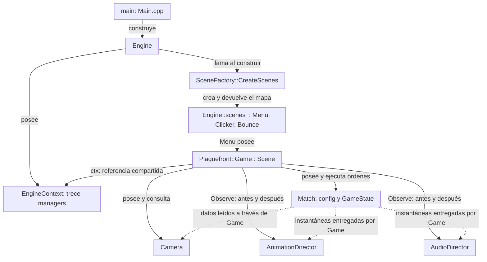

Lea desde `main` y distinga **posesión** de **observación** por las etiquetas. `Match` no conoce a Camera ni invoca a los directores: `Game::SyncPresentation` entrega las instantáneas. `SceneManager` no posee el mapa de escenas; conserva solicitudes que consume `Engine`. Las demos son instancias distintas de la misma API `Scene` y comparten el contexto.

Archivos responsables: [Main.cpp](../build/reconstruccion-C0/Engine/Source/Main.cpp), [Engine.h](../build/reconstruccion-C0/Engine/Include/Core/Engine.h), [Engine.cpp](../build/reconstruccion-C0/Engine/Source/Core/Engine.cpp), [EngineContext.h](../build/reconstruccion-C0/Engine/Include/Core/EngineContext.h), [SceneFactory.cpp](../build/reconstruccion-C0/Engine/Source/Scene/SceneFactory.cpp), [Game.h](../build/reconstruccion-C0/Games/Include/Plaguefront/Game.h) y [Game::SyncPresentation](../build/reconstruccion-C0/Games/Source/Plaguefront/Game.cpp). Construcción: [etapa 1](#etapa-1), [etapa 2](#etapa-2), [lecciones 2–4](#leccion-2).

<a id="diagrama-1-servicios"></a>

**Ampliación 1A. Servicios del contexto y salida.**

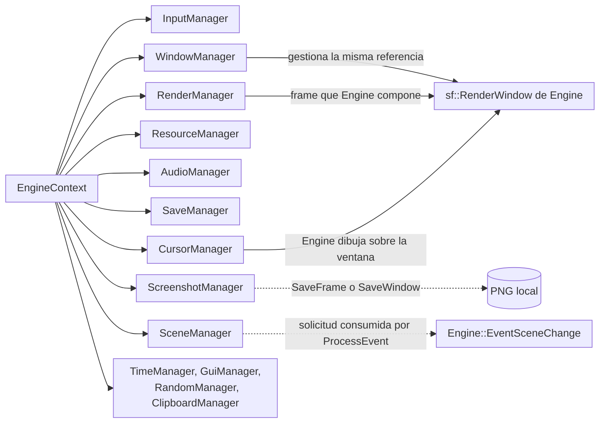

Las flechas desde Context enumeran sus miembros reales; no indican el orden de inicialización. El audio sale por `AudioManager`, no por `RenderWindow`. `GuiManager` atiende el overlay TGUI del motor; la UI táctica está dibujada por `Game`. `RandomManager` y `ClipboardManager` siguen disponibles aunque no deciden las reglas tácticas. Las rutas detalladas están en [entrada](#diagrama-9), [renderizado](#diagrama-10) y [persistencia](#diagrama-11).

<a id="diagrama-2"></a>

### Diagrama 2. Ciclo de vida, foco, cambio de escena y cierre

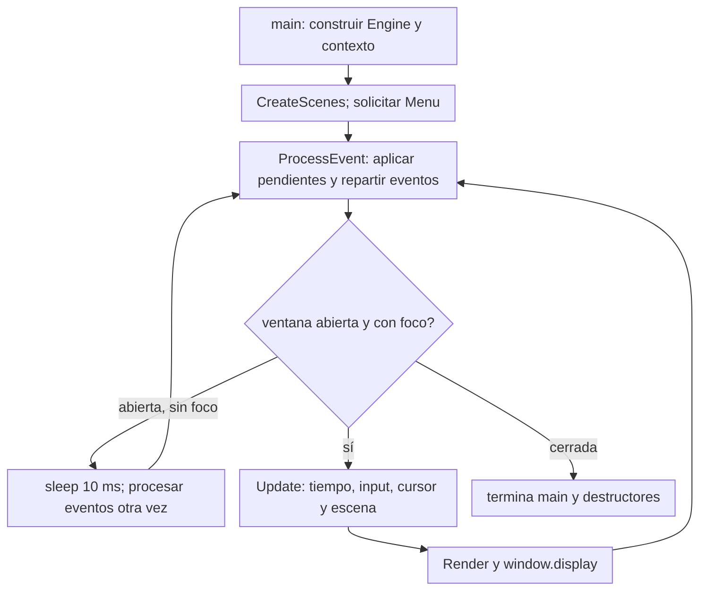

Siga la rama del foco: omitir `Update` no impide recuperar eventos. `OnPause` también se invoca al perder/ganar foco; el overlay heredado bloquea llamadas de escena cuando está visible. Un cambio pedido por `SceneManager::ChangeScene` se aplica en el límite de frame; las pantallas Menu/Playing/Paused de Plaguefront se gestionan dentro de **una** escena y no recrean `Engine`.

El modo `--smoke` toma una ruta explícita de `main`: `ProcessEvent`, 71 iteraciones `SmokeStep`→`Render`→`SaveScreenshot`, y salida 2 si falla PNG o 3 si una comprobación lanza. No depende del foco del bucle interactivo. F12 se recibe por `EngineVisitor` y llama a `ScreenshotManager::Take`; la captura del runner usa el frame terminado. Fuentes: [Main.cpp](../build/reconstruccion-C0/Engine/Source/Main.cpp), [Engine.cpp](../build/reconstruccion-C0/Engine/Source/Core/Engine.cpp), [EngineVisitor.cpp](../build/reconstruccion-C0/Engine/Source/Core/EngineVisitor.cpp), [SceneManager.cpp](../build/reconstruccion-C0/Engine/Source/Managers/SceneManager.cpp). Práctica: [etapa 1](#etapa-1), [lección 3](#leccion-3), [lección 26](#leccion-26).

<a id="diagrama-2-eventos"></a>

**Ampliación 2A. Dentro de `Engine::ProcessEvent`.**

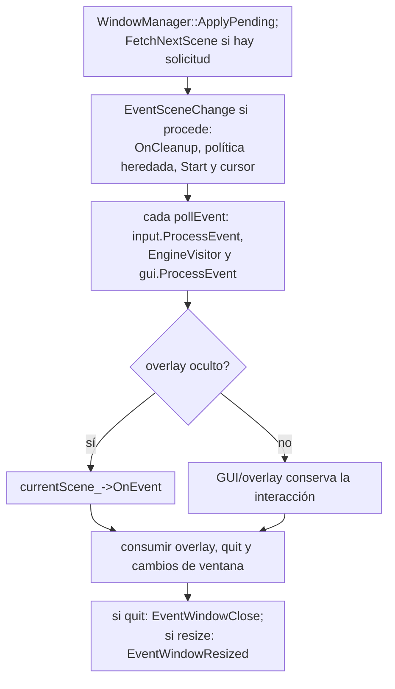

La vista amplía el bloque ProcessEvent, no añade otro bucle principal. `EngineVisitor` puede cerrar durante el reparto; el bucle de `main` deja de iterar cuando `IsRunning` es falso. La recuperación de foco utiliza los mismos eventos que llegan a `InputManager` y a `OnPause`; el overlay es un límite adicional para `OnEvent` y `Update` de escena.

<a id="diagrama-3"></a>

### Diagrama 3. Del clic a una orden aceptada o rechazada

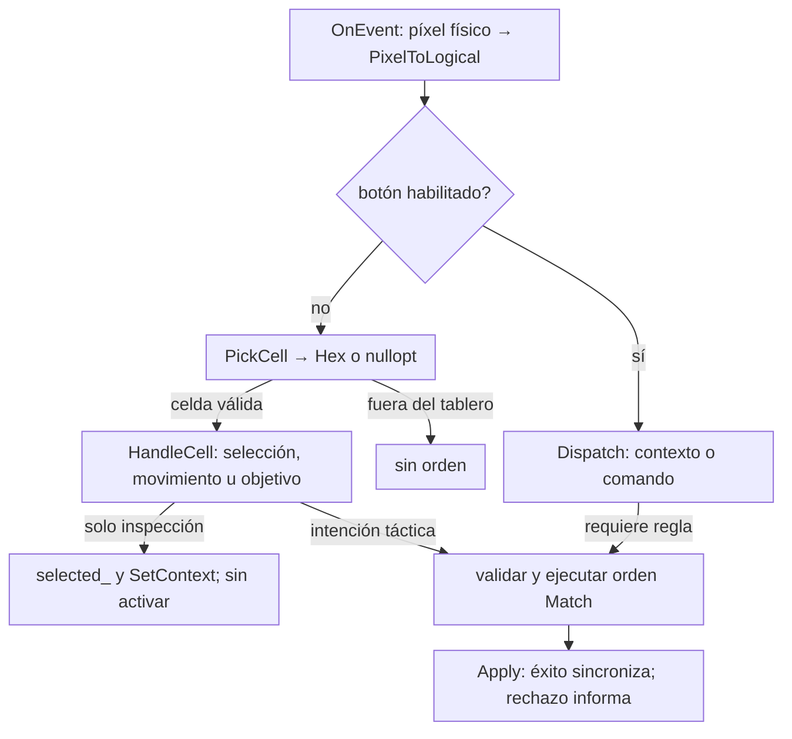

Las dos bifurcaciones superiores evitan confundir selección con una acción. `HandleCell` rechaza fuera de turno IA o mientras `visuals_.Busy()`. Para habilidades/objetos prueba una copia antes de `EnsureActive`; movimiento comprueba destinos alcanzables. El comando final **vuelve** a validar. `EnsureActive` es a su vez una orden y sincroniza una activación nueva: no afirme que cualquier secuencia que termine en rechazo conserva todos los campos del estado si antes aceptó esa activación. El rechazo del comando conserva sus recursos; las consultas y cancelaciones no ejecutan la acción pendiente.

Funciones exactas: [Game::{OnEvent, HandleCell, EnsureActive, Dispatch, Apply, SyncPresentation}](../build/reconstruccion-C0/Games/Source/Plaguefront/Game.cpp), [Game::{CheckAction, PreviewRules, UpdatePreview, CancelContext}](../build/reconstruccion-C0/Games/Source/Plaguefront/Contexts.cpp), [Match](../build/reconstruccion-C0/Games/Source/Plaguefront/Rules.cpp). Los observadores no calculan daño ni ejecutan otra vez la orden. Construcción: [etapa 3](#etapa-3), [etapa 7](#etapa-7), [lecciones 4 y 12](#leccion-12).

<a id="diagrama-3-resultado"></a>

**Ampliación 3A. La orden y su frontera de presentación.**

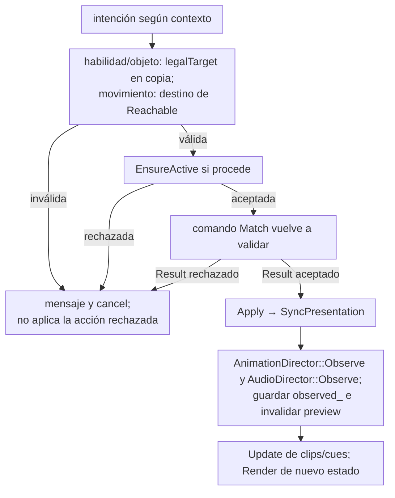

Las flechas «inválida» y «rechazada» convergen en el aviso, sin animación de una acción inexistente. El detalle representa la ruta de celda; las compras y comandos de botones usan sus propias comprobaciones `CheckAction`/`Dispatch` y convergen también en las órdenes y `Apply`.

<a id="diagrama-4"></a>

### Diagrama 4. Ruta ponderada, presupuesto y animación

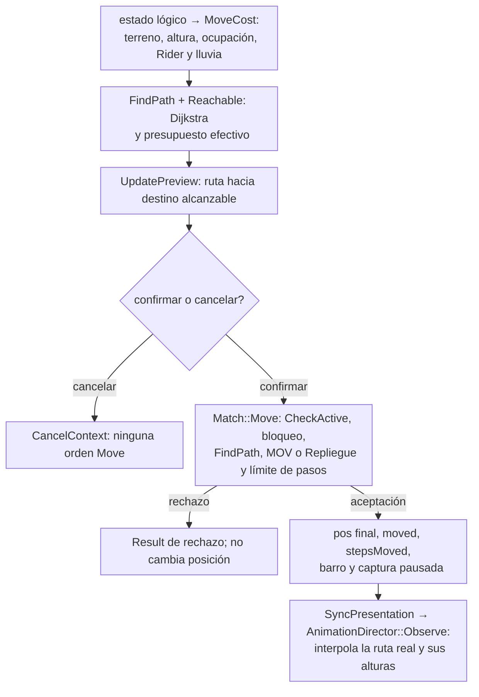

Lea las dos búsquedas como **consultas**, no como dos autoridades de movimiento. `FindPath` puede encontrar una ruta que supera MOV; solo `Move` autoriza consumir la orden. Los pasos geométricos son `cells.size()-1`, distintos de `cost`; Repliegue limita ambos según configuración. El origen y destino son `Hex`, nunca píxeles. Tras aceptar, la posición lógica ya es la final; el pie visual viaja por segmentos de esa ruta.

Ampliación del algoritmo, dentro de [Rules.cpp](../build/reconstruccion-C0/Games/Source/Plaguefront/Rules.cpp): extraer menor coste de `priority_queue` → descartar entrada obsoleta → recorrer `Neighbors` → añadir `MoveCost` válido → actualizar coste y predecesor si mejora → continuar hasta destino o cola vacía → reconstruir e invertir. `Reachable` descarta candidatos sobre presupuesto y no necesita predecesores. [Contexts.cpp](../build/reconstruccion-C0/Games/Source/Plaguefront/Contexts.cpp) invalida preview por unidad/revisión/destino; [Presentation.cpp](../build/reconstruccion-C0/Games/Source/Plaguefront/Presentation.cpp) observa y representa. Construcción: [etapa 3](#etapa-3), [lección 11](#leccion-11), [lección 21](#leccion-21).

<a id="diagrama-5"></a>

### Diagrama 5. Combate: impacto, enlaces y respuesta

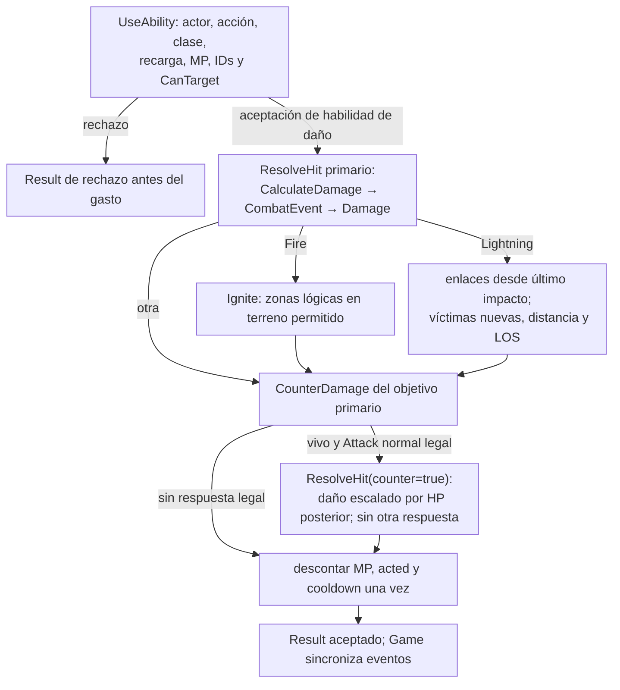

El diagrama representa la rama de **daño** de `UseAbility`; Guard, Precise, Pike, Smoke, Retreat, Purify, Incinerate, Heal y Mark tienen ramas propias descritas en la lección 15. El objetivo primario puede responder tras todos los enlaces; los secundarios no responden. `CounterDamage` llama a la estimación normal del defensor contra el atacante y escala por HP que le queda después del golpe, con redondeo superior. `ResolveHit` ignora muertos y evita otra muerte/recompensa. La respuesta no consume la futura acción del defensor.

Fuentes: [Match::{UseAbility, CanTarget, CalculateDamage, CounterDamage, ResolveHit, Damage, Ignite}](../build/reconstruccion-C0/Games/Source/Plaguefront/Rules.cpp), [CombatEvent](../build/reconstruccion-C0/Games/Include/Types/PlaguefrontRulesTypes.h), [AnimationDirector::Observe](../build/reconstruccion-C0/Games/Source/Plaguefront/Presentation.cpp), [AudioDirector::Observe](../build/reconstruccion-C0/Games/Source/Plaguefront/Audio.cpp). Construcción: [etapa 4](#etapa-4), [lecciones 14–15](#leccion-14).

<a id="diagrama-5-dano"></a>

**Ampliación 5A. Fórmula y separación ambiental.**

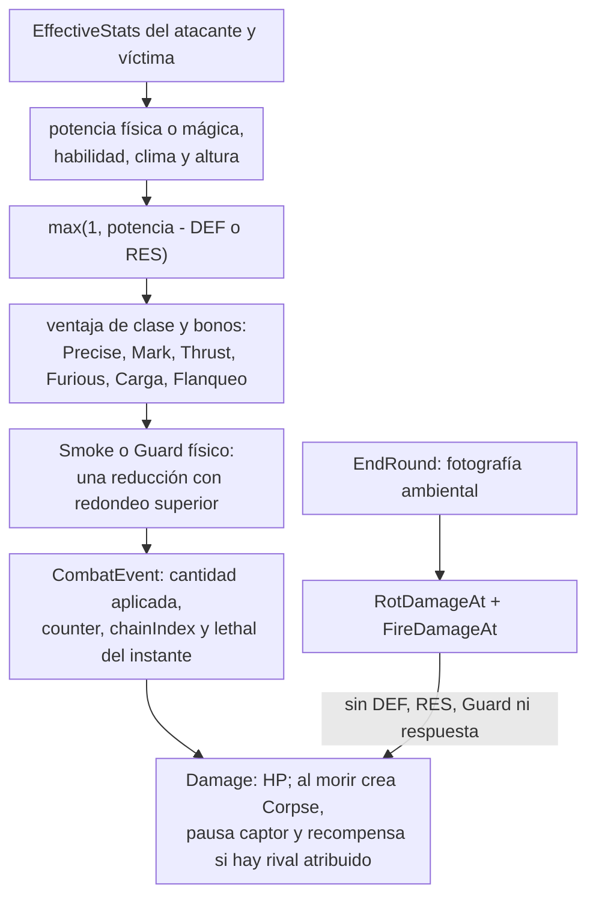

La rama inferior llega a `Damage` sin `ResolveHit`: el tick ambiental no crea un `CombatEvent`, no paga recompensa al atacante y no consume Humo/Parada. `AnimationDirector` y `AudioDirector` pueden inferir el daño ambiental restante al comparar instantáneas; no deben confundirlo con los impactos ya registrados. En Lightning cada enlace conserva el Caster atacante pero usa la posición anterior como origen visual y calcula la RES de su propia víctima. No hay un dado de impacto o crítico oculto.

<a id="diagrama-6"></a>

### Diagrama 6. Cadáver, fuentes activas y peste residual

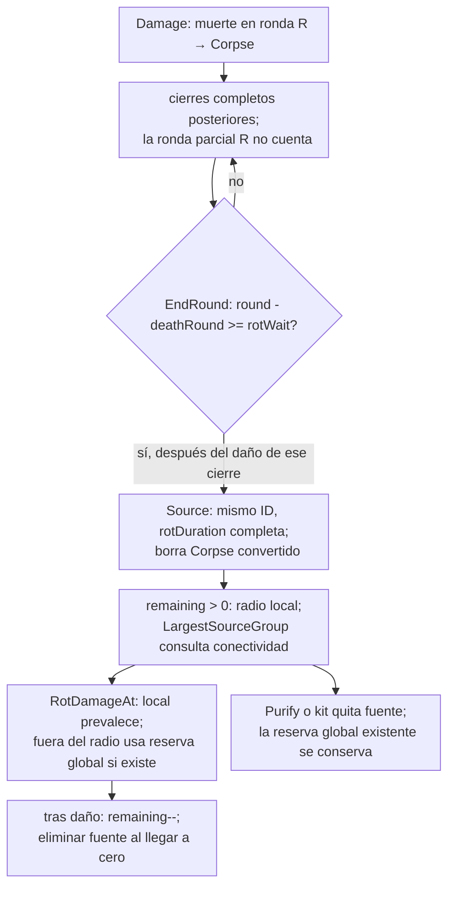

Siga primero la cronología y después el grafo. Con valores iniciales, una muerte en R se convierte después del daño de R+3 y causa sus cinco daños locales en R+4…R+8. El radio no se suma por fuente: varias coberturas devuelven un único `rotDamage`. La peste global solo afecta mediante `globalRemaining>0`. Incinerate elimina el cadáver durante espera; Purify/kit elimina la fuente activa. Un cadáver y una fuente superpuestos conservan identidades independientes.

Archivos: [Match::{Damage, EndRound, RotDamageAt, LargestSourceGroup, UseAbility, UseItem}](../build/reconstruccion-C0/Games/Source/Plaguefront/Rules.cpp), [tipos ambientales](../build/reconstruccion-C0/Games/Include/Types/PlaguefrontRulesTypes.h), [configuración](../build/reconstruccion-C0/Games/Include/Config/PlaguefrontRulesConfig.h), [RotPresentationAt](../build/reconstruccion-C0/Games/Source/Plaguefront/Presentation.cpp), [RotGround](../build/reconstruccion-C0/Games/Source/Plaguefront/PixelRenderer.cpp). Construcción: [etapa 5](#etapa-5), [lecciones 16–17](#leccion-16).

<a id="diagrama-6-grafo"></a>

**Ampliación 6A. Tres fuentes en cadena, no un triángulo completo.**

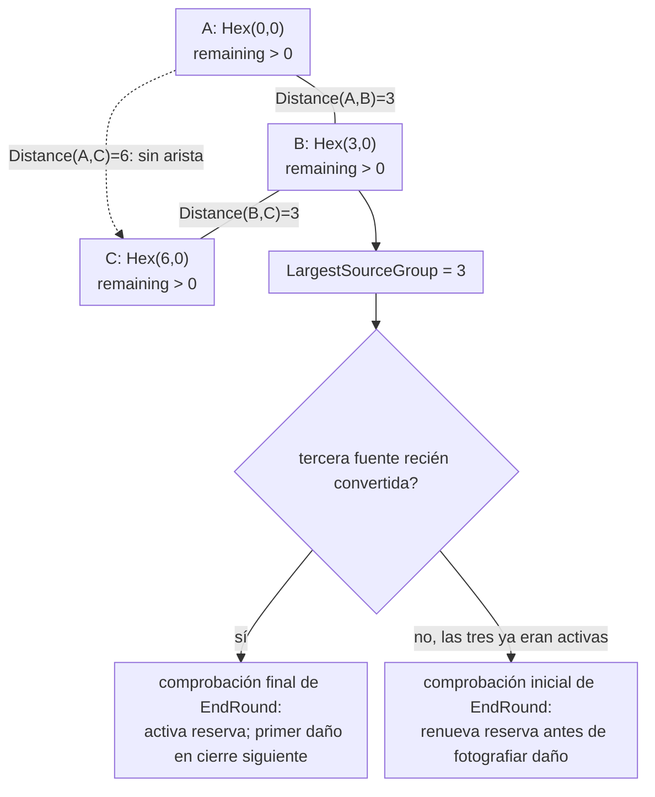

Aquí el enlace **sin punta** representa una arista del grafo, no una llamada. La flecha discontinua declara una distancia que **no** crea arista. Con `connectionDistance=3` y `globalThreshold=3`, A alcanza C a través de B; retirar B deja dos componentes de uno. La reserva ya obtenida no desaparece al romper esa conexión. Cambiar esos parámetros altera el ejemplo: no son constantes escondidas en el algoritmo.

<a id="diagrama-6-cierre"></a>

**Ampliación 6B. Orden autoritativo de `EndRound`.**

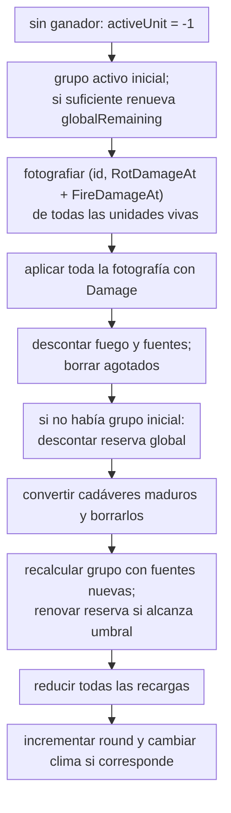

La fotografía impide que una muerte del mismo tick cree daño instantáneo para otra unidad. La conversión sucede después de descontar fuentes anteriores: la nueva empieza íntegra y no golpea ese cierre. Los ingresos se pagan después, en `StartTurn`, fuera de esta función. Este orden es relevante para guardar/cargar, IA y efectos, no un temporizador por segundos.

<a id="diagrama-7"></a>

### Diagrama 7. Activar, terminar una tropa, entregar ejército y cerrar ronda

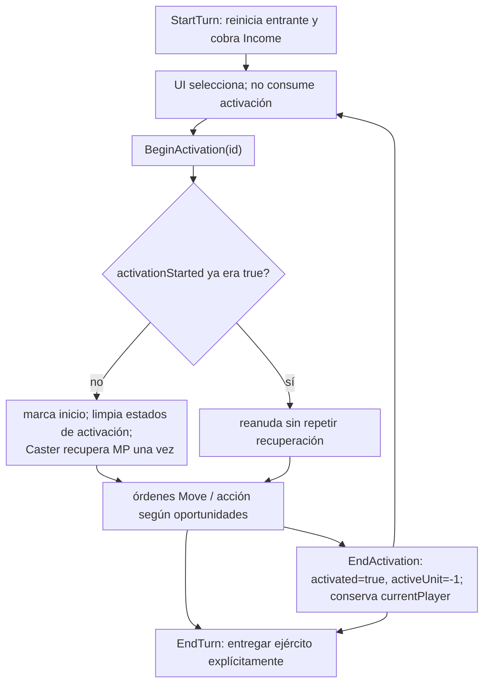

`EndActivation` no cambia automáticamente de ejército aunque no queden disponibles. `EndTurn` puede entregarlo anticipadamente y `Pass` es su alias. En la interfaz `FinishTurn` termina una unidad; `FinishArmyTurn` puede pedir confirmación y muestra traspaso en modo local. Un recluta con `readyRound=R+1` espera su ronda elegible; `StartTurn` reinicia banderas pero no elimina esa condición. Las muertes no suprimen los ingresos del ejército que todavía conserva su fortaleza.

Fuentes: [Match::{Available, BeginActivation, EndActivation, EndTurn, AdvanceTurn, StartTurn, EndRound, Income}](../build/reconstruccion-C0/Games/Source/Plaguefront/Rules.cpp), [Game::{FinishTurn, FinishArmyTurn}](../build/reconstruccion-C0/Games/Source/Plaguefront/Game.cpp), [Match::StepAI](../build/reconstruccion-C0/Games/Source/Plaguefront/AI.cpp). Construcción: [etapa 3](#etapa-3), [lección 13](#leccion-13), [lección 19](#leccion-19).

<a id="diagrama-7-ejercito"></a>

**Ampliación 7A. El cambio de ejército cierra una ronda solamente tras rojo.**

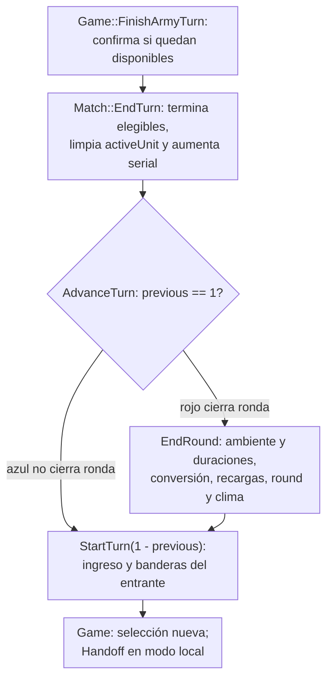

La confirmación es una pantalla previa de Game, no parte de `Match::EndTurn`. Cancelarla conserva el ejército; aceptarla ejecuta una sola orden. El núcleo también sirve a la IA y a las pruebas sin abrir esa pantalla.

<a id="diagrama-8"></a>

### Diagrama 8. Captura acumulada, disputa y victoria

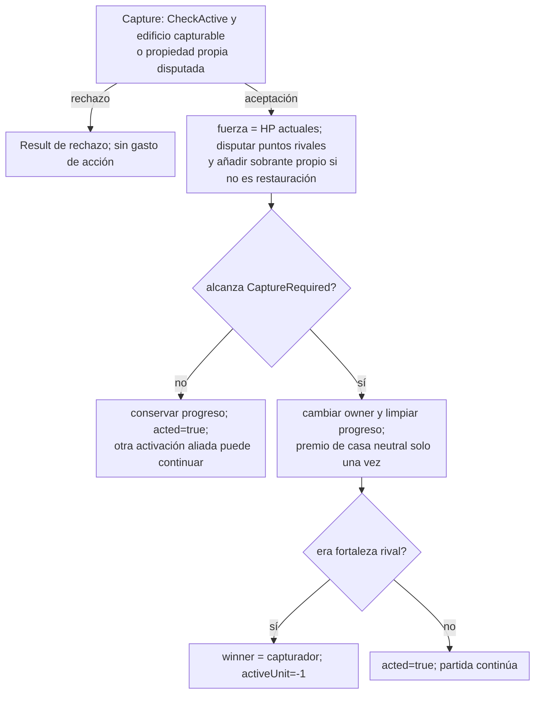

Los puntos pertenecen a `Cell`, no al captor: salir o morir interrumpe la participación pero no borra la inversión. Un aliado puede gastar su propia acción después. La propiedad permanece hasta alcanzar el umbral; el rival primero elimina puntos del otro y aprovecha sobrante si puede conquistar. Si solo está restaurando un edificio propio, no inicia progreso contra sí mismo. Seleccionar, terminar turno o cargar no completa una fortaleza. `Game::Update` muestra Victory al quedar libres los clips, pero `winner` ya impide nuevas órdenes.

Funciones: [Match::{Capture, CaptureRequired, Move, Damage}](../build/reconstruccion-C0/Games/Source/Plaguefront/Rules.cpp), [Cell](../build/reconstruccion-C0/Games/Include/Types/PlaguefrontRulesTypes.h), [barras en TacticalOverlay.cpp](../build/reconstruccion-C0/Games/Source/Plaguefront/TacticalOverlay.cpp), [validación y persistencia](../build/reconstruccion-C0/Games/Source/Plaguefront/Persistence.cpp). Construcción: [etapa 5](#etapa-5), [lección 18](#leccion-18).

<a id="diagrama-8-disputa"></a>

**Ampliación 8A. Progreso sin captor y disputa de propiedad.**

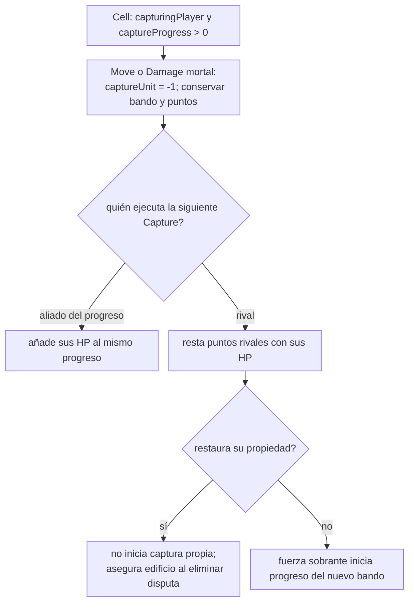

Los rombos explican las ramas de `Capture`; no añaden un comando de restauración separado. El caso rival consume acción aunque sus HP solamente alcancen para reducir puntos sin conquistar.

<a id="diagrama-9"></a>

### Diagrama 9. Dispositivos físicos, acciones lógicas y contexto

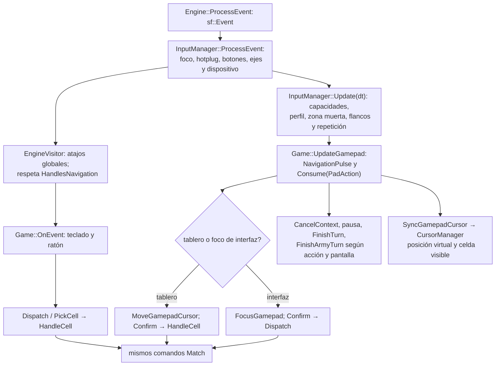

La flecha Input→Update es evolución entre fases del frame, no una llamada directa desde `ProcessEvent`. Engine llama `input.Update` antes de cursor y escena. Perder foco o desconectar limpia transitorios; no borra la partida. `SuppressUntilReleased` al cambiar pantalla/ejército evita confirmar dos contextos con la misma pulsación. Confirmación es flanco único; navegación mantiene repetición controlada. El ratón conserva su píxel físico, el mando conserva una celda y una posición virtual del **mismo** cursor; ninguno ejecuta una regla exclusiva.

Archivos y funciones: [InputManager.cpp](../build/reconstruccion-C0/Engine/Source/Managers/InputManager.cpp), [InputBindings.cpp](../build/reconstruccion-C0/Engine/Source/Utils/InputBindings.cpp), [InputConfig.h](../build/reconstruccion-C0/Engine/Include/Config/InputConfig.h), [Gamepad.cpp](../build/reconstruccion-C0/Games/Source/Plaguefront/Gamepad.cpp), [Game::OnEvent](../build/reconstruccion-C0/Games/Source/Plaguefront/Game.cpp), [CursorManager.cpp](../build/reconstruccion-C0/Engine/Source/Managers/CursorManager.cpp). `Bind/Pressed/Clear` siguen disponibles para Clicker/Bounce. F12 termina en ScreenshotManager; F11/Alt+Enter en WindowManager. Práctica: [etapa 8](#etapa-8), [lección 24](#leccion-24). Los fixtures SFML no certifican un mando físico.

<a id="diagrama-10"></a>

### Diagrama 10. De `Match` al frame final sin mezclar coordenadas

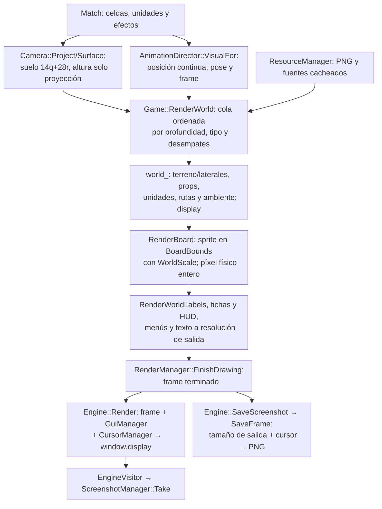

Lea la cola como entradas **intercaladas** por profundidad, no tres capas globales terreno→props→unidades. Los pies usan posición visual y altura; el `Hex` lógico no se mueve durante el dibujo. Los indicadores esenciales de putrefacción siguen la consulta real aunque se desactiven efectos decorativos. Texto se rasteriza para salida, después del mundo de píxeles nativos. La captura del runner compone el frame terminado con cursor; F12 captura la ventana final. `ScreenshotManager` es el único codificador PNG.

Archivos: [Game::Render](../build/reconstruccion-C0/Games/Source/Plaguefront/Interface.cpp), [RenderWorld/RenderBoard/RenderWorldLabels](../build/reconstruccion-C0/Games/Source/Plaguefront/PixelRenderer.cpp), [RenderTacticalInformation](../build/reconstruccion-C0/Games/Source/Plaguefront/TacticalOverlay.cpp), [Presentation.cpp](../build/reconstruccion-C0/Games/Source/Plaguefront/Presentation.cpp), [RenderManager.cpp](../build/reconstruccion-C0/Engine/Source/Managers/RenderManager.cpp), [ScreenshotManager.cpp](../build/reconstruccion-C0/Engine/Source/Managers/ScreenshotManager.cpp), [Engine::Render](../build/reconstruccion-C0/Engine/Source/Core/Engine.cpp). Construcción: [etapa 7](#etapa-7), [lecciones 21–23](#leccion-21).

<a id="diagrama-10-coordenadas"></a>

**Ampliación 10A. Transformación de entrada y reacción al resize.**

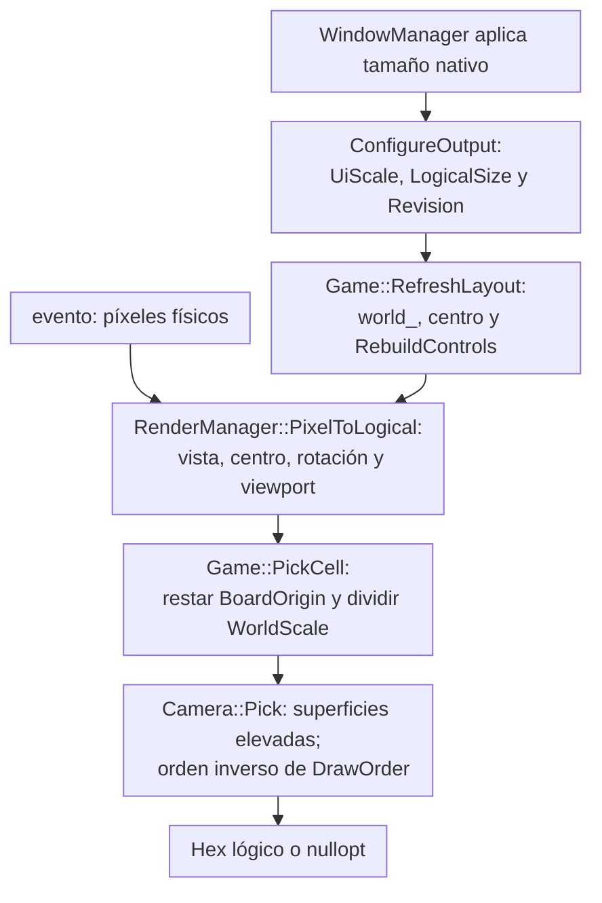

`UiScale=min(ancho/1440,alto/900)` y `WorldScale=worldPixelScale/UiScale`; su producto conserva ×1 o ×2 físico. `Camera::Pick` examina polígonos superiores con altura, no la inversa regular de una malla plana. `RefreshLayout` conserva partida/selección y `RebuildControls` recalcula los mismos botones, preservando foco por acción/valor. El primer evento con revisión nueva refresca layout antes de usar hitboxes.

<a id="diagrama-11"></a>

### Diagrama 11. Guardado táctico y preferencias son contratos distintos

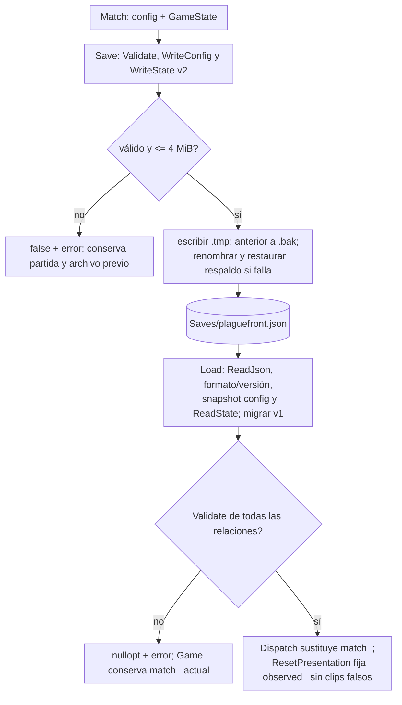

El cilindro identifica un archivo, no una segunda copia en memoria que deba sincronizarse cada frame. La partida incluye balance, mapa, unidades, activaciones, progreso de captura, cadáveres, fuentes, fuego, reserva, clima y semilla. Excluye cámara, selección, foco, segundos de clips y cola `combatEvents`; `nextEventId` sí persiste. Cargar no paga ingresos ni llama `StartTurn` para refrescar UI. El balance externo afecta nuevas partidas; la guardada utiliza su instantánea.

`SaveManager` almacena documentos genéricos y preferencias de mando sin interpretar reglas ni migrar unidades. Su reemplazo Windows usa `MoveFileExW`; no se le atribuye la política `.bak` del guardado táctico ni los límites de su parser. Fuentes: [Persistence.cpp](../build/reconstruccion-C0/Games/Source/Plaguefront/Persistence.cpp), [Game::{LoadSettings, SaveSettings, Dispatch}](../build/reconstruccion-C0/Games/Source/Plaguefront/Game.cpp), [SaveManager.cpp](../build/reconstruccion-C0/Engine/Source/Managers/SaveManager.cpp), [InputManager.cpp](../build/reconstruccion-C0/Engine/Source/Managers/InputManager.cpp), [WindowManager.cpp](../build/reconstruccion-C0/Engine/Source/Managers/WindowManager.cpp). Construcción: [etapa 9](#etapa-9), [lección 25](#leccion-25).

<a id="diagrama-11-preferencias"></a>

**Ampliación 11A. Dos documentos de preferencias y ningún estado táctico.**

```mermaid
%%{init: {"flowchart":{"nodeSpacing":16,"rankSpacing":22,"padding":8},"themeVariables":{"fontFamily":"Arial","fontSize":"15px"}}}%%
flowchart TD
  Scene["Game::LoadSettings / SaveSettings;
  WindowManager aplica/recoge ventana"] --> Document["SaveManager::ReadDocument / WriteDocument"]
  Document --> Settings[("Saves/settings.json:
  ventana, audio, grid, effects, ai_delay")]
  Input["InputManager::LoadPreferences / SavePreferences"] --> Store["SaveManager::Get / Set / Flush"]
  Store --> Common[("Content/Save.json:
  Engine:Input y récords Clicker/Bounce")]
  Document -->|JSON inválido o escritura fallida| Error["error o fallback; no sustituir Match"]
  Store -->|valores inválidos| Normalize["normalizar GamepadConfig y suprimir mantenidos"]
  click Input "#diagrama-9" "Perfiles, flancos y capacidades"
```

Una lectura de documento válida tampoco garantiza que todos los campos sean del tipo esperado: el consumidor aplica límites y captura errores. `LoadSettings` asigna campos secuencialmente; no se presenta como transacción total. Input normaliza su configuración y mantiene la API de récords para otros juegos.

<a id="diagrama-12"></a>

### Diagrama 12. CMake: bibliotecas, ejecutable y pruebas reales

```mermaid
%%{init: {"flowchart":{"nodeSpacing":16,"rankSpacing":22,"padding":8},"themeVariables":{"fontFamily":"Arial","fontSize":"15px"}}}%%
flowchart TD
  Sources["fuentes locales + CMake >= 3.28,
  C++20, MSVC x64 y Ninja"] --> Config["cmake -S . -B build:
  FetchContent desconectado y BUILD_TESTING"]
  Config --> Local["orígenes locales: SFML 3.1.0, JSON 3.12.0,
  spdlog 1.16.0, TGUI 1.13.0, magic_enum 0.9.8"]
  Local --> Json["nlohmann_json::nlohmann_json"]
  Json --> Logic["PlaguefrontLogic:
  Rules.cpp + Persistence.cpp + AI.cpp"]
  Logic --> Present["PlaguefrontPresentationLogic:
  Presentation.cpp; sin ventana"]
  Present --> App["AwesomeEngine target:
  Engine/Source + resto de Games/Source"]
  Local -->|SFML Graphics/Audio, JSON,
  spdlog, TGUI y magic_enum| App
  App --> Exe["build/Plaguefront.exe"]
  Logic --> Pure["Tests Rules, Campaigns y Phase4"]
  Present --> Projection["Tests Projection; Phase3 también usa presentación"]
  App --> Smoke["CTest PlaguefrontPresentation:
  AwesomeEngine --smoke"]
  Local --> Services["Tests Audio, EngineManagers e InputManager:
  fuentes y bibliotecas declaradas por target"]
  Pure --> CTest["ctest --test-dir build --output-on-failure"]
  Projection --> CTest
  Smoke --> CTest
  Services --> CTest
  click Logic "#etapa-3" "Núcleo sin SFML"
  click Present "#etapa-7" "Presentación pura"
  click CTest "#etapa-9" "Verificación de salida"
```

Las flechas son dependencias de construcción, no llamadas durante la partida. `Phase3` enlaza `PlaguefrontPresentationLogic` y recibe el núcleo transitivamente, junto a las pruebas de proyección. AudioTests compila `AudioManager.cpp` y `Audio.cpp`; EngineManagers compila sus gestores/efectos necesarios; InputManager compila entrada, bindings y guardado. No existe un ejecutable distinto para cada función de prueba interna.

La configuración está desconectada: declarar URL/versiones no descarga ni resuelve un origen ausente. Use las fuentes existentes o `FETCHCONTENT_SOURCE_DIR_*` locales. Configure Release también en `CMAKE_TRY_COMPILE_CONFIGURATION`; conserve el prefijo español de `/showIncludes` para dependencias de Ninja. `Jugar.cmd` no compila: inicia el ejecutable ya construido desde raíz. Fuente: [CMakeLists.txt](../build/reconstruccion-C0/CMakeLists.txt), [BuildLocal.ps1](../build/reconstruccion-C0/Tools/BuildLocal.ps1), [Jugar.cmd](../build/reconstruccion-C0/Jugar.cmd). Construcción: [etapa 0](#etapa-0), [etapa 9](#etapa-9), [etapa 10](#etapa-10), [lecciones 1 y 29](#leccion-29).

Volver al [itinerario por etapas](#itinerario) o al [inicio del atlas](#atlas-diagramas). Una flecha facilita encontrar la siguiente función; la compilación y las pruebas de cada etapa siguen siendo la comprobación del programa real.

<a id="fichas-motor"></a>

## Fichas verificables A/B/C del motor

**Ámbito:** las fichas siguientes documentan A→C0. Su columna C corresponde al resultado completo conservado antes de los ajustes adicionales. Las lecciones 30–31 muestran después los cambios exactos C0→C1. Los enlaces de fuente de estas fichas apuntan al snapshot para que la comparación no cambie.

Base A: commit local `19e1162fe338eb46e9dd0b2c563d3eebfb1572d9`; no es una copia descargada ni una reconstrucción supuesta. El historial sólo demuestra la diferencia entre ese commit y el working tree actual. Las fases intermedias de Plaguefront no tienen commits locales; los snapshots de build son evidencia complementaria, no genealogía Git. B es el parche neto y C el código actual. Las fichas siguientes describen cambios previos: esta revisión documental no los vuelve a aplicar al juego.

Lectura del parche: `---` es archivo A, `+++` el actual; `-` se elimina, `+` se añade, espacio es contexto. Aplicar cada hunk dentro del método/section nombrado. Para archivos nuevos se muestra el contenido completo, sin prefijos `+`. No se sustituye un archivo heredado entero por un cambio localizado. Los números @@ sirven de guía pero se debe buscar el contexto textual.

Comprobación local de origen, desde raíz:

```powershell
git rev-parse 19e1162
git show 19e1162:Engine/Source/Core/Engine.cpp
git show 19e1162:Games/Include/Clicker.h
git diff -- Engine/Source/Scene/SceneFactory.cpp
```

Las pruebas indicadas son mecanismos reales. Sus resultados históricos están en la referencia; sólo una ejecución con registro de esta intervención puede etiquetarse como ejecutada ahora. En particular, mando físico, escucha humana, arrastre humano y conmutación exclusiva física permanecen pendientes.

**Orden de incorporación.** La etapa 1 adopta las capacidades compartidas como un lote compatible; se utilizan después en las etapas 7–9. Los parches de esta auditoría muestran el cambio neto completo A→C, no obligan a activar cada consumidor inmediatamente. El checkpoint 1 conserva Engine final, que agenda `Menu`, y añade en la Factory didáctica el alias `Menu`→`Clicker::Game`; este alias temporal no pertenece al resultado C. En la etapa 2 se sustituye sólo ese registro por `Menu`→`Plaguefront::Game` con su escena mínima completa. La textura `Content/Textures/Plaguefront/Pixel/cursors.png` debe estar copiada antes de construir el cursor final. Los helpers Smoke de Engine pueden compilar desde la etapa 1 porque usan los contratos virtuales de Scene; el recorrido de 71 pantallas de Plaguefront no se ejecuta hasta la etapa 9. El Main didáctico inicial de la práctica permite verificar un frame; se sustituye por el Main final mostrado en la ficha motor-16 cuando existen los fixtures. El CMake de pasos anteriores sólo declara los archivos que ya existen.

<a id="motor-01"></a>

### Ventana: una referencia estable y transiciones diferidas

Ubicación pedagógica de incorporación: [etapa 1](#etapa-1); uso o comprobación integrada: [etapa 8](#etapa-8). Archivos: `Engine/Include/Managers/WindowManager.h`, `Engine/Source/Managers/WindowManager.cpp`.

**Objetivo:** Permitir resolución, fullscreen y maximizar/restaurar sin que Game construya otra ventana ni invalide los managers que conservan la referencia.

**Archivo original y estado inicial A:** No existen estos archivos en A. La responsabilidad original reside en Engine::Engine: crea RenderWindow, aplica Icon.png, mínimo a mitad del tamaño, repetición de teclas desactivada y cursor del sistema oculto. EventWindowResized sólo registraba el tamaño en el log. Por tanto se añade una capacidad general; no se adapta un WindowManager preexistente.

**Problema encontrado:** El tamaño físico podía cambiar sin que render/input actualizasen sus espacios; faltaba una API compartida para configuración de pantalla.

**Cambio localizado B:** Crear ambos archivos completos mostrados abajo. El constructor recoge modos de vídeo, tamaños comunes y estado de la RenderWindow recibida. No mueve ni reemplaza el objeto C++: ApplyPending recrea su manejador nativo mediante window_.create cuando corresponde.

**Implementación resultante C:** SetResolution/SetFullscreen solicitan cambios. ApplyPending los realiza entre frames; OnResized registra un resize externo. LoadPreferences/StorePreferences interpretan sólo claves gráficas.

**Explicación:** pending_ agrupa la transición; fullscreen_ es la intención y appliedFullscreen_ el estado aplicado. windowedSize_ y windowedPosition_ permiten volver al modo previo. ConfigureWindow reaplica icono, visibilidad, 60 FPS, cursor, mínimo y repetición tras recrear la ventana. Revision cambia con las solicitudes/resize; no es un reloj táctico.

**Integración:** EngineContext debe construir window antes de screenshot/cursor/gui; Engine llama ApplyPending y EventWindowResized; Game solicita cambios y persiste claves mediante SaveManager.

**Compatibilidad:** Todos siguen referenciando la misma RenderWindow. No se tocan Clicker/Bounce; usan gConfig.windowSize. La nueva configuración global cambia esa constante de 800×800 en A a 1440×900 en C.

**Prueba:** ctest --test-dir build -R "^(EngineManagers|PlaguefrontPresentation)$" --output-on-failure; verificar cinco resoluciones, 24 resizes nativos, maximizar/restaurar, fullscreen y JSON táctico intacto.

**Replicación:** Crear el par, añadir WindowManager a EngineContext, aplicar las modificaciones localizadas de Engine/Config/Visitor y compilar conjuntamente. Llevar el icono configurado o usar una ruta existente.

**Limitaciones:** Maximize/Restore/IsMaximized dependen de Windows y devuelven false fuera. La prueba oculta no certifica conmutación exclusiva física del monitor. No persiste posición de ventana.

**Código verificable para aplicar.**

Archivo `Engine/Include/Managers/WindowManager.h`.

Crear el archivo completo; no existía en A.

```cpp
#pragma once

#include <SFML/Graphics/RenderWindow.hpp>
#include <cstdint>
#include <vector>
#include <nlohmann/json_fwd.hpp>

// RenderWindow conserva su dirección; la escena solicita transiciones que el motor aplica entre fotogramas sin invalidar referencias.
class WindowManager {
public:
  explicit WindowManager(sf::RenderWindow &window, bool visible = true);

  bool IsFullscreen() const { return fullscreen_; }
  bool SetFullscreen(bool fullscreen);
  bool ToggleFullscreen() { return SetFullscreen(!fullscreen_); }
  bool SetResolution(sf::Vector2u size);
  bool SetFullscreenResolution(sf::Vector2u size);
  sf::Vector2u Resolution() const { return fullscreen_ ? fullscreenSize_ : windowedSize_; }
  sf::Vector2u WindowedSize() const { return windowedSize_; }
  sf::Vector2u FullscreenResolution() const { return fullscreenSize_; }
  sf::Vector2u OutputSize() const { return window_.getSize(); }
  sf::Vector2u DesktopResolution() const { return desktopSize_; }
  const std::vector<sf::Vector2u> &Resolutions() const;
  std::uint64_t Revision() const { return revision_; }
  void LoadPreferences(const nlohmann::json &values);
  void StorePreferences(nlohmann::json &values) const;
  bool Maximize();
  bool Restore();
  bool IsMaximized() const;

  // Expone la transición para pruebas locales deterministas sobre la misma ventana.
  bool ApplyPending();
  void OnResized(sf::Vector2u size);

private:
  sf::RenderWindow &window_;
  bool visible_{true};
  bool fullscreen_{false};
  bool appliedFullscreen_{false};
  bool pending_{false};
  sf::Vector2u windowedSize_;
  sf::Vector2u fullscreenSize_;
  sf::Vector2u desktopSize_;
  sf::Vector2i windowedPosition_;
  std::uint64_t revision_{0};
  std::vector<sf::Vector2u> windowedResolutions_;
  std::vector<sf::Vector2u> fullscreenResolutions_;

  void ConfigureWindow();
};
```

Archivo `Engine/Source/Managers/WindowManager.cpp`.

Crear el archivo completo; no existía en A.

```cpp
#include "Managers/WindowManager.h"

#include "Core/EngineConfig.h"
#include <SFML/Graphics/Image.hpp>
#include <algorithm>
#include <array>
#include <nlohmann/json.hpp>
#ifdef _WIN32
#define WIN32_LEAN_AND_MEAN
#define NOMINMAX
#include <Windows.h>
#endif

namespace {
  void AddUnique(std::vector<sf::Vector2u> &sizes, sf::Vector2u size) {
    if (std::find(sizes.begin(), sizes.end(), size) == sizes.end())
      sizes.push_back(size);
  }

  bool SizeOrder(sf::Vector2u a, sf::Vector2u b) {
    return a.x == b.x ? a.y < b.y : a.x < b.x;
  }
} // espacio de nombres

WindowManager::WindowManager(sf::RenderWindow &window, bool visible)
    : window_(window), visible_(visible), windowedSize_(window.getSize()),
      fullscreenSize_(sf::VideoMode::getDesktopMode().size), desktopSize_(fullscreenSize_),
      windowedPosition_(window.getPosition()) {
  for (const auto &mode : sf::VideoMode::getFullscreenModes()) {
    if (mode.size.x >= gConfig.minimumWindowSize.x && mode.size.y >= gConfig.minimumWindowSize.y)
      AddUnique(fullscreenResolutions_, mode.size);
  }
  AddUnique(fullscreenResolutions_, desktopSize_);
  constexpr std::array common{sf::Vector2u{1280, 720}, sf::Vector2u{1366, 768}, sf::Vector2u{1440, 900},
                              sf::Vector2u{1600, 900}, sf::Vector2u{1920, 1080}, sf::Vector2u{2560, 1440}, sf::Vector2u{3840, 2160}};
  for (const auto size : common)
    if (size.x <= desktopSize_.x && size.y <= desktopSize_.y)
      AddUnique(windowedResolutions_, size);
  AddUnique(windowedResolutions_, windowedSize_);
  AddUnique(windowedResolutions_, desktopSize_);
  std::sort(fullscreenResolutions_.begin(), fullscreenResolutions_.end(), SizeOrder);
  std::sort(windowedResolutions_.begin(), windowedResolutions_.end(), SizeOrder);
  ConfigureWindow();
}

const std::vector<sf::Vector2u> &WindowManager::Resolutions() const {
  return fullscreen_ ? fullscreenResolutions_ : windowedResolutions_;
}

bool WindowManager::SetFullscreen(bool fullscreen) {
  if (fullscreen_ == fullscreen)
    return false;
  fullscreen_ = fullscreen;
  pending_ = true;
  ++revision_;
  return true;
}

bool WindowManager::SetResolution(sf::Vector2u size) {
  if (size.x < gConfig.minimumWindowSize.x || size.y < gConfig.minimumWindowSize.y || size.x > 8192 || size.y > 8192)
    return false;
  if (fullscreen_)
    return SetFullscreenResolution(size);
  if (windowedSize_ == size)
    return false;
  windowedSize_ = size;
  AddUnique(windowedResolutions_, size);
  pending_ = true;
  ++revision_;
  return true;
}

bool WindowManager::SetFullscreenResolution(sf::Vector2u size) {
  if (size.x < gConfig.minimumWindowSize.x || size.y < gConfig.minimumWindowSize.y || size.x > 8192 || size.y > 8192 ||
      !sf::VideoMode(size, sf::VideoMode::getDesktopMode().bitsPerPixel).isValid() || fullscreenSize_ == size)
    return false;
  fullscreenSize_ = size;
  pending_ |= fullscreen_;
  ++revision_;
  return true;
}

void WindowManager::ConfigureWindow() {
  window_.setVisible(visible_);
  window_.setFramerateLimit(60);
  window_.setKeyRepeatEnabled(false);
  window_.setMouseCursorVisible(false);
  if (!gConfig.windowIcon.empty()) {
    sf::Image icon;
    if (icon.loadFromFile(gConfig.windowIcon))
      window_.setIcon(icon);
  }
  window_.setMinimumSize(appliedFullscreen_ ? std::nullopt : std::optional{gConfig.minimumWindowSize});
}

bool WindowManager::ApplyPending() {
  if (!pending_ || !window_.isOpen())
    return false;
  pending_ = false;
  if (fullscreen_ != appliedFullscreen_) {
    if (fullscreen_)
      windowedPosition_ = window_.getPosition();
    const auto mode = sf::VideoMode(Resolution(), sf::VideoMode::getDesktopMode().bitsPerPixel);
    window_.create(mode, gConfig.windowTitle, sf::Style::Default,
                   fullscreen_ ? sf::State::Fullscreen : sf::State::Windowed);
    appliedFullscreen_ = fullscreen_;
    ConfigureWindow();
    if (!fullscreen_)
      window_.setPosition(windowedPosition_);
    if (visible_)
      window_.requestFocus();
  } else if (fullscreen_) {
    // SFML recrea el manejador nativo para cambiar el modo de vídeo a pantalla completa.
    window_.create(sf::VideoMode(fullscreenSize_, sf::VideoMode::getDesktopMode().bitsPerPixel),
                   gConfig.windowTitle, sf::Style::Default, sf::State::Fullscreen);
    ConfigureWindow();
    if (visible_)
      window_.requestFocus();
  } else {
    window_.setSize(windowedSize_);
  }
  return true;
}

void WindowManager::OnResized(sf::Vector2u size) {
  if (size.x == 0 || size.y == 0 || fullscreen_ || pending_ || size == windowedSize_)
    return;
  windowedSize_ = size;
  ++revision_;
}

void WindowManager::LoadPreferences(const nlohmann::json &values) {
  SetFullscreen(false);
  SetResolution({values.value("window_width", static_cast<unsigned>(gConfig.windowSize.x)),
                 values.value("window_height", static_cast<unsigned>(gConfig.windowSize.y))});
  SetFullscreenResolution({values.value("fullscreen_width", desktopSize_.x),
                           values.value("fullscreen_height", desktopSize_.y)});
  SetFullscreen(values.value("fullscreen", false));
}

void WindowManager::StorePreferences(nlohmann::json &values) const {
  values["fullscreen"] = fullscreen_;
  values["window_width"] = windowedSize_.x;
  values["window_height"] = windowedSize_.y;
  values["fullscreen_width"] = fullscreenSize_.x;
  values["fullscreen_height"] = fullscreenSize_.y;
}

bool WindowManager::Maximize() {
#ifdef _WIN32
  if (fullscreen_ || !window_.isOpen())
    return false;
  ShowWindow(window_.getNativeHandle(), SW_MAXIMIZE);
  if (!visible_)
    window_.setVisible(false);
  return IsMaximized();
#else
  return false;
#endif
}

bool WindowManager::Restore() {
#ifdef _WIN32
  if (fullscreen_ || !window_.isOpen())
    return false;
  ShowWindow(window_.getNativeHandle(), SW_RESTORE);
  if (!visible_)
    window_.setVisible(false);
  return !IsMaximized();
#else
  return false;
#endif
}

bool WindowManager::IsMaximized() const {
#ifdef _WIN32
  return window_.isOpen() && IsZoomed(window_.getNativeHandle()) != FALSE;
#else
  return false;
#endif
}
```

<a id="motor-02"></a>

### RenderManager: separar salida física y espacio lógico

Ubicación pedagógica de incorporación: [etapa 1](#etapa-1); uso o comprobación integrada: [etapa 8](#etapa-8). Archivos: `Engine/Include/Managers/RenderManager.h`, `Engine/Source/Managers/RenderManager.cpp`.

**Objetivo:** Usar ambos ejes de salida para UI adaptable, conservar pixel art y convertir clics con la misma vista que dibuja.

**Archivo original y estado inicial A:** A ya posee target_, effectsTarget_, background_ y un vector de efectos; Draw, SetView, ResetView, BeginDrawing y FinishDrawing existen. target_ tiene gConfig.windowSize, suavizado true, y SetView sólo modifica target_.

**Problema encontrado:** No hay OutputSize/LogicalSize, política de layout, revisión, conversión físico↔lógico ni actualización de targets tras resize.

**Cambio localizado B:** Aplicar cada hunk a su método, no sustituir todo el archivo. Añadir los campos/API del header. ConfigureOutput actualiza métricas y destinos; SetView guarda la vista y la aplica; ResetView usa defaultView_.

**Implementación resultante C:** ResponsiveLayout=false conserva el lienzo de gConfig.windowSize. true calcula UiScale=min(salida/referencia) y LogicalSize=salida/UiScale. PixelToLogical/LogicalToPixel usan transforms de SFML y viewport físico redondeado.

**Explicación:** layoutDirty_ distingue un cambio de política de una salida idéntica; revision_ sólo invalida cuando cambian métricas/política. pixelScale_ limita 1–4 y redimensiona textura por división entera. SetEffectsEnabled(false) devuelve target_ terminado sin postprocesado. El mundo de Plaguefront lleva además su escala física entera; UI/texto no se confunden con ese lienzo.

**Integración:** Engine configura salida antes de render y sincroniza la vista del cursor. Game::Start solicita responsive; Game::RefreshLayout/RebuildControls consume Revision. Camera táctica permanece en el juego.

**Compatibilidad:** Los demos no solicitan responsive y conservan sus coordenadas configuradas. Engine restablece false antes de cada Start. No se crean renderer/cámara global alternativos.

**Prueba:** EngineManagers compara conversiones con window.mapPixelToCoords incluso centro, rotación y viewport. PlaguefrontProjection prueba cámara pura; PlaguefrontPresentation prueba botones/picking y layout real.

**Replicación:** Aplicar header+cpp y EngineConfig.referenceSize, luego los puntos de integración de Engine. Mantener las llamadas Draw/SetView anteriores. No reconstruir hitboxes en el manager: pertenecen a la escena.

**Limitaciones:** Legacy estira el lienzo a toda salida; no convierte Clicker/Bounce en responsive. Cambiar ConfigureOutput restablece defaultView: una escena con vista particular debe volver a fijarla cuando cambian métricas.

**Código verificable para aplicar.**

Archivo `Engine/Include/Managers/RenderManager.h`.

El estado inicial exacto es el lado `-` más el contexto del parche; las inserciones conservan las líneas no mostradas.

```diff
diff --git a/Engine/Include/Managers/RenderManager.h b/Engine/Include/Managers/RenderManager.h
index 1712247..161ee55 100644
--- a/Engine/Include/Managers/RenderManager.h
+++ b/Engine/Include/Managers/RenderManager.h
@@ -3,6 +3,7 @@
 
 #include <vector>
 #include <memory>
+#include <cstdint>
 
 #include "Graphics/Effect.h"
 
@@ -13,7 +14,16 @@ private:
   sf::RectangleShape background_;
 
   std::vector<std::unique_ptr<Effect>> effects_;
+  bool effectsEnabled_{true};
+  unsigned pixelScale_{1};
   sf::RenderTexture effectsTarget_;
+  sf::Vector2u outputSize_;
+  sf::Vector2f logicalSize_;
+  sf::View view_;
+  sf::View defaultView_;
+  float uiScale_{1.f};
+  bool responsiveLayout_{false}, layoutDirty_{true};
+  std::uint64_t revision_{};
 
 public:
   RenderManager();
@@ -21,6 +31,20 @@ public:
 
   void SetView(const sf::View &view);
   void ResetView();
+  void SetEffectsEnabled(bool enabled) { effectsEnabled_ = enabled; }
+  // Las escenas heredadas conservan sus coordenadas; el modo adaptable expande el lienzo lógico sin deformar los ejes.
+  void SetResponsiveLayout(bool enabled);
+  bool ResponsiveLayout() const { return responsiveLayout_; }
+  std::uint64_t Revision() const { return revision_; }
+  void SetPixelScale(unsigned scale);
+  void ConfigureOutput(sf::Vector2u size);
+  sf::Vector2u OutputSize() const { return outputSize_; }
+  sf::Vector2f LogicalSize() const { return logicalSize_; }
+  float UiScale() const { return uiScale_; }
+  const sf::View &View() const { return view_; }
+  const sf::Texture &FrameTexture() const { return target_.getTexture(); }
+  sf::Vector2f PixelToLogical(sf::Vector2i point) const;
+  sf::Vector2i LogicalToPixel(sf::Vector2f point) const;
 
 private:
   friend class Engine;
```

Archivo `Engine/Source/Managers/RenderManager.cpp`.

El estado inicial exacto es el lado `-` más el contexto del parche; las inserciones conservan las líneas no mostradas.

```diff
diff --git a/Engine/Source/Managers/RenderManager.cpp b/Engine/Source/Managers/RenderManager.cpp
index 588f1e7..3766679 100644
--- a/Engine/Source/Managers/RenderManager.cpp
+++ b/Engine/Source/Managers/RenderManager.cpp
@@ -1,6 +1,8 @@
 #include "Managers/RenderManager.h"
 
 #include <utility>
+#include <algorithm>
+#include <cmath>
 
 #include "Graphics/Effects/EffectBloom.h"
 #include "Graphics/Effects/EffectMonitor.h"
@@ -26,15 +28,84 @@ RenderManager::RenderManager()
     effects_.emplace_back(std::make_unique<EffectMonitor>());
     // effects_.emplace_back(std::make_unique<EffectGlitch>());
   }
+  ConfigureOutput(sf::Vector2u(gConfig.windowSize));
 }
 
 void RenderManager::Draw(const sf::Drawable &drawable) {
   target_.draw(drawable);
 }
 
-void RenderManager::SetView(const sf::View &view) { target_.setView(view); }
+void RenderManager::SetView(const sf::View &view) {
+  view_ = view;
+  target_.setView(view_);
+}
+
+void RenderManager::ResetView() { SetView(defaultView_); }
+
+void RenderManager::SetResponsiveLayout(bool enabled) {
+  if (responsiveLayout_ == enabled)
+    return;
+  responsiveLayout_ = enabled;
+  layoutDirty_ = true;
+  ConfigureOutput(outputSize_);
+}
+
+void RenderManager::SetPixelScale(unsigned scale) {
+  scale = std::clamp(scale, 1u, 4u);
+  if (pixelScale_ == scale)
+    return;
+  pixelScale_ = scale;
+  layoutDirty_ = true;
+  ConfigureOutput(outputSize_);
+}
 
-void RenderManager::ResetView() { SetView(target_.getDefaultView()); }
+void RenderManager::ConfigureOutput(sf::Vector2u size) {
+  if (size.x == 0 || size.y == 0)
+    return;
+  if (outputSize_ == size && !layoutDirty_)
+    return;
+  outputSize_ = size;
+  uiScale_ = std::min(static_cast<float>(size.x) / gConfig.referenceSize.x,
+                      static_cast<float>(size.y) / gConfig.referenceSize.y);
+  logicalSize_ = responsiveLayout_ ? sf::Vector2f(size) / uiScale_ : gConfig.windowSize;
+  defaultView_ = sf::View(sf::FloatRect({0.f, 0.f}, logicalSize_));
+  defaultView_.setViewport(sf::FloatRect({0.f, 0.f}, {1.f, 1.f}));
+  const sf::Vector2u nativeSize{std::max(1u, size.x / pixelScale_), std::max(1u, size.y / pixelScale_)};
+  if (target_.getSize() != nativeSize)
+    VERIFY(target_.resize(nativeSize));
+  if (sf::Shader::isAvailable() && effectsTarget_.getSize() != nativeSize)
+    VERIFY(effectsTarget_.resize(nativeSize));
+  target_.setSmooth(false);
+  background_.setSize(logicalSize_);
+  layoutDirty_ = false;
+  ++revision_;
+  ResetView();
+}
+
+sf::Vector2f RenderManager::PixelToLogical(sf::Vector2i point) const {
+  const auto viewport = view_.getViewport();
+  const sf::FloatRect pixels{
+      {static_cast<float>(std::lround(viewport.position.x * outputSize_.x)),
+       static_cast<float>(std::lround(viewport.position.y * outputSize_.y))},
+      {static_cast<float>(std::lround(viewport.size.x * outputSize_.x)),
+       static_cast<float>(std::lround(viewport.size.y * outputSize_.y))}};
+  const sf::Vector2f normalized{
+      (static_cast<float>(point.x) - pixels.position.x) / pixels.size.x * 2.f - 1.f,
+      1.f - (static_cast<float>(point.y) - pixels.position.y) / pixels.size.y * 2.f};
+  return view_.getInverseTransform().transformPoint(normalized);
+}
+
+sf::Vector2i RenderManager::LogicalToPixel(sf::Vector2f point) const {
+  const auto viewport = view_.getViewport();
+  const sf::FloatRect pixels{
+      {static_cast<float>(std::lround(viewport.position.x * outputSize_.x)),
+       static_cast<float>(std::lround(viewport.position.y * outputSize_.y))},
+      {static_cast<float>(std::lround(viewport.size.x * outputSize_.x)),
+       static_cast<float>(std::lround(viewport.size.y * outputSize_.y))}};
+  const auto normalized = view_.getTransform().transformPoint(point);
+  return {static_cast<int>(std::lround((normalized.x + 1.f) * 0.5f * pixels.size.x + pixels.position.x)),
+          static_cast<int>(std::lround((1.f - normalized.y) * 0.5f * pixels.size.y + pixels.position.y))};
+}
 
 void RenderManager::BeginDrawing() {
   target_.clear();
@@ -47,6 +118,8 @@ const sf::Texture &RenderManager::FinishDrawing() {
   sf::RenderTexture *input = &target_;
   sf::RenderTexture *output = &effectsTarget_;
 
+  if (!effectsEnabled_)
+    return target_.getTexture();
   for (auto &effect : effects_) {
     output->clear();
     effect->Apply(input->getTexture(), *output);
```

<a id="motor-03"></a>

### InputManager: capacidades, eventos y acciones lógicas

Ubicación pedagógica de incorporación: [etapa 1](#etapa-1); uso o comprobación integrada: [etapa 8](#etapa-8). Archivos: `Engine/Include/Types/InputTypes.h`, `Engine/Include/Config/InputConfig.h`, `Engine/Include/utils/InputBindings.h`, `Engine/Source/Utils/InputBindings.cpp`, `Engine/Include/Managers/InputManager.h`, `Engine/Source/Managers/InputManager.cpp`.

**Objetivo:** Añadir mando completo sin crear otro lector de joystick y preservar los enlaces de Clicker/Bounce.

**Archivo original y estado inicial A:** A ya tiene InputManager::Bind/Pressed/Clear y Binding=variant<Keyboard, Mouse, Gamepad, Axis>. Pressed(Gamepad) consulta LogicalToHardware y SFML; Axis sondea directamente. GamepadButton global West…R3 ya existe en InputBindings.h. Mapping distingue vendor Microsoft del resto, tratado como PlayStation.

**Problema encontrado:** El sondeo sostenido no ofrece flanco consumible, repetición de foco, capacidades seguras, dispositivo activo, hotplug persistido ni supresión tras cambio de pantalla.

**Cambio localizado B:** Crear InputTypes/InputConfig completos. Mover GamepadButton sin cambiar su espacio global ni orden a Types e incluirlo desde InputBindings. Reemplazar sólo los métodos tocados y añadir los nuevos de cada hunk. Procesar eventos antes de visitor/escena y Update(dt) antes de cursor/escena en Engine.

**Implementación resultante C:** ProcessEvent mantiene el estado recibido; RegisterDevice/Discover registran capacidades. ReadButtons detecta flancos; Update publica pulsos y navegación con demora/repetición; Consume(PadAction) borra un pulso único. Configure normaliza límites, suprime mantenidos y SavePreferences usa Engine:Input.

**Explicación:** PadState guarda botones físicos, ejes, held, pending y pulses por dispositivo. Las capacidades se comprueban antes de indexar o usar un eje. Auto reconoce Microsoft/Sony y deja Generic para el resto. El fallback de gatillos sólo se usa con hardwareButtons=-2; -1 desactiva. Mouse/teclado recuperan Device::KeyboardMouse. FocusLost limpia pulsos; FocusGained exige soltar. La separación entre pending y pulses evita perder un flanco al ordenar eventos y Update.

**Integración:** Gamepad.cpp consume NavigationPulse/Consume y converge en Dispatch/HandleCell. Engine suministra PointerDirection al cursor sólo para escenas sin HandlesNavigation. Cursor ya no consulta joystick.

**Compatibilidad:** Bind/Pressed/Clear siguen con las mismas firmas públicas. Clear ahora también suprime mantenidos. Clicker conserva dos enlaces Click; Bounce conserva Keyboard/Axis. Los valores lógicos antiguos no se renumeran.

**Prueba:** ctest --test-dir build -R "^(InputManager|PlaguefrontPresentation)$" --output-on-failure; cinco grupos/178 checks de input y 114 UI históricos. DevicesAndCompatibility comprueba Bind/Pressed y Consume una vez; fixtures usan eventos SFML/capacidades simuladas.

**Replicación:** Aplicar los seis archivos como una unidad con SaveManager genérico y el feed de Engine. Conservar los tipos SFML y las inclusiones del árbol: en Git el header se llama utils/InputBindings.h aunque consumidores usan Utils (Windows tolera diferencias de caja).

**Limitaciones:** No certifica numeración/deriva/ergonomía de un mando real. Generic no autodetecta toda distribución. No hay editor UI de cada botón, aunque JSON permite mapping. Mismo botón para varias acciones puede consumirse por la primera. version se escribe pero no selecciona un migrador específico.

**Código verificable para aplicar.**

Archivo `Engine/Include/Types/InputTypes.h`.

Crear el archivo completo; no existía en A.

```cpp
#pragma once
#include <SFML/System/Vector2.hpp>
#include <SFML/Window/Joystick.hpp>
#include <array>
#include <optional>
#include <string>
#include <string_view>

// Conserva el espacio de nombres global para los consumidores existentes de Clicker e InputBindings.
enum class GamepadButton { West,
                           South,
                           East,
                           North,
                           L1,
                           R1,
                           L2,
                           R2,
                           Select,
                           Start,
                           L3,
                           R3 };

namespace Input {
  enum class Device { KeyboardMouse,
                      Gamepad };
  enum class GamepadProfile { Auto,
                              Xbox,
                              PlayStation,
                              Generic };
  enum class PadAction { Confirm,
                         Cancel,
                         Orders,
                         Information,
                         PreviousUnit,
                         NextUnit,
                         Center,
                         ZoomOut,
                         ZoomIn,
                         FinishUnit,
                         EndTurn,
                         Pause,
                         Count };
  inline constexpr std::size_t PadActionCount = static_cast<std::size_t>(PadAction::Count);
  struct DeviceCapabilities {
    bool connected{};
    unsigned buttonCount{}, vendorId{}, productId{};
    std::string name;
    std::array<bool, sf::Joystick::AxisCount> axes{};
  };
  std::string_view ActionName(PadAction action);
  std::string_view ButtonName(GamepadButton button);
  std::string_view ProfileName(GamepadProfile profile);
} // espacio de nombres Input
```

Archivo `Engine/Include/Config/InputConfig.h`.

Crear el archivo completo; no existía en A.

```cpp
#pragma once
#include "Types/InputTypes.h"

namespace Input {
  struct GamepadConfig {
    float deadzone{0.22f}, sensitivity{1.f}, initialRepeat{0.32f}, repeatInterval{0.12f};
    bool invertX{}, invertY{}, povYUpPositive{true};
    sf::Joystick::Axis stickX{sf::Joystick::Axis::X}, stickY{sf::Joystick::Axis::Y};
    sf::Joystick::Axis triggerAxis{sf::Joystick::Axis::Z};
    // Los gatillos Xbox combinados usan +Z izquierdo y −Z derecho; otros dispositivos pueden asignar ejes independientes.
    sf::Joystick::Axis rightTriggerAxis{sf::Joystick::Axis::R};
    bool separateTriggers{}, triggerInverted{};
    GamepadProfile profile{GamepadProfile::Auto};
    // −2 utiliza la asignación del perfil; −1 desactiva el botón lógico.
    std::array<int, 12> hardwareButtons{-2, -2, -2, -2, -2, -2, -2, -2, -2, -2, -2, -2};
    std::array<GamepadButton, PadActionCount> actionButtons{
        GamepadButton::South, GamepadButton::East, GamepadButton::West, GamepadButton::North,
        GamepadButton::L1, GamepadButton::R1, GamepadButton::R3, GamepadButton::L2,
        GamepadButton::R2, GamepadButton::L3, GamepadButton::Select, GamepadButton::Start};
    bool operator==(const GamepadConfig &) const = default;
  };
  inline constexpr std::string_view PreferencesKey = "Engine:Input";
} // espacio de nombres Input
```

Archivo `Engine/Include/utils/InputBindings.h`.

El estado inicial exacto es el lado `-` más el contexto del parche; las inserciones conservan las líneas no mostradas.

```diff
diff --git a/Engine/Include/utils/InputBindings.h b/Engine/Include/utils/InputBindings.h
index 5199be8..fdff8db 100644
--- a/Engine/Include/utils/InputBindings.h
+++ b/Engine/Include/utils/InputBindings.h
@@ -2,21 +2,7 @@
 #include <SFML/Window.hpp>
 #include <optional>
 #include <variant>
-
-enum class GamepadButton {
-  West,
-  South,
-  East,
-  North,
-  L1,
-  R1,
-  L2,
-  R2,
-  Select,
-  Start,
-  L3,
-  R3
-};
+#include "Types/InputTypes.h"
 
 namespace Input {
   struct Keyboard {
@@ -39,4 +25,5 @@ namespace Input {
 
   std::optional<int> LogicalToHardware(GamepadButton button, int id);
   std::optional<GamepadButton> HardwareToLogical(int button, int id);
-} // namespace Input
+  std::array<int, 12> DefaultHardwareMapping(GamepadProfile profile, unsigned vendorId);
+} // espacio de nombres Input
```

Archivo `Engine/Source/Utils/InputBindings.cpp`.

El estado inicial exacto es el lado `-` más el contexto del parche; las inserciones conservan las líneas no mostradas.

```diff
diff --git a/Engine/Source/Utils/InputBindings.cpp b/Engine/Source/Utils/InputBindings.cpp
index 153ee0c..e80be36 100644
--- a/Engine/Source/Utils/InputBindings.cpp
+++ b/Engine/Source/Utils/InputBindings.cpp
@@ -1,36 +1,49 @@
 #include "Utils/InputBindings.h"
-#include "SFML/Window/Joystick.hpp"
-#include <array>
-
-namespace Mapping {
-  const std::array<int, 12> PlayStation = {0, 1, 2, 3, 4, 5, 6, 7, 8, 9, 10, 11};
-  const std::array<int, 12> Xbox = {2, 0, 1, 3, 4, 5, -1, -1, 6, 7, 8, 9};
-
-  // const int SonyVID = 0x054C;
-  const int MicrosoftVID = 0x045E;
-
-  const auto &GetMapping(int id) {
-    const int vendorId = sf::Joystick::getIdentification(id).vendorId;
-    return (vendorId == MicrosoftVID) ? Xbox : PlayStation;
-  }
-
-} // namespace Mapping
 
+std::array<int, 12> Input::DefaultHardwareMapping(GamepadProfile profile, unsigned vendorId) {
+  if (profile == GamepadProfile::Auto)
+    profile = vendorId == 0x045e ? GamepadProfile::Xbox : vendorId == 0x054c ? GamepadProfile::PlayStation
+                                                                             : GamepadProfile::Generic;
+  if (profile == GamepadProfile::Xbox)
+    return {2, 0, 1, 3, 4, 5, -1, -1, 6, 7, 8, 9};
+  return {0, 1, 2, 3, 4, 5, 6, 7, 8, 9, 10, 11};
+}
 std::optional<int> Input::LogicalToHardware(GamepadButton button, int id) {
-  const auto &mapping = Mapping::GetMapping(id);
-  const int value = mapping[(int)button];
-
-  return (value != -1) ? std::optional(value) : std::nullopt;
+  if (id < 0 || id >= static_cast<int>(sf::Joystick::Count) || !sf::Joystick::isConnected(id))
+    return {};
+  const auto index = static_cast<std::size_t>(button);
+  if (index >= 12)
+    return {};
+  const int hardware = DefaultHardwareMapping(GamepadProfile::Auto, sf::Joystick::getIdentification(id).vendorId)[index];
+  if (hardware < 0 || static_cast<unsigned>(hardware) >= sf::Joystick::getButtonCount(id))
+    return {};
+  return hardware;
 }
-
 std::optional<GamepadButton> Input::HardwareToLogical(int button, int id) {
-  const auto &mapping = Mapping::GetMapping(id);
-
-  for (std::size_t i = 0; i < mapping.size(); i++) {
-    if (mapping[i] == button) {
-      return GamepadButton(i);
-    }
-  }
-
-  return std::nullopt;
+  if (button < 0 || id < 0 || id >= static_cast<int>(sf::Joystick::Count) || !sf::Joystick::isConnected(id) ||
+      static_cast<unsigned>(button) >= sf::Joystick::getButtonCount(id))
+    return {};
+  const auto mapping = DefaultHardwareMapping(GamepadProfile::Auto, sf::Joystick::getIdentification(id).vendorId);
+  for (std::size_t i = 0; i < mapping.size(); ++i)
+    if (mapping[i] == button)
+      return static_cast<GamepadButton>(i);
+  return {};
+}
+std::string_view Input::ActionName(PadAction action) {
+  static constexpr std::array<std::string_view, PadActionCount> names{
+      "Confirmar", "Cancelar / volver", "Órdenes / tablero", "Consultar información", "Unidad anterior", "Unidad siguiente",
+      "Centrar cámara", "Alejar", "Acercar", "Terminar activación", "Fin de turno", "Pausa"};
+  const auto i = static_cast<std::size_t>(action);
+  return i < names.size() ? names[i] : "Sin acción";
+}
+std::string_view Input::ButtonName(GamepadButton button) {
+  static constexpr std::array<std::string_view, 12> names{"Izquierdo / X", "Inferior / A", "Derecho / B", "Superior / Y",
+                                                          "LB / L1", "RB / R1", "LT / L2", "RT / R2", "Vista / Select", "Menu / Start", "Stick izquierdo", "Stick derecho"};
+  const auto i = static_cast<std::size_t>(button);
+  return i < names.size() ? names[i] : "Sin botón";
+}
+std::string_view Input::ProfileName(GamepadProfile profile) {
+  static constexpr std::array<std::string_view, 4> names{"Automático", "Xbox", "PlayStation", "Genérico"};
+  const auto i = static_cast<std::size_t>(profile);
+  return i < names.size() ? names[i] : names[0];
 }
```

Archivo `Engine/Include/Managers/InputManager.h`.

El estado inicial exacto es el lado `-` más el contexto del parche; las inserciones conservan las líneas no mostradas.

```diff
diff --git a/Engine/Include/Managers/InputManager.h b/Engine/Include/Managers/InputManager.h
index db9285b..299d132 100644
--- a/Engine/Include/Managers/InputManager.h
+++ b/Engine/Include/Managers/InputManager.h
@@ -1,17 +1,58 @@
 #pragma once
 #include "Utils/InputBindings.h"
+#include "Config/InputConfig.h"
 #include <unordered_map>
 
+class SaveManager;
+
 class InputManager {
 private:
   std::unordered_multimap<int, Input::Binding> bindings_;
+  struct PadState {
+    Input::DeviceCapabilities capabilities;
+    std::array<float, sf::Joystick::AxisCount> axes{};
+    std::array<bool, sf::Joystick::ButtonCount> buttons{};
+    std::array<bool, 12> held{}, pending{}, pulses{};
+    bool blocked{};
+  };
+  std::array<PadState, sf::Joystick::Count> pads_{};
+  Input::GamepadConfig controls_;
+  Input::Device device_{Input::Device::KeyboardMouse};
+  std::optional<unsigned> activePad_;
+  sf::Vector2i navigation_{}, previousNavigation_{};
+  float repeatElapsed_{};
+  bool repeating_{}, discover_{};
+  bool focused_{true};
 
 public:
+  explicit InputManager(bool discoverDevices = true);
   void Bind(int action, const Input::Binding &binding);
   bool Pressed(int action) const;
   void Clear();
+  void ProcessEvent(const sf::Event &event);
+  void Update(float deltaTime);
+  Input::Device Device() const { return device_; }
+  bool GamepadAvailable() const { return activePad_.has_value(); }
+  std::optional<unsigned> ActiveGamepad() const { return activePad_; }
+  const Input::DeviceCapabilities *DeviceInfo(unsigned id) const;
+  sf::Vector2i NavigationPulse() const { return navigation_; }
+  sf::Vector2f PointerDirection() const;
+  bool Consume(Input::PadAction action);
+  void SuppressUntilReleased();
+  const Input::GamepadConfig &Controls() const { return controls_; }
+  void Configure(Input::GamepadConfig config);
+  void LoadPreferences(SaveManager &save);
+  void SavePreferences(SaveManager &save) const;
+  // Comparte el registro de capacidades entre conexión dinámica y pruebas deterministas; producción consulta las capacidades reales de SFML.
+  void RegisterDevice(unsigned id, Input::DeviceCapabilities capabilities);
+  std::optional<unsigned> HardwareButton(GamepadButton button, unsigned id) const;
 
 private:
+  void Discover(unsigned id);
+  void ReadButtons(PadState &pad);
+  bool LogicalHeld(const PadState &pad, GamepadButton button) const;
+  sf::Vector2i NavigationDirection() const;
+  void SelectDevice(unsigned id);
   bool Pressed(const Input::Keyboard &) const;
   bool Pressed(const Input::Mouse &) const;
   bool Pressed(const Input::Gamepad &) const;
```

Archivo `Engine/Source/Managers/InputManager.cpp`.

El estado inicial exacto es el lado `-` más el contexto del parche; las inserciones conservan las líneas no mostradas.

```diff
diff --git a/Engine/Source/Managers/InputManager.cpp b/Engine/Source/Managers/InputManager.cpp
index c38f9d8..375fb0c 100644
--- a/Engine/Source/Managers/InputManager.cpp
+++ b/Engine/Source/Managers/InputManager.cpp
@@ -1,55 +1,343 @@
 #include "Managers/InputManager.h"
-#include "SFML/Window/Joystick.hpp"
-#include "Utils/InputBindings.h"
+#include "Managers/SaveManager.h"
 #include <algorithm>
+#include <cmath>
 
-void InputManager::Bind(int action, const Input::Binding &binding) {
-  bindings_.emplace(action, binding);
-}
-
-/**Busca todos los bindings de esta acción. Luego revisa cada binding.
- * Dependiendo del tipo de entrada que sea, comprueba si esa entrada está
- * presionada. Si al menos una está presionada, devuelve true **/
-
-//  Pressed(action):
-
-//     bindings = todos los bindings de action <Keyboard, Mouse, Gamepad, Axis>
+namespace {
+  std::size_t AxisIndex(sf::Joystick::Axis axis) { return static_cast<std::size_t>(axis); }
+  int Sign(float value, float threshold) { return value > threshold ? 1 : value < -threshold ? -1
+                                                                                             : 0; }
+} // espacio de nombres
 
-//     para cada binding:
-//         si la entrada está presionada:
-//             return true
-
-//     return false
+InputManager::InputManager(bool discoverDevices) : discover_(discoverDevices) {
+  if (discover_) {
+    sf::Joystick::update();
+    for (unsigned id = 0; id < sf::Joystick::Count; ++id)
+      Discover(id);
+  }
+}
+void InputManager::Bind(int action, const Input::Binding &binding) { bindings_.emplace(action, binding); }
 bool InputManager::Pressed(int action) const {
   const auto [first, last] = bindings_.equal_range(action);
-
-  return std::any_of(first, last, [this](const auto &entry) {
-    return std::visit(
-        [this](const auto &binding) { return this->Pressed(binding); },
-        entry.second);
-  });
+  return std::any_of(first, last, [this](const auto &entry) { return std::visit([this](const auto &binding) { return Pressed(binding); }, entry.second); });
 }
-
-void InputManager::Clear() { bindings_.clear(); }
-
-bool InputManager::Pressed(const Input::Keyboard &binding) const {
-  return sf::Keyboard::isKeyPressed(binding.key);
-}
-
-bool InputManager::Pressed(const Input::Mouse &binding) const {
-  return sf::Mouse::isButtonPressed(binding.button);
+void InputManager::Clear() {
+  bindings_.clear();
+  SuppressUntilReleased();
 }
-
+bool InputManager::Pressed(const Input::Keyboard &binding) const { return sf::Keyboard::isKeyPressed(binding.key); }
+bool InputManager::Pressed(const Input::Mouse &binding) const { return sf::Mouse::isButtonPressed(binding.button); }
 bool InputManager::Pressed(const Input::Gamepad &binding) const {
-  const auto button = Input::LogicalToHardware(binding.button, binding.id);
-  return button ? sf::Joystick::isButtonPressed(binding.id, *button) : false;
+  if (binding.id < 0 || binding.id >= static_cast<int>(pads_.size()))
+    return false;
+  const auto &pad = pads_[binding.id];
+  return pad.capabilities.connected && !pad.blocked && LogicalHeld(pad, binding.button);
 }
-
-/** Se lee el valor del joysticj axis y se divide entre 100 para normalizarlo
- * entre -1 y 1 **/
 bool InputManager::Pressed(const Input::Axis &binding) const {
-  const float axis =
-      sf::Joystick::getAxisPosition(binding.id, binding.axis) / 100;
-  return (binding.threshold >= 0) ? axis > binding.threshold
-                                  : axis < binding.threshold;
+  if (binding.id < 0 || binding.id >= static_cast<int>(pads_.size()) || AxisIndex(binding.axis) >= sf::Joystick::AxisCount)
+    return false;
+  const auto &pad = pads_[binding.id];
+  if (!pad.capabilities.connected || !pad.capabilities.axes[AxisIndex(binding.axis)] || pad.blocked)
+    return false;
+  const float value = pad.axes[AxisIndex(binding.axis)];
+  return binding.threshold >= 0 ? value > binding.threshold : value < binding.threshold;
+}
+void InputManager::Discover(unsigned id) {
+  if (id >= pads_.size())
+    return;
+  Input::DeviceCapabilities info;
+  info.connected = sf::Joystick::isConnected(id);
+  if (info.connected) {
+    const auto identification = sf::Joystick::getIdentification(id);
+    info.name = identification.name.toAnsiString();
+    info.vendorId = identification.vendorId;
+    info.productId = identification.productId;
+    info.buttonCount = sf::Joystick::getButtonCount(id);
+    for (unsigned a = 0; a < sf::Joystick::AxisCount; ++a)
+      info.axes[a] = sf::Joystick::hasAxis(id, static_cast<sf::Joystick::Axis>(a));
+  }
+  RegisterDevice(id, info);
+  if (info.connected) {
+    auto &pad = pads_[id];
+    for (unsigned a = 0; a < sf::Joystick::AxisCount; ++a)
+      if (info.axes[a])
+        pad.axes[a] = sf::Joystick::getAxisPosition(id, static_cast<sf::Joystick::Axis>(a)) / 100.f;
+    for (unsigned b = 0; b < info.buttonCount; ++b)
+      pad.buttons[b] = sf::Joystick::isButtonPressed(id, b);
+    ReadButtons(pad);
+    pad.pending.fill(false);
+  }
+}
+void InputManager::RegisterDevice(unsigned id, Input::DeviceCapabilities info) {
+  if (id >= pads_.size())
+    return;
+  info.buttonCount = std::min(info.buttonCount, sf::Joystick::ButtonCount);
+  pads_[id] = {};
+  pads_[id].capabilities = std::move(info);
+  if (pads_[id].capabilities.connected) {
+    if (!activePad_)
+      activePad_ = id;
+  } else if (activePad_ == id) {
+    activePad_.reset();
+    for (unsigned candidate = 0; candidate < pads_.size(); ++candidate)
+      if (pads_[candidate].capabilities.connected) {
+        activePad_ = candidate;
+        break;
+      }
+    device_ = Input::Device::KeyboardMouse;
+    navigation_ = previousNavigation_ = {};
+    repeatElapsed_ = 0;
+    repeating_ = false;
+  }
+}
+const Input::DeviceCapabilities *InputManager::DeviceInfo(unsigned id) const { return id < pads_.size() ? &pads_[id].capabilities : nullptr; }
+std::optional<unsigned> InputManager::HardwareButton(GamepadButton button, unsigned id) const {
+  const auto index = static_cast<std::size_t>(button);
+  if (id >= pads_.size() || index >= 12 || !pads_[id].capabilities.connected)
+    return {};
+  const auto &info = pads_[id].capabilities;
+  const int configured = controls_.hardwareButtons[index];
+  const int hardware = configured == -2 ? Input::DefaultHardwareMapping(controls_.profile, info.vendorId)[index] : configured;
+  if (hardware < 0 || static_cast<unsigned>(hardware) >= info.buttonCount)
+    return {};
+  return static_cast<unsigned>(hardware);
+}
+bool InputManager::LogicalHeld(const PadState &pad, GamepadButton button) const {
+  const unsigned id = static_cast<unsigned>(&pad - pads_.data());
+  if (auto hardware = HardwareButton(button, id))
+    return pad.buttons[*hardware];
+  const auto index = static_cast<std::size_t>(button);
+  if (index >= 12 || controls_.hardwareButtons[index] != -2)
+    return false;
+  if (button != GamepadButton::L2 && button != GamepadButton::R2)
+    return false;
+  const auto axis = button == GamepadButton::R2 && controls_.separateTriggers ? controls_.rightTriggerAxis : controls_.triggerAxis;
+  const auto a = AxisIndex(axis);
+  if (a >= sf::Joystick::AxisCount || !pad.capabilities.axes[a])
+    return false;
+  const float value = pad.axes[a] * (controls_.triggerInverted ? -1.f : 1.f);
+  if (controls_.separateTriggers)
+    return value > 0.5f;
+  return button == GamepadButton::L2 ? value > 0.5f : value < -0.5f;
+}
+void InputManager::ReadButtons(PadState &pad) {
+  for (std::size_t b = 0; b < pad.held.size(); ++b) {
+    const bool down = LogicalHeld(pad, static_cast<GamepadButton>(b));
+    if (down && !pad.held[b] && !pad.blocked)
+      pad.pending[b] = true;
+    pad.held[b] = down;
+  }
+}
+void InputManager::SelectDevice(unsigned id) {
+  if (focused_ && id < pads_.size() && pads_[id].capabilities.connected) {
+    activePad_ = id;
+    device_ = Input::Device::Gamepad;
+  }
+}
+void InputManager::ProcessEvent(const sf::Event &event) {
+  if (const auto *connected = event.getIf<sf::Event::JoystickConnected>()) {
+    if (discover_)
+      Discover(connected->joystickId);
+    return;
+  }
+  if (const auto *disconnected = event.getIf<sf::Event::JoystickDisconnected>()) {
+    RegisterDevice(disconnected->joystickId, {});
+    return;
+  }
+  if (event.is<sf::Event::FocusLost>()) {
+    focused_ = false;
+    SuppressUntilReleased();
+    return;
+  }
+  if (event.is<sf::Event::FocusGained>()) {
+    focused_ = true;
+    SuppressUntilReleased();
+    return;
+  }
+  if (event.is<sf::Event::KeyPressed>() || event.is<sf::Event::MouseButtonPressed>() || event.is<sf::Event::MouseMoved>() || event.is<sf::Event::MouseWheelScrolled>()) {
+    device_ = Input::Device::KeyboardMouse;
+    navigation_ = previousNavigation_ = {};
+    repeatElapsed_ = 0;
+    repeating_ = false;
+    return;
+  }
+  if (const auto *moved = event.getIf<sf::Event::JoystickMoved>()) {
+    if (moved->joystickId >= pads_.size() || AxisIndex(moved->axis) >= sf::Joystick::AxisCount)
+      return;
+    auto &pad = pads_[moved->joystickId];
+    if (!pad.capabilities.connected || !pad.capabilities.axes[AxisIndex(moved->axis)])
+      return;
+    pad.axes[AxisIndex(moved->axis)] = std::clamp(moved->position / 100.f, -1.f, 1.f);
+    if (std::abs(moved->position) > controls_.deadzone * 100.f)
+      SelectDevice(moved->joystickId);
+    ReadButtons(pad);
+    return;
+  }
+  if (const auto *pressed = event.getIf<sf::Event::JoystickButtonPressed>()) {
+    if (pressed->joystickId >= pads_.size())
+      return;
+    auto &pad = pads_[pressed->joystickId];
+    if (!pad.capabilities.connected || pressed->button >= pad.capabilities.buttonCount)
+      return;
+    pad.buttons[pressed->button] = true;
+    SelectDevice(pressed->joystickId);
+    ReadButtons(pad);
+    return;
+  }
+  if (const auto *released = event.getIf<sf::Event::JoystickButtonReleased>()) {
+    if (released->joystickId >= pads_.size())
+      return;
+    auto &pad = pads_[released->joystickId];
+    if (released->button >= pad.buttons.size())
+      return;
+    pad.buttons[released->button] = false;
+    ReadButtons(pad);
+  }
+}
+sf::Vector2f InputManager::PointerDirection() const {
+  if (!activePad_ || !focused_)
+    return {};
+  const auto &pad = pads_[*activePad_];
+  if (pad.blocked)
+    return {};
+  auto axis = [&](sf::Joystick::Axis axis) {const auto a=AxisIndex(axis);return a<sf::Joystick::AxisCount&&pad.capabilities.axes[a]?pad.axes[a]:0.f; };
+  sf::Vector2f direction{axis(controls_.stickX) * (controls_.invertX ? -1.f : 1.f), axis(controls_.stickY) * (controls_.invertY ? -1.f : 1.f)};
+  const float magnitude = direction.length();
+  if (magnitude <= controls_.deadzone)
+    return {};
+  return direction / magnitude * (std::min(1.f, (magnitude - controls_.deadzone) / (1.f - controls_.deadzone)) * controls_.sensitivity);
+}
+sf::Vector2i InputManager::NavigationDirection() const {
+  if (!activePad_ || !focused_)
+    return {};
+  const auto &pad = pads_[*activePad_];
+  if (pad.blocked)
+    return {};
+  auto axis = [&](sf::Joystick::Axis axis) {const auto a=AxisIndex(axis);return a<sf::Joystick::AxisCount&&pad.capabilities.axes[a]?pad.axes[a]:0.f; };
+  sf::Vector2i result{Sign(axis(controls_.stickX) * (controls_.invertX ? -1.f : 1.f), controls_.deadzone), Sign(axis(controls_.stickY) * (controls_.invertY ? -1.f : 1.f), controls_.deadzone)};
+  const int povX = Sign(axis(sf::Joystick::Axis::PovX), 0.5f), povY = Sign(axis(sf::Joystick::Axis::PovY), 0.5f) * (controls_.povYUpPositive ? -1 : 1);
+  if (povX)
+    result.x = povX;
+  if (povY)
+    result.y = povY;
+  return result;
+}
+void InputManager::Update(float deltaTime) {
+  navigation_ = {};
+  for (auto &pad : pads_) {
+    pad.pulses = pad.pending;
+    pad.pending.fill(false);
+    if (pad.blocked) {
+      const bool buttons = std::ranges::any_of(pad.buttons, [](bool held) { return held; });
+      bool axes = false;
+      for (const auto axis : {controls_.stickX, controls_.stickY, sf::Joystick::Axis::PovX, sf::Joystick::Axis::PovY})
+        if (pad.capabilities.axes[AxisIndex(axis)] && std::abs(pad.axes[AxisIndex(axis)]) > controls_.deadzone)
+          axes = true;
+      if (!buttons && !axes) {
+        pad.blocked = false;
+        pad.held.fill(false);
+      }
+      pad.pulses.fill(false);
+    }
+  }
+  if (device_ != Input::Device::Gamepad || !focused_)
+    return;
+  const auto direction = NavigationDirection();
+  if (direction == sf::Vector2i{}) {
+    previousNavigation_ = {};
+    repeatElapsed_ = 0;
+    repeating_ = false;
+    return;
+  }
+  if (direction != previousNavigation_) {
+    navigation_ = direction;
+    previousNavigation_ = direction;
+    repeatElapsed_ = 0;
+    repeating_ = false;
+    return;
+  }
+  repeatElapsed_ += std::clamp(deltaTime, 0.f, 1.f);
+  const float interval = controls_.repeatInterval / controls_.sensitivity;
+  const float threshold = repeating_ ? interval : controls_.initialRepeat;
+  if (repeatElapsed_ >= threshold) {
+    navigation_ = direction;
+    repeatElapsed_ = std::fmod(repeatElapsed_ - threshold, interval);
+    repeating_ = true;
+  }
+}
+bool InputManager::Consume(Input::PadAction action) {
+  const auto index = static_cast<std::size_t>(action);
+  if (!activePad_ || device_ != Input::Device::Gamepad || index >= Input::PadActionCount || !focused_)
+    return false;
+  auto &pad = pads_[*activePad_];
+  const auto button = static_cast<std::size_t>(controls_.actionButtons[index]);
+  const bool pulse = pad.pulses[button];
+  pad.pulses[button] = false;
+  return pulse;
+}
+void InputManager::SuppressUntilReleased() {
+  for (auto &pad : pads_) {
+    pad.blocked = true;
+    pad.pending.fill(false);
+    pad.pulses.fill(false);
+  }
+  navigation_ = previousNavigation_ = {};
+  repeatElapsed_ = 0;
+  repeating_ = false;
+}
+void InputManager::Configure(Input::GamepadConfig config) {
+  const auto sane = [](float value, float fallback, float min, float max) { return std::isfinite(value) ? std::clamp(value, min, max) : fallback; };
+  config.deadzone = sane(config.deadzone, .22f, .05f, .8f);
+  config.sensitivity = sane(config.sensitivity, 1.f, .25f, 3.f);
+  config.initialRepeat = sane(config.initialRepeat, .32f, .15f, 1.f);
+  config.repeatInterval = sane(config.repeatInterval, .12f, .06f, .5f);
+  if (static_cast<unsigned>(config.profile) > 3)
+    config.profile = Input::GamepadProfile::Auto;
+  for (auto &button : config.hardwareButtons)
+    button = std::clamp(button, -2, static_cast<int>(sf::Joystick::ButtonCount) - 1);
+  for (std::size_t i = 0; i < config.actionButtons.size(); ++i)
+    if (static_cast<unsigned>(config.actionButtons[i]) >= 12)
+      config.actionButtons[i] = Input::GamepadConfig{}.actionButtons[i];
+  for (auto *axis : {&config.stickX, &config.stickY, &config.triggerAxis, &config.rightTriggerAxis})
+    if (AxisIndex(*axis) >= sf::Joystick::AxisCount)
+      *axis = sf::Joystick::Axis::X;
+  controls_ = config;
+  SuppressUntilReleased();
+}
+void InputManager::LoadPreferences(SaveManager &save) {
+  try {
+    const auto json = save.Get(Input::PreferencesKey, nlohmann::json::object());
+    if (!json.is_object())
+      return;
+    auto config = Input::GamepadConfig{};
+    config.deadzone = json.value("deadzone", config.deadzone);
+    config.sensitivity = json.value("sensitivity", config.sensitivity);
+    config.initialRepeat = json.value("initial_repeat", config.initialRepeat);
+    config.repeatInterval = json.value("repeat_interval", config.repeatInterval);
+    config.invertX = json.value("invert_x", false);
+    config.invertY = json.value("invert_y", false);
+    config.povYUpPositive = json.value("pov_y_up_positive", true);
+    config.profile = static_cast<Input::GamepadProfile>(json.value("profile", 0));
+    config.stickX = static_cast<sf::Joystick::Axis>(json.value("stick_x", 0));
+    config.stickY = static_cast<sf::Joystick::Axis>(json.value("stick_y", 1));
+    config.triggerAxis = static_cast<sf::Joystick::Axis>(json.value("trigger_axis", 2));
+    config.rightTriggerAxis = static_cast<sf::Joystick::Axis>(json.value("right_trigger_axis", 3));
+    config.separateTriggers = json.value("separate_triggers", false);
+    config.triggerInverted = json.value("trigger_inverted", false);
+    if (auto found = json.find("hardware_buttons"); found != json.end() && found->is_array() && found->size() == 12)
+      config.hardwareButtons = found->get<std::array<int, 12>>();
+    if (auto found = json.find("action_buttons"); found != json.end() && found->is_array() && found->size() == Input::PadActionCount)
+      for (std::size_t i = 0; i < Input::PadActionCount; ++i)
+        config.actionButtons[i] = static_cast<GamepadButton>((*found)[i].get<int>());
+    Configure(config);
+  } catch (const nlohmann::json::exception &) {
+    Configure({});
+  }
+}
+void InputManager::SavePreferences(SaveManager &save) const {
+  auto json = nlohmann::json{{"version", 1}, {"deadzone", controls_.deadzone}, {"sensitivity", controls_.sensitivity}, {"initial_repeat", controls_.initialRepeat}, {"repeat_interval", controls_.repeatInterval}, {"invert_x", controls_.invertX}, {"invert_y", controls_.invertY}, {"pov_y_up_positive", controls_.povYUpPositive}, {"profile", static_cast<int>(controls_.profile)}, {"stick_x", static_cast<int>(controls_.stickX)}, {"stick_y", static_cast<int>(controls_.stickY)}, {"trigger_axis", static_cast<int>(controls_.triggerAxis)}, {"right_trigger_axis", static_cast<int>(controls_.rightTriggerAxis)}, {"separate_triggers", controls_.separateTriggers}, {"trigger_inverted", controls_.triggerInverted}, {"hardware_buttons", controls_.hardwareButtons}};
+  json["action_buttons"] = nlohmann::json::array();
+  for (auto button : controls_.actionButtons)
+    json["action_buttons"].push_back(static_cast<int>(button));
+  save.Set(Input::PreferencesKey, json);
 }
```

<a id="motor-04"></a>

### CursorManager: coordenadas, foco y cursor virtual

Ubicación pedagógica de incorporación: [etapa 1](#etapa-1); uso o comprobación integrada: [etapa 8](#etapa-8). Archivos: `Engine/Include/Managers/CursorManager.h`, `Engine/Source/Managers/CursorManager.cpp`.

**Objetivo:** Unificar cursor contextual, ratón y navegación de celdas sin duplicar lectura del mando ni forzar el puntero del sistema para navegar.

**Archivo original y estado inicial A:** A tiene CircleShape con radius/color de gConfig; Update lee joystick 0 X/Y, lo limita a gConfig.windowSize y SetPosition mueve sf::Mouse. GetPosition usa defaultView de ventana.

**Problema encontrado:** La lectura independiente de joystick contradice perfiles/zona muerta de InputManager; defaultView no representa el layout adaptable. El cursor circular no expresa contexto táctico ni gestiona foco del sistema.

**Cambio localizado B:** Añadir CursorContext, textura, view_, focused_ y posiciones opcionales. Sustituir Update(dt) por Update(dt, direction) interno invocado por Engine. Reemplazar Render por Draw+Render. GetPosition sin argumentos prioriza la posición virtual.

**Implementación resultante C:** Draw usa el atlas de seis cursores con hotspot (1,1), píxeles físicos ×1/×2 y guarda/restaura la vista del destino. Fuera de foco devuelve el cursor del sistema. SetVirtualPosition permite navegar sin mover sf::Mouse.

**Explicación:** view_ permite que entrada/dibujo compartan coordenadas. lastRequestedOutputPosition_ sólo respalda capturas ocultas con ignoreFocus=true; no cambia el comportamiento interactivo. La posición virtual se convierte con la misma vista de ventana. GetPosition(view) explícito sigue leyendo ratón físico.

**Integración:** Engine actualiza dirección y foco; Game::UpdateCursor elige contexto, SyncGamepadCursor fija la posición virtual; ScreenshotManager dibuja el mismo cursor mediante callback.

**Compatibilidad:** SetSpeed/SetVisible/SetPosition/GetPosition conservan su API; Bounce puede ocultarlo y Clicker seguir consultando hover. El aspecto de cursor sí cambia para todos los consumidores.

**Prueba:** PlaguefrontPresentation verifica seis contextos, hotspot visible y acciones de mando; EngineManagers compara coordenadas, Engine::SmokeConsumers comprueba demo cursor mapping.

**Replicación:** Aplicar header/cpp y modificar la única llamada Update de Engine; trasladar Content/Textures/Plaguefront/Pixel/cursors.png. Conectar SetFocused en eventos de foco/cierre y SetView cuando cambia renderer.

**Limitaciones:** El manager actual carga directamente un atlas bajo Plaguefront: su código es compartido, pero esa dependencia de contenido debe viajar o parametrizarse en una ampliación futura. No hay fallback circular si falta el PNG.

**Código verificable para aplicar.**

Archivo `Engine/Include/Managers/CursorManager.h`.

El estado inicial exacto es el lado `-` más el contexto del parche; las inserciones conservan las líneas no mostradas.

```diff
diff --git a/Engine/Include/Managers/CursorManager.h b/Engine/Include/Managers/CursorManager.h
index 5d43776..0d9a48b 100644
--- a/Engine/Include/Managers/CursorManager.h
+++ b/Engine/Include/Managers/CursorManager.h
@@ -1,30 +1,58 @@
 #pragma once
-#include <SFML/Graphics/CircleShape.hpp>
 #include <SFML/Graphics/RenderWindow.hpp>
+#include <SFML/Graphics/Sprite.hpp>
+#include <SFML/Graphics/Texture.hpp>
 #include <SFML/Graphics/View.hpp>
+#include <optional>
+
+enum class CursorContext { Normal,
+                           Move,
+                           Attack,
+                           Capture,
+                           Economy,
+                           Blocked };
 
 class CursorManager {
 private:
   sf::RenderWindow &window_;
-  sf::CircleShape shape_;
+  sf::Texture texture_;
   float speed_;
   bool visible_;
+  bool focused_;
+  CursorContext context_{CursorContext::Normal};
+  sf::View view_;
+  std::optional<sf::Vector2i> lastRequestedOutputPosition_;
+  std::optional<sf::Vector2f> virtualPosition_;
 
 public:
   CursorManager(sf::RenderWindow &window);
+  ~CursorManager();
 
   void SetSpeed(float speed);
   float GetSpeed() const;
 
   void SetVisible(bool visible);
   bool IsVisible() const;
+  void SetFocused(bool focused);
+  bool IsFocused() const { return focused_; }
+  void SetContext(CursorContext context) { context_ = context; }
+  CursorContext GetContext() const { return context_; }
+
+  // Dibuja el punto activo en píxeles físicos; ignoreFocus reserva la última posición inyectada para capturas de pruebas ocultas.
+  void Draw(sf::RenderTarget &target, bool ignoreFocus = false) const;
+  std::optional<sf::Vector2i> LastRequestedOutputPosition() const {
+    return lastRequestedOutputPosition_;
+  }
 
   void SetPosition(sf::Vector2f position);
+  // La escena puede mostrar un cursor de celdas o menús sin mover el puntero del sistema.
+  void SetVirtualPosition(std::optional<sf::Vector2f> position) { virtualPosition_ = position; }
   sf::Vector2f GetPosition() const;
   sf::Vector2f GetPosition(const sf::View &view) const;
+  void SetView(const sf::View &view) { view_ = view; }
 
 private:
   friend class Engine;
-  void Update(float deltaTime);
+  void Update(float deltaTime, sf::Vector2f direction);
   void Render() const;
 };
```

Archivo `Engine/Source/Managers/CursorManager.cpp`.

El estado inicial exacto es el lado `-` más el contexto del parche; las inserciones conservan las líneas no mostradas.

```diff
diff --git a/Engine/Source/Managers/CursorManager.cpp b/Engine/Source/Managers/CursorManager.cpp
index 43eac51..b6a87fc 100644
--- a/Engine/Source/Managers/CursorManager.cpp
+++ b/Engine/Source/Managers/CursorManager.cpp
@@ -1,6 +1,5 @@
 #include "Managers/CursorManager.h"
 
-#include <SFML/Window/Joystick.hpp>
 #include <SFML/Window/Mouse.hpp>
 
 #include <algorithm>
@@ -8,51 +7,80 @@
 #include "Core/EngineConfig.h"
 
 CursorManager::CursorManager(sf::RenderWindow &window)
-    : window_(window), shape_(gConfig.cursorRadius),
-      speed_(gConfig.cursorSpeed), visible_(true) {
-  shape_.setFillColor(gConfig.cursorColor);
-  shape_.setOrigin(shape_.getGeometricCenter());
-  shape_.setPosition(gConfig.windowSize / 2.f);
-};
-
-void CursorManager::Update(float deltaTime) {
-  const sf::Vector2f joystickDirection(
-      sf::Joystick::getAxisPosition(0, sf::Joystick::Axis::X) / 100,
-      sf::Joystick::getAxisPosition(0, sf::Joystick::Axis::Y) / 100);
-
-  if (joystickDirection.length() > gConfig.joystickDeadzone) {
-    shape_.move(joystickDirection * speed_ * deltaTime);
-    shape_.setPosition(
-        {std::clamp(shape_.getPosition().x, 0.f, gConfig.windowSize.x - 1),
-         std::clamp(shape_.getPosition().y, 0.f, gConfig.windowSize.y - 1)});
-
-    SetPosition(shape_.getPosition());
-  } else {
-    shape_.setPosition(GetPosition());
-  }
+    : window_(window), texture_("Content/Textures/Plaguefront/Pixel/cursors.png"),
+      speed_(gConfig.cursorSpeed), visible_(true), focused_(window.hasFocus()),
+      view_(window.getDefaultView()) {
+  texture_.setSmooth(false);
+  window_.setMouseCursorVisible(!focused_);
+}
+
+CursorManager::~CursorManager() {
+  if (window_.isOpen())
+    window_.setMouseCursorVisible(true);
 }
 
-void CursorManager::Render() const {
-  if (visible_) {
-    window_.draw(shape_);
+void CursorManager::Update(float deltaTime, sf::Vector2f direction) {
+  if (direction.lengthSquared() > 0.f) {
+    auto position = GetPosition() + direction * speed_ * deltaTime;
+    const auto topLeft = view_.getCenter() - view_.getSize() / 2.f;
+    position.x = std::clamp(position.x, topLeft.x,
+                            topLeft.x + view_.getSize().x - 1.f);
+    position.y = std::clamp(position.y, topLeft.y,
+                            topLeft.y + view_.getSize().y - 1.f);
+    SetPosition(position);
   }
 }
 
+void CursorManager::Draw(sf::RenderTarget &target, bool ignoreFocus) const {
+  if (!visible_ || (!ignoreFocus && !focused_))
+    return;
+  const auto position = virtualPosition_ ? window_.mapCoordsToPixel(*virtualPosition_, view_) : ignoreFocus && lastRequestedOutputPosition_ ? *lastRequestedOutputPosition_
+                                                                                                                                            : sf::Mouse::getPosition(window_);
+  const auto windowSize = window_.getSize();
+  if (!ignoreFocus && (position.x < 0 || position.y < 0 ||
+                       position.x >= static_cast<int>(windowSize.x) ||
+                       position.y >= static_cast<int>(windowSize.y)))
+    return;
+  const float scale = target.getSize().y >= 1200 ? 2.f : 1.f;
+  sf::Sprite sprite(texture_);
+  sprite.setTextureRect(sf::IntRect({static_cast<int>(context_) * 24, 0}, {24, 24}));
+  sprite.setOrigin({1.f, 1.f});
+  sprite.setScale({scale, scale});
+  sprite.setPosition(sf::Vector2f(position));
+  const auto previousView = target.getView();
+  target.setView(target.getDefaultView());
+  target.draw(sprite);
+  target.setView(previousView);
+}
+
+void CursorManager::Render() const { Draw(window_); }
+
 void CursorManager::SetSpeed(float speed) { speed_ = speed; }
 
 float CursorManager::GetSpeed() const { return speed_; }
 
-void CursorManager::SetVisible(bool visible) { visible_ = visible; }
+void CursorManager::SetVisible(bool visible) {
+  visible_ = visible;
+  if (window_.isOpen())
+    window_.setMouseCursorVisible(!visible_ || !focused_);
+}
 
 bool CursorManager::IsVisible() const { return visible_; }
 
+void CursorManager::SetFocused(bool focused) {
+  focused_ = focused;
+  if (window_.isOpen())
+    window_.setMouseCursorVisible(!visible_ || !focused_);
+}
+
 void CursorManager::SetPosition(sf::Vector2f position) {
-  sf::Mouse::setPosition(
-      window_.mapCoordsToPixel(position, window_.getDefaultView()), window_);
+  const auto outputPosition = window_.mapCoordsToPixel(position, view_);
+  lastRequestedOutputPosition_ = outputPosition;
+  sf::Mouse::setPosition(outputPosition, window_);
 }
 
 sf::Vector2f CursorManager::GetPosition() const {
-  return GetPosition(window_.getDefaultView());
+  return virtualPosition_.value_or(GetPosition(view_));
 }
 
 sf::Vector2f CursorManager::GetPosition(const sf::View &view) const {
```

<a id="motor-05"></a>

### AudioManager: ampliar Listener con cues y voces

Ubicación pedagógica de incorporación: [etapa 1](#etapa-1); uso o comprobación integrada: [etapa 7](#etapa-7). Archivos: `Engine/Include/Managers/AudioManager.h`, `Engine/Source/Managers/AudioManager.cpp`.

**Objetivo:** Prestar caché, música, ambiente, efectos y mezcla al juego mediante un manager ya existente.

**Archivo original y estado inicial A:** A sólo envuelve Listener: Set/GetGlobalVolume, Set/GetListenerPosition y Set/GetListenerDirection. ResourceManager ya carga sonidos/música; Bounce posee sf::Sound y sf::Music directamente.

**Problema encontrado:** No existe playback por cue, buses, cooldown, mute que conserve preferencia ni pool de efectos compartido.

**Cambio localizado B:** Añadir AudioBus, Cue/Voice, API de carga/reproducción y arrays/maps en el header. Insertar los métodos mostrados antes de SetListenerPosition; conservar los cuatro métodos espaciales originales.

**Implementación resultante C:** LoadCue almacena buffer para Effects y stream para Music/Ambient. PlayCue conserva una pista por bus, evita reiniciar la misma y escoge voz libre o la más antigua de doce. Update avanza el reloj de cooldown, no rondas.

**Explicación:** Volume valida finitud y limita 0–100. ApplyVolumes aplica gain×canal y Listener recibe maestro/silencio. LoadCue no inserta un recurso fallido. Cue posee buffers antes que las voces los referencien; StopAll en destructor detiene reproducción. Counters permiten comprobar solicitudes sin afirmar audibilidad.

**Integración:** AudioDirector::Start interpreta audio.json y carga cues; Observe/Update temporizan señales después de órdenes reales; Game entrega volúmenes. Engine conserva SetGlobalVolume del arranque.

**Compatibilidad:** Métodos anteriores permanecen. Bounce sigue usando sus recursos directos y Listener global; no se reescriben los demos. GetGlobalVolume ahora devuelve preferencia maestra aun con mute, mientras Listener puede ser cero: diferencia semántica intencionada.

**Prueba:** ctest --test-dir build -R "^PlaguefrontAudio$" --output-on-failure; 42 WAV/436 checks históricos de decodificación, canales, pool y secuencia. Escucha humana permanece pendiente.

**Replicación:** Aplicar ambos diffs, enlazar SFML::Audio ya presente y usar LoadCue/PlayCue desde un director propio. Trasladar manifiesto/WAV sólo si se usa AudioDirector de Plaguefront.

**Limitaciones:** No es un sistema espacial por unidad, mezclador profesional ni streaming de red. Update debe invocarse para desbloquear cooldown. El pool reemplaza una voz antigua cuando se llena.

**Código verificable para aplicar.**

Archivo `Engine/Include/Managers/AudioManager.h`.

El estado inicial exacto es el lado `-` más el contexto del parche; las inserciones conservan las líneas no mostradas.

```diff
diff --git a/Engine/Include/Managers/AudioManager.h b/Engine/Include/Managers/AudioManager.h
index a566253..324ee50 100644
--- a/Engine/Include/Managers/AudioManager.h
+++ b/Engine/Include/Managers/AudioManager.h
@@ -1,14 +1,75 @@
 #pragma once
+#include <SFML/Audio/Music.hpp>
+#include <SFML/Audio/Sound.hpp>
+#include <SFML/Audio/SoundBuffer.hpp>
 #include <SFML/System/Vector3.hpp>
+#include <array>
+#include <cstdint>
+#include <memory>
+#include <string>
+#include <unordered_map>
+
+enum class AudioBus { Music,
+                      Effects,
+                      Ambient };
 
 class AudioManager {
 public:
+  static constexpr std::size_t VoiceLimit = 12;
+  AudioManager() = default;
+  ~AudioManager();
+  AudioManager(const AudioManager &) = delete;
+  AudioManager &operator=(const AudioManager &) = delete;
   void SetGlobalVolume(float volume);
   float GetGlobalVolume() const;
+  void SetChannelVolumes(float master, float music, float effects, bool muted);
+  float GetMusicVolume() const { return musicVolume_; }
+  float GetEffectsVolume() const { return effectsVolume_; }
+  bool IsMuted() const { return muted_; }
+  bool LoadCue(const std::string &name, const std::string &filename, AudioBus bus,
+               float gain = 100.f, bool loop = false, float cooldown = 0.08f);
+  bool PlayCue(const std::string &name);
+  void StopMusic();
+  void StopAmbient();
+  void StopAll();
+  void Update(float seconds);
+  std::size_t LoadedCueCount() const { return cues_.size(); }
+  std::size_t ActiveVoiceCount() const;
+  std::size_t VoicePoolSize() const;
+  std::size_t ActiveMusicCount() const;
+  const std::string &CurrentMusic() const { return currentMusic_; }
+  const std::string &CurrentAmbient() const { return currentAmbient_; }
+  std::uint64_t MusicStarts() const { return musicStarts_; }
+  std::uint64_t EffectStarts() const { return effectStarts_; }
+  std::uint64_t CueStarts(const std::string &name) const;
 
   void SetListenerPosition(sf::Vector3f position);
   sf::Vector3f GetListenerPosition() const;
 
   void SetListenerDirection(sf::Vector3f direction);
   sf::Vector3f GetListenerDirection() const;
+
+private:
+  struct Cue {
+    AudioBus bus{AudioBus::Effects};
+    float gain{100.f}, cooldown{0.08f};
+    bool loop{};
+    double lastPlayed{-10000.0};
+    std::uint64_t starts{};
+    std::unique_ptr<sf::SoundBuffer> buffer;
+    std::unique_ptr<sf::Music> stream;
+  };
+  struct Voice {
+    std::unique_ptr<sf::Sound> sound;
+    float gain{100.f};
+    std::uint64_t serial{};
+  };
+  std::unordered_map<std::string, Cue> cues_;
+  std::array<Voice, VoiceLimit> voices_;
+  std::string currentMusic_, currentAmbient_;
+  float masterVolume_{60.f}, musicVolume_{65.f}, effectsVolume_{75.f};
+  bool muted_{};
+  double elapsed_{};
+  std::uint64_t voiceSerial_{}, musicStarts_{}, effectStarts_{};
+  void ApplyVolumes();
 };
```

Archivo `Engine/Source/Managers/AudioManager.cpp`.

El estado inicial exacto es el lado `-` más el contexto del parche; las inserciones conservan las líneas no mostradas.

```diff
diff --git a/Engine/Source/Managers/AudioManager.cpp b/Engine/Source/Managers/AudioManager.cpp
index 5df9cdf..a5af7c0 100644
--- a/Engine/Source/Managers/AudioManager.cpp
+++ b/Engine/Source/Managers/AudioManager.cpp
@@ -1,12 +1,148 @@
 #include "Managers/AudioManager.h"
 #include <SFML/Audio/Listener.hpp>
+#include <algorithm>
+#include <cmath>
+#include <iostream>
+
+namespace {
+  float Volume(float v) { return std::isfinite(v) ? std::clamp(v, 0.f, 100.f) : 0.f; }
+} // espacio de nombres
+AudioManager::~AudioManager() { StopAll(); }
 
 void AudioManager::SetGlobalVolume(float volume) {
-  sf::Listener::setGlobalVolume(volume);
+  masterVolume_ = Volume(volume);
+  sf::Listener::setGlobalVolume(muted_ ? 0.f : masterVolume_);
 }
 
 float AudioManager::GetGlobalVolume() const {
-  return sf::Listener::getGlobalVolume();
+  return masterVolume_;
+}
+
+void AudioManager::SetChannelVolumes(float master, float music, float effects, bool muted) {
+  masterVolume_ = Volume(master);
+  musicVolume_ = Volume(music);
+  effectsVolume_ = Volume(effects);
+  muted_ = muted;
+  ApplyVolumes();
+}
+void AudioManager::ApplyVolumes() {
+  sf::Listener::setGlobalVolume(muted_ ? 0.f : masterVolume_);
+  for (auto &[name, cue] : cues_) {
+    (void)name;
+    if (cue.stream)
+      cue.stream->setVolume(cue.gain * (cue.bus == AudioBus::Music ? musicVolume_ : effectsVolume_) / 100.f);
+  }
+  for (auto &voice : voices_)
+    if (voice.sound)
+      voice.sound->setVolume(voice.gain * effectsVolume_ / 100.f);
+}
+bool AudioManager::LoadCue(const std::string &name, const std::string &filename, AudioBus bus, float gain, bool loop, float cooldown) {
+  if (cues_.contains(name))
+    return true;
+  Cue cue;
+  cue.bus = bus;
+  cue.gain = Volume(gain);
+  cue.loop = loop;
+  cue.cooldown = std::isfinite(cooldown) ? std::clamp(cooldown, 0.f, 30.f) : 0.08f;
+  if (bus == AudioBus::Effects) {
+    cue.buffer = std::make_unique<sf::SoundBuffer>();
+    if (!cue.buffer->loadFromFile(filename)) {
+      std::cerr << "Audio: no se puede cargar " << filename << '\n';
+      return false;
+    }
+  } else {
+    cue.stream = std::make_unique<sf::Music>();
+    if (!cue.stream->openFromFile(filename)) {
+      std::cerr << "Audio: no se puede abrir " << filename << '\n';
+      return false;
+    }
+    cue.stream->setLooping(loop);
+    cue.stream->setVolume(cue.gain * (bus == AudioBus::Music ? musicVolume_ : effectsVolume_) / 100.f);
+  }
+  cues_.emplace(name, std::move(cue));
+  return true;
+}
+bool AudioManager::PlayCue(const std::string &name) {
+  const auto found = cues_.find(name);
+  if (found == cues_.end())
+    return false;
+  auto &cue = found->second;
+  if (cue.bus != AudioBus::Effects) {
+    auto &current = cue.bus == AudioBus::Music ? currentMusic_ : currentAmbient_;
+    if (current == name)
+      return true;
+    if (!current.empty()) {
+      const auto previous = cues_.find(current);
+      if (previous != cues_.end() && previous->second.stream)
+        previous->second.stream->stop();
+    }
+    current = name;
+    cue.stream->play();
+    ++cue.starts;
+    if (cue.bus == AudioBus::Music)
+      ++musicStarts_;
+    return true;
+  }
+  if (elapsed_ - cue.lastPlayed < cue.cooldown)
+    return false;
+  cue.lastPlayed = elapsed_;
+  auto slot = std::find_if(voices_.begin(), voices_.end(), [](const Voice &v) { return !v.sound || v.sound->getStatus() == sf::SoundSource::Status::Stopped; });
+  if (slot == voices_.end())
+    slot = std::min_element(voices_.begin(), voices_.end(), [](const Voice &a, const Voice &b) { return a.serial < b.serial; });
+  if (!slot->sound)
+    slot->sound = std::make_unique<sf::Sound>(*cue.buffer);
+  else {
+    slot->sound->stop();
+    slot->sound->setBuffer(*cue.buffer);
+  }
+  slot->gain = cue.gain;
+  slot->serial = ++voiceSerial_;
+  slot->sound->setLooping(false);
+  slot->sound->setVolume(cue.gain * effectsVolume_ / 100.f);
+  slot->sound->play();
+  ++cue.starts;
+  ++effectStarts_;
+  return true;
+}
+void AudioManager::StopMusic() {
+  if (auto it = cues_.find(currentMusic_); it != cues_.end() && it->second.stream)
+    it->second.stream->stop();
+  currentMusic_.clear();
+}
+void AudioManager::StopAmbient() {
+  if (auto it = cues_.find(currentAmbient_); it != cues_.end() && it->second.stream)
+    it->second.stream->stop();
+  currentAmbient_.clear();
+}
+void AudioManager::StopAll() {
+  StopMusic();
+  StopAmbient();
+  for (auto &v : voices_)
+    if (v.sound)
+      v.sound->stop();
+}
+void AudioManager::Update(float seconds) {
+  if (std::isfinite(seconds) && seconds > 0)
+    elapsed_ += std::min(seconds, 10.f);
+}
+std::size_t AudioManager::ActiveVoiceCount() const {
+  return static_cast<std::size_t>(std::count_if(voices_.begin(), voices_.end(), [](const Voice &v) { return v.sound && v.sound->getStatus() == sf::SoundSource::Status::Playing; }));
+}
+std::size_t AudioManager::VoicePoolSize() const {
+  return static_cast<std::size_t>(std::count_if(voices_.begin(), voices_.end(), [](const Voice &v) { return static_cast<bool>(v.sound); }));
+}
+std::size_t AudioManager::ActiveMusicCount() const {
+  std::size_t count = 0;
+  for (const auto &[name, c] : cues_) {
+    (void)name;
+    if (c.bus == AudioBus::Music && c.stream && c.stream->getStatus() == sf::SoundSource::Status::Playing)
+      ++count;
+  }
+  return count;
+}
+std::uint64_t AudioManager::CueStarts(const std::string &name) const {
+  const auto it = cues_.find(name);
+  return it == cues_.end() ? 0 : it->second.starts;
 }
 
 void AudioManager::SetListenerPosition(sf::Vector3f position) {
```

<a id="motor-06"></a>

### SaveManager: documentos genéricos sin perder récords

Ubicación pedagógica de incorporación: [etapa 1](#etapa-1); uso o comprobación integrada: [etapa 9](#etapa-9). Archivos: `Engine/Include/Managers/SaveManager.h`, `Engine/Source/Managers/SaveManager.cpp`.

**Objetivo:** Compartir IO JSON para preferencias y preservar el almacén de claves usado por demos.

**Archivo original y estado inicial A:** A parsea Content/Save.json si existe, ofrece Set/Get/Has/Erase/Clear y escribe al destruir si values_ no está vacío. No captura parse errors ni escribe otro documento.

**Problema encontrado:** JSON corrupto puede abortar el arranque; Clear no persiste un objeto vacío; leer/salir reescribe innecesariamente. Game no debe duplicar IO genérico de settings.

**Cambio localizado B:** Agregar filename_/dirty_, constructor con ruta opcional y ReadDocument/WriteDocument/Flush. Set marca dirty; Get captura excepciones de tipo; Erase/Clear marcan cambios reales; destructor llama Flush.

**Implementación resultante C:** ReadDocument devuelve optional JSON; WriteDocument escribe .tmp y reemplaza destino. Flush conserva dirty si falla y sólo lo limpia tras éxito. Defaults mantienen Content/Save.json.

**Explicación:** La ruta inyectable permite fixtures sin tocar preferencias personales. Windows usa MoveFileExW(REPLACE_EXISTING|WRITE_THROUGH); otras plataformas rename. El manager almacena cualquier JSON y no interpreta versiones tácticas. La transacción/validación acotada de Match::Save/Load permanece separada y sin SFML.

**Integración:** Clicker/Bounce guardan récords, InputManager usa Engine:Input, Game usa Read/WriteDocument para Saves/settings.json y WindowManager interpreta sólo sus claves.

**Compatibilidad:** Get/Set/Has/Erase/Clear conservados; llamadas a constructor sin argumentos siguen válidas. Se preserva conversión aritmética de JSON. Un valor de tipo incompatible devuelve el default.

**Prueba:** EngineManagers prueba récords, Clear, reemplazo, temporales y JSON malformado; InputManager prueba preferencias. Las pruebas usan build/test-output.

**Replicación:** Aplicar header/cpp y conservar nlohmann JSON ya enlazado. Usar ReadDocument/WriteDocument desde el consumidor; no trasladar Match ni sus esquemas al motor.

**Limitaciones:** No garantiza todo corte eléctrico, no aplica límites tácticos 4 MiB/profundidad 48 y no informa por qué ReadDocument falló. Set marca dirty incluso con un valor igual.

**Código verificable para aplicar.**

Archivo `Engine/Include/Managers/SaveManager.h`.

El estado inicial exacto es el lado `-` más el contexto del parche; las inserciones conservan las líneas no mostradas.

```diff
diff --git a/Engine/Include/Managers/SaveManager.h b/Engine/Include/Managers/SaveManager.h
index 5e67cfd..f985b9a 100644
--- a/Engine/Include/Managers/SaveManager.h
+++ b/Engine/Include/Managers/SaveManager.h
@@ -1,20 +1,36 @@
 #pragma once
 #include <nlohmann/json.hpp>
+#include <filesystem>
+#include <optional>
 #include <string_view>
 
 class SaveManager {
 private:
   nlohmann::json values_;
+  std::filesystem::path filename_;
+  bool dirty_{};
 
 public:
-  SaveManager();
+  explicit SaveManager(std::filesystem::path filename = "Content/Save.json");
   ~SaveManager();
 
-  void Set(std::string_view key, auto value) { values_[key] = value; }
+  void Set(std::string_view key, auto value) {
+    values_[key] = value;
+    dirty_ = true;
+  }
   auto Get(std::string_view key, auto defatultValue = {}) const {
-    return values_.value(key, defatultValue);
+    try {
+      return values_.value(key, defatultValue);
+    } catch (const nlohmann::json::exception &) {
+      return defatultValue;
+    }
   }
 
+  // Los documentos comparten persistencia JSON local; cada juego conserva la responsabilidad sobre el formato de su partida.
+  std::optional<nlohmann::json> ReadDocument(const std::filesystem::path &filename) const;
+  bool WriteDocument(const std::filesystem::path &filename, const nlohmann::json &values) const;
+  bool Flush();
+
   bool Has(std::string_view key) const;
   void Erase(std::string_view key);
   void Clear();
```

Archivo `Engine/Source/Managers/SaveManager.cpp`.

El estado inicial exacto es el lado `-` más el contexto del parche; las inserciones conservan las líneas no mostradas.

```diff
diff --git a/Engine/Source/Managers/SaveManager.cpp b/Engine/Source/Managers/SaveManager.cpp
index 25e7005..baa9d04 100644
--- a/Engine/Source/Managers/SaveManager.cpp
+++ b/Engine/Source/Managers/SaveManager.cpp
@@ -1,26 +1,79 @@
 #include "Managers/SaveManager.h"
 #include <fstream>
+#ifdef _WIN32
+#define WIN32_LEAN_AND_MEAN
+#define NOMINMAX
+#include <Windows.h>
+#endif
 
-SaveManager::SaveManager() {
-  if (std::ifstream file{"Content/Save.json"}) {
-    values_ = nlohmann::json::parse(file);
-  } else {
-    values_ = nlohmann::json::object();
+SaveManager::SaveManager(std::filesystem::path filename) : filename_(std::move(filename)) {
+  const auto loaded = ReadDocument(filename_);
+  values_ = loaded && loaded->is_object() ? *loaded : nlohmann::json::object();
+}
+
+SaveManager::~SaveManager() { Flush(); }
+
+std::optional<nlohmann::json> SaveManager::ReadDocument(const std::filesystem::path &filename) const {
+  try {
+    std::ifstream file(filename);
+    if (!file)
+      return {};
+    return nlohmann::json::parse(file);
+  } catch (const std::exception &) {
+    return {};
   }
 }
 
-SaveManager::~SaveManager() {
-  if (!values_.empty()) {
-    if (std::ofstream file{"Content/Save.json"}) {
-      file << values_.dump(4);
+bool SaveManager::WriteDocument(const std::filesystem::path &filename, const nlohmann::json &values) const {
+  auto temporary = filename;
+  temporary += ".tmp";
+  try {
+    if (!filename.parent_path().empty())
+      std::filesystem::create_directories(filename.parent_path());
+    {
+      std::ofstream file(temporary, std::ios::binary | std::ios::trunc);
+      if (!file)
+        return false;
+      file << values.dump(2) << '\n';
+      file.flush();
+      if (!file) {
+        file.close();
+        std::filesystem::remove(temporary);
+        return false;
+      }
+    }
+#ifdef _WIN32
+    if (!MoveFileExW(temporary.c_str(), filename.c_str(), MOVEFILE_REPLACE_EXISTING | MOVEFILE_WRITE_THROUGH)) {
+      std::filesystem::remove(temporary);
+      return false;
     }
+#else
+    std::filesystem::rename(temporary, filename);
+#endif
+    return true;
+  } catch (const std::exception &) {
+    std::error_code ignored;
+    std::filesystem::remove(temporary, ignored);
+    return false;
   }
 }
 
+bool SaveManager::Flush() {
+  if (!dirty_)
+    return true;
+  if (!WriteDocument(filename_, values_))
+    return false;
+  dirty_ = false;
+  return true;
+}
+
 bool SaveManager::Has(std::string_view key) const {
   return values_.contains(key);
 }
 
-void SaveManager::Erase(std::string_view key) { values_.erase(key); }
+void SaveManager::Erase(std::string_view key) { dirty_ |= values_.erase(key) > 0; }
 
-void SaveManager::Clear() { values_.clear(); }
+void SaveManager::Clear() {
+  dirty_ |= !values_.empty();
+  values_.clear();
+}
```

<a id="motor-07"></a>

### ResourceManager: insertar sólo cargas correctas

Ubicación pedagógica de incorporación: [etapa 1](#etapa-1); uso o comprobación integrada: [etapa 7](#etapa-7). Archivos: `Engine/Source/Managers/ResourceManager.cpp`.

**Objetivo:** Evitar un recurso vacío cacheado después de una carga fallida, sin inventar FontManager.

**Archivo original y estado inicial A:** A ya contiene FetchTexture, FetchSound, FetchFont y FetchMusic; header no cambia. Las primeras tres llaman load/open sobre map[filename] antes de saber si la carga tuvo éxito.

**Problema encontrado:** operator[] inserta un objeto vacío; tras un fallo, contains es true y una segunda petición devuelve un puntero a ese objeto en vez de nullptr.

**Cambio localizado B:** En cada uno de los tres métodos, crear recurso local, comprobar carga y emplace sólo tras éxito. Los tres hunks incluyen el método exacto; FetchMusic no cambia.

**Implementación resultante C:** Una ruta ausente falla tantas veces como se solicite; una carga correcta conserva una única instancia cacheada con la misma API de puntero.

**Explicación:** La vida del recurso pertenece al manager. El juego guarda referencias a fuentes o punteros a texturas que viven durante EngineContext. No se carga una fuente temporal dentro de Game.

**Integración:** Game obtiene Caudex/DejaVu mediante FetchFont; Clicker y Bounce ya usan FetchTexture/FetchSound. AudioManager posee sus cues específicos como parte de su política de reproducción.

**Compatibilidad:** No se modifica ResourceManager.h ni se cambia el prefijo de rutas Content/Textures, Sounds o Fonts; FetchMusic sigue devolviendo optional<sf::Music>.

**Prueba:** EngineManagers solicita textura/fuente inexistentes dos veces y exige ambos fallos; también compara identidad de caché correcta.

**Replicación:** Aplicar únicamente los tres bloques. No reemplace archivo completo ni cambie FetchMusic. Mantenga std::move y las inclusiones ya aportadas por el header/SFML.

**Limitaciones:** No hay recarga en caliente, fallback ni liberación por consumidor. Los nombres de ruta actuales son sensibles al contrato del manager.

**Código verificable para aplicar.**

Archivo `Engine/Source/Managers/ResourceManager.cpp`.

El estado inicial exacto es el lado `-` más el contexto del parche; las inserciones conservan las líneas no mostradas.

```diff
diff --git a/Engine/Source/Managers/ResourceManager.cpp b/Engine/Source/Managers/ResourceManager.cpp
index 1e14630..105a983 100644
--- a/Engine/Source/Managers/ResourceManager.cpp
+++ b/Engine/Source/Managers/ResourceManager.cpp
@@ -3,10 +3,12 @@
 
 sf::Texture *ResourceManager::FetchTexture(const std::string &filename) {
   if (!textures_.contains(filename)) {
-    if (!textures_[filename].loadFromFile("Content/Textures/" + filename)) {
+    sf::Texture texture;
+    if (!texture.loadFromFile("Content/Textures/" + filename)) {
       LOG_ERROR("Failed to load texture: {}", filename);
       return nullptr;
     }
+    textures_.emplace(filename, std::move(texture));
   }
 
   return &textures_.at(filename);
@@ -14,10 +16,12 @@ sf::Texture *ResourceManager::FetchTexture(const std::string &filename) {
 
 sf::SoundBuffer *ResourceManager::FetchSound(const std::string &filename) {
   if (!sounds_.contains(filename)) {
-    if (!sounds_[filename].loadFromFile("Content/Sounds/" + filename)) {
+    sf::SoundBuffer buffer;
+    if (!buffer.loadFromFile("Content/Sounds/" + filename)) {
       LOG_ERROR("Failed to load sound: {}", filename);
       return nullptr;
     }
+    sounds_.emplace(filename, std::move(buffer));
   }
 
   return &sounds_.at(filename);
@@ -25,10 +29,12 @@ sf::SoundBuffer *ResourceManager::FetchSound(const std::string &filename) {
 
 sf::Font *ResourceManager::FetchFont(const std::string &filename) {
   if (!fonts_.contains(filename)) {
-    if (!fonts_[filename].openFromFile("Content/Fonts/" + filename)) {
+    sf::Font font;
+    if (!font.openFromFile("Content/Fonts/" + filename)) {
       LOG_ERROR("Failed to load font: {}", filename);
       return nullptr;
     }
+    fonts_.emplace(filename, std::move(font));
   }
 
   return &fonts_.at(filename);
```

<a id="motor-08"></a>

### GuiManager: viewport físico tras resize

Ubicación pedagógica de incorporación: [etapa 1](#etapa-1); uso o comprobación integrada: [etapa 8](#etapa-8). Archivos: `Engine/Source/Managers/GuiManager.cpp`.

**Objetivo:** Conservar el overlay TGUI utilizable tras cambiar la ventana.

**Archivo original y estado inicial A:** A calcula defaultSize desde window_.getDefaultView(), divide resized.size/defaultSize y fija relativeView con inversas de esas escalas.

**Problema encontrado:** La defaultView puede conservar dimensiones iniciales aunque el output cambie; el cálculo vuelve a aplicar una transformación que ya pertenece a la salida.

**Cambio localizado B:** Reemplazar sólo HandleEvent(const sf::Event::Resized&) por el bloque del diff: ignorar dimensión cero y usar relativeView {0,0,1,1}.

**Implementación resultante C:** TGUI ocupa el viewport físico completo y recalcula sus controles relativos.

**Explicación:** El cambio no convierte la UI de Plaguefront en widgets TGUI: Game conserva su dibujo/botones propios. GuiManager sólo atiende el overlay del motor.

**Integración:** Engine::ProcessEvent sigue llamando gui.ProcessEvent y Engine::Render sigue llamando gui.Render encima de la escena.

**Compatibilidad:** Header y resto de handlers intactos; Clicker/Bounce conservan overlay y sus atajos.

**Prueba:** PlaguefrontPresentation ejecuta cambios de ventana y consumidores; comprobar manualmente el overlay de demos tras resize para ergonomía completa.

**Replicación:** Aplicar el único hunk al resize, conservando el dispatch de eventos y TGUI existente.

**Limitaciones:** La suite no mide ergonomía ni todos los widgets de terceros. No añade UI táctica TGUI.

**Código verificable para aplicar.**

Archivo `Engine/Source/Managers/GuiManager.cpp`.

El estado inicial exacto es el lado `-` más el contexto del parche; las inserciones conservan las líneas no mostradas.

```diff
diff --git a/Engine/Source/Managers/GuiManager.cpp b/Engine/Source/Managers/GuiManager.cpp
index e09b187..bb5fb73 100644
--- a/Engine/Source/Managers/GuiManager.cpp
+++ b/Engine/Source/Managers/GuiManager.cpp
@@ -26,10 +26,10 @@ void GuiManager::Remove(const tgui::Widget::Ptr &widget) {
 }
 
 void GuiManager::HandleEvent(const sf::Event::Resized &resized) {
-  const sf::Vector2f defaultSize = window_.getDefaultView().getSize();
-  const sf::Vector2f scale =
-      sf::Vector2f(resized.size).componentWiseDiv(defaultSize);
-  gui_.setRelativeView({0, 0, 1 / scale.x, 1 / scale.y});
+  if (!resized.size.x || !resized.size.y)
+    return;
+  // TGUI recalcula sus controles relativos en píxeles físicos al redimensionar; la vista predeterminada de SFML puede estar obsoleta.
+  gui_.setRelativeView({0, 0, 1, 1});
 }
 
 void GuiManager::HandleEvent(const sf::Event::JoystickButtonPressed &joystick) {
```

<a id="motor-09"></a>

### Scene y SceneManager: navegación y cierre negociado

Ubicación pedagógica de incorporación: [etapa 1](#etapa-1); uso o comprobación integrada: [etapa 2](#etapa-2). Archivos: `Engine/Include/Scene/Scene.h`, `Engine/Include/Managers/SceneManager.h`.

**Objetivo:** Permitir menús integrados, confirmación de salida y pruebas sobre la escena real sin romper implementaciones anteriores.

**Archivo original y estado inicial A:** A define Start/Update/Render puros y OnEvent/OnPause/OnCleanup opcionales. SceneManager ya difiere ChangeScene con nextScene_ y usa FetchNextScene; su .cpp se reutiliza íntegro.

**Problema encontrado:** El visitor aplicaba Escape/R/M y cierre directamente, aunque la escena táctica necesitara otra navegación y confirmar cambios.

**Cambio localizado B:** Agregar tres virtuales con implementación por defecto a Scene. Agregar quitRequested_, RequestQuit y FetchQuitRequest con exchange al header de SceneManager; incluir utility.

**Implementación resultante C:** HandlesNavigation=false mantiene atajos de demos; OnCloseRequest=false permite cierre inmediato; SmokeStep por defecto no hace nada. RequestQuit se consume una sola vez por Engine.

**Explicación:** Un virtual opcional conserva compilación de escenas que no lo implementan. El flag no destruye ventana desde Game ni muta Match. El cierre solicitado por UI se procesa al límite de frame.

**Integración:** Game sobrescribe HandlesNavigation, SmokeStep y OnCloseRequest. EngineVisitor consulta los dos primeros contratos de interacción y Engine consume FetchQuitRequest.

**Compatibilidad:** No se cambian firmas puras ni SceneManager.cpp. Clicker/Bounce heredan defaults y compilan sin cambios.

**Prueba:** PlaguefrontPresentation prueba cierre/confirmaciones y Engine::SmokeConsumers activa escenas antiguas. CMake debe compilar todos los demos.

**Replicación:** Insertar sólo los miembros/virtuales mostrados; después agregar los usos en Engine/Visitor. No usar nombres de escena inexistentes.

**Limitaciones:** SmokeStep es un hook de verificación incorporado a Scene; no sustituye pruebas puras. SceneManager conserva su política original de no reemplazar una solicitud pendiente.

**Código verificable para aplicar.**

Archivo `Engine/Include/Scene/Scene.h`.

El estado inicial exacto es el lado `-` más el contexto del parche; las inserciones conservan las líneas no mostradas.

```diff
diff --git a/Engine/Include/Scene/Scene.h b/Engine/Include/Scene/Scene.h
index f19a260..dd3f460 100644
--- a/Engine/Include/Scene/Scene.h
+++ b/Engine/Include/Scene/Scene.h
@@ -20,4 +20,8 @@ public:
   virtual void OnEvent(const sf::Event &) {};
   virtual void OnPause(bool /* pausa */) {};
   virtual void OnCleanup() {};
+  // Las escenas con menú integrado procesan Escape/R/M en lugar del panel de las demostraciones.
+  virtual bool HandlesNavigation() const { return false; }
+  virtual void SmokeStep(int) {}
+  virtual bool OnCloseRequest() { return false; }
 };
```

Archivo `Engine/Include/Managers/SceneManager.h`.

El estado inicial exacto es el lado `-` más el contexto del parche; las inserciones conservan las líneas no mostradas.

```diff
diff --git a/Engine/Include/Managers/SceneManager.h b/Engine/Include/Managers/SceneManager.h
index 6a62900..acf35a0 100644
--- a/Engine/Include/Managers/SceneManager.h
+++ b/Engine/Include/Managers/SceneManager.h
@@ -3,18 +3,22 @@
 #include <optional>
 #include <string>
 #include <string_view>
+#include <utility>
 
 class SceneManager {
 private:
   std::string currentScene_;
   std::optional<std::string> nextScene_;
+  bool quitRequested_{};
 
 public:
   void ChangeScene(std::string_view name);
   void RestartCurrentScene();
+  void RequestQuit() { quitRequested_ = true; }
 
 private:
   friend class Engine;
 
   std::optional<std::string> FetchNextScene();
+  bool FetchQuitRequest() { return std::exchange(quitRequested_, false); }
 };
```

<a id="motor-10"></a>

### EngineContext: agregar el manager de ventana en orden

Ubicación pedagógica de incorporación: [etapa 1](#etapa-1); uso o comprobación integrada: [etapa 2](#etapa-2). Archivos: `Engine/Include/Core/EngineContext.h`.

**Objetivo:** Exponer la ventana como servicio y conservar referencias estables durante toda la escena.

**Archivo original y estado inicial A:** A posee doce managers, incluyendo Screenshot/Cursor/Gui construidos con sf::RenderWindow&. No contiene WindowManager.

**Problema encontrado:** Game necesita solicitar resolución/fullscreen sin acceder a Engine ni poseer otra ventana.

**Cambio localizado B:** Añadir include de WindowManager, miembro window antes del resto y parámetro visible=true al constructor. Renombrar argumento renderWindow para no ocultar miembro y construir window(renderWindow, visible).

**Implementación resultante C:** EngineContext posee trece managers; Scene conserva EngineContext& ctx. Sólo hay una RenderWindow, aún propiedad de Engine.

**Explicación:** El orden de declaración determina orden de construcción en C++; la lista de inicialización no lo altera. WindowManager aplica configuración antes de que cursor/gui la consulten. El default visible conserva consumidores previos.

**Integración:** Engine pasa window_ y visibilidad. Game usa ctx.window; otros campos mantienen nombres y autoridad.

**Compatibilidad:** Las escenas siguen construyéndose con EngineContext&. No se añade EngineContext alternativo para Plaguefront.

**Prueba:** Compilación de todos los consumidores y EngineManagers/PlaguefrontPresentation.

**Replicación:** Aplicar el pequeño diff después de crear WindowManager; no duplicar la estructura completa.

**Limitaciones:** EngineContext sigue siendo un agregado de servicios concretos; no proporciona inyección abstracta universal ni aislamiento de todas las dependencias de SFML.

**Código verificable para aplicar.**

Archivo `Engine/Include/Core/EngineContext.h`.

El estado inicial exacto es el lado `-` más el contexto del parche; las inserciones conservan las líneas no mostradas.

```diff
diff --git a/Engine/Include/Core/EngineContext.h b/Engine/Include/Core/EngineContext.h
index b5abfbc..0a3bf58 100644
--- a/Engine/Include/Core/EngineContext.h
+++ b/Engine/Include/Core/EngineContext.h
@@ -14,8 +14,10 @@
 #include "Managers/SceneManager.h"
 #include "Managers/ScreenshotManager.h"
 #include "Managers/TimeManager.h"
+#include "Managers/WindowManager.h"
 
 struct EngineContext {
+  WindowManager window;
   RandomManager random;
   TimeManager time;
   SaveManager save;
@@ -29,6 +31,6 @@ struct EngineContext {
   GuiManager gui;
   SceneManager scenes;
 
-  EngineContext(sf::RenderWindow &window)
-      : screenshot(window), cursor(window), gui(window) {}
+  EngineContext(sf::RenderWindow &renderWindow, bool visible = true)
+      : window(renderWindow, visible), screenshot(renderWindow), cursor(renderWindow), gui(renderWindow) {}
 };
```

<a id="motor-11"></a>

### EngineConfig y Content: rutas y referencias explícitas

Ubicación pedagógica de incorporación: [etapa 1](#etapa-1); uso o comprobación integrada: [etapa 0](#etapa-0). Archivos: `Engine/Include/Core/EngineConfig.h`, `Engine/Source/Core/EngineConfig.cpp`, `Content/Config.json`.

**Objetivo:** Separar tamaño de arranque/referencia/minimo y localizar Content al lanzar desde explorador.

**Archivo original y estado inicial A:** A carga Content/Config.json relativo al cwd y usa assert(file). Config declara windowTitle, windowSize, límites de tiempo/audio/cursor/deadzone. JSON original title Awesome Engine y windowSize [800,800].

**Problema encontrado:** Release no garantiza una explicación clara si falta Content; faltan referencia adaptable, mínimo estable e icono configurable.

**Cambio localizado B:** Añadir tres campos. Antes de abrir JSON, buscar Content desde ejecutable en Windows hasta tres directorios; sustituir assert por excepción. Leer nuevos campos con fallback. Cambiar únicamente las entradas iniciales del JSON mostradas.

**Implementación resultante C:** referenceSize y minimumWindowSize tienen ejes positivos; windowIcon puede estar vacío. El arranque actual usa 1440×900, mínimo 960×600 e icono del juego.

**Explicación:** gConfig es inline const construido antes de main. Por eso la búsqueda cambia cwd antes de cargar recursos relativos de managers y escenas. No se deduce una ruta del nombre Plaguefront.exe. Los campos viejos continúan leyéndose; joystickDeadzone ya no es autoridad para el mando nuevo.

**Integración:** WindowManager usa título/mínimo/icono; RenderManager usa referencia; Engine usa size/delta/audio; Match no depende de gConfig.

**Compatibilidad:** JSON anterior omitiendo campos nuevos conserva fallback a windowSize y mínimo 960×600; cambiar windowSize global también cambia coordenadas fijas de demos. No se afirma que su tamaño siga siendo 800×800.

**Prueba:** Arrancar ejecutable desde raíz y smoke con working_directory build. EngineManagers/PlaguefrontPresentation ejercitan carga/configuración.

**Replicación:** Aplicar header+cpp+JSON junto con Window/Render. Conservar Content e icono según sus rutas; para réplica portable iniciar desde raíz.

**Limitaciones:** Búsqueda desde ejecutable sólo Windows. Parámetros viejos obligatorios siguen usando acceso JSON directo y pueden lanzar si faltan. No es un ConfigManager nuevo ni un validador táctico.

**Código verificable para aplicar.**

Archivo `Engine/Include/Core/EngineConfig.h`.

El estado inicial exacto es el lado `-` más el contexto del parche; las inserciones conservan las líneas no mostradas.

```diff
diff --git a/Engine/Include/Core/EngineConfig.h b/Engine/Include/Core/EngineConfig.h
index f7367e5..4f9922d 100644
--- a/Engine/Include/Core/EngineConfig.h
+++ b/Engine/Include/Core/EngineConfig.h
@@ -7,6 +7,9 @@
 struct EngineConfig {
   std::string windowTitle;
   sf::Vector2f windowSize;
+  sf::Vector2f referenceSize;
+  sf::Vector2u minimumWindowSize;
+  std::string windowIcon;
   bool disableSfmlLogs;
   sf::Time maximumDeltaTime;
   float globalVolume;
```

Archivo `Engine/Source/Core/EngineConfig.cpp`.

El estado inicial exacto es el lado `-` más el contexto del parche; las inserciones conservan las líneas no mostradas.

```diff
diff --git a/Engine/Source/Core/EngineConfig.cpp b/Engine/Source/Core/EngineConfig.cpp
index 64ec61e..8c952d9 100644
--- a/Engine/Source/Core/EngineConfig.cpp
+++ b/Engine/Source/Core/EngineConfig.cpp
@@ -1,15 +1,48 @@
 #include "Core/EngineConfig.h"
 #include <cassert>
 #include <fstream>
+#include <filesystem>
+#include <stdexcept>
+#include <algorithm>
+#include <array>
 #include <nlohmann/json.hpp>
+#ifdef _WIN32
+#define WIN32_LEAN_AND_MEAN
+#define NOMINMAX
+#include <Windows.h>
+#endif
 
 EngineConfig::EngineConfig() {
+  // Localiza Content antes de cargar recursos relativos, incluso al abrir build/Plaguefront.exe desde el explorador.
+  if (!std::filesystem::exists("Content/Config.json")) {
+#ifdef _WIN32
+    std::wstring executable(32768, L'\0');
+    const auto length = GetModuleFileNameW(nullptr, executable.data(), static_cast<DWORD>(executable.size()));
+    if (length > 0 && length < executable.size()) {
+      executable.resize(length);
+      auto directory = std::filesystem::path(executable).parent_path();
+      for (int level = 0; level < 3; ++level) {
+        if (std::filesystem::exists(directory / "Content/Config.json")) {
+          std::filesystem::current_path(directory);
+          break;
+        }
+        directory = directory.parent_path();
+      }
+    }
+#endif
+  }
   std::ifstream file("Content/Config.json");
-  assert(file);
+  if (!file)
+    throw std::runtime_error("No se encuentra Content/Config.json junto al proyecto o al ejecutable.");
 
   nlohmann::json json = nlohmann::json::parse(file);
   windowTitle = json["windowTitle"];
   windowSize = {json["windowSize"][0], json["windowSize"][1]};
+  const auto reference = json.value("referenceSize", std::array<float, 2>{windowSize.x, windowSize.y});
+  referenceSize = {std::max(1.f, reference[0]), std::max(1.f, reference[1])};
+  const auto minimum = json.value("minimumWindowSize", std::array<unsigned, 2>{960, 600});
+  minimumWindowSize = {std::max(1u, minimum[0]), std::max(1u, minimum[1])};
+  windowIcon = json.value("windowIcon", std::string{});
   disableSfmlLogs = json["disableSfmlLogs"];
   maximumDeltaTime = sf::seconds(json["maximumDeltaTime"]);
   globalVolume = json["globalVolume"];
```

Archivo `Content/Config.json`.

El estado inicial exacto es el lado `-` más el contexto del parche; las inserciones conservan las líneas no mostradas.

```diff
diff --git a/Content/Config.json b/Content/Config.json
index 94dd2fb..e131efa 100644
--- a/Content/Config.json
+++ b/Content/Config.json
@@ -1,6 +1,9 @@
 {
-    "windowTitle": "Awesome Engine",
-    "windowSize": [800, 800],
+    "windowTitle": "Plaguefront",
+    "windowSize": [1440, 900],
+    "referenceSize": [1440, 900],
+    "minimumWindowSize": [960, 600],
+    "windowIcon": "Content/Textures/Plaguefront/emblem.png",
     "disableSfmlLogs": true,
     "maximumDeltaTime": 0.03,
     "globalVolume": 100,
```

<a id="motor-12"></a>

### ScreenshotManager: un codificador y dos fuentes de captura

Ubicación pedagógica de incorporación: [etapa 1](#etapa-1); uso o comprobación integrada: [etapa 9](#etapa-9). Archivos: `Engine/Include/Managers/ScreenshotManager.h`, `Engine/Source/Managers/ScreenshotManager.cpp`.

**Objetivo:** Capturar frame terminado y cursor a la salida real, conservando F12 y su sonido.

**Archivo original y estado inicial A:** A ya tiene ScreenshotManager::Take, nombres con fecha/milisegundos, creación de Content/Screenshots, captura de ventana y sonido por captura. Usa std::localtime y saveToFile dentro de Take.

**Problema encontrado:** El runner oculto necesita una captura reproducible después de terminar textura, no leer un backbuffer tras display. No conviene que Engine/Render dupliquen codificación PNG.

**Cambio localizado B:** Mantener Take, mover su IO a Encode y SaveWindow, agregar SaveFrame con callback de overlay. Sustituir std::localtime por localtime_s/r según plataforma.

**Implementación resultante C:** SaveFrame compone la textura al outputSize en RenderTexture, dibuja overlay, display y Encode. SaveWindow conserva captura final de ventana y sonido opcional. Engine delega a SaveFrame.

**Explicación:** Encode es el único lugar de este manager que crea directorio y llama image.saveToFile. SaveFrame valida dimensiones y conserva nearest-neighbor. Take sólo nombra/loguea y solicita SaveWindow(true). La API de frame es general: no conoce Match ni CursorManager.

**Integración:** F12 llega a Take desde EngineVisitor. main smoke renderiza y llama Engine::SaveScreenshot; Engine pasa callback que dibuja cursor. CMake manager test enlaza SFML Graphics/Audio.

**Compatibilidad:** Constructor y Take continúan válidos; screenshot.mp3 ya era recurso original. No atribuir creación del sistema de capturas a Plaguefront.

**Prueba:** EngineManagers prueba captura compuesta 1366×768 y píxeles overlay; PlaguefrontPresentation genera 71 PNG de juego+2 demos.

**Replicación:** Aplicar header/cpp, luego delegación pequeña de Engine. No añadir saveToFile a RenderManager ni otro cargador de sonidos.

**Limitaciones:** SaveFrame incluye sólo frame y callback suministrado, no captura automáticamente widgets TGUI externos al frame. La ruta F12 usa ventana final; smoke usa frame+cursor. PNG no demuestra movimiento temporal ni hardware.

**Código verificable para aplicar.**

Archivo `Engine/Include/Managers/ScreenshotManager.h`.

El estado inicial exacto es el lado `-` más el contexto del parche; las inserciones conservan las líneas no mostradas.

```diff
diff --git a/Engine/Include/Managers/ScreenshotManager.h b/Engine/Include/Managers/ScreenshotManager.h
index 6c47ff8..082f444 100644
--- a/Engine/Include/Managers/ScreenshotManager.h
+++ b/Engine/Include/Managers/ScreenshotManager.h
@@ -4,6 +4,8 @@
 #include <SFML/Audio/SoundBuffer.hpp>
 
 #include <SFML/Graphics/RenderWindow.hpp>
+#include <functional>
+#include <string>
 
 class ScreenshotManager {
 private:
@@ -14,7 +16,13 @@ private:
 public:
   ScreenshotManager(const sf::RenderWindow &window);
   void Take() const;
+  // Compone capturas antes de codificarlas para evitar lecturas indefinidas tras display(); concentra aquí la escritura PNG.
+  bool SaveFrame(const sf::Texture &frame, sf::Vector2u outputSize,
+                 const std::string &filename,
+                 const std::function<void(sf::RenderTarget &)> &drawOverlay = {}) const;
+  bool SaveWindow(const std::string &filename, bool playSound = false) const;
 
 private:
   [[nodiscard]] static sf::Sound MakeSound(sf::SoundBuffer &buffer);
+  static bool Encode(const sf::Image &image, const std::string &filename);
 };
```

Archivo `Engine/Source/Managers/ScreenshotManager.cpp`.

El estado inicial exacto es el lado `-` más el contexto del parche; las inserciones conservan las líneas no mostradas.

```diff
diff --git a/Engine/Source/Managers/ScreenshotManager.cpp b/Engine/Source/Managers/ScreenshotManager.cpp
index f2f7a34..5651f9c 100644
--- a/Engine/Source/Managers/ScreenshotManager.cpp
+++ b/Engine/Source/Managers/ScreenshotManager.cpp
@@ -2,6 +2,8 @@
 
 #include <SFML/Graphics/Image.hpp>
 #include <SFML/Graphics/Texture.hpp>
+#include <SFML/Graphics/RenderTexture.hpp>
+#include <SFML/Graphics/Sprite.hpp>
 
 #include <chrono>
 #include <ctime>
@@ -26,7 +28,13 @@ sf::Sound ScreenshotManager::MakeSound(sf::SoundBuffer &buffer) {
 void ScreenshotManager::Take() const {
   auto now = std::chrono::system_clock::now();
   std::time_t t = std::chrono::system_clock::to_time_t(now);
-  std::tm *local = std::localtime(&t);
+  std::tm localTime{};
+#ifdef _WIN32
+  localtime_s(&localTime, &t);
+#else
+  localtime_r(&t, &localTime);
+#endif
+  const auto *local = &localTime;
   auto ms = std::chrono::duration_cast<std::chrono::milliseconds>(
                 now.time_since_epoch()) %
             1000;
@@ -35,16 +43,47 @@ void ScreenshotManager::Take() const {
                   local->tm_year + 1900, local->tm_mon + 1, local->tm_mday,
                   local->tm_hour, local->tm_min, local->tm_sec, ms.count());
 
-  sf::Texture screenshot(window_.getSize());
-  screenshot.update(window_);
-
-  std::error_code ec;
-  std::filesystem::create_directories("Content/Screenshots", ec);
-
-  if (screenshot.copyToImage().saveToFile("Content/Screenshots/" + filename)) {
+  if (SaveWindow("Content/Screenshots/" + filename, true)) {
     LOG_INFO("Screenshot saved as {}", filename);
-    sound_.play();
   } else {
     LOG_WARNING("Failed to save screenshot to {}", filename);
   }
 }
+
+bool ScreenshotManager::Encode(const sf::Image &image, const std::string &filename) {
+  std::error_code error;
+  const auto parent = std::filesystem::path(filename).parent_path();
+  if (!parent.empty())
+    std::filesystem::create_directories(parent, error);
+  return !error && image.saveToFile(filename);
+}
+
+bool ScreenshotManager::SaveWindow(const std::string &filename, bool playSound) const {
+  if (!window_.isOpen() || window_.getSize().x == 0 || window_.getSize().y == 0)
+    return false;
+  sf::Texture screenshot(window_.getSize());
+  screenshot.update(window_);
+  const bool saved = Encode(screenshot.copyToImage(), filename);
+  if (saved && playSound)
+    sound_.play();
+  return saved;
+}
+
+bool ScreenshotManager::SaveFrame(const sf::Texture &frame, sf::Vector2u outputSize,
+                                  const std::string &filename,
+                                  const std::function<void(sf::RenderTarget &)> &drawOverlay) const {
+  const auto sourceSize = frame.getSize();
+  if (!sourceSize.x || !sourceSize.y || !outputSize.x || !outputSize.y)
+    return false;
+  sf::RenderTexture output(outputSize);
+  output.setSmooth(false);
+  output.clear();
+  sf::Sprite sprite(frame);
+  sprite.setScale({static_cast<float>(outputSize.x) / sourceSize.x,
+                   static_cast<float>(outputSize.y) / sourceSize.y});
+  output.draw(sprite);
+  if (drawOverlay)
+    drawOverlay(output);
+  output.display();
+  return Encode(output.getTexture().copyToImage(), filename);
+}
```

<a id="motor-13"></a>

### Engine: conectar servicios con una sola autoridad

Ubicación pedagógica de incorporación: [etapa 1](#etapa-1); uso o comprobación integrada: [etapa 2](#etapa-2). Archivos: `Engine/Include/Core/Engine.h`, `Engine/Source/Core/Engine.cpp`.

**Objetivo:** Integrar la escena, ventana adaptable, entrada normalizada y captura sin modificar reglas.

**Archivo original y estado inicial A:** A crea RenderWindow, EngineContext y escenas, agenda Clicker, visitor→GUI→escena, time→cursor→escena, buffer→ventana→GUI→cursor. Resize sólo log. Capturas F12 ya se delegan a ScreenshotManager.

**Problema encontrado:** Las capacidades añadidas a managers no funcionan si Engine no las alimenta en el orden correcto; input de clic puede quedar desfasado tras resize y held de mando filtrarse a otra pantalla.

**Cambio localizado B:** Cambiar constructor a visible=true, delegar configuración en WindowManager, cargar preferencias input y agendar Menu. Añadir ApplyPending/configuración de salida en los límites de frame y ProcessEvent de input antes del visitor. En Update alimentar input y pasar dirección al cursor. Guardar completedFrame_ y delegar captura. Aplicar guards de foco y restablecer Legacy antes de Start.

**Implementación resultante C:** El ciclo conserva sus fases y las escenas antiguas; se extienden puntos concretos de servicio. Los hooks SmokeStep/SmokeWindowTransitions/SmokeConsumers ejercitan la aplicación real sin órdenes de producción alternativas.

**Explicación:** EngineContext y la ventana viven antes que escenas y se destruyen después. currentScene_ puede ser null durante el inicio, por eso foco lo comprueba. EventSceneChange conserva cleanup/clear/start y sólo añade política Legacy y vista cursor. completedFrame_ apunta a la textura devuelta por el renderer: SaveScreenshot se llama después del Render correspondiente.

**Integración:** Main invoca ProcessEvent/Update/Render; SceneFactory crea Game con el contexto; Game solicita servicios y ejecuta Match. Ningún manager decide HP/rondas/capturas.

**Compatibilidad:** Los fixtures entran en Clicker y Bounce reales, usan Start/Update/Render, verifican coordenadas y conservan récords. No se modifican sus fuentes.

**Prueba:** PlaguefrontPresentation incluye 15 checks de consumidores y nativo resize/F11/Alt+Enter; EngineManagers prueba transformaciones/captura. Compilar todos los targets conserva compatibilidad de includes/API.

**Replicación:** Aplicar primero archivos dependientes de managers/Scene/Context; después hunks de Engine. No copiar el Engine completo para agregar una escena. Los helpers Smoke pueden incorporarse en etapa de calidad, después de declarar sus contratos.

**Limitaciones:** El runner usa la aplicación oculta; sus callbacks no certifican intervención humana. El arranque Menu depende de registro previo en Factory. El objeto window_ puede recrear su manejador nativo y sólo se garantiza estabilidad de la referencia C++.

**Código verificable para aplicar.**

Archivo `Engine/Include/Core/Engine.h`.

El estado inicial exacto es el lado `-` más el contexto del parche; las inserciones conservan las líneas no mostradas.

```diff
diff --git a/Engine/Include/Core/Engine.h b/Engine/Include/Core/Engine.h
index 2428bbe..907b468 100644
--- a/Engine/Include/Core/Engine.h
+++ b/Engine/Include/Core/Engine.h
@@ -16,9 +16,10 @@ private:
 
   Overlay overlay_;
   bool cursorWasVisible_;
+  const sf::Texture *completedFrame_{};
 
 public:
-  Engine();
+  explicit Engine(bool visible = true);
 
   bool IsRunning() const;
   bool HasFocus() const;
@@ -26,9 +27,13 @@ public:
   void ProcessEvent();
   void Update();
   void Render();
+  void SmokeStep(int step);
+  bool SaveScreenshot(const std::string &filename) const;
 
 private:
   friend EngineVisitor;
+  void SmokeWindowTransitions();
+  void SmokeConsumers();
   void EventWindowClose();
   void EventWindowResized(sf::Vector2u size);
   void EventWindowFocusLost();
```

Archivo `Engine/Source/Core/Engine.cpp`.

El estado inicial exacto es el lado `-` más el contexto del parche; las inserciones conservan las líneas no mostradas.

```diff
diff --git a/Engine/Source/Core/Engine.cpp b/Engine/Source/Core/Engine.cpp
index 7c55b31..654b7b1 100644
--- a/Engine/Source/Core/Engine.cpp
+++ b/Engine/Source/Core/Engine.cpp
@@ -2,21 +2,21 @@
 #include "Core/EngineConfig.h"
 #include "Core/Overlay.h"
 #include "Utils/Log.h"
+#include <stdexcept>
+#include <iostream>
+#include <cmath>
 
 /** Constructor */
-Engine::Engine() : window_(sf::VideoMode(sf::Vector2u(gConfig.windowSize)),
-                           gConfig.windowTitle),
-                   context_(window_),
-                   scenes_(SceneFactory::CreateScenes(context_)),
-                   currentScene_(nullptr),
-                   overlay_(context_.gui),
-                   cursorWasVisible_(true) {
-
-  /**  Configuración inicial de la ventana */
-  window_.setIcon(sf::Image("Content/Textures/Icon.png"));
-  window_.setMinimumSize(window_.getSize() / 2u); // Mitad del tamaño actual como mínimo
-  window_.setKeyRepeatEnabled(false); // Evita repetición de teclas al mantener presionadas
-  window_.setMouseCursorVisible(false); // Oculta el cursor del sistema (AwesomeEngine dibuja el suyo)
+Engine::Engine(bool visible) : window_(sf::VideoMode(sf::Vector2u(gConfig.windowSize)),
+                                       gConfig.windowTitle),
+                               context_(window_, visible),
+                               scenes_(SceneFactory::CreateScenes(context_)),
+                               currentScene_(nullptr),
+                               overlay_(context_.gui),
+                               cursorWasVisible_(true) {
+
+  // WindowManager reaplica la configuración compartida cuando se recrea el manejador nativo.
+  EventWindowResized(window_.getSize());
 
   if (gConfig.disableSfmlLogs) { // Si disableSfmlLogs es true, silencia los logs propios de SFML (redirige el stream de errores a null para usar el sistema propio de logs)
     sf::err().rdbuf(nullptr);
@@ -25,7 +25,8 @@ Engine::Engine() : window_(sf::VideoMode(sf::Vector2u(gConfig.windowSize)),
   LOG_INFO("Window created");
 
   context_.audio.SetGlobalVolume(gConfig.globalVolume); // Aplica el volumen global de audio definido en la configuración
-  context_.scenes.ChangeScene("Clicker");
+  context_.input.LoadPreferences(context_.save);
+  context_.scenes.ChangeScene("Menu");
 }
 
 /** Indica si el bucle principal debe seguir ejecutándose */
@@ -38,12 +39,15 @@ bool Engine::HasFocus() const {
 
 /** Procesa todos los eventos de la ventana pendientes en este frame */
 void Engine::ProcessEvent() {
+  if (context_.window.ApplyPending())
+    EventWindowResized(window_.getSize());
   if (const auto nextScene = context_.scenes.FetchNextScene()) { // Si hay un cambio de escena pendiente, lo aplica antes de procesar eventos
     EventSceneChange(*nextScene);
   }
 
   while (const auto event = window_.pollEvent()) { // Extrae y reparte cada evento de la cola de la ventana
 
+    context_.input.ProcessEvent(*event);
     event->visit(EngineVisitor{*this}); // El visitor maneja eventos globales del motor (cerrar, redimensionar, etc.)
     context_.gui.ProcessEvent(*event); // La GUI procesa el evento para sus propios widgets
 
@@ -55,13 +59,20 @@ void Engine::ProcessEvent() {
   if (const auto selection = overlay_.FetchSelection()) { // Si el usuario seleccionó una opción del overlay de pausa, la consume y la procesa (FetchSelection devuelve vacío tras leerla)
     EventOverlaySelect(*selection);
   }
+  if (context_.scenes.FetchQuitRequest())
+    EventWindowClose();
+  if (context_.window.ApplyPending())
+    EventWindowResized(window_.getSize());
 }
 
 /** Actualiza la lógica del juego una vez por frame */
 void Engine::Update() {
 
   context_.time.Update(); // Actualiza el tiempo con el delta time del frame
-  context_.cursor.Update(context_.time.GetDeltaTime()); // Actualiza el cursor con el delta time del frame
+  context_.input.Update(context_.time.GetDeltaTime());
+  context_.cursor.Update(context_.time.GetDeltaTime(), currentScene_ && currentScene_->HandlesNavigation()
+                                                           ? sf::Vector2f{}
+                                                           : context_.input.PointerDirection());
 
   if (!overlay_.IsVisible()) { // Actualizamos la escena solo si el overlay está oculto (con la pausa abierta el juego se congela)
     currentScene_->Update(); // Actualiza la lógica de la escena actual
@@ -70,11 +81,21 @@ void Engine::Update() {
 
 /** Dibuja el frame completo en la ventana */
 void Engine::Render() {
+  if (context_.window.ApplyPending())
+    EventWindowResized(window_.getSize());
+  context_.renderer.ConfigureOutput(window_.getSize());
+  context_.cursor.SetView(context_.renderer.View());
   window_.clear(); // Limpia el frame anterior
 
   context_.renderer.BeginDrawing(); // Renderiza la escena a un buffer intermedio ->
   currentScene_->Render();
-  window_.draw(sf::Sprite(context_.renderer.FinishDrawing())); // -> y luego lo dibuja en la ventana
+  const auto &texture = context_.renderer.FinishDrawing();
+  completedFrame_ = &texture;
+  sf::Sprite frame(texture);
+  window_.setView(sf::View(sf::FloatRect({0.f, 0.f}, sf::Vector2f(window_.getSize()))));
+  frame.setScale({static_cast<float>(window_.getSize().x) / texture.getSize().x,
+                  static_cast<float>(window_.getSize().y) / texture.getSize().y});
+  window_.draw(frame); // Amplía el lienzo lógico por vecino más cercano, incluido el modo pixel art.
 
   context_.gui.Render(); // Encima de la escena se dibuja la GUI
   context_.cursor.Render(); // y también el cursor personalizado
@@ -84,24 +105,134 @@ void Engine::Render() {
 
 /** Evento: el usuario cerró la ventana */
 void Engine::EventWindowClose() {
+  context_.cursor.SetFocused(false);
   window_.close();
   LOG_INFO("Window closed");
 }
 
 /** Evento: la ventana cambió de tamaño */
 void Engine::EventWindowResized(sf::Vector2u size) {
+  if (size.x == 0 || size.y == 0)
+    return;
+  context_.window.OnResized(size);
+  context_.renderer.ConfigureOutput(size);
+  context_.cursor.SetView(context_.renderer.View());
+  window_.setView(sf::View(sf::FloatRect({0.f, 0.f}, sf::Vector2f(size))));
   LOG_INFO("Window resized to: {}x{}", size.x, size.y);
 }
 
+bool Engine::SaveScreenshot(const std::string &filename) const {
+  const auto &frame = completedFrame_ ? *completedFrame_ : context_.renderer.FrameTexture();
+  return context_.screenshot.SaveFrame(frame, context_.renderer.OutputSize(), filename,
+                                       [this](sf::RenderTarget &target) { context_.cursor.Draw(target, true); });
+}
+
+void Engine::SmokeStep(int step) {
+  if (step == 49)
+    SmokeConsumers();
+  currentScene_->SmokeStep(step);
+  if (step == 21)
+    SmokeWindowTransitions();
+}
+
+void Engine::SmokeConsumers() {
+  int checks = 0;
+  const auto check = [&](bool value, const char *message) {
+    ++checks;
+    if (!value)
+      throw std::runtime_error(message);
+  };
+  const auto clickerBefore = context_.save.Get("Clicker:Best Time", nlohmann::json{});
+  const auto bounceBefore = context_.save.Get("Bounce:High Score", nlohmann::json{});
+  for (const auto &name : {std::string{"Clicker"}, std::string{"Bounce"}}) {
+    EventSceneChange(name);
+    check(!context_.renderer.ResponsiveLayout(), "Legacy consumer inherited the responsive tactical canvas");
+    check(context_.renderer.LogicalSize() == gConfig.windowSize, "Legacy consumer lost its configured coordinate space");
+    // Aleja el puntero del blanco de Clicker durante la prueba automática para conservar puntuaciones y récords.
+    context_.cursor.SetVirtualPosition(sf::Vector2f{4.f, 4.f});
+    Update();
+    Render();
+    check(window_.isOpen(), "Legacy consumer closed the shared engine window");
+    check(context_.renderer.OutputSize() == window_.getSize(), "Legacy consumer lost the physical render output");
+    const auto point = context_.renderer.LogicalToPixel(gConfig.windowSize / 2.f);
+    const auto logical = context_.renderer.PixelToLogical(point);
+    check(std::abs(logical.x - gConfig.windowSize.x / 2.f) < 1.f &&
+              std::abs(logical.y - gConfig.windowSize.y / 2.f) < 1.f,
+          "Legacy consumer cursor mapping disagreed with drawing");
+    check(SaveScreenshot("build/screenshots/phase5-" + std::string(name == "Clicker" ? "clicker" : "bounce") + ".png"),
+          "ScreenshotManager could not capture the legacy consumer");
+  }
+  check(context_.save.Get("Clicker:Best Time", nlohmann::json{}) == clickerBefore,
+        "Consumer compatibility fixture changed the user's Clicker record");
+  check(context_.save.Get("Bounce:High Score", nlohmann::json{}) == bounceBefore,
+        "Consumer compatibility fixture changed the user's Bounce record");
+  context_.cursor.SetVirtualPosition({});
+  EventSceneChange("Menu");
+  check(context_.renderer.ResponsiveLayout(), "Returning to Plaguefront did not restore its responsive policy");
+  std::cout << "Engine consumers: " << checks << " checks passed; actual Clicker and Bounce Start/Update/Render, shared-window captures and unchanged records\n";
+}
+
+void Engine::SmokeWindowTransitions() {
+  const auto initialFullscreen = context_.window.IsFullscreen();
+  const auto initialWindowedSize = context_.window.WindowedSize();
+  const auto initialResolution = context_.window.Resolution();
+  const auto check = [](bool valid, const char *message) {
+    if (!valid)
+      throw std::runtime_error(message);
+  };
+  check(!initialFullscreen, "External resize fixture requires windowed mode");
+  // El redimensionamiento nativo debe actualizar preferencias, destino y transformación mediante el evento del sistema.
+  window_.setSize({1280, 720});
+  const auto resized = window_.getSize();
+  EngineVisitor{*this}(sf::Event::Resized{resized});
+  check(resized == sf::Vector2u{1280, 720}, "Native window resize was not applied");
+  check(context_.window.WindowedSize() == resized && context_.renderer.OutputSize() == resized,
+        "Native resize did not update window preferences and render target");
+  for (const sf::Vector2i pixel : {sf::Vector2i{0, 0}, sf::Vector2i{640, 360}, sf::Vector2i{1279, 719}}) {
+    const auto logical = context_.renderer.PixelToLogical(pixel);
+    check(context_.renderer.LogicalToPixel(logical) == pixel, "UI coordinates did not round trip after native resize");
+    const auto sfml = window_.mapPixelToCoords(pixel, context_.renderer.View());
+    check(std::abs(sfml.x - logical.x) < 0.001f && std::abs(sfml.y - logical.y) < 0.001f,
+          "SFML mouse mapping and renderer mapping disagreed after native resize");
+  }
+  window_.setSize(initialWindowedSize);
+  EngineVisitor{*this}(sf::Event::Resized{window_.getSize()});
+  check(window_.getSize() == initialWindowedSize && context_.window.WindowedSize() == initialWindowedSize,
+        "Native resize did not restore the prior window before fullscreen checks");
+  for (int shortcut = 0; shortcut < 2; ++shortcut) {
+    for (int toggle = 0; toggle < 2; ++toggle) {
+      sf::Event::KeyPressed event;
+      event.scancode = shortcut == 0 ? sf::Keyboard::Scan::F11 : sf::Keyboard::Scan::Enter;
+      event.alt = shortcut == 1;
+      EngineVisitor{*this}(event);
+      check(context_.window.IsFullscreen() == (toggle == 0 ? !initialFullscreen : initialFullscreen),
+            "Fullscreen shortcut did not request the expected mode");
+      check(context_.window.ApplyPending(), "Fullscreen shortcut did not apply a window transition");
+      EventWindowResized(window_.getSize());
+      check(window_.isOpen(), "Window closed during fullscreen transition");
+      check(context_.renderer.OutputSize() == window_.getSize(), "Render target did not follow display mode");
+    }
+  }
+  check(context_.window.WindowedSize() == initialWindowedSize, "Fullscreen changed the saved window dimensions");
+  check(context_.window.Resolution() == initialResolution, "Fullscreen did not restore the prior resolution");
+  EngineVisitor{*this}(sf::Event::FocusLost{});
+  EngineVisitor{*this}(sf::Event::FocusGained{});
+  std::cout << "Window smoke: native resize/mouse mapping passed; F11 and Alt+Enter changed mode twice; window dimensions and focus hooks restored\n";
+}
+
 /** Evento: la ventana perdió el foco (la escena se pausa) */
 void Engine::EventWindowFocusLost() {
-  currentScene_->OnPause(true);
+  context_.cursor.SetFocused(false);
+  if (currentScene_)
+    currentScene_->OnPause(true);
   LOG_INFO("Window focus lost");
 }
 
 /** Evento: la ventana recuperó el foco (la escena se reanuda, salvo que el overlay esté abierto, en cuyo caso sigue pausada) */
 void Engine::EventWindowFocusGained() {
-  currentScene_->OnPause(overlay_.IsVisible());
+  context_.cursor.SetFocused(true);
+  if (currentScene_)
+    currentScene_->OnPause(overlay_.IsVisible());
   LOG_INFO("Window focus gained");
 }
 
@@ -131,9 +262,11 @@ void Engine::EventSceneChange(const std::string &name) {
   }
 
   context_.input.Clear(); // Reinicia el estado de entrada para que la nueva escena empiece limpia
+  context_.renderer.SetResponsiveLayout(false); // Las demostraciones conservan sus coordenadas configuradas.
 
   currentScene_ = nextScene; // Cambia a la nueva escena e inicializa su estado
   currentScene_->Start();
+  context_.cursor.SetView(context_.renderer.View());
 }
 
 /** Evento: reiniciar la escena actual */
```

<a id="motor-14"></a>

### EngineVisitor: reservar atajos globales y respetar escenas

Ubicación pedagógica de incorporación: [etapa 1](#etapa-1); uso o comprobación integrada: [etapa 8](#etapa-8). Archivos: `Engine/Source/Core/EngineVisitor.cpp`.

**Objetivo:** Permitir navegación táctica propia sin perder fullscreen/captura compartidos.

**Archivo original y estado inicial A:** A atiende Closed cerrando inmediatamente y KeyPressed con F12/R/M/Escape del overlay. JoystickButtonPressed interpreta Select/Start para menú/pausa de demos.

**Problema encontrado:** M es mover cámara/orden en el juego, Escape administra contextos y Start/Select tienen significado táctico; el visitor no puede ejecutar dos acciones por la misma entrada.

**Cambio localizado B:** Consultar OnCloseRequest antes del cierre; agregar F11/Alt+Enter a WindowManager. Después de F12 devolver si HandlesNavigation. En botón de joystick devolver antes de los atajos genéricos cuando la escena gestiona navegación.

**Implementación resultante C:** Fullscreen/F12 quedan globales. Plaguefront recibe su propia navegación por evento y mando normalizado; demos conservan atajos heredados.

**Explicación:** El orden de ramas es parte del contrato: si se coloca el guard antes de F11/F12 se pierden atajos compartidos; si se coloca después de R/M/Escape se ejecuta navegación dos veces. El cierre devuelto true significa que la escena aceptó ocuparse de la solicitud.

**Integración:** Game sobrescribe HandlesNavigation y OnCloseRequest; InputManager ya recibió el evento y Game lo recibe después. WindowManager aplica la solicitud al límite de frame.

**Compatibilidad:** Demos heredan false y no necesitan nuevos métodos. HardwareToLogical conserva validación de capacidad en sus rutas.

**Prueba:** SmokeWindowTransitions llama al visitor para F11/Alt+Enter y foco; smoke UI comprueba pausa/retornos y cierre.

**Replicación:** Aplicar los cuatro hunks en el orden mostrado, mantener EngineVisitor.h intacto.

**Limitaciones:** No configura cada atajo del teclado. F12 dentro de pollEvent captura la ventana presentada anterior al próximo Render; el runner explícito usa el frame recién terminado.

**Código verificable para aplicar.**

Archivo `Engine/Source/Core/EngineVisitor.cpp`.

El estado inicial exacto es el lado `-` más el contexto del parche; las inserciones conservan las líneas no mostradas.

```diff
diff --git a/Engine/Source/Core/EngineVisitor.cpp b/Engine/Source/Core/EngineVisitor.cpp
index 539215b..215fe6a 100644
--- a/Engine/Source/Core/EngineVisitor.cpp
+++ b/Engine/Source/Core/EngineVisitor.cpp
@@ -3,7 +3,8 @@
 #include "Utils/InputBindings.h"
 
 void EngineVisitor::operator()(const sf::Event::Closed &) {
-  engine.EventWindowClose();
+  if (!engine.currentScene_ || !engine.currentScene_->OnCloseRequest())
+    engine.EventWindowClose();
 }
 
 void EngineVisitor::operator()(const sf::Event::Resized &resized) {
@@ -28,10 +29,18 @@ void EngineVisitor::operator()(
 }
 
 void EngineVisitor::operator()(const sf::Event::KeyPressed &key) {
-  if (key.scancode == sf::Keyboard::Scan::F12) {
+  if (key.scancode == sf::Keyboard::Scan::F11 || (key.alt && key.scancode == sf::Keyboard::Scan::Enter)) {
+    engine.context_.window.ToggleFullscreen();
+  }
+
+  else if (key.scancode == sf::Keyboard::Scan::F12) {
     engine.EventWindowScreenshot();
   }
 
+  else if (engine.currentScene_ && engine.currentScene_->HandlesNavigation()) {
+    return;
+  }
+
   else if (key.scancode == sf::Keyboard::Scan::R) {
     engine.EventSceneRestart();
   }
@@ -47,6 +56,9 @@ void EngineVisitor::operator()(const sf::Event::KeyPressed &key) {
 
 void EngineVisitor::operator()(
     const sf::Event::JoystickButtonPressed &joystick) {
+  // Los juegos integrados usan InputManager; las demostraciones conservan sus atajos del panel de pausa.
+  if (engine.currentScene_ && engine.currentScene_->HandlesNavigation())
+    return;
   if (const auto button =
           Input::HardwareToLogical(joystick.button, joystick.joystickId)) {
```

<a id="motor-15"></a>

### SceneFactory: registrar sin reemplazar los demos

Ubicación pedagógica de incorporación: [etapa 2](#etapa-2); uso o comprobación integrada: [etapa 2](#etapa-2). Archivos: `Engine/Source/Scene/SceneFactory.cpp`.

**Objetivo:** Crear Plaguefront con el mismo contexto y conservar escenas existentes.

**Archivo original y estado inicial A:** A incluye Bounce.h/Clicker.h, crea Scenes y emplace de Bounce/Clicker. No registra Menu aunque el overlay ya podía solicitar ese nombre.

**Problema encontrado:** El inicio Menu y el retorno desde demos necesitan un registro real.

**Cambio localizado B:** Añadir include Plaguefront/Game.h y una línea scenes.emplace("Menu", make_unique<Plaguefront::Game>(context)); antes de los registros existentes.

**Implementación resultante C:** Menu es una instancia de Game que administra sus pantallas; no hay una Scene distinta por menú/setup/partida.

**Explicación:** Scenes posee unique_ptr; Engine conserva puntero a elemento de ese registro. El contexto se comparte por referencia, no por copia. Añadir un include no exige reescribir Factory.h.

**Integración:** Engine agenda Menu y EventSceneChange lo inicia en ProcessEvent.

**Compatibilidad:** Bounce y Clicker quedan registrados con los mismos nombres/código. No cambiar orden o claves de records.

**Prueba:** Compilar AwesomeEngine y ejecutar PlaguefrontPresentation; SmokeConsumers visita ambos y vuelve a Menu.

**Replicación:** Aplicar sólo dos inserciones; la implementación mínima de Game debe existir antes de compilar este paso.

**Limitaciones:** Factory crea las tres escenas inmediatamente; sus constructores pueden cargar recursos aunque no sean la escena activa. Deben acompañar recursos heredados, no sólo Plaguefront.

**Código verificable para aplicar.**

Archivo `Engine/Source/Scene/SceneFactory.cpp`.

El estado inicial exacto es el lado `-` más el contexto del parche; las inserciones conservan las líneas no mostradas.

```diff
diff --git a/Engine/Source/Scene/SceneFactory.cpp b/Engine/Source/Scene/SceneFactory.cpp
index 400c024..42def15 100644
--- a/Engine/Source/Scene/SceneFactory.cpp
+++ b/Engine/Source/Scene/SceneFactory.cpp
@@ -2,14 +2,16 @@
 
 #include "Bounce.h"
 #include "Clicker.h"
+#include "Plaguefront/Game.h"
 
 namespace SceneFactory {
   Scenes CreateScenes(EngineContext &context) {
     Scenes scenes;
+    scenes.emplace("Menu", std::make_unique<Plaguefront::Game>(context));
 
     scenes.emplace("Bounce", std::make_unique<Bounce::Game>(context));
     scenes.emplace("Clicker", std::make_unique<Clicker::Game>(context));
 
     return scenes;
   }
-} // namespace SceneFactory
+} // espacio de nombres SceneFactory
```

<a id="motor-16"></a>

### Main: añadir un recorrido automatizado sin sustituir el bucle

Ubicación pedagógica de incorporación: [etapa 9](#etapa-9); uso o comprobación integrada: [etapa 9](#etapa-9). Archivos: `Engine/Source/Main.cpp`.

**Objetivo:** Reutilizar la aplicación real para pruebas/capturas reproducibles.

**Archivo original y estado inicial A:** A main() construye Engine y repite ProcessEvent; si no hay foco espera 10ms; si hay foco Update/Render. SFML_DEFINE_DISCRETE_GPU_PREFERENCE ya existe.

**Problema encontrado:** CTest necesita terminar, informar fallos y capturar estados sin interacción humana.

**Cambio localizado B:** Cambiar firma a main(argc, argv), reconocer --smoke y construir Engine(!smoke). Insertar rama smoke antes del while original. Mantener el bucle interactivo intacto.

**Implementación resultante C:** El runner genera 71 pantallas secuenciales y devuelve 2 ante fallo de PNG o 3 ante excepción identificada por paso; Engine::SmokeConsumers agrega dos PNG. Sin flag continúa ejecución interactiva.

**Explicación:** engine.ProcessEvent inicial aplica la escena pendiente. Para cada paso se prepara fixture, Render finaliza el frame y SaveScreenshot compone la salida. unitbuf conserva trazas ante fallo. La ventana oculta sigue creando contexto/texturas reales.

**Integración:** CMake registra AwesomeEngine --smoke como PlaguefrontPresentation; Scene::SmokeStep conecta el fixture de Game.

**Compatibilidad:** El ejecutable conserva el comportamiento normal y preferencia de GPU original; cambia sólo nombre de salida por CMake.

**Prueba:** ctest --test-dir build -R "^PlaguefrontPresentation$" --output-on-failure; ejecución directa & .\build\Plaguefront.exe --smoke desde raíz.

**Replicación:** Insertar la rama después de construir Engine con la firma nueva; añadir sólo los includes filesystem/iostream/string_view requeridos.

**Limitaciones:** Los fixtures preparan estados aislados y no son una campaña humana completa. Parte de los cuerpos de fixture pueden añadirse en calidad; no inventar funciones de consola que no existen.

**Código verificable para aplicar.**

Archivo `Engine/Source/Main.cpp`.

El estado inicial exacto es el lado `-` más el contexto del parche; las inserciones conservan las líneas no mostradas.

```diff
diff --git a/Engine/Source/Main.cpp b/Engine/Source/Main.cpp
index 3caf049..8831aeb 100644
--- a/Engine/Source/Main.cpp
+++ b/Engine/Source/Main.cpp
@@ -3,11 +3,36 @@
 
 #include "Core/Engine.h"
 #include "SFML/System/Time.hpp"
+#include <filesystem>
+#include <iostream>
+#include <string_view>
 
 SFML_DEFINE_DISCRETE_GPU_PREFERENCE
 
-int main() {
-  Engine engine;
+int main(int argc, char **argv) {
+  const bool smoke = argc > 1 && std::string_view(argv[1]) == "--smoke";
+  Engine engine(!smoke);
+
+  if (smoke) {
+    std::cout << std::unitbuf;
+    engine.ProcessEvent();
+    std::filesystem::create_directories("build/screenshots");
+    for (int step = 0; step < 71; ++step) {
+      try {
+        engine.SmokeStep(step);
+        engine.Render();
+        if (!engine.SaveScreenshot((step < 28 ? "build/screenshots/screen-" + std::to_string(step) : step < 49 ? "build/screenshots/phase4-" + std::to_string(step - 27)
+                                                                                                               : "build/screenshots/phase5-" + std::to_string(step - 48)) +
+                                   ".png"))
+          return 2;
+      } catch (const std::exception &error) {
+        std::cerr << "Plaguefront smoke step " << step << ": " << error.what() << '\n';
+        return 3;
+      }
+    }
+    std::cout << "Plaguefront UI smoke: 71 application screens (49 regression +22 phase5) saved at their actual output dimensions\n";
+    return 0;
+  }
 
   while (engine.IsRunning()) {
     engine.ProcessEvent();
```

<a id="motor-17"></a>

### CMake: conservar dependencias y separar núcleos comprobables

Ubicación pedagógica de incorporación: [etapa 9](#etapa-9); uso o comprobación integrada: [etapa 0](#etapa-0). Archivos: `CMakeLists.txt`.

**Objetivo:** Compilar offline con fuentes locales y verificar reglas/presentación puras antes de abrir SFML.

**Archivo original y estado inicial A:** A ya exige CMake3.28/C++20, declara versiones actuales de SFML, JSON, spdlog, TGUI, magic_enum, usa glob recursivo Engine/Source y Games/Source, target AwesomeEngine y enlaces gráficos/audio. No contiene CTest ni PlaguefrontLogic.

**Problema encontrado:** Un único ejecutable no permite tests lógicos sin render; el glob duplicaría símbolos si archivos de Rules se enlazaran además desde una biblioteca. Se encontraron limitaciones locales de escaneo de módulos y prefijo /showIncludes en español.

**Cambio localizado B:** Añadir políticas FetchContent desconectadas antes de MakeAvailable y desactivar escaneo de módulos. Excluir Rules/Persistence/AI/Presentation del glob; declarar dos bibliotecas; mantener add_executable y cambiar sólo OUTPUT_NAME. Añadir links/UTF-8, CTest y los targets/propiedades exactos mostrados.

**Implementación resultante C:** PlaguefrontLogic depende de JSON sin SFML; PlaguefrontPresentationLogic depende del núcleo sin ventana. AwesomeEngine agrega servicios y Scene. Nueve suites CTest usan nombres, working directory, etiquetas y timeouts reales.

**Explicación:** El filtro evita compilar dos veces definiciones. PUBLIC propaga Games/Include/C++20/JSON a consumidores. /utf-8 mantiene fuentes/textos y el prefijo corregido deja a Ninja registrar headers. RUN_SERIAL evita competencia entre ventanas/audio cuando corresponde. Los URL declarados son identidad de versiones: la configuración actual no descarga.

**Integración:** Tests puros enlazan sólo núcleo/presentación; manager tests compilan las implementaciones concretas necesarias; aplicación enlaza biblioteca y dependencias originales.

**Compatibilidad:** El target conserva AwesomeEngine, Clicker/Bounce siguen en glob y se enlazan como antes. OUTPUT_NAME sólo cambia el archivo producido. No se suben ni descargan dependencias en esta revisión.

**Prueba:** cmake -S . -B build -G Ninja -DCMAKE_BUILD_TYPE=Release -DCMAKE_TRY_COMPILE_CONFIGURATION=Release -DBUILD_TESTING=ON; cmake --build build --parallel 4; ctest --test-dir build --output-on-failure.

**Replicación:** Para una base A limpia: usar primero sus dependencias locales via FETCHCONTENT_SOURCE_DIR_* y BuildTesting apagado. Introducir targets a medida que existen archivos, conservando el filtro desde que se añade cada biblioteca; no registrar un test que aún no se ha creado.

**Limitaciones:** Las fuentes de dependencias deben existir localmente. C1902 llevó a Release para try_compile en este equipo. Configuración Debug/otros compiladores no queda certificada por documentar estos comandos.

**Código verificable para aplicar.**

Archivo `CMakeLists.txt`.

El estado inicial exacto es el lado `-` más el contexto del parche; las inserciones conservan las líneas no mostradas.

```diff
diff --git a/CMakeLists.txt b/CMakeLists.txt
index 321e587..cf674c7 100644
--- a/CMakeLists.txt
+++ b/CMakeLists.txt
@@ -1,8 +1,13 @@
 cmake_minimum_required(VERSION 3.28)
 project(AwesomeEngine CXX)
 
+# Compila sin conexión con las dependencias ya disponibles en build/_deps.
+set(FETCHCONTENT_FULLY_DISCONNECTED ON CACHE BOOL "Never download dependencies" FORCE)
+set(FETCHCONTENT_UPDATES_DISCONNECTED ON CACHE BOOL "Never update dependencies" FORCE)
+
 set(SFML_BUILD_NETWORK OFF)
 set(CMAKE_EXPORT_COMPILE_COMMANDS ON)
+set(CMAKE_CXX_SCAN_FOR_MODULES OFF)
 set(SPDLOG_USE_STD_FORMAT ON)
 set(TGUI_BACKEND SFML_GRAPHICS)
 set(TGUI_BUILD_GUI_BUILDER OFF)
@@ -15,13 +20,111 @@ FetchContent_Declare(tgui URL https://github.com/texus/TGUI/archive/refs/tags/v1
 FetchContent_Declare(magic_enum URL https://github.com/Neargye/magic_enum/archive/refs/tags/v0.9.8.tar.gz)
 FetchContent_MakeAvailable(sfml json logs tgui magic_enum)
 
+# Corrige el prefijo UTF-8 de MSVC en español para que Ninja detecte cabeceras modificadas y reconstruya sus consumidores.
+if(MSVC AND CMAKE_CXX_CL_SHOWINCLUDES_PREFIX MATCHES "^Nota:")
+  set(CMAKE_CL_SHOWINCLUDES_PREFIX "Nota: inclusión del archivo: ")
+endif()
+
 file(GLOB_RECURSE SOURCES CONFIGURE_DEPENDS Engine/Source/*.cpp Games/Source/*.cpp)
+list(FILTER SOURCES EXCLUDE REGEX "/Plaguefront/(Rules|Persistence|AI|Presentation)\\.cpp$")
+add_library(PlaguefrontLogic STATIC
+  Games/Source/Plaguefront/Rules.cpp
+  Games/Source/Plaguefront/Persistence.cpp
+  Games/Source/Plaguefront/AI.cpp)
+target_include_directories(PlaguefrontLogic PUBLIC Games/Include)
+target_compile_features(PlaguefrontLogic PUBLIC cxx_std_20)
+target_link_libraries(PlaguefrontLogic PUBLIC nlohmann_json::nlohmann_json)
+add_library(PlaguefrontPresentationLogic STATIC Games/Source/Plaguefront/Presentation.cpp)
+target_link_libraries(PlaguefrontPresentationLogic PUBLIC PlaguefrontLogic)
 add_executable(AwesomeEngine ${SOURCES})
+set_target_properties(AwesomeEngine PROPERTIES OUTPUT_NAME Plaguefront)
 
 target_include_directories(AwesomeEngine PRIVATE Engine/Include Games/Include)
 target_compile_features(AwesomeEngine PRIVATE cxx_std_20)
 target_compile_options(AwesomeEngine PRIVATE $<IF:$<CXX_COMPILER_ID:MSVC>, /W4, -Wall -Wextra>)
-target_link_libraries(AwesomeEngine PRIVATE SFML::Graphics SFML::Audio nlohmann_json::nlohmann_json spdlog::spdlog TGUI::TGUI magic_enum::magic_enum)
+target_link_libraries(AwesomeEngine PRIVATE PlaguefrontPresentationLogic SFML::Graphics SFML::Audio nlohmann_json::nlohmann_json spdlog::spdlog TGUI::TGUI magic_enum::magic_enum)
+
+if(MSVC)
+  target_compile_options(AwesomeEngine PRIVATE /utf-8)
+  target_compile_options(PlaguefrontLogic PRIVATE /W4 /utf-8)
+  target_compile_options(PlaguefrontPresentationLogic PRIVATE /W4 /utf-8)
+endif()
+
+include(CTest)
+if(BUILD_TESTING)
+  add_executable(PlaguefrontTests Tests/PlaguefrontTests.cpp)
+  target_link_libraries(PlaguefrontTests PRIVATE PlaguefrontLogic)
+  if(MSVC)
+    target_compile_options(PlaguefrontTests PRIVATE /utf-8)
+  endif()
+  add_test(NAME PlaguefrontRules COMMAND PlaguefrontTests)
+  set_tests_properties(PlaguefrontRules PROPERTIES WORKING_DIRECTORY "${CMAKE_SOURCE_DIR}")
+  add_executable(PlaguefrontCampaignTests Tests/CampaignTests.cpp)
+  target_link_libraries(PlaguefrontCampaignTests PRIVATE PlaguefrontLogic)
+  if(MSVC)
+    target_compile_options(PlaguefrontCampaignTests PRIVATE /utf-8)
+  endif()
+  add_test(NAME PlaguefrontCampaigns COMMAND PlaguefrontCampaignTests)
+  set_tests_properties(PlaguefrontCampaigns PROPERTIES WORKING_DIRECTORY "${CMAKE_SOURCE_DIR}" TIMEOUT 60)
+  add_test(NAME PlaguefrontPresentation COMMAND AwesomeEngine --smoke)
+  set_tests_properties(PlaguefrontPresentation PROPERTIES WORKING_DIRECTORY "${CMAKE_BINARY_DIR}" LABELS "graphics" TIMEOUT 60 RUN_SERIAL TRUE)
+  add_executable(PlaguefrontProjectionTests Tests/PresentationTests.cpp)
+  target_link_libraries(PlaguefrontProjectionTests PRIVATE PlaguefrontPresentationLogic)
+  add_test(NAME PlaguefrontProjection COMMAND PlaguefrontProjectionTests)
+  set_tests_properties(PlaguefrontProjection PROPERTIES WORKING_DIRECTORY "${CMAKE_SOURCE_DIR}")
+  add_executable(PlaguefrontAudioTests Tests/AudioTests.cpp Engine/Source/Managers/AudioManager.cpp Games/Source/Plaguefront/Audio.cpp)
+  target_include_directories(PlaguefrontAudioTests PRIVATE Engine/Include)
+  target_link_libraries(PlaguefrontAudioTests PRIVATE PlaguefrontLogic SFML::Audio nlohmann_json::nlohmann_json)
+  if(MSVC)
+    target_compile_options(PlaguefrontAudioTests PRIVATE /utf-8)
+    target_compile_options(PlaguefrontProjectionTests PRIVATE /utf-8)
+  endif()
+  add_test(NAME PlaguefrontAudio COMMAND PlaguefrontAudioTests)
+  set_tests_properties(PlaguefrontAudio PROPERTIES WORKING_DIRECTORY "${CMAKE_SOURCE_DIR}" LABELS "audio" TIMEOUT 60 RUN_SERIAL TRUE)
+  add_executable(PlaguefrontPhase3Tests Tests/Phase3Tests.cpp)
+  target_link_libraries(PlaguefrontPhase3Tests PRIVATE PlaguefrontPresentationLogic)
+  if(MSVC)
+    target_compile_options(PlaguefrontPhase3Tests PRIVATE /W4 /utf-8)
+  endif()
+  add_test(NAME PlaguefrontPhase3 COMMAND PlaguefrontPhase3Tests)
+  set_tests_properties(PlaguefrontPhase3 PROPERTIES WORKING_DIRECTORY "${CMAKE_SOURCE_DIR}" TIMEOUT 60)
+  add_executable(PlaguefrontPhase4Tests Tests/Phase4Tests.cpp)
+  target_link_libraries(PlaguefrontPhase4Tests PRIVATE PlaguefrontLogic)
+  if(MSVC)
+    target_compile_options(PlaguefrontPhase4Tests PRIVATE /W4 /utf-8)
+  endif()
+  add_test(NAME PlaguefrontPhase4 COMMAND PlaguefrontPhase4Tests)
+  set_tests_properties(PlaguefrontPhase4 PROPERTIES WORKING_DIRECTORY "${CMAKE_SOURCE_DIR}" TIMEOUT 60)
+  add_executable(EngineManagerTests Tests/EngineManagerTests.cpp
+    Engine/Source/Core/EngineConfig.cpp
+    Engine/Source/Managers/RenderManager.cpp
+    Engine/Source/Managers/ResourceManager.cpp
+    Engine/Source/Managers/SaveManager.cpp
+    Engine/Source/Managers/ScreenshotManager.cpp
+    Engine/Source/Managers/WindowManager.cpp
+    Engine/Source/Graphics/Effects/EfflectBloom.cpp
+    Engine/Source/Graphics/Effects/EffectMonitor.cpp)
+  target_include_directories(EngineManagerTests PRIVATE Engine/Include)
+  target_compile_features(EngineManagerTests PRIVATE cxx_std_20)
+  target_link_libraries(EngineManagerTests PRIVATE SFML::Graphics SFML::Audio nlohmann_json::nlohmann_json spdlog::spdlog)
+  if(MSVC)
+    target_compile_options(EngineManagerTests PRIVATE /W4 /utf-8)
+  endif()
+  add_test(NAME EngineManagers COMMAND EngineManagerTests)
+  set_tests_properties(EngineManagers PROPERTIES WORKING_DIRECTORY "${CMAKE_SOURCE_DIR}" LABELS "graphics;engine" TIMEOUT 60 RUN_SERIAL TRUE)
+  add_executable(InputManagerTests Tests/InputTests.cpp
+    Engine/Source/Managers/InputManager.cpp
+    Engine/Source/Utils/InputBindings.cpp
+    Engine/Source/Managers/SaveManager.cpp)
+  target_include_directories(InputManagerTests PRIVATE Engine/Include)
+  target_compile_features(InputManagerTests PRIVATE cxx_std_20)
+  target_link_libraries(InputManagerTests PRIVATE SFML::Window nlohmann_json::nlohmann_json)
+  if(MSVC)
+    target_compile_options(InputManagerTests PRIVATE /W4 /utf-8)
+  endif()
+  add_test(NAME InputManager COMMAND InputManagerTests)
+  set_tests_properties(InputManager PROPERTIES WORKING_DIRECTORY "${CMAKE_SOURCE_DIR}" LABELS "input;engine" TIMEOUT 60)
+endif()
 
 if(CMAKE_CXX_COMPILER_ID MATCHES "GNU|Clang" AND WIN32)
   set(CMAKE_EXE_LINKER_FLAGS "${CMAKE_EXE_LINKER_FLAGS} -Wl,--start-group")
```

### Catálogo verificable del cambio neto

La matriz completa está en [reconstruccion-catalogo-git.json](../build/reconstruccion-catalogo-git.json); el parche completo de los 32 archivos Engine/Config/CMake añadidos o modificados está en [reconstruccion-engine.patch](../build/reconstruccion-engine.patch). Los cambios de documentación se clasifican contra Git A, por lo que los tres documentos aparecen creados aunque ya existían al comenzar esta revisión. No confundir esa clasificación histórica con archivos creados durante la tarea actual.

#### modificado

- `.gitignore`
- `.vscode/launch.json`
- `CMakeLists.txt`
- `Content/Config.json`
- `Engine/Include/Core/Engine.h`
- `Engine/Include/Core/EngineConfig.h`
- `Engine/Include/Core/EngineContext.h`
- `Engine/Include/Managers/AudioManager.h`
- `Engine/Include/Managers/CursorManager.h`
- `Engine/Include/Managers/InputManager.h`
- `Engine/Include/Managers/RenderManager.h`
- `Engine/Include/Managers/SaveManager.h`
- `Engine/Include/Managers/SceneManager.h`
- `Engine/Include/Managers/ScreenshotManager.h`
- `Engine/Include/Scene/Scene.h`
- `Engine/Include/utils/InputBindings.h`
- `Engine/Source/Core/Engine.cpp`
- `Engine/Source/Core/EngineConfig.cpp`
- `Engine/Source/Core/EngineVisitor.cpp`
- `Engine/Source/Main.cpp`
- `Engine/Source/Managers/AudioManager.cpp`
- `Engine/Source/Managers/CursorManager.cpp`
- `Engine/Source/Managers/GuiManager.cpp`
- `Engine/Source/Managers/InputManager.cpp`
- `Engine/Source/Managers/RenderManager.cpp`
- `Engine/Source/Managers/ResourceManager.cpp`
- `Engine/Source/Managers/SaveManager.cpp`
- `Engine/Source/Managers/ScreenshotManager.cpp`
- `Engine/Source/Scene/SceneFactory.cpp`
- `Engine/Source/Utils/InputBindings.cpp`
- `README.md`

#### creado

- `Content/Audio/Plaguefront/Ambient/battle.wav`
- `Content/Audio/Plaguefront/Music/battle.wav`
- `Content/Audio/Plaguefront/Music/defeat.wav`
- `Content/Audio/Plaguefront/Music/menu.wav`
- `Content/Audio/Plaguefront/Music/victory.wav`
- `Content/Audio/Plaguefront/Sfx/ability.wav`
- `Content/Audio/Plaguefront/Sfx/arrow.wav`
- `Content/Audio/Plaguefront/Sfx/axe.wav`
- `Content/Audio/Plaguefront/Sfx/build.wav`
- `Content/Audio/Plaguefront/Sfx/buy.wav`
- `Content/Audio/Plaguefront/Sfx/cancel.wav`
- `Content/Audio/Plaguefront/Sfx/capture_fortress.wav`
- `Content/Audio/Plaguefront/Sfx/capture_house.wav`
- `Content/Audio/Plaguefront/Sfx/charge.wav`
- `Content/Audio/Plaguefront/Sfx/close.wav`
- `Content/Audio/Plaguefront/Sfx/confirm.wav`
- `Content/Audio/Plaguefront/Sfx/dagger.wav`
- `Content/Audio/Plaguefront/Sfx/death.wav`
- `Content/Audio/Plaguefront/Sfx/handoff.wav`
- `Content/Audio/Plaguefront/Sfx/hover.wav`
- `Content/Audio/Plaguefront/Sfx/impact.wav`
- `Content/Audio/Plaguefront/Sfx/incinerate.wav`
- `Content/Audio/Plaguefront/Sfx/income.wav`
- `Content/Audio/Plaguefront/Sfx/item.wav`
- `Content/Audio/Plaguefront/Sfx/menu.wav`
- `Content/Audio/Plaguefront/Sfx/move.wav`
- `Content/Audio/Plaguefront/Sfx/notice.wav`
- `Content/Audio/Plaguefront/Sfx/open.wav`
- `Content/Audio/Plaguefront/Sfx/purify.wav`
- `Content/Audio/Plaguefront/Sfx/recruit.wav`
- `Content/Audio/Plaguefront/Sfx/rot_birth.wav`
- `Content/Audio/Plaguefront/Sfx/rot_pulse.wav`
- `Content/Audio/Plaguefront/Sfx/round.wav`
- `Content/Audio/Plaguefront/Sfx/select.wav`
- `Content/Audio/Plaguefront/Sfx/spear.wav`
- `Content/Audio/Plaguefront/Sfx/spell_fire.wav`
- `Content/Audio/Plaguefront/Sfx/spell_heal.wav`
- `Content/Audio/Plaguefront/Sfx/spell_ice.wav`
- `Content/Audio/Plaguefront/Sfx/spell_lightning.wav`
- `Content/Audio/Plaguefront/Sfx/spell_support.wav`
- `Content/Audio/Plaguefront/Sfx/sword.wav`
- `Content/Audio/Plaguefront/Sfx/turn.wav`
- `Content/Fonts/Caudex-Regular.ttf`
- `Content/Fonts/CaudexLicense.txt`
- `Content/Fonts/DejaVuSans.ttf`
- `Content/Fonts/DejaVuSansLicense.txt`
- `Content/Plaguefront/art.json`
- `Content/Plaguefront/audio.json`
- `Content/Plaguefront/balance.json`
- `Content/Plaguefront/scenarios/frontier.json`
- `Content/Plaguefront/scenarios/highlands.json`
- `Content/Plaguefront/scenarios/marsh.json`
- `Content/Textures/Plaguefront/Pixel/cursors.png`
- `Content/Textures/Plaguefront/Pixel/effects.png`
- `Content/Textures/Plaguefront/Pixel/icons.png`
- `Content/Textures/Plaguefront/Pixel/menu.png`
- `Content/Textures/Plaguefront/Pixel/props.png`
- `Content/Textures/Plaguefront/Pixel/terrain.png`
- `Content/Textures/Plaguefront/Pixel/ui.png`
- `Content/Textures/Plaguefront/Pixel/unit-icons.png`
- `Content/Textures/Plaguefront/Pixel/units.png`
- `Content/Textures/Plaguefront/emblem.png`
- `Content/Textures/Plaguefront/icons.png`
- `Content/Textures/Plaguefront/menu.png`
- `Content/Textures/Plaguefront/tiles.png`
- `Content/Textures/Plaguefront/units.png`
- `Engine/Include/Config/InputConfig.h`
- `Engine/Include/Managers/WindowManager.h`
- `Engine/Include/Types/InputTypes.h`
- `Engine/Source/Managers/WindowManager.cpp`
- `Games/Include/Config/PlaguefrontGameConfig.h`
- `Games/Include/Config/PlaguefrontPresentationConfig.h`
- `Games/Include/Config/PlaguefrontRulesConfig.h`
- `Games/Include/Plaguefront/Audio.h`
- `Games/Include/Plaguefront/Game.h`
- `Games/Include/Plaguefront/Presentation.h`
- `Games/Include/Plaguefront/Rules.h`
- `Games/Include/Types/PlaguefrontGameTypes.h`
- `Games/Include/Types/PlaguefrontPresentationTypes.h`
- `Games/Include/Types/PlaguefrontRulesTypes.h`
- `Games/Source/Plaguefront/AI.cpp`
- `Games/Source/Plaguefront/Audio.cpp`
- `Games/Source/Plaguefront/Contexts.cpp`
- `Games/Source/Plaguefront/Game.cpp`
- `Games/Source/Plaguefront/Gamepad.cpp`
- `Games/Source/Plaguefront/GamepadSmoke.cpp`
- `Games/Source/Plaguefront/Interface.cpp`
- `Games/Source/Plaguefront/Persistence.cpp`
- `Games/Source/Plaguefront/Phase4Controls.cpp`
- `Games/Source/Plaguefront/Phase4Smoke.cpp`
- `Games/Source/Plaguefront/Phase5Smoke.cpp`
- `Games/Source/Plaguefront/PixelRenderer.cpp`
- `Games/Source/Plaguefront/Presentation.cpp`
- `Games/Source/Plaguefront/RotSmoke.cpp`
- `Games/Source/Plaguefront/Rules.cpp`
- `Games/Source/Plaguefront/Smoke.cpp`
- `Games/Source/Plaguefront/TacticalOverlay.cpp`
- `Games/Source/Plaguefront/TacticalPanel.cpp`
- `Jugar.cmd`
- `Tests/AudioTests.cpp`
- `Tests/CampaignTests.cpp`
- `Tests/EngineManagerTests.cpp`
- `Tests/InputTests.cpp`
- `Tests/Phase3Tests.cpp`
- `Tests/Phase4Tests.cpp`
- `Tests/PlaguefrontTests.cpp`
- `Tests/PresentationTests.cpp`
- `Tools/BuildLocal.ps1`
- `Tools/GenerateArt.ps1`
- `Tools/GenerateAudio.ps1`
- `Tools/GeneratePixelArt.ps1`
- `Tools/GenerateScenario.ps1`
- `docs/CURSO_DESARROLLO_PLAGUEFRONT.md`
- `docs/REFERENCIA_TECNICA_PLAGUEFRONT.md`

#### reutilizado sin diferencias Git

- `.clang-format`
- `.clangd`
- `.vscode/c_cpp_properties.json`
- `.vscode/settings.json`
- `.vscode/tasks.json`
- `Content/Fonts/Relidux.otf`
- `Content/Musics/Music.mp3`
- `Content/Musics/Space.mp3`
- `Content/Shaders/Additive.frag`
- `Content/Shaders/Blur.frag`
- `Content/Shaders/Default.vert`
- `Content/Shaders/Downsample.frag`
- `Content/Shaders/Glitch.frag`
- `Content/Shaders/Invert.frag`
- `Content/Shaders/Monitor.frag`
- `Content/Sounds/Bonus.mp3`
- `Content/Sounds/Explosion.mp3`
- `Content/Sounds/Laser.mp3`
- `Content/Sounds/screenshot.mp3`
- `Content/Textures/Alien_1.png`
- `Content/Textures/Alien_2.png`
- `Content/Textures/Alien_3.png`
- `Content/Textures/Background.png`
- `Content/Textures/Bird.png`
- `Content/Textures/Button.png`
- `Content/Textures/Card.png`
- `Content/Textures/Castle.png`
- `Content/Textures/Cockpit.png`
- `Content/Textures/Enemy.png`
- `Content/Textures/Explosion.png`
- `Content/Textures/Icon.png`
- `Content/Textures/LandscapeBackground.png`
- `Content/Textures/MinestormForeground.png`
- `Content/Textures/Paddle.png`
- `Content/Textures/Pipe.png`
- `Content/Textures/PurpleBackground.png`
- `Content/Textures/Snake.png`
- `Content/Textures/Spaceship.png`
- `Content/Textures/SpriteSheet.png`
- `Content/Textures/Target.png`
- `Content/Textures/TileMap.png`
- `Content/Themes/Dark.txt`
- `Engine/Include/Core/EngineVisitor.h`
- `Engine/Include/Core/Overlay.h`
- `Engine/Include/Graphics/Effect.h`
- `Engine/Include/Graphics/Effects/EffectBloom.h`
- `Engine/Include/Graphics/Effects/EffectGlitch.h`
- `Engine/Include/Graphics/Effects/EffectInverted.h`
- `Engine/Include/Graphics/Effects/EffectMonitor.h`
- `Engine/Include/Managers/ClipboardManager.h`
- `Engine/Include/Managers/GuiManager.h`
- `Engine/Include/Managers/RandomManager.h`
- `Engine/Include/Managers/ResourceManager.h`
- `Engine/Include/Managers/TimeManager.h`
- `Engine/Include/Scene/SceneFactory.h`
- `Engine/Include/Scene/SceneUtils.h`
- `Engine/Include/utils/Cooldown.h`
- `Engine/Include/utils/Log.h`
- `Engine/Include/utils/Verify.h`
- `Engine/Source/Core/Overlay.cpp`
- `Engine/Source/Graphics/Effects/EffectGlitch.cpp`
- `Engine/Source/Graphics/Effects/EffectInverted.cpp`
- `Engine/Source/Graphics/Effects/EffectMonitor.cpp`
- `Engine/Source/Graphics/Effects/EfflectBloom.cpp`
- `Engine/Source/Managers/ClipboardManager.cpp`
- `Engine/Source/Managers/RandomManager.cpp`
- `Engine/Source/Managers/SceneManager.cpp`
- `Engine/Source/Managers/TimeManager.cpp`
- `Engine/Source/Utils/Cooldown.cpp`
- `Games/Include/Bounce.h`
- `Games/Include/Clicker.h`
- `Games/Include/Config/BounceConfig.h`
- `Games/Include/Config/ClickerConfig.h`
- `Games/Include/Types/BounceTypes.h`
- `Games/Include/Types/ClickerTypes.h`
- `Games/Source/Bounce.cpp`
- `Games/Source/Clicker.cpp`
- `LICENSE.md`

Se verificó además el manifiesto de 213 archivos protegido al comenzar esta intervención: 213 SHA256 iguales en la auditoría. Rules.cpp, Persistence.cpp y AI.cpp figuran entre ellos. Esto demuestra ausencia de cambios en esta revisión documental, no igualdad de Plaguefront con un motor original que no lo contenía.

## Lecciones detalladas para acompañar la reconstrucción

Estas lecciones explican los bloques construidos en las etapas. Sus extractos breves se leen junto a los archivos completos y no sustituyen los listados progresivos anteriores. Cada lección enlaza al checkpoint que debe aprobarse.

## Itinerario

Las lecciones 1–29 acompañan A→C0; [30. Paleta configurable](#leccion-30) y [31. Pantalla completa y cursor](#leccion-31) completan C1.

1. [Preparación del entorno y compilación inicial](#leccion-1)
2. [Estructura de AwesomeEngine y organización de módulos](#leccion-2)
3. [Punto de entrada y ciclo principal del juego](#leccion-3)
4. [Separación entre reglas, estado y presentación](#leccion-4)
5. [Tipos de datos, configuración y escenarios](#leccion-5)
6. [Representación de la cuadrícula hexagonal](#leccion-6)
7. [Conversión entre coordenadas y selección por ratón](#leccion-7)
8. [Cámara axonométrica, zoom, desplazamiento y redimensionamiento](#leccion-8)
9. [Terrenos, elevaciones, caminos y obstáculos](#leccion-9)
10. [Unidades, clases y estadísticas](#leccion-10)
11. [Movimiento y cálculo de rutas](#leccion-11)
12. [Selección de unidades y menú de órdenes](#leccion-12)
13. [Turnos por ejército y estados de activación](#leccion-13)
14. [Combate, fórmulas de daño y contraataques](#leccion-14)
15. [Habilidades de cada clase](#leccion-15)
16. [Efectos ambientales, cadáveres y putrefacción](#leccion-16)
17. [Peste global y conectividad de las fuentes](#leccion-17)
18. [Captura de edificios y condiciones de victoria](#leccion-18)
19. [Economía, ingresos, compras y reclutamiento](#leccion-19)
20. [IA y ejecución de sus turnos](#leccion-20)
21. [Renderizado de sprites, animaciones y orden de profundidad](#leccion-21)
22. [HUD, estadísticas, indicadores y efectos visuales](#leccion-22)
23. [Audio y utilización de los managers correspondientes](#leccion-23)
24. [Entrada por teclado, ratón y gamepad](#leccion-24)
25. [Configuración, guardado y restauración](#leccion-25)
26. [Pruebas automatizadas y diagnóstico](#leccion-26)
27. [Incorporación de nuevos escenarios y unidades](#leccion-27)
28. [Creación de una nueva funcionalidad reutilizando AwesomeEngine](#leccion-28)
29. [Replicación del proyecto en otro entorno o repositorio local](#leccion-29)

<a id="leccion-1"></a>

## Lección 1. Preparación del entorno y compilación inicial

**Reconstrucción obligatoria:** complete la [etapa 0](#etapa-0) y contraste el [diagrama 12](#diagrama-12) con los métodos de esta lección antes de darla por terminada.

**Objetivo.** Obtener el ejecutable local y una primera comprobación del núcleo antes de estudiar las reglas. Se necesitan nociones de terminal, compilación de C++ y rutas relativas; todavía no hace falta conocer SFML.

Estudie [CMakeLists.txt](../build/reconstruccion-C0/CMakeLists.txt), [Tools/BuildLocal.ps1](../build/reconstruccion-C0/Tools/BuildLocal.ps1), [Jugar.cmd](../build/reconstruccion-C0/Jugar.cmd) y [Content/Config.json](../build/reconstruccion-C0/Content/Config.json). CMake declara C++20, un mínimo de CMake 3.28 y las versiones exactas de las dependencias. El script prepara la instalación local de MSVC x64, configura Release y compila; el archivo `.cmd` cambia a la raíz del proyecto antes de iniciar el ejecutable. Cada archivo cubre construcción, automatización o lanzamiento, respectivamente.

El proyecto fuerza `FETCHCONTENT_FULLY_DISCONNECTED` y `FETCHCONTENT_UPDATES_DISCONNECTED`. Los orígenes declarados por `FetchContent` identifican las dependencias, pero no autorizan su descarga durante esta configuración. Primero compruebe que existen las fuentes en `build/_deps` o suministre sus directorios locales mediante las variables descritas en la [referencia de compilación](REFERENCIA_TECNICA_PLAGUEFRONT.md#7-compilación-y-pruebas). Los PNG, fuentes y WAV ya están incluidos; no ejecute los generadores para satisfacer una compilación ordinaria.

Abra una terminal de desarrollo x64 de MSVC y ejecute desde la raíz:

```powershell
Set-Location 'D:\Proyectos\SFML\Plagefront'
cmake -S . -B build -G Ninja -DCMAKE_BUILD_TYPE=Release -DCMAKE_TRY_COMPILE_CONFIGURATION=Release -DBUILD_TESTING=ON
cmake --build build --parallel 4
ctest --test-dir build -R '^PlaguefrontRules$' --output-on-failure
```

En el equipo documentado también sirve `./Tools/BuildLocal.ps1 -Test`: el parámetro `-Test` ejecuta las nueve suites, incluidas las gráficas y de audio. El script contiene una ruta concreta a `VsDevCmd.bat`; compruébela antes de usarlo en otro equipo. No presenta detección universal de instalaciones.

Observe esta relación real de CMake:

```cmake
add_executable(AwesomeEngine ${SOURCES})
set_target_properties(AwesomeEngine PROPERTIES OUTPUT_NAME Plaguefront)
```

El objetivo sigue llamándose `AwesomeEngine`, pero produce `build/Plaguefront.exe`. `PlaguefrontLogic` compila reglas, IA y persistencia; `PlaguefrontPresentationLogic` añade cámara y animaciones sin SFML. Esa división permite probar primero la lógica aunque todavía no pueda abrir una ventana.

**Prueba práctica.** Tras aprobar `PlaguefrontRules`, abra `Jugar.cmd`, entre en Nueva partida, elija un escenario y comience. Deben aparecer tablero, lista de tropas y órdenes; seleccionar una tropa no debe terminar el turno del ejército. Cierre desde la confirmación de salida. La suite de reglas conserva 18 grupos y 550 comprobaciones en la línea base de este curso; el resultado de la ejecución final y su registro están en la referencia técnica. Abrir la aplicación exige un entorno gráfico compatible con SFML/OpenGL; las pruebas de audio requieren el servicio correspondiente.

**Problemas y diagnóstico.** Si CMake no encuentra las dependencias, revise las rutas locales antes de cambiar su política desconectada. Si `cl` no existe en la terminal, falta preparar MSVC. No reutilice la misma caché con MinGW. El error local `C1902` ocurrió en la comprobación Debug de MSVC; la ruta verificada utiliza Release también para `try_compile`. El ajuste de `CMAKE_CL_SHOWINCLUDES_PREFIX` conserva el prefijo UTF-8 de MSVC en español: quitarlo puede impedir que Ninja reconstruya consumidores de cabeceras y producir objetos incompatibles. Las tareas Debug y la configuración de clangd de `.vscode` son heredadas; el lanzamiento desde su depurador no está verificado.

**Ejercicio opcional.** Ejecute sólo `PlaguefrontProjection` y compare su dependencia de bibliotecas con la de `AwesomeEngine`, sin modificar archivos. La siguiente lección explica por qué cada objetivo necesita servicios distintos.

<a id="leccion-2"></a>

## Lección 2. Estructura de AwesomeEngine y organización de módulos

**Reconstrucción obligatoria:** complete la [etapa 1](#etapa-1) y contraste el [diagrama 1](#diagrama-1) con los métodos de esta lección antes de darla por terminada.

**Objetivo.** Localizar al propietario de cada responsabilidad y conservar la convención real del motor. Se presupone haber compilado el proyecto y distinguir declaración, definición, estructura y enumeración en C++.

Abra los cuatro archivos de Clicker: [Clicker.h](../build/reconstruccion-C0/Games/Include/Clicker.h), [Clicker.cpp](../build/reconstruccion-C0/Games/Source/Clicker.cpp), [ClickerTypes.h](../build/reconstruccion-C0/Games/Include/Types/ClickerTypes.h) y [ClickerConfig.h](../build/reconstruccion-C0/Games/Include/Config/ClickerConfig.h). El header principal declara `Clicker::Game : public Scene`; el `.cpp` implementa sus métodos; Types define `Action`, `Target` y `Stats`; Config reúne tamaños, colores, tiempos y nombres de recursos. No copie sus dependencias gráficas a los tipos puros del núcleo táctico: la convención separa responsabilidades, no obliga a introducir SFML en todos los módulos.

Siga primero `Clicker::Game::StartInputs` y después `EventStatsScoreIncrease`:

```cpp
ctx.input.Bind(Click, Input::Mouse{sf::Mouse::Button::Left});
ctx.input.Bind(Click, Input::Gamepad{GamepadButton::South});
```

El mismo `InputManager` admite dos dispositivos para una acción. Clicker obtiene la textura de `ctx.resources`, la posición del blanco de `ctx.random`, el puntero de `ctx.cursor` y su récord de `ctx.save`. Esto demuestra la conexión con los servicios existentes antes de buscar una nueva abstracción.

Estudie [EngineContext.h](../build/reconstruccion-C0/Engine/Include/Core/EngineContext.h), [Scene.h](../build/reconstruccion-C0/Engine/Include/Scene/Scene.h), [SceneFactory.cpp](../build/reconstruccion-C0/Engine/Source/Scene/SceneFactory.cpp) y las familias `Plaguefront/Game.h`, `Rules.h`, `Presentation.h` y sus correspondientes `Types/Plaguefront*Types.h` y `Config/Plaguefront*Config.h`. `EngineContext` posee los managers y se los entrega a la escena por referencia. `SceneFactory::CreateScenes` registra Plaguefront bajo el nombre `Menu` y conserva las escenas reales `Clicker` y `Bounce`; ese nombre de registro no significa que exista una segunda escena para cada pantalla táctica.

La separación de Plaguefront queda así: `Game` coordina interacción y pantalla; `Match` contiene reglas y estado; `Camera` y `AnimationDirector` representan posiciones y secuencias visuales; `AudioDirector` interpreta sucesos tácticos para `AudioManager`. La API está en el header de cada módulo, los datos compartidos en Types y los parámetros en Config. Las implementaciones de una escena grande se distribuyen entre varios `.cpp`; todas siguen implementando la misma clase. Un módulo pequeño como `AudioDirector` mantiene su par `.h/.cpp` sin archivos vacíos adicionales.

El motor presta ventana, entrada, tiempo, recursos, renderizado, cursor, audio, escenas y documentos JSON. El juego decide las acciones, la legalidad y el significado de sus datos. No existen clases `Board`, `CombatSystem`, `RotSystem`, un controlador de gamepad independiente ni un `ConfigManager` oculto: son nombres conceptuales que no deben confundirse con clases implementadas. `ClipboardManager` no tiene consumidor táctico activo; `RandomManager` sirve a los demos, mientras que `Match` conserva su propia semilla táctica persistida. El [inventario de contratos](REFERENCIA_TECNICA_PLAGUEFRONT.md#2-contratos-y-gestores) distingue el uso comprobado de la disponibilidad general de un servicio.

**Prueba práctica.** Ejecute `ctest --test-dir build -R '^PlaguefrontPresentation$' --output-on-failure`. Dentro del recorrido, `Engine::SmokeConsumers` entra en Clicker y Bounce, ejecuta `Start`, `Update` y `Render`, captura ambos y vuelve a Plaguefront. Sus 15 comprobaciones exigen conservar los récords y la misma ventana. Los demos mantienen su lienzo fijo histórico; Plaguefront solicita expresamente la política adaptable. No se afirma que los demos tengan el mismo layout responsive.

**Problemas y diagnóstico.** Si una escena hereda coordenadas incorrectas, inspeccione `Engine::EventSceneChange`: restablece la política gráfica heredada antes de `Start` y sincroniza la vista del cursor después. Si un recurso pierde su vida útil, revise que procede de `ResourceManager` y no de una variable temporal. No sustituya los gestores compartidos para resolver un problema exclusivo de reglas.

**Ejercicio opcional.** Dibuje un mapa de dependencias a partir de los includes de Clicker y de `Rules.h`; identifique por qué sólo el segundo puede enlazarse sin SFML. La siguiente lección recorre cuándo se crean y llaman esos componentes.

<a id="leccion-3"></a>

## Lección 3. Punto de entrada y ciclo principal del juego

**Reconstrucción obligatoria:** complete la [etapa 1](#etapa-1) y contraste el [diagrama 2](#diagrama-2) con los métodos de esta lección antes de darla por terminada.

**Objetivo.** Seguir una iteración desde el sistema operativo hasta la escena y el frame terminado. Se necesitan los conceptos de eventos, delta de tiempo y ciclo de vida estudiados en la lección anterior.

Los archivos principales son [Main.cpp](../build/reconstruccion-C0/Engine/Source/Main.cpp), [Engine.cpp](../build/reconstruccion-C0/Engine/Source/Core/Engine.cpp), [EngineVisitor.cpp](../build/reconstruccion-C0/Engine/Source/Core/EngineVisitor.cpp), [TimeManager.cpp](../build/reconstruccion-C0/Engine/Source/Managers/TimeManager.cpp), [SceneManager.cpp](../build/reconstruccion-C0/Engine/Source/Managers/SceneManager.cpp) y [Game.cpp](../build/reconstruccion-C0/Games/Source/Plaguefront/Game.cpp). En Windows, `EngineConfig::EngineConfig` intenta localizar `Content/Config.json` desde la ubicación del ejecutable cuando no existe en el directorio actual; el comportamiento portátil más explícito sigue siendo ejecutar desde la raíz.

`main` distingue la ejecución interactiva del argumento exacto `--smoke`. Construye `Engine engine(!smoke)`: el recorrido automático usa una ventana oculta, pero un contexto gráfico real. El bucle interactivo llama a `ProcessEvent`, comprueba el foco y, cuando puede continuar, ejecuta `Update` y `Render`. Sin foco espera diez milisegundos y omite actualización/renderizado; sigue procesando eventos para recuperar el control.

Dentro de `Engine::ProcessEvent`, las transiciones pendientes de ventana y escena se aplican en un límite de frame. Cada evento pasa por este orden real:

```cpp
context_.input.ProcessEvent(*event);
event->visit(EngineVisitor{*this});
context_.gui.ProcessEvent(*event);
```

Después se reenvía a `currentScene_->OnEvent` cuando el overlay del motor está oculto. El visitor atiende cierre, resize, foco y atajos globales. Una escena con `HandlesNavigation()`, como Plaguefront, administra su navegación y pausa tácticas; no confunda sus pantallas con el overlay genérico usado por los demos.

`Engine::Update` actualiza tiempo, entrada y cursor antes de la escena. `TimeManager` limita el delta según `maximumDeltaTime`; ese delta alimenta animaciones, repetición de navegación y ritmo de IA. Los turnos tácticos no se deducen de segundos: sólo las órdenes de `Match` los hacen avanzar. `Game::Update` refresca layout, audio y visuales, consulta puntero y previsualización, consume el mando y, si corresponde, ejecuta `StepAI` cuando se cumplen demora y fin de animación.

`Engine::Render` configura la salida, comienza el destino de `RenderManager`, invoca `Game::Render` y obtiene el frame terminado. Lo dibuja a la ventana y compone GUI y cursor antes de `display`. Plaguefront dibuja primero el mundo nativo y luego texto/HUD a la resolución de salida. `Engine::SaveScreenshot` delega la captura del frame ya terminado a `ScreenshotManager::SaveFrame`, incluyendo el cursor; F12 utiliza `ScreenshotManager::Take` sobre la ventana. El codificador PNG tiene un único propietario.

**Prueba práctica.** En la aplicación, abra Configuración, cambie de resolución, vuelva al tablero, pierda y recupere el foco y cierre mediante la confirmación. Observe que no empieza otra partida por cambiar la ventana y que una selección no modifica HP. Para una prueba reproducible, ejecute `ctest --test-dir build -R '^PlaguefrontPresentation$' --output-on-failure`: los fixtures recorren eventos de foco y cuatro transiciones F11/Alt+Enter, además de los layouts. La presencia de esos callbacks automatizados no certifica una prueba humana de Alt+Tab.

**Problemas y diagnóstico.** Un clic desplazado suele requerir revisar la vista y su revisión antes de investigar las reglas. Un botón que se confirma repetidamente exige distinguir sondeo sostenido de flanco consumible. Si una captura parece atrasada, compruebe que se tomó después de `Render` y desde el frame actual; leer el back buffer de una ventana oculta tras `display` originó una regresión ya corregida. Si la IA parece detenida, revise primero `visuals_.Busy()`, pantalla, jugador actual y `aiElapsed_`.

**Ejercicio opcional.** Coloque puntos de interrupción en `Game::OnEvent`, `Game::Apply` y `Game::SyncPresentation`, ejecute una orden y anote el orden de llamadas; no necesita alterar el código. La siguiente lección explica la información que debe pasar entre esas llamadas.

<a id="leccion-4"></a>

## Lección 4. Separación entre reglas, estado y presentación

**Reconstrucción obligatoria:** complete la [etapa 2](#etapa-2) y contraste el [diagrama 1](#diagrama-1) con los métodos de esta lección antes de darla por terminada.

**Objetivo.** Distinguir lo que ocurrió en la partida de cómo se muestra y se oye. Se presupone comprender el ciclo principal y las copias de objetos en C++.

Abra [Rules.h](../build/reconstruccion-C0/Games/Include/Plaguefront/Rules.h), [PlaguefrontRulesTypes.h](../build/reconstruccion-C0/Games/Include/Types/PlaguefrontRulesTypes.h), [Rules.cpp](../build/reconstruccion-C0/Games/Source/Plaguefront/Rules.cpp), [Game.cpp](../build/reconstruccion-C0/Games/Source/Plaguefront/Game.cpp), [Presentation.cpp](../build/reconstruccion-C0/Games/Source/Plaguefront/Presentation.cpp) y [Audio.cpp](../build/reconstruccion-C0/Games/Source/Plaguefront/Audio.cpp). La estructura `GameState` describe unidades, celdas, jugadores, ronda y efectos; `Match` contiene `Config config` y `GameState state` y ejecuta las órdenes. Ni esos datos ni sus API requieren textura, ventana o reloj SFML.

Siga una orden de movimiento. `HandleCell` decide la intención a partir del contexto táctico. `EnsureActive` solicita `BeginActivation` cuando procede y `Match::Move` valida al actor, destino y presupuesto. La escena recibe un `Result`: el mensaje explica éxito o rechazo; no sustituye la comprobación booleana. La misma orden sirve a la IA y a las pruebas. Tener `state` público facilita fixtures y simulaciones, pero la interfaz no debe saltarse las órdenes para conceder dinero, mover tropas o asignar victoria.

En `Game::Apply`, el éxito conduce a `SyncPresentation`. Su núcleo real es:

```cpp
if (observed_) {
  visuals_.Observe(*observed_, *match_, hint);
  audio_.Observe(*observed_, *match_, hint);
} else
  visuals_.Reset(*match_);
observed_ = *match_;
```

Los observadores reciben antes/después y una pista opcional de habilidad. Una posición lógica ya confirmada puede dibujarse caminando entre celdas mediante `UnitVisual::q`, `r` y `elevation`; las coordenadas lógicas finales no retroceden durante ese clip. Los `CombatEvent` del núcleo identifican impactos, enlaces y contraataques con IDs, daño y letalidad en el instante del golpe. Los observadores reconocen sólo eventos nuevos y mantienen la separación entre combate y daño ambiental posterior. No calculan de nuevo quién debe perder HP.

La revisión `matchRevision_` invalida consultas de presentación almacenadas. `UpdatePreview` reutiliza `Reachable` y calcula `FindPath` sólo al cambiar el destino; `PreviewRules` permite consultar legalidad sobre una copia con activación simulada. Esa copia nunca reemplaza la partida real al mostrar un botón. Al crear, reiniciar o cargar se llama a `ResetPresentation`: reconstruye cámara y pistas, fija `observed_` al estado actual y evita interpretar una carga como diez movimientos y ataques nuevos.

La separación también explica decisiones del motor. `ResourceManager` conserva PNG y fuentes, `RenderManager` transforma la interfaz y `AudioManager` reproduce señales. `Match` conserva su formato y validación de guardado independiente de SFML; las preferencias generales sí utilizan `SaveManager`. No hacen falta motores alternativos para reglas, render y mando.

**Prueba práctica.** Ejecute `ctest --test-dir build -R '^(PlaguefrontRules|PlaguefrontProjection)$' --output-on-failure`. `IdleClockAndImmutability` comprueba que avanzar la presentación no modifica `Match`; `LegalWalkInterpolation` sigue una ruta real y sus alturas; `CombatAndEnvironmentInOneSnapshot` conserva impactos y muerte ambiental en su orden. En el juego, mueva una tropa y espere el clip: su orden lógica ya fue aceptada, pero otras acciones quedan bloqueadas mientras corresponda por `visuals_.Busy()`.

**Problemas y diagnóstico.** Si un arma suena dos veces, compare IDs nuevos y la instantánea observada antes de modificar las reglas. Si un reclutamiento deja un puntero inválido, recuerde que insertar en `state.units` puede realojar el vector: conserve IDs y vuelva a usar `Find`. Lo mismo ocurre al sustituir el estado completo. Si cambiar cámara altera la legalidad, se ha mezclado información de píxeles con el núcleo; use las pruebas geométricas de las siguientes lecciones para aislarlo.

**Ejercicio opcional.** Observe la misma instantánea dos veces en las pruebas existentes y localice la aserción que impide repetir efectos. Las lecciones 5–20 desarrollan los datos y órdenes que alimentan esta frontera; la 21 retoma sus resultados para dibujarlos.

<a id="leccion-5"></a>

## Lección 5. Tipos de datos, configuración y escenarios

**Reconstrucción obligatoria:** complete la [etapa 3](#etapa-3) y contraste el [diagrama 1](#diagrama-1) con los métodos de esta lección antes de darla por terminada.

**Objetivo.** Reconstruir una partida a partir de datos y reconocer qué valores son catálogo, estado mutable o metadatos del escenario. Se necesitan las distinciones entre declaración, implementación, tipos y configuración de las lecciones anteriores.

Estudie [PlaguefrontRulesTypes.h](../build/reconstruccion-C0/Games/Include/Types/PlaguefrontRulesTypes.h), [PlaguefrontRulesConfig.h](../build/reconstruccion-C0/Games/Include/Config/PlaguefrontRulesConfig.h), [Rules.h](../build/reconstruccion-C0/Games/Include/Plaguefront/Rules.h), [Rules.cpp](../build/reconstruccion-C0/Games/Source/Plaguefront/Rules.cpp), [Persistence.cpp](../build/reconstruccion-C0/Games/Source/Plaguefront/Persistence.cpp), [balance.json](../build/reconstruccion-C0/Content/Plaguefront/balance.json) y [frontier.json](../build/reconstruccion-C0/Content/Plaguefront/scenarios/frontier.json). Los primeros tres siguen la separación de Clicker sin exigir que la biblioteca lógica herede de `Scene`. `Config` contiene el catálogo y las reglas; `GameState`, una partida concreta; `Match`, las consultas y órdenes que operan sobre ambos. Ninguno necesita SFML.

1. Abra `Hex`, los enumerados y las estructuras de tipos. `Cell::pos` identifica una celda; `Unit::pos`, la posición actual de una unidad. No existe un segundo ocupante almacenado en `Cell`: `Match::Occupant` lo deriva de las unidades vivas. `Corpse`, `Source` y `FireZone` describen efectos diferentes, no unidades adicionales.
2. Lea `Config::Config` en `Rules.cpp` y después `Config::Load` en `Persistence.cpp`. El constructor ofrece valores iniciales; el JSON local sustituye los presentes después de comprobar tipos e intervalos. Los atributos de una clase declarada se leen como un conjunto completo, no como parches arbitrarios de atributos individuales. `ValidConfig` valida la coherencia final.
3. Siga `Match::Create`. Lee nombre, semilla, celdas, ejércitos y posiciones iniciales; asigna identificadores, HP y MP; ejecuta `Validate` y empieza el turno azul con `StartTurn(0)`. Cada ejército inicial requiere cinco clases y cinco posiciones. La selección de preparación puede sustituir las clases, conservando las posiciones del escenario.
4. Regrese a `Game::Start`, `ScenarioFile`, `LoadArmies` y `BeginGame` en `Game.cpp`: allí se conectan los archivos de contenido con la escena de AwesomeEngine. El motor presta recursos y ejecución; el lector específico del escenario sigue perteneciendo a `Match`.

Esta construcción real aparece en `Tests/CampaignTests.cpp`:

```cpp
Match match = Match::Create(Config::Load("Content/Plaguefront/balance.json"),
  std::string("Content/Plaguefront/scenarios/") + scenario + ".json", Mode::VersusAI, difficulty);
```

El escenario declara celdas explícitas. Campos como `columns`, `rows`, `description`, `coordinate_system` y la versión descriptiva del JSON no sustituyen esa colección ni son todos interpretados por `Match::Create`. El lector no genera automáticamente un rectángulo a partir de sus dimensiones. El esquema y los límites completos se consultan en [Formatos y validaciones](REFERENCIA_TECNICA_PLAGUEFRONT.md#4-formatos-y-validaciones); las tablas de balance se concentran en [Configuración y reglas numéricas](REFERENCIA_TECNICA_PLAGUEFRONT.md#3-configuración-y-reglas-numéricas).

**Prueba práctica.** Desde la raíz, ejecute `ctest --test-dir build -R '^PlaguefrontRules$' --output-on-failure`. `ScenariosAndOverrides` carga Frontera y Pantano y comprueba sustituciones de ejército; `ScenarioDesignAndAlternateCrossings` de `PlaguefrontPhase3` amplía la comprobación a Los tres pasos. La evidencia previa de estas suites es aprobada; la validación final de esta normalización se registra en la referencia técnica. En el juego, cambie de escenario y clases en preparación y comience una partida: deben coincidir escenario, diez tropas y posiciones libres.

**Depuración y ejercicio.** Ante un escenario rechazado, lea primero el mensaje de `ReadJson`/`Number` y después el de `Match::Validate`; una casilla repetida o un spawn ocupado no se arregla aumentando `columns`. Como ejercicio local reversible, cambie únicamente `weather_seed`, observe la secuencia al avanzar rondas y restaure el archivo. La siguiente lección explica las coordenadas que esos datos almacenan.

<a id="leccion-6"></a>

## Lección 6. Representación de la cuadrícula hexagonal

**Reconstrucción obligatoria:** complete la [etapa 3](#etapa-3) y contraste el [diagrama 4](#diagrama-4) con los métodos de esta lección antes de darla por terminada.

**Objetivo.** Obtener vecinos, distancias y líneas sin depender de la orientación de la cámara. Se necesitan enteros, comparaciones de C++20 y la colección explícita de celdas de la lección 5.

Los archivos centrales son [PlaguefrontRulesTypes.h](../build/reconstruccion-C0/Games/Include/Types/PlaguefrontRulesTypes.h), [Rules.h](../build/reconstruccion-C0/Games/Include/Plaguefront/Rules.h), [Rules.cpp](../build/reconstruccion-C0/Games/Source/Plaguefront/Rules.cpp) y [PlaguefrontTests.cpp](../build/reconstruccion-C0/Tests/PlaguefrontTests.cpp). `Hex` contiene `q` y `r`; el eje cúbico restante es `s=-q-r`. El operador de comparación predeterminado permite emplear `Hex` en `std::map`, `std::set` y los desempates de las colas de rutas. Las coordenadas negativas son válidas; su pertenencia al tablero la decide `Match::At`, no el signo ni un supuesto ancho rectangular.

1. Localice `Distance` y derive la suma de diferencias de los tres ejes. Cada paso aumenta una coordenada y disminuye otra, por lo que se divide la suma entre dos.
2. Lea `Neighbors`. Devuelve seis posiciones en un orden estable, aunque alguna no exista en el escenario. El consumidor debe consultar `At` antes de transitarla. Mantener ese orden ayuda a reproducir rutas y reclutamientos.
3. Siga `HexLine`: interpola entre extremos, aplica un pequeño desplazamiento igual en los dos ejes y llama a `RoundedCube`. El redondeo conserva la restricción cúbica corrigiendo el eje con mayor error. El desplazamiento evita que una línea exactamente compartida cambie de recorrido por un empate numérico.
4. Distinga esos auxiliares de `HexToPixel` y `PixelToHex`. Estas dos funciones ofrecen una conversión regular de hexágonos con vértice arriba y radio positivo. Continúan disponibles para pruebas y herramientas, pero el clic del tablero elevado utiliza `Camera::Pick`, estudiado en la lección 7.

La implementación real de la distancia es:

```cpp
int Distance(Hex a, Hex b) {
  return (std::abs(a.q - b.q) + std::abs(a.r - b.r) + std::abs(a.q + a.r - b.q - b.r)) / 2;
}
```

Por ejemplo, `(0,0)` a `(1,-1)` es un paso. Un radio se define mediante `Distance(center,pos)<=radius` sobre celdas existentes: no es una circunferencia de pantalla ni una caja de q/r. Esta misma definición sirve para putrefacción, reclutamiento adyacente, habilidades y conexiones; duplicar una distancia visual produciría reglas contradictorias al girar o comprimir la presentación.

**Relación con el motor.** AwesomeEngine no aporta un manager hexagonal; `Match` es código específico del juego. La geometría es una biblioteca independiente usada tanto por la escena como por la IA y las pruebas. Para replicarla, copie su contrato lógico junto con sus pruebas y sustituya solamente la transformación de presentación cuando el nuevo juego lo necesite.

**Prueba práctica.** Ejecute `ctest --test-dir build -R '^PlaguefrontRules$' --output-on-failure`. El grupo `Geometry` verifica vecinos distintos, distancia con negativos, ida y vuelta regular en una malla de coordenadas y continuidad de `HexLine`. No hay opción de consola que seleccione únicamente esa función: el comando ejecuta toda la suite. El resultado esperado es que las muestras consecutivas de una línea estén a distancia uno y que el número de pasos sea su distancia axial.

**Depuración y ejercicio.** Si una habilidad dibuja un radio correcto pero rechaza sus bordes, imprima q/r y `Distance`, no las posiciones de los sprites. Si una conversión regular falla, revise el radio y el redondeo cúbico antes de tocar la cámara. Compruebe a mano que la cadena `(0,0)`, `(3,0)`, `(6,0)` conecta extremos separados por seis mediante pasos de tres; esa propiedad reaparecerá en la peste global. A continuación se convertirá esta geometría en superficies seleccionables.

<a id="leccion-7"></a>

## Lección 7. Conversión entre coordenadas y selección por ratón

**Reconstrucción obligatoria:** complete la [etapa 7](#etapa-7) y contraste el [diagrama 10](#diagrama-10) con los métodos de esta lección antes de darla por terminada.

**Objetivo.** Seguir un clic físico hasta la celda realmente visible, incluidas alturas y superficies superpuestas. Se necesitan la geometría axial y la diferencia entre estado y presentación.

Estudie [RenderManager.cpp](../build/reconstruccion-C0/Engine/Source/Managers/RenderManager.cpp), `Game::OnEvent` y `Game::PickCell` en [Game.cpp](../build/reconstruccion-C0/Games/Source/Plaguefront/Game.cpp), `Game::WorldScale` en [Contexts.cpp](../build/reconstruccion-C0/Games/Source/Plaguefront/Contexts.cpp), y `Camera::{ProjectContinuous,Inverse,Surface,Pick}` más `DrawOrder`/`InsideTop` en [Presentation.cpp](../build/reconstruccion-C0/Games/Source/Plaguefront/Presentation.cpp). Las constantes están en [PlaguefrontPresentationConfig.h](../build/reconstruccion-C0/Games/Include/Config/PlaguefrontPresentationConfig.h), no en la cabecera pública principal de la cámara.

El recorrido contiene cuatro espacios. La entrada de SFML está en píxeles físicos de ventana. `ctx.renderer.PixelToLogical` la convierte a la vista lógica completa de interfaz. `PickCell` resta el origen del área del tablero y divide entre su escala externa para obtener píxeles nativos del mundo. Por último, `Camera::Pick` consulta las superficies proyectadas y devuelve un `Hex`. HP, MOV y posición lógica nunca se expresan en ninguno de los tres espacios de píxeles.

```cpp
std::optional<Hex> Game::PickCell(sf::Vector2f cursor) const {
  if (!match_ || !BoardBounds().contains(cursor))
    return {};
  const float scale = WorldScale();
  return camera_.Pick(match_->state.cells, {(cursor.x - BoardOrigin.x) / scale, (cursor.y - BoardOrigin.y) / scale});
}
```

1. Lea `Raw`: transforma q/r/altura a la base `(30q,14q+28r-6altura)`. `ProjectContinuous` añade origen, pan y zoom entero. `Inverse` invierte esa base cuando la altura es conocida; es útil para comprobar consistencia, pero una inversa con una altura arbitraria no resuelve qué celda tapa a otra.
2. `Surface` proyecta los seis vértices superiores. `InsideTop` prueba el signo de sus productos cruzados, incluye bordes y rechaza puntos no finitos. Las paredes verticales y la silueta de un árbol no se convierten en nuevas celdas seleccionables.
3. `DrawOrder` ordena por profundidad del suelo `14q+28r`, con desempate por q/r. La altura desplaza la superficie, pero no cambia ese orden. `Pick` recorre ese mismo orden al revés: gana la superficie superior que se dibujó delante. Así se evita escoger la celda trasera por el orden accidental de un vector.
4. Regrese a `OnEvent`: los botones de interfaz consumen sus clics antes de `HandleCell`. El área del roster o del panel de órdenes no debe interpretarse como mapa.

**Prueba práctica.** Ejecute `ctest --test-dir build -R '^PlaguefrontProjection$' --output-on-failure`. `AffineProjectionAndInverse` comprueba negativos, alturas y zooms; `TopPicking` incluye centros, vértices, bordes y oclusión. `PlaguefrontPhase3`, función `CameraViewports`, comprueba además todas las superficies aisladas de Los tres pasos en varios lienzos. La suite de proyección actual contiene quince grupos; los nombres históricos de archivos no limitan su cobertura. En la aplicación, elija una celda elevada, haga zoom y confirme que sigue respondiendo su superficie superior.

**Depuración y ejercicio.** Registre sucesivamente píxel físico, punto lógico, punto nativo y resultado de `Pick`. Un desplazamiento que crece al cambiar resolución suele indicar una conversión omitida; un error solo en solapamientos suele indicar un orden de profundidad distinto. Como ejercicio, examine `TopPicking` y siga el caso de una celda elevada que cubre otra; no cambie el estado para corregir su apariencia. La siguiente lección conserva esta cadena al mover y redimensionar la vista.

<a id="leccion-8"></a>

## Lección 8. Cámara axonométrica, zoom, desplazamiento y redimensionamiento

**Reconstrucción obligatoria:** complete la [etapa 7](#etapa-7) y contraste el [diagrama 10](#diagrama-10) con los métodos de esta lección antes de darla por terminada.

**Objetivo.** Adaptar el espacio visible conservando el estado táctico y la nitidez del mundo. Se necesitan las cuatro coordenadas de la lección 7 y los servicios de ventana/renderizado del motor.

Lea `Camera` en [Presentation.h](../build/reconstruccion-C0/Games/Include/Plaguefront/Presentation.h) y [Presentation.cpp](../build/reconstruccion-C0/Games/Source/Plaguefront/Presentation.cpp), `Game::{RefreshLayout,FocusCamera,RebuildControls,WorldScale,BoardBounds}` en [Contexts.cpp](../build/reconstruccion-C0/Games/Source/Plaguefront/Contexts.cpp), los eventos de cámara en [Game.cpp](../build/reconstruccion-C0/Games/Source/Plaguefront/Game.cpp), [PlaguefrontGameConfig.h](../build/reconstruccion-C0/Games/Include/Config/PlaguefrontGameConfig.h) y los managers [RenderManager](../build/reconstruccion-C0/Engine/Include/Managers/RenderManager.h)/[WindowManager](../build/reconstruccion-C0/Engine/Include/Managers/WindowManager.h). Hay una cámara táctica específica y una vista de salida del motor con responsabilidades distintas; añadir otra cámara del mundo al manager duplicaría el estado de pan/zoom.

1. `Camera::Fit` centra los límites a zoom uno y pan cero. `Bounds` reserva espacio para cuerpos y elementos altos, además del suelo. `FrameAll` prueba zooms enteros de mayor a menor y elige el que contiene esos límites. Si el mapa no cabe a zoom uno, se conserva y se recorre; no se introduce reducción fraccionaria escondida.
2. `SetZoom` acepta 1–3 y conserva el punto nativo usado como ancla mediante un pan redondeado. `PanBy` alinea el desplazamiento a píxeles nativos. El arrastre central de `OnEvent` acumula restos fraccionarios en `dragRemainder_` antes de aplicar el movimiento entero, evitando perder desplazamientos pequeños.
3. `FocusCamera(false)` usa escala externa física dos y centra la unidad o una fortaleza propia. `FocusCamera(true)` usa escala externa uno, amplía el lienzo disponible y llama a `FrameAll`. Inicio y V invocan esas dos operaciones; rueda y WASD ajustan zoom y pan.
4. La ventana aplica los cambios pendientes y `RenderManager::ConfigureOutput` actualiza sus métricas. La escala de interfaz se calcula usando ambos ejes de la referencia 1440×900; la vista lógica aprovecha la superficie resultante. `Game::RefreshLayout` consulta esas métricas, recrea `world_` solo cuando su tamaño cambia y desplaza la cámara media diferencia para conservar el centro.

La separación que evita deformar el pixel art está en `Contexts.cpp`:

```cpp
float Game::WorldScale() const { return static_cast<float>(worldPixelScale_) / ctx.renderer.UiScale(); }
```

El producto de la escala externa lógica por la escala de interfaz es un entero físico. Los textos se dibujan después a resolución de salida; no necesitan heredar la baja resolución del mundo. Cuando cambia `RenderManager::Revision`, `RebuildControls` reconstruye los mismos botones mediante una pasada de layout, conserva el foco por acción/valor y sincroniza el cursor de mando. También se actualiza antes de procesar un evento con métricas nuevas, para que el primer clic tras un resize no use áreas antiguas.

**Prueba práctica.** Ejecute `ctest --test-dir build -R '^(PlaguefrontPhase3|EngineManagers|PlaguefrontPresentation)$' --output-on-failure`. `CameraViewports` prueba encuadre/centro; `EngineManagerTests.cpp` compara transformaciones con SFML; `Phase5Smoke.cpp` prueba resoluciones, contextos, resize nativo continuo y JSON de partida idéntico antes/después. El smoke usa una ventana oculta y cambios programados. Abra `Jugar.cmd` para comprobar manualmente arrastre, maximizar/restaurar y fullscreen; no confunda esas pruebas automáticas con validación física del monitor o ergonomía.

**Depuración y ejercicio.** Revise `LogicalSize`, `UiScale`, `WorldScale`, tamaño de `world_` y revisión de métricas antes de modificar hitboxes. En otro proyecto, reutilice la política adaptable del manager y conserve la cámara específica en su módulo. Como ejercicio, alterne V/Inicio y cambie tamaño conservando la selección: no debe ganar movimiento, cambiar de ronda ni perder el objetivo. El siguiente paso asigna significado táctico a las superficies.

<a id="leccion-9"></a>

## Lección 9. Terrenos, elevaciones, caminos y obstáculos

**Reconstrucción obligatoria:** complete la [etapa 3](#etapa-3) y contraste el [diagrama 4](#diagrama-4) con los métodos de esta lección antes de darla por terminada.

**Objetivo.** Hacer que el mapa afecte rutas, estadísticas y visión mediante consultas compartidas. Se necesitan `Cell`, distancias y cámara, pero las reglas permanecen independientes del dibujo.

Estudie `Terrain`/`Cell` en [PlaguefrontRulesTypes.h](../build/reconstruccion-C0/Games/Include/Types/PlaguefrontRulesTypes.h), [balance.json](../build/reconstruccion-C0/Content/Plaguefront/balance.json), `Match::{MoveCost,EffectiveStats,LineOfSight,Ignite}` en [Rules.cpp](../build/reconstruccion-C0/Games/Source/Plaguefront/Rules.cpp), y las pruebas [PlaguefrontTests.cpp](../build/reconstruccion-C0/Tests/PlaguefrontTests.cpp), [Phase3Tests.cpp](../build/reconstruccion-C0/Tests/Phase3Tests.cpp) y [Phase4Tests.cpp](../build/reconstruccion-C0/Tests/Phase4Tests.cpp). La correspondencia completa de costes y modificadores vive en la [referencia numérica](REFERENCIA_TECNICA_PLAGUEFRONT.md#3-configuración-y-reglas-numéricas). Las celdas del JSON son la autoridad de terreno y altura: el atlas representa esos datos y no define colisiones por sus píxeles.

1. Siga `MoveCost`. Rechaza posiciones inexistentes, pasos no adyacentes, agua profunda, terreno bloqueado y cualquier otra unidad viva en destino. Después añade coste de entrada, subida positiva, recargo de Rider en bosque y lluvia en pantano o altura negativa. Bajar no añade coste de subida y no existe un desnivel máximo artificial independiente del presupuesto.
2. Siga `EffectiveStats`. Copia las estadísticas de catálogo y aplica bosque, ruinas, barro, picas, Frenesí, hielo y clima; no modifica permanentemente `Config::classes`. Así un Archer obtiene su ataque de bosque tanto en la ficha como en la estimación y resolución de combate.
3. Siga `LineOfSight`. Recorre solo las celdas intermedias de `HexLine`, bloquea ante huecos, ruinas, inaccesibles y elevación por encima de la altura de ojos interpolada. La celda objetivo no se usa como obstáculo intermedio y las unidades no bloquean disparos en esta versión. Los ataques adyacentes no necesitan ese rayo.
4. Inspeccione los escenarios. `highlands.json` contiene avenidas, tres pasos del río, alturas y rodeos; `ScenarioDesignAndAlternateCrossings` verifica que no se dependa de un único cruce. Un puente sigue siendo terreno transitable y puede arder; río, pantano, agua profunda e inaccesible no retienen `FireZone`.

Este tramo real de `MoveCost` muestra por qué no basta con contar celdas:

```cpp
int cost = std::max(1, config.terrainCosts[index(destination->terrain)]);
cost += std::max(0, destination->height - origin->height) * config.uphillCost;
if (unit.type == UnitClass::Rider && destination->terrain == Terrain::Forest)
  cost += config.forestRiderSurcharge;
```

**Relación con AwesomeEngine.** `ResourceManager` carga el atlas y la escena dibuja la altura; ninguno recalcula estas reglas. Cambiar la vista, una textura o el tamaño de ventana no debe cambiar `MoveCost`, `EffectiveStats` o `LineOfSight`. Para reutilizar este diseño, mantenga las consultas en un solo núcleo y haga que los indicadores de UI las consuman.

**Prueba práctica.** Ejecute `ctest --test-dir build -R '^(PlaguefrontRules|PlaguefrontPhase3|PlaguefrontPhase4)$' --output-on-failure`. `Movement` incluye bosque/subida/lluvia/ocupación; `RangedAndLOS` comprueba ruinas y alcance; `WeatherRules` comprueba efectos del clima; `PersistentFire` distingue superficies secas y húmedas. Se espera una ruta alternativa legal o un rechazo, nunca un paso por agua profunda porque la imagen parezca un vado. En el juego, inspeccione un Archer en bosque y otro fuera: la ficha y el daño previsto deben corresponder a su posición real.

**Depuración y ejercicio.** Si una ruta resulta más cara, sume `MoveCost` tramo por tramo en el estado anterior al movimiento. Ante un tiro rechazado, inspeccione `HexLine` y alturas intermedias antes de cambiar el alcance. Como ejercicio, localice en `RealRouteQueriesAndConfirmation` la ruta que evita un pantano elevado y explique por qué es más barata. La siguiente lección aplica esos modificadores a unidades concretas.

<a id="leccion-10"></a>

## Lección 10. Unidades, clases y estadísticas

**Reconstrucción obligatoria:** complete la [etapa 3](#etapa-3) y contraste el [diagrama 5](#diagrama-5) con los métodos de esta lección antes de darla por terminada.

**Objetivo.** Diferenciar identidad, estadísticas base, estadísticas efectivas y disponibilidad. Se necesitan los tipos/configuración y los efectos de terreno.

Estudie `UnitClass`, `Stats`, `Unit`, `CombatEvent` y `GameState` en [PlaguefrontRulesTypes.h](../build/reconstruccion-C0/Games/Include/Types/PlaguefrontRulesTypes.h); `Config::Config`, `Match::{Find,Occupant,EffectiveStats,Available}` en [Rules.cpp](../build/reconstruccion-C0/Games/Source/Plaguefront/Rules.cpp); y la creación de tropas en `Match::Create` de [Persistence.cpp](../build/reconstruccion-C0/Games/Source/Plaguefront/Persistence.cpp) y `Match::Recruit` de `Rules.cpp`. Las siete clases existentes son Saber, Archer, Lancer, Rider, Caster, Assassin y Berserker. Sus valores completos se consultan en la referencia técnica, evitando mantener una segunda tabla de balance en el curso.

1. Separe ID y posición. `Find(id)` permite seguir a una unidad aunque se mueva; `Occupant(pos)` solo devuelve una unidad viva en esa celda. Una unidad con HP cero permanece en el vector histórico, deja de bloquear y se relaciona con un `Corpse` mediante su ID. No elimine esos elementos durante una animación esperando que el resto conserve índices estables.
2. `Stats` reúne HP máximo, ataque, defensa, magia, resistencia, movimiento, alcance y precio de catálogo. `Unit::hp/mp` son recursos actuales. `EffectiveStats(unit)` devuelve una copia modificada: Frenesí compara HP actual con la mitad del máximo; el bosque favorece a Archer; el clima afecta determinadas movilidades y alcances.
3. Revise las banderas. `activated` significa que la unidad terminó; `activationStarted`, que comenzó al menos una vez en el turno; `moved` y `acted`, oportunidades ordinarias consumidas. `attacked` permite Repliegue; `moveLocked` representa Disparo concentrado. `readyRound` impide usar inmediatamente un recluta. Ninguna de estas condiciones debe derivarse del color de un sprite.
4. Localice las ventajas en `HasAdvantage`, las habilidades en `Abilities` y los estados temporales en `EffectiveStats`/`ResolveHit`. Esta separación permite inspeccionar una unidad sin consumir su activación y evita que la presentación mantenga otra copia de sus defensas o recargas.

La elegibilidad se expresa mediante el helper real de `Rules.cpp`:

```cpp
bool Eligible(const Unit &unit, int player, int round) {
  return unit.Alive() && unit.owner == player && unit.readyRound <= round && !unit.activated;
}
```

`Match::Available` añade que la partida no haya terminado y usa el ejército actual. `AvailableCount(player)` acepta explícitamente otro propietario para consultas; eso no autoriza a activarlo fuera de turno. `BeginActivation` vuelve a comprobar la legalidad antes de mutar el estado.

**Relación con el motor.** Las texturas vienen de `ResourceManager`; `AnimationDirector::VisualFor` describe cómo representar una unidad por ID. El manager no define las clases ni su HP, y un cuadro de animación nunca modifica esas estadísticas. Al replicar, conserve el ID como unión entre lógica, vista y audio, sin guardar punteros a elementos de un vector que puede crecer por reclutamiento.

**Prueba práctica.** Ejecute `ctest --test-dir build -R '^(PlaguefrontRules|PlaguefrontPhase4)$' --output-on-failure`. `ClassTacticsAndActionOrder` verifica flanco, carga y Estocada; `ArmyTurnsAndInterleaving` comprueba unidades comenzadas, reanudadas y terminadas; `RecruitmentAndEarlyEnd` prueba disponibilidad del recluta. En el juego, seleccione una tropa ACTUADA: debe mostrar su ficha sin habilitar otra orden ordinaria.

**Depuración y ejercicio.** Ante estadísticas inesperadas, compare catálogo, terreno, clima y banderas en ese orden. Ante una tropa inmóvil, revise dueño/turno, `readyRound`, `activated`, `moved` y `moveLocked`. Como ejercicio, siga la prueba de Caster que cambia de selección y compruebe por qué recibe maná una sola vez. La lección 11 convierte su MOV efectivo en destinos legales.

<a id="leccion-11"></a>

## Lección 11. Movimiento y cálculo de rutas

**Reconstrucción obligatoria:** complete la [etapa 3](#etapa-3) y contraste el [diagrama 4](#diagrama-4) con los métodos de esta lección antes de darla por terminada.

**Objetivo.** Mostrar y ejecutar exactamente la misma ruta ponderada, sin consumir recursos al previsualizar. Se necesitan geometría, costes y elegibilidad.

Estudie `Match::{FindPath,Reachable,Move}` en [Rules.cpp](../build/reconstruccion-C0/Games/Source/Plaguefront/Rules.cpp), `Game::UpdatePreview` en [Contexts.cpp](../build/reconstruccion-C0/Games/Source/Plaguefront/Contexts.cpp), `HandleCell` en [Game.cpp](../build/reconstruccion-C0/Games/Source/Plaguefront/Game.cpp), `AnimationDirector::Observe` en [Presentation.cpp](../build/reconstruccion-C0/Games/Source/Plaguefront/Presentation.cpp) y [Phase3Tests.cpp](../build/reconstruccion-C0/Tests/Phase3Tests.cpp). El núcleo usa Dijkstra porque los pasos no tienen coste uniforme. La lógica no emplea una búsqueda geométrica de pantalla ni un servicio de rutas del motor.

1. `FindPath` inicia coste cero en la posición de la unidad. Una `priority_queue` extrae el menor coste conocido; entradas antiguas se descartan; cada vecino válido añade `MoveCost`. `cameFrom` conserva el predecesor y la reconstrucción invierte la secuencia al llegar al destino. La ruta contiene origen y destino.
2. `Reachable` hace una búsqueda limitada por MOV efectivo o presupuesto de Repliegue, incluye el origen y rechaza movimiento ya gastado/bloqueado. `FindPath` puede encontrar una ruta más larga que MOV, útil para objetivos estratégicos; eso no implica que `Move` la permita en esa activación.
3. `UpdatePreview` conserva alcance y ruta mientras no cambien unidad, destino o `matchRevision_`. Solo muestra ruta a destinos del mapa de `Reachable`. La caché evita repetir Dijkstra cada cuadro, pero se invalida tras una orden real y no se convierte en otra autoridad de movimiento.
4. `HandleCell` llama a `EnsureActive` y `Move` al confirmar. `Move` comprueba activación, bloqueo, oportunidad, ruta y coste antes de mutar. Actualiza posición, `stepsMoved`, barro y pausa de captura. Si falla devuelve un `Result`; no descuenta movimiento ni desplaza visualmente la unidad como si hubiera aceptado.

La validación final real es:

```cpp
const auto path = FindPath(unitId, destination);
const int budget = retreat ? unit->retreatRemaining : EffectiveStats(*unit).movement;
if (!path || path->cost > budget || (retreat && static_cast<int>(path->cells.size()) - 1 > config.retreatSteps))
  return No("Destino fuera del alcance o bloqueado.");
```

`path.cost` mide puntos; `path.cells.size()-1`, pasos. La carga de Rider depende de pasos y Repliegue limita además su cantidad. `AnimationDirector::Observe(before,after)` consulta `before.FindPath` para conservar las celdas y alturas legales anteriores. La posición lógica ya está confirmada en destino mientras la representación recorre esa ruta; la animación no vuelve a ejecutar `Move` al terminar.

**Prueba práctica.** Ejecute `ctest --test-dir build -R '^(PlaguefrontRules|PlaguefrontPhase3|PlaguefrontProjection)$' --output-on-failure`. `RealRouteQueriesAndConfirmation` compara una huella del estado antes/después de consultar y cancelar, verifica costes por tramo y exige que la ruta animada sea la previsualizada. `Movement` comprueba ocupación y único movimiento ordinario. En el juego, seleccione una tropa, sitúe el cursor sobre un destino y cancele; ni posición, monedas, acción ni movimiento deben cambiar. Vuelva a seleccionarlo y confirme mediante clic o Enter cuando haya ruta previa.

**Depuración y ejercicio.** Si la flecha y la ejecución difieren, compare revisión de estado, unidad, destino y ruta del estado anterior, además de ocupación recién cambiada. Si existe ruta pero no movimiento, compruebe presupuesto y banderas antes de culpar a Dijkstra. Como ejercicio, siga la ruta de coste cuatro que evita un pantano elevado en la prueba existente. La siguiente lección organiza estas consultas dentro del menú de órdenes.

<a id="leccion-12"></a>

## Lección 12. Selección de unidades y menú de órdenes

**Reconstrucción obligatoria:** complete la [etapa 8](#etapa-8) y contraste el [diagrama 3](#diagrama-3) con los métodos de esta lección antes de darla por terminada.

**Objetivo.** Construir una interacción táctica que consulta legalidad sin modificar la partida hasta confirmar. Se necesitan las consultas y comandos de `Match` estudiados hasta ahora.

Estudie [PlaguefrontGameTypes.h](../build/reconstruccion-C0/Games/Include/Types/PlaguefrontGameTypes.h) (`TacticalContext`, `GameAction`, `Button`, `LegalityKey`), [Game.cpp](../build/reconstruccion-C0/Games/Source/Plaguefront/Game.cpp) (`Dispatch`, `HandleCell`, `EnsureActive`, `Apply`), [Contexts.cpp](../build/reconstruccion-C0/Games/Source/Plaguefront/Contexts.cpp) (`SetContext`, `CancelContext`, `CheckAction`, `PreviewRules`, `UpdatePreview`), [TacticalPanel.cpp](../build/reconstruccion-C0/Games/Source/Plaguefront/TacticalPanel.cpp) y [TacticalOverlay.cpp](../build/reconstruccion-C0/Games/Source/Plaguefront/TacticalOverlay.cpp). AwesomeEngine entrega eventos, recursos y destino de dibujo; estos contextos específicos describen la conversación entre el jugador y las reglas.

1. Un clic o el roster puede cambiar `selected_` y `selectedCell_` sin ejecutar `BeginActivation`. `HandleCell` abre órdenes para una unidad propia, permite inspeccionar otras y distingue un edificio de una tropa. Las unidades terminadas siguen consultables; su selección no les devuelve oportunidades.
2. `SetContext` borra botones/foco y previsualizaciones que ya no corresponden; conserva habilidad/objeto únicamente cuando se entra en `Target`. `CancelContext` vuelve al nivel previsto: desde compra a su origen, desde tienda/reclutamiento al edificio y desde objetivos al menú de órdenes. No es un deshacer de órdenes ya confirmadas.
3. `CheckAction` ejecuta el comando real en una copia `Match test=*match_`. Por ejemplo, una compra prueba dinero, posición, inventario y espacio sin cobrar en la partida. Su resultado se guarda mediante `LegalityKey`, que incluye revisión, selección, turno, monedas, animación y composición. Una copia que inicia la activación puede recuperar su propio maná para evaluar una habilidad; la copia se descarta y no concede recursos reales.
4. `Dispatch` transforma un botón en una orden o transición. Las operaciones económicas abren `Purchase` antes de ejecutar; `HandleCell` valida objetivos de habilidad/objeto y solo después llama a `EnsureActive` y al comando real. `Apply` publica el mensaje y sincroniza los observadores. Durante `visuals_.Busy()` se rechazan las órdenes tácticas que romperían su secuencia.

Un tramo real de `HandleCell` demuestra las dos etapas de una habilidad:

```cpp
if (EnsureActive()) {
  auto result = match_->UseAbility(selected_, *ability_, cell);
  Apply(result, *ability_);
  if (result)
    SetContext(TacticalContext::Orders);
}
```

La comprobación previa no sustituye el guardia definitivo de `Match`. Entre dos cuadros puede cambiar el estado; tanto interfaz como IA reciben un rechazo consistente de la misma función. Para replicar, conserve los comandos públicos y adapte `Button`/contextos; no escriba una segunda fórmula de alcance o una compra especial para el ratón.

**Prueba práctica.** Ejecute `ctest --test-dir build -R '^PlaguefrontPresentation$' --output-on-failure`. Es el smoke del juego completo: `Smoke.cpp`, `Phase4Controls.cpp`, `Phase4Smoke.cpp`, `Phase5Smoke.cpp` y `GamepadSmoke.cpp` ejercitan contextos, cancelaciones, selección, legalidad y confirmaciones. El nombre `Phase4Controls.cpp` corresponde a un fixture de comprobación, no a un subsistema productivo distinto. Para inspección humana, abra `Jugar.cmd`, seleccione una unidad, abra movimiento, cancele, abra habilidades e inventario y cambie a otra unidad. Debe conservar las oportunidades realmente consumidas y explicar órdenes deshabilitadas.

**Depuración y ejercicio.** Si un botón aparece habilitado incorrectamente, compare primero `CheckAction`, `LegalityKey` y `matchRevision_`; no elimine la validación de reglas. Si el clic falla solo después de resize, revise `RebuildControls` de la lección 8. Como ejercicio, siga un mismo `AbilitySelect` desde botón y desde mando: ambos deben acabar en las funciones anteriores. La próxima lección define qué conserva cada unidad al cambiar la selección y cuándo cambia el ejército.

<a id="leccion-13"></a>

## Lección 13. Turnos por ejército y estados de activación

**Reconstrucción obligatoria:** complete la [etapa 3](#etapa-3) y contraste el [diagrama 7](#diagrama-7) con los métodos de esta lección antes de darla por terminada.

**Objetivo.** Implementar dos relojes distintos: oportunidades de cada tropa dentro del turno y efectos que avanzan una vez por ronda completa. Se necesitan selección, `Available`, banderas de `Unit` y órdenes comunes.

Estudie `Match::{BeginActivation,EndActivation,EndTurn,AdvanceTurn,StartTurn,EndRound}` en [Rules.cpp](../build/reconstruccion-C0/Games/Source/Plaguefront/Rules.cpp); `Game::{EnsureActive,FinishTurn,FinishArmyTurn}` en [Game.cpp](../build/reconstruccion-C0/Games/Source/Plaguefront/Game.cpp); y `ArmyTurnsAndInterleaving`/`OwnerIncomeAndRoundClocks` en [Phase4Tests.cpp](../build/reconstruccion-C0/Tests/Phase4Tests.cpp). La evolución desde activaciones alternadas quedó sustituida por turnos completos azul→rojo. Mantener esa versión antigua como explicación actual haría incorrectos ingresos, avisos de fin de turno y duración de efectos.

1. `BeginActivation(id)` exige una tropa elegible del ejército actual y fija `activeUnit`. En su primer comienzo del turno restablece estados de activación, elimina barro y recupera maná de Caster. Si `activationStarted` ya es verdadero, reanuda los indicadores existentes sin recuperar maná ni movimiento. Cambiar entre dos tropas no termina automáticamente ninguna.
2. `EndActivation` consume la unidad activa mediante `activated=true`, elimina Repliegue pendiente y limpia `activeUnit`. El ejército y la ronda permanecen. Incluso después de terminar todas las unidades, el jugador debe entregar explícitamente el turno.
3. `EndTurn` cierra las oportunidades restantes, incrementa el serial del propietario y llama a `AdvanceTurn`. Solo después del rojo se ejecuta `EndRound`; después `StartTurn` reinicia las oportunidades del nuevo propietario y entrega una vez sus ingresos. `Pass` es un alias de `EndTurn`, no un turno especial sin economía.
4. `EndRound` resuelve ambiente, envejece duraciones, convierte cadáveres, reduce recargas, aumenta ronda y cambia el clima cuando corresponde. No paga ingresos ni restablece simultáneamente ambos ejércitos. `TimeManager::GetDeltaTime` mueve animaciones y demora de IA; no participa en estos relojes tácticos.

El comienzo de activación real contiene la protección frente a recuperar recursos cambiando de selección:

```cpp
state.activeUnit = unitId;
if (unit->activationStarted)
  return Yes("Se reanuda la activacion de " + Name(unit->type) + ".");
unit->activationStarted = true;
```

Una activación ordinaria permite un movimiento y una acción en cualquiera de los órdenes. Disparo concentrado bloquea movimiento posterior y Repliegue añade solo su presupuesto propio. `precise` no se borra indiscriminadamente al comenzar: la preparación sigue reservada para el siguiente golpe físico. Defensas como Parada, Picas y Humo se limpian al primer inicio de la próxima activación, conforme a sus reglas.

**Prueba práctica.** Ejecute `ctest --test-dir build -R '^PlaguefrontPhase4$' --output-on-failure`. `ArmyTurnsAndInterleaving` mueve un Caster, cambia a un aliado y vuelve: conserva movimiento consumido y recibe un único MP. `OwnerIncomeAndRoundClocks` verifica que terminar una unidad o medio ciclo de ejército no reduzca fuentes/recargas. `RecruitmentAndEarlyEnd` prueba el cierre anticipado y `readyRound`. Se espera azul y rojo dentro de una misma ronda, con un solo avance ambiental al terminar ambos.

En `Jugar.cmd`, use dos jugadores locales, mueva una tropa, seleccione otra y vuelva. Termine una unidad con E/Espacio y compruebe que sigue el mismo bando. F solicita finalizar el ejército; si quedan oportunidades aparece confirmación. La pantalla de traspaso local protege el cambio entre participantes, pero no introduce otra simulación de ronda.

**Depuración y ejercicio.** Registre `currentPlayer`, `round`, `activeUnit`, `activationStarted`, `activated` y los dos indicadores de consumo. No corrija una bandera visual para conceder una orden rechazada por el núcleo. Como ejercicio, siga `EconomyAfterArmyLoss` de `CampaignTests.cpp`: un ejército sin tropas conserva ingreso, reclutamiento y posibilidad de pasar; perder todas las unidades no equivale a victoria rival. El combate siguiente utilizará exactamente estas oportunidades.

<a id="leccion-14"></a>

## Lección 14. Combate, fórmulas de daño y contraataques

**Reconstrucción obligatoria:** complete la [etapa 4](#etapa-4) y contraste el [diagrama 5](#diagrama-5) con los métodos de esta lección antes de darla por terminada.

**Objetivo.** Tener una única estimación que coincida con HP realmente perdido y permita responder una sola vez con fuerza proporcional a la vida restante. Se necesitan estadísticas efectivas, alcance, visión y activación.

Estudie `Match::{CanTarget,EstimateDamage,CalculateDamage,UseAbility,ResolveHit,CounterDamage,Damage}` en [Rules.cpp](../build/reconstruccion-C0/Games/Source/Plaguefront/Rules.cpp), `CombatEvent` en [PlaguefrontRulesTypes.h](../build/reconstruccion-C0/Games/Include/Types/PlaguefrontRulesTypes.h) y los grupos de combate de [PlaguefrontTests.cpp](../build/reconstruccion-C0/Tests/PlaguefrontTests.cpp), [Phase4Tests.cpp](../build/reconstruccion-C0/Tests/Phase4Tests.cpp) y [PresentationTests.cpp](../build/reconstruccion-C0/Tests/PresentationTests.cpp). El panel consulta el núcleo; ni la animación ni el audio tiran daño ni repiten sus impactos.

1. `CanTarget` comprueba existencia/vida, habilidad de clase, recarga, MP, bando, alcance y visión. Curación acepta aliados heridos y alcance mínimo cero; acciones de postura y eliminación ambiental se validan en sus ramas específicas de `UseAbility`, no como ataques contra unidades.
2. `CalculateDamage` elige ATQ/DEF o MAG/RES, incorpora potencia, clima y altura, aplica un mínimo de uno y después ventajas, marcas y bonificaciones aplicables. Humo o Parada reducen una sola vez con redondeo hacia arriba; Parada se aplica a físico. El ataque normal de Caster usa magia. No hay azar de impacto ni críticos implementados.
3. `UseAbility` reserva identificadores suficientes antes de cambiar el combate, limpia los eventos de la orden anterior y llama a `ResolveHit`. Este registra el daño aplicado, consume defensas/preparaciones pertinentes y llama a `Damage`, que centraliza muerte, cadáver, recompensa y pausa de captura. `CombatEvent::amount` refleja HP efectivamente perdido, aunque la potencia calculada fuera mayor.
4. Tras resolver el golpe y los enlaces si los hay, solo el objetivo primario puede responder, si sigue vivo y su ataque normal es legal contra el atacante. `CounterDamage` usa su HP posterior al golpe. `ResolveHit` del contraataque no llama recursivamente a otra respuesta ni consume la acción ordinaria del defensor.

La fórmula real de respuesta es:

```cpp
const int maximum = config.classes[index(defender->type)].hp;
return std::max(1, (base * defender->hp + maximum - 1) / maximum);
```

`base` procede de `EstimateDamage(defenderId,attackerId,Ability::Attack)`. La comprobación anterior de esa función devuelve cero si no existe un ataque legal. Por eso un Archer adyacente no responde, una línea bloqueada impide el disparo y una víctima letal no contraataca. El ambiente no entra en `ResolveHit` ni paga recompensa enemiga: `EndRound` llama a `Damage` con su cantidad fija.

**Relación con AwesomeEngine.** El núcleo publica eventos secuenciados; `AnimationDirector` y `AudioDirector` consumen su ID para sincronizar golpe, reacción y respuesta. Los managers de render/audio ejecutan la presentación. `TimeManager` determina el progreso visual, nunca la cantidad de daño. Para replicar, publique resultados desde un único comando y haga observadores de solo lectura.

**Prueba práctica.** Ejecute `ctest --test-dir build -R '^(PlaguefrontRules|PlaguefrontPhase4|PlaguefrontProjection)$' --output-on-failure`. `Combat`, `CounterattacksAndHealth`, `CounterRangeVisionAndModifiers` y `SequencedCounterImpacts` comparan estimación, HP, preparaciones, alcance y orden de eventos. La regresión `EventBoundaryIsTransactional` exige rechazo íntegro antes de desbordar IDs; `CompleteLongChainHistory` conserva cadenas configuradas extensas. En la aplicación, compare el daño previsto con el HP final y observe un contraataque sin segunda respuesta.

**Depuración y ejercicio.** Revise primero `CanTarget`, estadísticas efectivas y estados antes del impacto; después evento e HP posterior. Una cifra de daño base distinta de HP aplicado puede ser exceso letal válido. Como ejercicio, siga el defensor herido de `CounterattacksAndHealth` y calcule su respuesta usando la división entera anterior. La próxima lección reutiliza esta canalización para las habilidades de clase.

<a id="leccion-15"></a>

## Lección 15. Habilidades de cada clase

**Reconstrucción obligatoria:** complete la [etapa 4](#etapa-4) y contraste el [diagrama 5](#diagrama-5) con los métodos de esta lección antes de darla por terminada.

**Objetivo.** Extender las órdenes comunes sin crear un combate distinto por clase. Se necesitan activación, validación de objetivo y resolución de impactos.

Estudie `Ability`/`Unit` en [PlaguefrontRulesTypes.h](../build/reconstruccion-C0/Games/Include/Types/PlaguefrontRulesTypes.h), `Config::abilityCooldowns` en [PlaguefrontRulesConfig.h](../build/reconstruccion-C0/Games/Include/Config/PlaguefrontRulesConfig.h), `Match::{Abilities,CanTarget,UseAbility,CalculateDamage,ResolveHit,Ignite}` y los helpers `ManaCost`, `RangedAbility` y `Spell` de [Rules.cpp](../build/reconstruccion-C0/Games/Source/Plaguefront/Rules.cpp). Consulte [Configuración y reglas numéricas](REFERENCIA_TECNICA_PLAGUEFRONT.md#3-configuración-y-reglas-numéricas) para costes, duraciones y bonificaciones exactos; esta lección explica su recorrido.

1. `Abilities(id)` compone ataque normal, capacidades específicas y la incineración común. Saber prepara Parada/Corte preciso; Archer marca o concentra disparo; Lancer prepara Picas o ataca en un eje con Estocada; Rider puede replegarse tras atacar; Caster dispone de magia, curación y purificación; Assassin usa Humo y flanco; Berserker combina Golpe furioso con Frenesí por vida baja. Carga, flanco y Frenesí son condiciones de estadísticas/daño, no botones adicionales inventados.
2. `UseAbility` comprueba clase, recarga y maná antes de ejecutar una rama. Guard/Precise/Pike/Smoke preparan estados; Heal restaura HP con límite; Mark prepara al objetivo; Purify e Incinerate eliminan un efecto concreto. Al finalizar se descuenta MP, se marca acción salvo Repliegue y se asigna recarga. Las consultas que muestran botones usan copias de este mismo comando.
3. Ice hace daño y deja `slowThroughRound=round+1`; `EffectiveStats` aplica la reducción durante esa siguiente ronda completa, incluso si la víctima ya había actuado. Focus deja `moveLocked` tras el disparo. Retreat exige un ataque previo y habilita su movimiento adicional, no una segunda acción ordinaria.
4. Fire separa el impacto inicial mágico de `Ignite`, que crea zonas persistentes en celdas permitidas. No elimina automáticamente un cadáver ni una fuente. Lightning valida el primer objetivo en el alcance del Caster y después conecta enemigos nuevos desde la última celda golpeada. Respeta distancia/visión de cada enlace y desempata por ID; cada víctima utiliza su propia resistencia. Solo el primer objetivo conserva la posibilidad de responder.

Este filtro real evita repetir víctimas o saltar a aliados en Lightning:

```cpp
const int distance = Distance(previous, candidate.pos);
if (!candidate.Alive() || candidate.owner == unit->owner || hit.contains(candidate.id) ||
    distance > config.lightningRadius || !LineOfSight(previous, candidate.pos))
  continue;
```

**Relación con el motor.** `Game::SelectAbility`/`Dispatch` abren el contexto correspondiente y `HandleCell` entrega un `Hex`; la entrada de mando converge en las mismas órdenes. La clase no llama directamente a `AudioManager` ni dibuja partículas en la regla. Los eventos y diferencias de estado permiten a los observadores elegir sus recursos de presentación.

**Prueba práctica.** Ejecute `ctest --test-dir build -R '^(PlaguefrontRules|PlaguefrontPhase4)$' --output-on-failure`. `Abilities` y `ClassTacticsAndActionOrder` prueban estados, costes, flanco y ejes; `LightningChains`, `PersistentFire` y `BurnDeathsAndRotChronology` cubren enlaces y efectos posteriores. En una partida local, abra las habilidades de un Caster con H, seleccione un conjuro y compruebe objetivos válidos, coste previsto y rechazo sin gasto ante un objetivo ilegal. La prueba automática no asegura que una posición inicial concreta permita todos los conjuros de inmediato: los fixtures construyen situaciones explícitas.

**Depuración y ejercicio.** Ante un botón ausente, revise `Abilities`; ante un objetivo rechazado, bando, MP/recarga y alcance/visión; ante potencia inesperada, `Spell` y `CalculateDamage`. Para ampliar otra clase se necesitan catálogo, validación, presentación y pruebas coherentes, no solo un enumerado nuevo. Como ejercicio, contraste Estocada a `(2,0)` con `(1,1)`: ambas distan dos, pero solo la primera sigue un eje. La siguiente lección estudia los efectos que persisten después del ataque.

<a id="leccion-16"></a>

## Lección 16. Efectos ambientales, cadáveres y putrefacción

**Reconstrucción obligatoria:** complete la [etapa 5](#etapa-5) y contraste el [diagrama 6](#diagrama-6) con los métodos de esta lección antes de darla por terminada.

**Objetivo.** Representar una cronología ambiental reproducible que afecte por igual a los bandos y permanezca sincronizada con lo que se dibuja. Se necesitan muerte, ronda completa y consultas de distancia.

Estudie `Corpse`, `Source`, `FireZone`, `GameState` y `Config`; `Match::{Damage,EndRound,RotDamageAt,FireDamageAt,UseAbility,UseItem}` en [Rules.cpp](../build/reconstruccion-C0/Games/Source/Plaguefront/Rules.cpp); `RotPresentationAt` en [Presentation.cpp](../build/reconstruccion-C0/Games/Source/Plaguefront/Presentation.cpp); `RotGround`/`RenderWorld` en [PixelRenderer.cpp](../build/reconstruccion-C0/Games/Source/Plaguefront/PixelRenderer.cpp); y `SmokeRotPhase5` en [RotSmoke.cpp](../build/reconstruccion-C0/Games/Source/Plaguefront/RotSmoke.cpp). El motor no aporta otro reloj de contaminación: es una regla de `Match` que los visuales consultan.

1. `Damage` transforma una unidad viva con HP agotado en una unidad histórica muerta más un cadáver independiente. Conserva clase, dueño, posición y `unitId`; una llamada posterior sobre esa unidad no crea otra recompensa ni otro cuerpo. La ocupación queda libre y la captura conserva sus puntos.
2. La ronda parcialmente transcurrida de la muerte no cuenta. Un cadáver muerto en R espera los cierres completos posteriores según `rotWait`; con el balance inicial se convierte tras la fase de daño de R+3. La nueva fuente conserva el ID del efecto y empieza con duración completa. Su primer daño llega al cierre de R+4, no en el instante de conversión. La cronología inicial completa se concentra en la referencia técnica.
3. `EndRound` toma primero una lista de daños para todas las unidades vivas y después la aplica. Así una muerte del mismo ciclo no crea contaminación que dañe a otra unidad inmediatamente. Descuenta fuentes/fuego, elimina agotados y convierte cadáveres después del daño. La pausa del juego y el número de cuadros no adelantan estas operaciones.
4. `RotDamageAt` devuelve daño local si existe alguna fuente activa dentro del radio; en otro caso devuelve daño global residual o cero. Dos fuentes no suman daño. `FireDamageAt` aporta un único daño de fuego por celda y sí se suma a la cantidad local/global. Ninguno usa DEF/RES/Parada/Humo ni genera contraataques.

La consulta autoritativa real de putrefacción es:

```cpp
if (std::ranges::any_of(state.sources, [&](const Source &source) {
      return source.remaining > 0 && Distance(source.pos, pos) <= config.rotRadius;
    }))
  return config.rotDamage;
return state.globalRemaining > 0 ? config.globalDamage : 0;
```

`RotPresentationAt` añade clasificación visual local/global y número de fuentes que cubren la celda, pero obtiene `damage` de esa consulta. `RotGround` trata una vez cada celda, con borde, trama, pulso y esporas; el centro activo se distingue del cadáver inerte. Desactivar efectos decorativos no debe ocultar las señales esenciales. Incinerar elimina un cadáver cercano; Purify y el kit eliminan una fuente, incluso si comparte celda con un cuerpo que debe conservarse.

**Prueba práctica.** Ejecute `ctest --test-dir build -R '^(PlaguefrontRules|PlaguefrontPhase4|PlaguefrontProjection|PlaguefrontPresentation)$' --output-on-failure`. `RotTimers`, `RotConnectionsAndSimultaneous`, `Purification`, `BurnDeathsAndRotChronology`, `ContaminationMaskUsesRealRules` y el smoke comprueban cronología, máscaras, no acumulación y cuerpo por fuego. El smoke genera siete estados ambientales alcanzados mediante muertes y cierres reales; su inspección visual no equivale a una prueba humana de toda la campaña.

**Depuración y ejercicio.** Inspeccione en orden `round`, `deathRound`, `remaining`, distancia, `RotDamageAt` y `FireDamageAt`. Un tinte incorrecto con daño correcto se investiga en presentación; no cambie la regla para que coincida con una partícula. Como ejercicio, siga `PurifySourceAboveCorpse` de `CampaignTests.cpp` y explique por qué queda el cuerpo. La lección 17 conecta varias fuentes sin sumar sus radios como daño independiente.

<a id="leccion-17"></a>

## Lección 17. Peste global y conectividad de las fuentes

**Reconstrucción obligatoria:** complete la [etapa 5](#etapa-5) y contraste el [diagrama 6](#diagrama-6) con los métodos de esta lección antes de darla por terminada.

**Objetivo.** Activar una amenaza global por componentes conectados, con duración residual verificable. Se necesitan fuentes activas, distancia axial y orden de `EndRound`.

Estudie `Match::{LargestSourceGroup,EndRound,RotDamageAt}` en [Rules.cpp](../build/reconstruccion-C0/Games/Source/Plaguefront/Rules.cpp); `GameState::globalRemaining`; `RotPresentationAt` en [Presentation.cpp](../build/reconstruccion-C0/Games/Source/Plaguefront/Presentation.cpp); el HUD de `RenderBoard` en [PixelRenderer.cpp](../build/reconstruccion-C0/Games/Source/Plaguefront/PixelRenderer.cpp); y `ConnectedSourcesAndRoundRestore` de [Phase4Tests.cpp](../build/reconstruccion-C0/Tests/Phase4Tests.cpp). La conexión es una propiedad del grafo lógico, no del contacto entre las partículas ni del solapamiento que parezca verse en pantalla.

1. Considere cada `Source` con `remaining>0` como un vértice. Existe arista si la distancia entre sus posiciones no supera `connectionDistance`. `LargestSourceGroup` recorre componentes mediante una pila y un conjunto de IDs visitados, cuenta cada fuente una sola vez y devuelve el tamaño máximo.
2. Una cadena A–B–C conecta A y C aunque sus extremos superen la distancia de una arista. Con las posiciones `(0,0)`, `(3,0)`, `(6,0)` y distancia inicial de tres, el grupo es de tres. Un cadáver todavía inerte o una fuente agotada no se incluye.
3. Al comenzar la fase ambiental, un grupo suficiente renueva `globalRemaining` a `globalDuration`. El daño se fotografía con ese estado; al terminar la conversión de cadáveres se vuelve a comprobar conectividad para que una tercera fuente nueva active el indicador global. Esa nueva contaminación causa su primer daño en el siguiente cierre.
4. Cuando ya no hay grupo, cada cierre aplica la reserva existente y la reduce en uno. Purificar una fuente rompe aristas y elimina su radio inmediatamente, pero no borra la reserva global ya establecida. Si reaparece un grupo suficiente, renueva la duración.

El recorrido real de una conexión en `LargestSourceGroup` es:

```cpp
if (candidate.remaining > 0 && !visited.contains(candidate.id) && Distance(current->pos, candidate.pos) <= config.connectionDistance) {
  visited.insert(candidate.id);
  pending.push_back(&candidate);
}
```

La vista informa de grupo y duración, pero el campo `global` devuelto por `RotPresentationAt` deriva de `globalRemaining>0`, no de calcular otra activación anticipada a partir de un grupo aún no procesado. Dentro de un radio local se conserva el daño local; fuera, el global. La presentación puede comunicar ambos estados simultáneos sin sumarlos. El ambiente global cubre todas las celdas existentes, no únicamente la zona donde aparecieron las fuentes.

**Relación con AwesomeEngine.** El reloj táctico está en el núcleo; el HUD y partículas usan el render de la escena; `AudioDirector` observa la transición para su señal. No se necesita otro manager de conectividad ni un temporizador de `TimeManager`. Para replicar la mecánica, mantenga IDs estables y persista la reserva junto a las fuentes, en lugar de reconstruir duración al cargar desde el aspecto visible del mapa.

**Prueba práctica.** Ejecute `ctest --test-dir build -R '^(PlaguefrontRules|PlaguefrontPhase4|PlaguefrontProjection)$' --output-on-failure`. `RotConnectionsAndSimultaneous` comprueba cadena y muertes simultáneas; `ConnectedSourcesAndRoundRestore`, conectividad y restauración; `OverlapAndGlobalPresentationLifecycle`, precedencia local/global y reserva después de agotarse la última fuente. La suite de presentación añade capturas de grupo y peste en el juego completo. El resultado esperado fuera de radios es daño global mientras exista reserva y cero tras su último ciclo, sin depender del número de cuadros.

**Depuración y ejercicio.** Si el mapa muestra peste antes de tiempo, compare `globalRemaining` con la consulta visual; si la pierde demasiado pronto, revise el orden de mantenimiento y decremento. Si un grupo parece incompleto, registre IDs, duraciones y distancias de cada arista. Como ejercicio, quite conceptualmente B de la cadena anterior y calcule los componentes sin modificar aún el programa. La siguiente lección cambia el objetivo del ejército de sobrevivir a conquistar.

<a id="leccion-18"></a>

## Lección 18. Captura de edificios y condiciones de victoria

**Reconstrucción obligatoria:** complete la [etapa 5](#etapa-5) y contraste el [diagrama 8](#diagrama-8) con los métodos de esta lección antes de darla por terminada.

**Objetivo.** Conservar progreso por edificio y declarar victoria únicamente mediante una acción de conquista completada. Se necesitan activación, HP actual y turnos completos.

Estudie `Cell`/`Building`; `Match::{Capture,CaptureRequired,Damage,Move}` en [Rules.cpp](../build/reconstruccion-C0/Games/Source/Plaguefront/Rules.cpp); el panel de edificios y barras de [TacticalPanel.cpp](../build/reconstruccion-C0/Games/Source/Plaguefront/TacticalPanel.cpp)/[TacticalOverlay.cpp](../build/reconstruccion-C0/Games/Source/Plaguefront/TacticalOverlay.cpp); y las pruebas [CampaignTests.cpp](../build/reconstruccion-C0/Tests/CampaignTests.cpp) y [Phase4Tests.cpp](../build/reconstruccion-C0/Tests/Phase4Tests.cpp). La implementación anterior de intento pendiente se migró al modelo de puntos: seleccionar o cargar al captor no completa una fortaleza automáticamente.

1. `Capture` exige unidad activa, acción disponible y edificio no propio, salvo restauración de una propiedad disputada. La fuerza de esta acción es su HP actual. `CaptureRequired` obtiene el umbral por tipo desde `Config`; no se calcula en el HUD.
2. `capturingPlayer` y `captureProgress` pertenecen a la celda. `captureUnit` identifica al participante actual para informar/pausar. Si sale o muere se limpia esa participación, pero los puntos permanecen. Un aliado posterior puede continuarlos mediante otra acción explícita.
3. Si existe progreso rival, la acción resta primero esos puntos. Solo el sobrante puede iniciar progreso del nuevo capturador cuando no está simplemente restaurando su propiedad. Esto permite disputar un edificio y defender su control sin ganar puntos de ambos bandos a la vez.
4. Al alcanzar el umbral cambia el dueño, se limpian los datos de captura y se concede una única recompensa si era una casa neutral sin premio previo. Si es la fortaleza enemiga se fija `winner` y se cierra `activeUnit`. Una acción parcial consume la acción igualmente. Eliminar todas las tropas rivales no declara victoria; mientras conserve fortaleza puede obtener ingresos y reclutar.

El cambio terminal real está dentro de `Capture`, después de completar los puntos:

```cpp
if (victory) {
  state.winner = unit->owner;
  state.activeUnit = -1;
  Log("Fortaleza conquistada. Victoria de " + state.players[static_cast<std::size_t>(unit->owner)].name + ".");
}
```

`Game::Update` espera que las animaciones estén libres para abrir `Screen::Victory`; la regla ya es terminal. Una captura persistida restaura dueño, progreso y bando coherentes. `Match::Validate` rechaza contradicciones entre fortalezas y ganador. Los campos antiguos de captura se conservan donde necesita la compatibilidad de lectura, pero no son un reloj paralelo que entregue victorias al pasar cuadros.

**Relación con el motor.** Los managers dibujan, reproducen la señal y almacenan archivos genéricos; el formato y la victoria son del juego. El guardado específico captura el estado completo de `Match`, sin que la ventana o `SceneManager` decidan quién ganó.

**Prueba práctica.** Ejecute `ctest --test-dir build -R '^(PlaguefrontCampaigns|PlaguefrontPhase4)$' --output-on-failure`. `ScriptedLocalConquest` realiza movimiento→captura parcial→ambos turnos→nueva activación→acción final, validando después de cada comando. `CaptureAcrossTurnsAndSave`, `PausedAlliedAndContestedCapture` y `NeutralEconomyAndRestoration` cubren guardado, muerte/salida, aliados, disputas y recompensa única. El resultado esperado es ausencia de ganador al seleccionar y victoria solo tras la acción que cruza el umbral.

**Depuración y ejercicio.** Revise posición, acción consumida, `capturingPlayer`, progreso y `CaptureRequired` antes de revisar la barra dibujada. Si una conquista parece retroceder, compruebe si el rival gastó una acción disputándola. Como ejercicio, siga la fuerza restante de una captura rival que primero elimina puntos y determine si alcanza a comenzar la propia. La siguiente lección utiliza los edificios conquistados como infraestructura económica.

<a id="leccion-19"></a>

## Lección 19. Economía, ingresos, compras y reclutamiento

**Reconstrucción obligatoria:** complete la [etapa 5](#etapa-5) y contraste el [diagrama 8](#diagrama-8) con los métodos de esta lección antes de darla por terminada.

**Objetivo.** Cobrar, comprar y crear unidades con validación íntegra y sin pérdidas parciales al fallar. Se necesitan edificios, turno propietario, IDs y límites de inventario.

Estudie `Player::coins`, precios de `Config`, `Match::{Income,StartTurn,BuildOutpost,Recruit,RecruitBattalion,BuyItem,UseItem}` en [Rules.cpp](../build/reconstruccion-C0/Games/Source/Plaguefront/Rules.cpp); `Game::Dispatch` en [Game.cpp](../build/reconstruccion-C0/Games/Source/Plaguefront/Game.cpp) y `CheckAction` en [Contexts.cpp](../build/reconstruccion-C0/Games/Source/Plaguefront/Contexts.cpp); y el contexto económico de [TacticalPanel.cpp](../build/reconstruccion-C0/Games/Source/Plaguefront/TacticalPanel.cpp). La referencia numérica reúne precios, ingresos y artículos para evitar copias divergentes en esta lección.

1. `Income` recorre propiedades reales: fortaleza y casa producen sus cantidades configuradas. El fuerte avanzado permite servicios, pero no aparece como productor independiente en esa función. `StartTurn` paga al propietario entrante una vez; `Match::Create` comienza azul con su primer ingreso. Ni seleccionar una unidad ni terminarla genera monedas.
2. `BuildOutpost` consume acción y dinero. Permite transformar una casa propia o construir en una celda sin edificio a distancia permitida de fortaleza propia; rechaza captura disputada y sitio inválido. No hay un descuento implícito por transformar una casa ni ingreso de fuerte inventado.
3. `Recruit` exige jugador actual y fortaleza/fuerte propio, precio suficiente y espacio legal. Busca primero la celda del edificio y luego sus seis vecinas, excluyendo ocupación viva y terrenos inaccesibles. Crea ID, HP/MP iniciales y `readyRound=round+1`, y cobra después de encontrar espacio. La tropa nueva espera hasta su próximo turno elegible.
4. `RecruitBattalion` hace todos los reclutamientos sobre una copia. Si uno falla, el estado original permanece; si todos funcionan sustituye `state`. El batallón es una compra conjunta, no una unidad de combate agregada: cada integrante actúa por separado. `BuyItem` exige tienda propia adyacente e inventario con espacio; `UseItem` exige activación/acción y objetivo legal, y elimina el objeto solo después del uso válido.

La transacción real de batallón es:

```cpp
Match candidate = *this;
for (UnitClass type : classes)
  if (const auto result = candidate.Recruit(player, type, building); !result)
    return result;
state = std::move(candidate.state);
```

La UI prueba esa misma compra mediante `CheckAction`, muestra composición/precio en `Purchase` y permite cancelar antes de ejecutar. No cobra por abrir la tienda. La confirmación vuelve a consultar el núcleo; no asume que un presupuesto mostrado en un cuadro anterior siga siendo válido. `neutralRewardClaimed` y la comprobación de vida en `Damage` impiden duplicar premios neutrales o de muerte.

**Relación con AwesomeEngine.** `ResourceManager` proporciona iconos y `AudioDirector` interpreta un resultado económico real. `SaveManager` conserva preferencias y documentos generales; la partida específica guarda monedas, inventario, edificios y reclutas dentro de su propio esquema. No existe un manager económico del motor que sustituya estos comandos.

**Prueba práctica.** Ejecute `ctest --test-dir build -R '^(PlaguefrontRules|PlaguefrontCampaigns|PlaguefrontPhase4)$' --output-on-failure`. `EconomyAndItems`, `Recruitment`, `OwnerIncomeAndRoundClocks`, `RecruitmentAndEarlyEnd` y `EconomyAfterArmyLoss` prueban precio, inventario, batallón fallido, retraso y recuperación de un ejército eliminado. El smoke comprueba confirmaciones y cancelaciones económicas en la aplicación. Manualmente, abra un edificio propio, prepare una compra, cancele y compruebe monedas/entidades iguales; confirme después una operación asequible y observe el retraso del recluta.

**Depuración y ejercicio.** Para un rechazo, registre jugador actual, tipo/dueño del edificio, ocupación de sus siete posiciones candidatas, monedas e inventario. Para ingresos inesperados, compare dueño del turno entrante con `Income`, no con el número de activaciones. Como ejercicio, siga una compra múltiple que carece de espacio en su último integrante y compruebe por qué no necesita una operación manual de reembolso. La próxima lección hace que la IA reutilice todas estas operaciones.

<a id="leccion-20"></a>

## Lección 20. IA y ejecución de sus turnos

**Reconstrucción obligatoria:** complete la [etapa 6](#etapa-6) y contraste el [diagrama 3](#diagrama-3) con los métodos de esta lección antes de darla por terminada.

**Objetivo.** Elegir acciones mediante simulaciones legales sobre copias sin conceder privilegios al rival. Se necesitan movimiento, habilidades, captura y economía del mismo `Match` que usa el jugador.

Estudie [AI.cpp](../build/reconstruccion-C0/Games/Source/Plaguefront/AI.cpp), `Match::StepAI`, los helpers privados del archivo `Threat`, `PositionScore`, `ActionScore`, `Decision`; `Game::Update`/`SyncPresentation` en [Game.cpp](../build/reconstruccion-C0/Games/Source/Plaguefront/Game.cpp); y las pruebas [CampaignTests.cpp](../build/reconstruccion-C0/Tests/CampaignTests.cpp), [Phase3Tests.cpp](../build/reconstruccion-C0/Tests/Phase3Tests.cpp) y [Phase4Tests.cpp](../build/reconstruccion-C0/Tests/Phase4Tests.cpp). No hay un manager de IA paralelo en AwesomeEngine. El planificador pertenece a las reglas del juego y la escena regula cuándo se solicita otra activación.

1. `StepAI` se niega si el modo no es contra IA, corresponde al azul humano o existe ganador. Al comenzar busca reclutamiento legal conservando una reserva económica y selecciona una unidad `Available`, favoreciendo capturas parciales que puede continuar y enfrentamientos cercanos.
2. Inicia la activación mediante `BeginActivation` y reúne destinos de `Reachable`, incluido permanecer. Para cada destino copia `Match`, prueba `Move` y evalúa posición. En cada copia prueba captura, capacidades de su clase, objetos y, en difícil, una construcción estratégica. Las órdenes inválidas se descartan por su `Result`; no se ignoran alcance, ocupación, MP ni recargas.
3. `ActionScore` compara HP, muertes y efectos retirados; `PositionScore` combina proximidad a edificios, captura propia, terreno, altura y peligro. Normal/difícil consideran amenazas y contaminación; difícil penaliza más riesgo y cadáveres cercanos a activarse. Estas ponderaciones son criterio de elección, no bonos de daño o dinero.
4. Ejecuta el mejor destino/acción sobre la partida real, considera Repliegue legal de Rider y termina la unidad. Si no quedan disponibles termina explícitamente el ejército. Una llamada completa una activación y puede conservar el mando rojo, permitiendo que la presentación la reproduzca antes de pedir la siguiente.

La simulación real de un destino empieza así:

```cpp
for (const auto destination : destinations) {
  Match moved = *this;
  if (destination != start && !moved.Move(id, destination))
    continue;
```

`Game::Update` acumula `dt` y llama a `StepAI` solo al alcanzar `aiDelay_` y cuando `visuals_.Busy()` es falso. Después `SyncPresentation` observa el resultado. Por tanto, la demora de IA es de presentación y no una ronda lógica; una simulación descartada no recupera maná, paga ingresos ni compra en la partida real. El combate simulado incluye contraataques y cadenas, por lo que su evaluación contempla sus consecuencias reales.

**Prueba práctica.** Ejecute `ctest --test-dir build -R '^(PlaguefrontRules|PlaguefrontCampaigns|PlaguefrontPhase3|PlaguefrontPhase4)$' --output-on-failure`. `AI` comprueba prioridades económicas y estadísticas iguales; `FullAITurn` exige que dos llamadas mantengan rojo tras la primera y cierren tras la última. `Campaign` hace seis conquistas de Frontera/Pantano y `LargerMapAICampaigns`, tres de Los tres pasos. Cada orden valida todo el estado y las campañas tienen límites de tiempo/rondas/activaciones. Los resultados exactos, conservados en la referencia, demuestran progresión legal frente a un rival que pasa, no fuerza medida frente a personas.

**Límites, depuración y ejercicio.** Es una heurística de una activación, sin árbol de varias rondas, información oculta ni azar táctico. Copiar estados y probar rutas/objetivos puede costar más al ampliar ejércitos; mida antes de prometer escalabilidad. Si una IA parece detenerse, compruebe modo, jugador, ganador, `AvailableCount`, animación y `aiDelay_`; después imprima destino, acción y puntuación elegidos. Como ejercicio, siga una decisión de captura y distinga puntuación estratégica de puntos reales del edificio. Para replicar, conserve `StepAI` como consumidor de comandos comunes y adapte únicamente evaluación/objetivos. La lección 21 presenta esos resultados sin volver a ejecutarlos.

<a id="leccion-21"></a>

## Lección 21. Renderizado de sprites, animaciones y orden de profundidad

**Reconstrucción obligatoria:** complete la [etapa 7](#etapa-7) y contraste el [diagrama 10](#diagrama-10) con los métodos de esta lección antes de darla por terminada.

**Objetivo.** Seguir una unidad desde su estado táctico hasta el rectángulo del atlas y su posición interpolada. Se requieren las lecciones 7–8 sobre cámara y 14–17 sobre eventos de combate y ambiente; aquí se reutilizan esas transformaciones sin redefinirlas.

Los archivos son [PixelRenderer.cpp](../build/reconstruccion-C0/Games/Source/Plaguefront/PixelRenderer.cpp), [Presentation.cpp](../build/reconstruccion-C0/Games/Source/Plaguefront/Presentation.cpp), [PlaguefrontPresentationTypes.h](../build/reconstruccion-C0/Games/Include/Types/PlaguefrontPresentationTypes.h), [PlaguefrontPresentationConfig.h](../build/reconstruccion-C0/Games/Include/Config/PlaguefrontPresentationConfig.h), [art.json](../build/reconstruccion-C0/Content/Plaguefront/art.json) y [GeneratePixelArt.ps1](../build/reconstruccion-C0/Tools/GeneratePixelArt.ps1). `Game::Start` obtiene las texturas del `ResourceManager` y desactiva su suavizado; `AnimationDirector` produce poses sin SFML; el renderizador las convierte en sprites. El manifiesto describe el contrato, pero el renderizador calcula también índices y anclas explícitamente: editar sólo el JSON no reprograma sus constantes.

`RenderBoard` coloca el sprite de `world_` dentro de `BoardBounds`. `RenderWorld` limpia ese destino nativo, construye una cola de terreno, props y unidades, dibuja las caras elevadas y las superficies y termina con `world_.display()`. La cola usa `GroundDepth` para terreno y posiciones visuales continuas para unidades; ordena por profundidad, tipo y desempates deterministas. Suelo, objeto y tropa no son tres pasadas globales que ignoren las filas: sus entradas se intercalan en profundidad. En C0 se atenúa el follaje que tapa la unidad seleccionada o señalada; la [lección 32](#leccion-32) amplía esta condición al árbol bajo el cursor, incluso sin tropa.

La selección del marco de una tropa aparece literalmente así:

```cpp
Atlas(world_, units_, static_cast<int>(visual.state) * 8 + std::clamp(visual.frame, 0, 7), static_cast<int>(unit.type) + 7 * unit.owner + 14 * visual.facing, 48, 64, {24, 56}, p, zoom, tint);
```

La columna combina seis estados con ocho poses; la fila combina siete clases, dos bandos y cuatro orientaciones. El ancla `(24,56)` mantiene los pies en el suelo. `Atlas` crea el rectángulo SFML, redondea la posición y aplica escala entera. La fórmula forma parte del contrato de `units.png`, no de las reglas. Los 2688 marcos actuales incluyen reposo, caminar, ataque, daño, muerte y conjuro; algunas habilidades comparten estado de animación. Las vistas izquierdas reflejan sus máscaras y el caballo conserva silueta lateral: no hay seis modelos volumétricos independientes.

`AnimationDirector::Reset` inicializa pistas a partir de unidades reales. `Observe` encola clips y efectos según cambios y eventos; `Queue`, `Start` y `Sample` los ejecutan. Al caminar, `Sample` interpola cada segmento del camino real y sus alturas; el fotograma avanza mediante `AnimationTiming.walkFrameSeconds`. Los contactos, la respuesta y los enlaces de Lightning usan los tiempos centralizados de `AnimationTiming`, compartidos con audio. `Update` avanza segundos visuales; `Busy` informa de secuencias pendientes. Tras una muerte termina el desplome y el cadáver conserva `Death 7` de su clase y bando, sin mantener una unidad de pie oscurecida.

**Prueba práctica.** Compile y ejecute `ctest --test-dir build -R '^(PlaguefrontProjection|PlaguefrontPhase3)$' --output-on-failure`. `MoveAttackQueue`, `DeathVisibility`, `SequencedCounterImpacts` y `OrderedChainLinksAndBurnFeedback` comprueban las colas; `DirectionalAnimationFrames` verifica las cuatro orientaciones y ocho poses. En la aplicación, mueva una tropa por una elevación y ataque: los pies deben seguir la superficie y el impacto aparecer durante el contacto. El smoke ofrece estados reproducibles, pero no mide por sí solo calidad artística subjetiva.

La generación opcional `./Tools/GeneratePixelArt.ps1` escribe los nueve PNG runtime y muestrarios en `build/phase4-art`. No es necesaria para compilar y sobrescribe esos recursos; úsela cuando estudie o cambie el arte. Sus verificaciones reales exigen 2848 marcos no vacíos, 336 secuencias distintas, alfa binario, cero recortes y contraste de equipos. Los recursos iniciales y `GenerateArt.ps1` se conservan como antecedente; no son el atlas runtime vigente. El contrato completo, licencias y rutas están en [recursos](REFERENCIA_TECNICA_PLAGUEFRONT.md#6-recursos-y-licencias).

**Problemas y diagnóstico.** Para un sprite flotante revise primero ancla, altura y proyección; para una clase equivocada, fila y enum; para borrosidad, `setSmooth(false)` y escala física entera; para un impacto repetido, IDs de eventos y `observed_`. No corrija uno de esos síntomas desplazando la posición lógica de la tropa.

**Ejercicio opcional.** Compare `units-walk-2x.png` y `units-death-2x.png` si ya existen los muestrarios y localice sus marcos en el atlas. La siguiente lección explica por qué las etiquetas se dibujan después del mundo.

<a id="leccion-22"></a>

## Lección 22. HUD, estadísticas, indicadores y efectos visuales

**Reconstrucción obligatoria:** complete la [etapa 7](#etapa-7) y contraste el [diagrama 10](#diagrama-10) con los métodos de esta lección antes de darla por terminada.

**Objetivo.** Relacionar la información visible con consultas reales y mantenerla legible al cambiar la salida. Se requieren selección/contextos y cámara; el cálculo de coordenadas y la política responsive se estudian en las lecciones 7–8.

Estudie [Interface.cpp](../build/reconstruccion-C0/Games/Source/Plaguefront/Interface.cpp), [TacticalPanel.cpp](../build/reconstruccion-C0/Games/Source/Plaguefront/TacticalPanel.cpp), [TacticalOverlay.cpp](../build/reconstruccion-C0/Games/Source/Plaguefront/TacticalOverlay.cpp), [Contexts.cpp](../build/reconstruccion-C0/Games/Source/Plaguefront/Contexts.cpp), [PlaguefrontGameConfig.h](../build/reconstruccion-C0/Games/Include/Config/PlaguefrontGameConfig.h) y `RenderBoard`/`RenderWorldLabels` en `PixelRenderer.cpp`. La interfaz tiene cuatro responsabilidades complementarias: crear controles, decidir qué contexto se consulta, colocar etiquetas y representar los datos. Ninguna concede daño, ingreso o captura al dibujarse.

`Game::ButtonAt` utiliza el mismo rectángulo para apariencia, hover y `Button` almacenado. `Game::OnEvent` convierte la posición física del evento mediante `RenderManager::PixelToLogical` y consulta esos rectángulos; el mando confirma el mismo botón. Por tanto, mover una etiqueta sin cambiar el rectángulo no basta para cambiar su zona de clic. `RebuildControls` conserva el foco por acción/valor y llama a `Render` con `layoutOnly_`: reconstruye geometría sin producir sprites o texto. `OnEvent` detecta la nueva revisión antes del clic siguiente. No se conserva una tabla paralela de hitboxes para cada resolución.

Los menús y modales se centran con `layoutYOffset_`; el roster, panel de órdenes y registro inferior se anclan a `UiWidth`/`UiHeight`. `RosterVisibleRows` adapta las filas al alto disponible. La tipografía usa Caudex para títulos y DejaVu Sans para texto pequeño, ambas obtenidas de `ResourceManager`. `Text` rasteriza al tamaño físico adecuado y aplica escala inversa de `UiScale`; el texto no procede de ampliar una textura táctica pequeña. El skin de nueve regiones conserva esquinas y bordes mientras estira su centro.

`RenderTacticalInformation` coloca barras de edificio y fichas de unidad sobre el mundo. Una función local busca posiciones dentro del tablero y evita intersecciones con rectángulos ya ocupados; conectores mantienen la asociación con la entidad. La tropa seleccionada y la consultada reciben prioridad y una ficha detallada; las demás pueden mostrar barras compactas. El sistema tiene una búsqueda acotada de posiciones, no un solucionador universal de etiquetas para cualquier densidad imaginada.

La ficha ambiental consulta el núcleo; este fragmento real de `TacticalOverlay.cpp` no replica una fórmula de daño:

```cpp
const auto exposure = RotPresentationAt(game, unit->pos);
if (exposure.Active())
  warnings.push_back(std::string(exposure.local ? "PUTREF. LOCAL -" : "PESTE GLOBAL -") + std::to_string(exposure.damage) + " HP");
if (exposure.local && exposure.global)
  warnings.push_back("Global no se suma");
```

`FireDamageAt` añade su aviso por separado. La altura de la ficha crece con las líneas y el smoke mide los glifos reales para impedir desbordamientos. La peste global muestra grupo y duración únicamente cuando `globalRemaining > 0`; una cadena que todavía no activó el contador no inventa contaminación visual. Las barras de captura usan `captureProgress/CaptureRequired` y muestran continuidad o pausa sin borrar puntos. Los números de HP flotantes siguen eventos visuales y no vuelven a aplicar daño.

**Prueba práctica.** Ejecute `ctest --test-dir build -R '^PlaguefrontPresentation$' --output-on-failure`. El recorrido incluye once contextos y nueve pantallas a cinco resoluciones, centros de botones convertidos físico→lógico, 24 tamaños nativos y estado serializado idéntico antes/después. En una sesión manual, consulte una tropa, abra Mover, cancele, abra Inventario, redimensione y pulse una orden. La selección debe conservarse y el centro visible de cada botón debe corresponder a su acción. Las capturas `phase5-12.png`…`phase5-18.png` muestran cadáver, fuente, radios, solapamiento, grupo/global y unidad afectada; el índice técnico identifica cada estado sin depender de documentos antiguos.

**Problemas y diagnóstico.** Un texto que cabe a 1440×900 puede desbordarse a menor tamaño porque existe un mínimo físico de letra: mida con la fuente real. Si el overlay queda detrás de un árbol, revise que se compone después del sprite `world_`. Si un botón se ve bien pero recibe mal el clic, revise `Revision`, `RebuildControls` y el desplazamiento vertical compartido. La escala física de mundo entero y la escala de interfaz son parámetros distintos.

**Ejercicio opcional.** Compare una ficha de Caster con una de Saber y localice en `EffectiveStats` y el overlay de dónde procede cada cifra. La siguiente lección acompaña esos cambios con sonido sin alterar su resultado.

<a id="leccion-23"></a>

## Lección 23. Audio y utilización de los managers correspondientes

**Reconstrucción obligatoria:** complete la [etapa 7](#etapa-7) y contraste el [diagrama 10](#diagrama-10) con los métodos de esta lección antes de darla por terminada.

**Objetivo.** Comprender cómo una orden resuelta se convierte en música, ambiente y efectos con recursos reutilizados. Se requieren instantáneas, eventos de combate y el ciclo de actualización.

Los puntos de entrada están en [Audio.h](../build/reconstruccion-C0/Games/Include/Plaguefront/Audio.h), [Audio.cpp](../build/reconstruccion-C0/Games/Source/Plaguefront/Audio.cpp), [AudioManager.h](../build/reconstruccion-C0/Engine/Include/Managers/AudioManager.h), [AudioManager.cpp](../build/reconstruccion-C0/Engine/Source/Managers/AudioManager.cpp), [audio.json](../build/reconstruccion-C0/Content/Plaguefront/audio.json), [GenerateAudio.ps1](../build/reconstruccion-C0/Tools/GenerateAudio.ps1) y [AudioTests.cpp](../build/reconstruccion-C0/Tests/AudioTests.cpp). `AudioDirector` es el adaptador del juego; `AudioManager` posee buffers, streams y voces. El director no abre un segundo dispositivo ni ejecuta reglas tácticas.

En `Game::Start`, `AudioDirector::Start` lee el manifiesto una vez y llama a `LoadCue` para cada entrada. `bus` distingue música, ambiente y efectos; `file`, `gain`, `loop` y `cooldown` definen el recurso. Los efectos se precargan en `sf::SoundBuffer`; música y ambiente utilizan `sf::Music`. `PlayCue` conserva un stream activo por cada uno de esos dos buses, evita reiniciar la misma pista y reutiliza una de doce voces de efectos. Si todas están ocupadas sustituye la más antigua. El cooldown limita avisos repetidos sin asignar buffers en cada frame.

`ChangeScreen` llama a `SetScene`; este bloque real selecciona la batalla:

```cpp
if (scene == "battle") {
  Play("music_battle");
  Play("ambient_battle");
} else {
  manager_.StopAmbient();
```

El resto de esa rama elige victoria, derrota o menú. `Game::SyncPresentation` llama a `Observe` con las instantáneas tácticas. Los eventos nuevos distinguen arma, impacto, contraataque y enlaces; las señales diferidas utilizan `AnimationTiming` para coincidir con los contactos visuales. La inferencia de estados/logs se conserva para instantáneas sin esos eventos, comparando el sufijo preservado del registro acotado: una línea antigua no debe sonar al terminar otra ronda. `Update` avanza las señales pendientes, cooldowns y el pulso ambiental; no aplica daño ni termina turnos.

`SetChannelVolumes` combina ganancia por recurso y volumen de su canal; el listener de SFML aplica maestro y silencio. Ambiente comparte volumen de efectos. Cambiar un ajuste actualiza también voces activas. Silenciar conserva las preferencias y los streams siguen avanzando: ausencia de sonido no significa que el recurso no esté reproduciéndose. `Game::LoadSettings` y `SaveSettings` conservan los cuatro parámetros mediante `SaveManager`.

**Prueba práctica.** Ejecute `ctest --test-dir build -R '^PlaguefrontAudio$' --output-on-failure`. La suite decodifica 42 WAV, mide formato, energía, clipping, diferencias y extremos de bucles; comprueba caché, buses, silencio, pool y orden de impactos. Su línea base actual registra 436 comprobaciones y reproducción invocada silenciada. En la aplicación, escuche menú, batalla, un movimiento y una acción; cambie maestro/música/efectos, silencie y restaure. Ese recorrido manual permite juzgar mezcla y repetición percibida, aspectos que las comprobaciones numéricas no certifican y que no se presentan como ya realizados.

Los WAV se generan localmente con C# embebido en PowerShell: PCM mono de 16 bits a 22050 Hz, cuatro composiciones, ambiente y 37 efectos. El generador combina osciladores, envolventes, ruido y periodos de bucle; no descarga grabaciones. `./Tools/GenerateAudio.ps1` es una herramienta opcional de producción que sobrescribe sus recursos. El lector no necesita regenerarlos para seguir la prueba ni esta normalización de comentarios los regenera.

**Problemas y diagnóstico.** Para un silencio inesperado revise maestro, canal, `muted`, ID del cue, ruta y resultado de `Start`, antes de cambiar reglas. `CueStarts`, `ActiveVoiceCount`, `VoicePoolSize` y `CurrentMusic` ayudan a separar reproducción de audibilidad. Si sólo falta un impacto, examine la cola diferida y el ID del evento. Si el menú reinicia la música cada frame, compruebe que se mantiene el mismo nombre de escena/cue.

**Ejercicio opcional.** Localice `rot_pulse` en el manifiesto y su programación a 7,5 segundos en `AudioDirector::Update`; explique por qué no coincide con una duración en rondas. La siguiente lección trata los dispositivos que disparan las órdenes compartidas.

<a id="leccion-24"></a>

## Lección 24. Entrada por teclado, ratón y gamepad

**Reconstrucción obligatoria:** complete la [etapa 8](#etapa-8) y contraste el [diagrama 9](#diagrama-9) con los métodos de esta lección antes de darla por terminada.

**Objetivo.** Seguir tres dispositivos hasta los mismos comandos y comprobar flancos, foco y reconexión. Se requieren ciclo de eventos, contextos tácticos y conversiones de coordenadas.

Estudie [InputManager.h](../build/reconstruccion-C0/Engine/Include/Managers/InputManager.h), [InputManager.cpp](../build/reconstruccion-C0/Engine/Source/Managers/InputManager.cpp), [InputBindings.cpp](../build/reconstruccion-C0/Engine/Source/Utils/InputBindings.cpp), [InputTypes.h](../build/reconstruccion-C0/Engine/Include/Types/InputTypes.h), [InputConfig.h](../build/reconstruccion-C0/Engine/Include/Config/InputConfig.h), [Gamepad.cpp](../build/reconstruccion-C0/Games/Source/Plaguefront/Gamepad.cpp) y `Game::OnEvent` en [Game.cpp](../build/reconstruccion-C0/Games/Source/Plaguefront/Game.cpp). La tabla completa de asignaciones y campos persistidos está en [entrada y preferencias](REFERENCIA_TECNICA_PLAGUEFRONT.md#5-entrada-y-preferencias).

El motor entrega cada evento a `InputManager::ProcessEvent` antes del visitor global y la escena. `ProcessEvent` normaliza los valores recibidos; en `Update` el manager consulta la zona muerta y produce `NavigationPulse` y acciones consumibles. Una dirección puede repetirse después de una demora; Confirmar requiere un nuevo flanco. Se comprueban ID, botones y ejes disponibles. La selección automática reconoce fabricantes habituales y conserva un perfil genérico; no identifica mágicamente toda distribución de terceros.

El teclado y ratón entran en `Game::OnEvent`. Un clic usa la posición del evento convertida a interfaz, primero consulta botones y después `PickCell`/`HandleCell`. Un atajo como M utiliza `Dispatch(OpenMove)`; F entrega el ejército mediante `FinishArmyTurn`, E/Espacio termina una activación mediante `FinishTurn`. Enter confirma el foco o una ruta según contexto; Escape retrocede o abre pausa. F11/Alt+Enter y F12 pertenecen al visitor del motor, que solicita ventana o captura a sus managers. No añada otra lectura de joystick dentro de la escena.

`Game::UpdateGamepad` consume acciones lógicas y decide entre foco de botones y cursor de tablero. `FocusGamepad` escoge controles habilitados según su geometría, con recorrido circular si no encuentra otro en la dirección. `MoveGamepadCursor` elige un vecino existente en la dirección visual; puede consultar terreno no transitable porque mover el cursor no concede movimiento a la unidad. Confirmar vuelve a `Dispatch` o `HandleCell`; LB/RB recorren tropas disponibles. `SyncGamepadCursor` mantiene la celda visible y utiliza `CursorManager::SetVirtualPosition` sin desplazar el puntero del sistema operativo.

El botón inferior confirma, derecho cancela, izquierdo alterna órdenes/tablero, superior consulta; R3 centra, gatillos alejan/acercan, L3 termina una tropa, Select/Vista finaliza el ejército y Start/Menú pausa. Son posiciones lógicas, traducidas por el perfil; una etiqueta A no demuestra que el índice físico sea cero en todos los dispositivos. La pantalla Configuración→Controles permite revisar y ajustar las opciones implementadas. `SuppressUntilReleased`, llamado al cambiar pantalla o mando de ejército, evita que una confirmación mantenida se aplique al siguiente contexto.

**Prueba práctica automatizada.** Ejecute `ctest --test-dir build -R '^InputManager$' --output-on-failure`. Este fragmento procede de `DevicesAndCompatibility` en `InputTests.cpp`:

```cpp
Press(input,0,3);Check(input.Pressed(7),"Clicker existing Bind/Pressed interface broken");
Check(input.Consume(Input::PadAction::Confirm)&&!input.Consume(Input::PadAction::Confirm),"Confirm edge consumed more than once");
```

Comprueba simultáneamente la API histórica de Clicker y el consumo único. Otros casos prueban zona muerta, repetición, foco, perfiles limitados, gatillos y preferencias; la suite tiene cinco grupos y 178 comprobaciones. `Game::SmokeGamepad`, incluido en `PlaguefrontPresentation`, añade 114 comprobaciones de UI con eventos SFML simulados, menús reales y comandos compartidos. No es una sesión física con mando.

**Prueba práctica manual.** Con un mando disponible, libere todos los controles, abra el menú, navegue a Nueva partida y confirme; seleccione una tropa, abra Mover, mueva el cursor, cancele y vuelva a órdenes. Termine una activación y luego el ejército, compruebe la confirmación, desconecte el dispositivo y continúe con ratón. Reconecte y revise gatillos, orientación y deriva. Esta secuencia queda pendiente de verificación en hardware concreto; los eventos simulados no certifican ergonomía ni lo que publique su driver.

**Problemas y diagnóstico.** Si se ignora una acción, revise foco, dispositivo activo, capacidades y supresión antes de investigar `Match`. Una pulsación sostenida no debe repetirse como confirmación. Si los gatillos se invierten o no existen, revise perfil, ejes y `separate_triggers`; si dos acciones comparten botón, la primera consumida puede ocultar la segunda. Si el clic queda desplazado tras resize, inspeccione la vista del cursor y la revisión del renderer. La siguiente lección explica dónde se conservan estas preferencias y qué datos pertenecen a una partida.

**Ejercicio opcional.** Lea `SuppressionAndModeSwitch` y determine qué eventos permiten recuperar el mando después de perder foco, sin cambiar sus aserciones.

<a id="leccion-25"></a>

## Lección 25. Configuración, guardado y restauración

**Reconstrucción obligatoria:** complete la [etapa 9](#etapa-9) y contraste el [diagrama 11](#diagrama-11) con los métodos de esta lección antes de darla por terminada.

**Objetivo.** Distinguir configuración de arranque, balance de una partida y preferencias del usuario, y seguir una carga validada. Se requieren JSON, estado táctico y servicios de motor.

Los archivos principales son [EngineConfig.cpp](../build/reconstruccion-C0/Engine/Source/Core/EngineConfig.cpp), [Persistence.cpp](../build/reconstruccion-C0/Games/Source/Plaguefront/Persistence.cpp), [SaveManager.cpp](../build/reconstruccion-C0/Engine/Source/Managers/SaveManager.cpp), [WindowManager.cpp](../build/reconstruccion-C0/Engine/Source/Managers/WindowManager.cpp), `LoadSettings`/`SaveSettings`/`Dispatch` en [Game.cpp](../build/reconstruccion-C0/Games/Source/Plaguefront/Game.cpp) y `LoadPreferences`/`SavePreferences` en `InputManager.cpp`. La [referencia de datos](REFERENCIA_TECNICA_PLAGUEFRONT.md#4-formatos-y-validaciones) contiene el esquema y los límites; aquí se estudia el recorrido.

`Content/Config.json` define el arranque del motor: ventana, referencia de UI, tamaño mínimo, icono, límite de delta y otros parámetros comunes. `Config::Load` interpreta `Content/Plaguefront/balance.json`; sus valores iniciales proceden de `PlaguefrontRulesConfig.h` y `Config::Config` en Rules.cpp, pero cada campo editable requiere lectura explícita y validación. `Match::Create` combina esa configuración con celdas, ejércitos y semilla del escenario. El tamaño descriptivo del JSON no crea celdas automáticamente.

El usuario conserva tres grupos separados. `Saves/settings.json` contiene preferencias visuales, ritmo de IA y audio de Plaguefront. `Content/Save.json`, clave `Engine:Input`, conserva las preferencias comunes de mando junto a los récords heredados. `Saves/plaguefront.json` contiene la partida y una instantánea de su balance; editar balance externo afecta a partidas nuevas, no reinterpreta silenciosamente una guardada.

`Game::LoadSettings` utiliza `SaveManager::ReadDocument`, aplica defaults y límites y entrega las claves gráficas a `WindowManager::LoadPreferences`. `SaveSettings` compone los valores del juego, pide a `StorePreferences` los de ventana y usa `WriteDocument`. El manager escribe un temporal y en Windows lo reemplaza mediante `MoveFileExW`; no escribe continuamente el almacén común si no cambió. `InputManager` conserva preferencias con el mismo servicio y normaliza valores inválidos. Cargar esos documentos no debería reemplazar `Match`.

Las partidas utilizan el formato propio de `Match`, independiente de SFML. El guardado comienza con este código real:

```cpp
if (!Validate(error))
  return false;
const auto data = Json{{"format", "Plaguefront"}, {"version", 2}, {"config", WriteConfig(config)}, {"state", WriteState(state)}}.dump(2);
```

Después aplica el límite de tamaño, escribe `.tmp` y reemplaza con respaldo `.bak`, restaurándolo si falla el cambio de nombre. Esa política y el esquema son responsabilidad del núcleo; el `SaveManager` general no interpreta unidades ni versiones tácticas. Compartir el servicio para preferencias no obliga a enlazar la biblioteca lógica con el motor gráfico.

`Match::Load` lee JSON acotado, exige formato y versión compatibles, reconstruye la configuración incluida, interpreta el estado y llama a `Validate`. Devuelve `std::optional<Match>` y un error; cargar nunca sobrescribe el archivo original. La migración v1 adapta activaciones, capturas y cadáveres a las reglas actuales sin conceder ingresos adicionales ni victoria artificial. El parámetro de balance externo de `Load` se conserva por compatibilidad de API, pero la configuración efectiva procede del snapshot guardado.

`Dispatch(Continue/Load)` sólo sustituye `match_` si la carga tuvo éxito. El mapa ya viene dentro del archivo: la búsqueda posterior de un escenario conocido sirve al setup, no es requisito para reanudar sus celdas. `ResetPresentation` fija la instantánea para que una carga no reproduzca efectos falsos. `restartSetup_` conserva la composición con que empezó la partida; un borrador posterior de Nueva partida no altera Reiniciar.

**Prueba práctica.** En una partida, mueva una tropa, termine su activación, guarde con F5, haga otro cambio y cargue con F9. Deben restaurarse posición, disponibilidad y turno guardados. Para la comprobación aislada ejecute `ctest --test-dir build -R '^(PlaguefrontRules|PlaguefrontPhase4|EngineManagers|InputManager)$' --output-on-failure`. Las pruebas usan `build/test-output` y cubren round trips, JSON inválido, versiones, copia de balance y preferencias. No hace falta corromper un guardado del usuario para estudiar errores.

**Problemas y diagnóstico.** Distinga `Result.message`, error de `Match::Load` y fallback de preferencias. Si no aparece Continuar, `RefreshContinue` no pudo cargar una partida válida. Si un campo de balance no cambia, compruebe que se lee realmente y que inició una partida nueva. Si una carga duplica audio, revise `ResetPresentation`; si cambia monedas, inspeccione la migración y no llame a `StartTurn` sólo para refrescar la UI. La siguiente lección reúne estas verificaciones en un procedimiento de diagnóstico.

**Ejercicio opcional.** Compare un snapshot v2 generado por las pruebas con `balance.json` y localice una clase, una duración ambiental y el estado de activación; no modifique archivos personales.

<a id="leccion-26"></a>

## Lección 26. Pruebas automatizadas y diagnóstico

**Reconstrucción obligatoria:** complete la [etapa 9](#etapa-9) y contraste el [diagrama 12](#diagrama-12) con los métodos de esta lección antes de darla por terminada.

**Objetivo.** Elegir una comprobación que distinga lógica, presentación, servicios y hardware, y conservar evidencias reproducibles. Se requieren las fronteras entre módulos estudiadas en el curso.

Abra [CMakeLists.txt](../build/reconstruccion-C0/CMakeLists.txt), la carpeta [Tests](../Tests), [Main.cpp](../build/reconstruccion-C0/Engine/Source/Main.cpp), [Smoke.cpp](../build/reconstruccion-C0/Games/Source/Plaguefront/Smoke.cpp), [Phase4Controls.cpp](../build/reconstruccion-C0/Games/Source/Plaguefront/Phase4Controls.cpp), [Phase5Smoke.cpp](../build/reconstruccion-C0/Games/Source/Plaguefront/Phase5Smoke.cpp), [GamepadSmoke.cpp](../build/reconstruccion-C0/Games/Source/Plaguefront/GamepadSmoke.cpp) y [RotSmoke.cpp](../build/reconstruccion-C0/Games/Source/Plaguefront/RotSmoke.cpp). Los nombres históricos de las suites se mantienen porque son objetivos reales, aunque la documentación ya no se divide por fases.

Las pruebas lógicas usan funciones `Check`, `Ok` y `Valid` activas en Release; no dependen de `assert` deshabilitado por `NDEBUG`. `Sandbox` y `Add` son auxiliares internos de pruebas, no API pública de la aplicación. Crean estados pequeños y luego ejecutan órdenes reales. Las campañas validan el estado tras cada comando y exigen conquista dentro de límites; el rival que pasa facilita demostrar progresión, no medir fuerza competitiva.

Empiece por la suite más cercana al síntoma. Un coste de ruta pertenece a `PlaguefrontRules`; un camino interpolado, a `PlaguefrontProjection`; mapa grande y rutas alternativas, a `PlaguefrontPhase3`; turnos completos, migración y eventos encadenados, a `PlaguefrontPhase4`; cues y forma de onda, a `PlaguefrontAudio`; transformaciones/ventana/documentos/recursos/captura, a `EngineManagers`; pulsos y perfiles, a `InputManager`. `PlaguefrontCampaigns` integra las reglas a lo largo de partidas. La [referencia de pruebas](REFERENCIA_TECNICA_PLAGUEFRONT.md#7-compilación-y-pruebas) concentra sus coberturas y resultados vigentes.

Desde la raíz, después de compilar:

```powershell
ctest --test-dir build --output-on-failure
ctest --test-dir build -LE "graphics|audio" --output-on-failure
ctest --test-dir build -R '^PlaguefrontProjection$' --output-on-failure
```

El segundo comando excluye servicios gráficos y sonoros mediante las etiquetas reales de CTest; no certifica lo excluido. Las pruebas gráficas y sonoras se ejecutan en serie donde se requiere. Consulte `build/Testing/Temporary/LastTest.log` para el detalle de la última ejecución; los registros archivados conservan resultados anteriores sin convertirlos en evidencia de un cambio nuevo.

`PlaguefrontPresentation` ejecuta la aplicación con `--smoke`, no una maqueta aparte. `Engine::SmokeStep` llama a fixtures de la escena; después `main` renderiza y solicita la captura. El runner recorre 71 pantallas de Plaguefront y dos consumidores del motor, con PNG en `build/screenshots`. Los estados aislados pueden recolocar tropas para reproducir un caso, pero daño, captura, turno y victoria utilizan las órdenes reales; no se asigna `winner` para obtener una imagen. Puede ejecutarse directamente con `& .\build\Plaguefront.exe --smoke`, desde la raíz o mediante la localización de contenido del juego.

Los fixtures comprueban más que ausencia de fallos: ancho real de glifos, bounds de botones, conversiones de ida y vuelta, selección elevada, JSON de partida idéntico antes/después de resize, máscara de contaminación frente a `RotDamageAt`, confirmaciones y disponibilidad. `SmokeGamepad` añade dispositivos/eventos simulados al mismo manager; `Engine::SmokeConsumers` ejecuta Clicker/Bounce reales. El [índice técnico de capturas](REFERENCIA_TECNICA_PLAGUEFRONT.md#9-índice-de-capturas) vincula archivos y estados.

**Prueba práctica de diagnóstico.** Ejecute `PlaguefrontProjection`, localice `LegalWalkInterpolation` y siga su camino esperado antes de abrir el juego. Después ejecute `PlaguefrontPresentation` y abra una captura de movimiento. Si la primera falla, investigue cámara/animación pura; si sólo falla el clic de la segunda, investigue conversión, hitboxes o contexto. No quite la aserción que hace visible el error. Si cambia una regla, escriba el estado mínimo que diferencia el resultado correcto, modifique su única autoridad y vuelva a ejecutar la suite relevante antes del conjunto completo.

La línea base previa a esta normalización tenía nueve suites aprobadas. Después de traducir comentarios se recompiló Release y CTest aprobó 9/9 suites en 18,22 segundos. Tras consolidar y retirar los documentos anteriores, la comprobación final volvió a aprobar **9/9 suites en 17,93 segundos el 15 de octubre de 2026**. Se conservaron los recuentos: 6553 comprobaciones de proyección, 436 de audio, 3884 de layout y 1470 de putrefacción runtime, entre las demás suites. Son ejecuciones nuevas de pruebas existentes, no funcionalidades o pruebas añadidas para este curso. Los registros completos y la comparación de tokens ejecutables están enlazados en la referencia técnica. La ventana automática está oculta, el resize se programa mediante la ventana nativa y la conmutación exclusiva del monitor no quedó certificada por el driver. La ejecución silenciada de audio y los eventos de mando no sustituyen hardware ni recorridos manuales.

**Problemas y diagnóstico.** Si falla un ejecutable lógico por ruta, CTest establece su directorio de trabajo a la raíz; al lanzarlo directamente haga lo mismo. Si la caché parece ignorar una cabecera modificada, revise `/showIncludes` y la configuración MSVC. Si una campaña termina pero el balance parece pobre, la prueba no mide equilibrio competitivo. Si un fallo aparece tras reclutar, vuelva a obtener los punteros por ID. Las limitaciones y errores conocidos se consultan en [diagnóstico](REFERENCIA_TECNICA_PLAGUEFRONT.md#8-diagnóstico-y-límites).

**Ejercicio opcional.** Elija una aserción de `InputTests.cpp` y explique qué defecto detecta que una captura estática no puede demostrar. Las siguientes lecciones aplican este procedimiento a cambios de contenido y nuevas capacidades.

<a id="leccion-27"></a>

## Lección 27. Incorporación de nuevos escenarios y unidades

**Reconstrucción obligatoria:** complete la [etapa 10](#etapa-10) y contraste el [diagrama 1](#diagrama-1) con los métodos de esta lección antes de darla por terminada.

**Objetivo.** Identificar qué puede cambiarse como datos y qué exige ampliar código, recursos y pruebas. Se requieren formatos, validación y los siete tipos de unidad existentes; esta lección enseña el procedimiento y no añade un octavo tipo ni un cuarto escenario en esta entrega.

Estudie `Match::Create`, `ClassName`, `ReadConfigSnapshot` y `Validate` en [Persistence.cpp](../build/reconstruccion-C0/Games/Source/Plaguefront/Persistence.cpp), [PlaguefrontRulesTypes.h](../build/reconstruccion-C0/Games/Include/Types/PlaguefrontRulesTypes.h), [PlaguefrontRulesConfig.h](../build/reconstruccion-C0/Games/Include/Config/PlaguefrontRulesConfig.h), [GenerateScenario.ps1](../build/reconstruccion-C0/Tools/GenerateScenario.ps1), los escenarios de [Content/Plaguefront/scenarios](../build/reconstruccion-C0/Content/Plaguefront/scenarios), `ScenarioFile`/`BeginGame`/`Dispatch` en `Game.cpp` y `RenderSetup` en `Interface.cpp`.

Los escenarios actuales contienen `cells`, `armies`, `spawns`, `name` y semilla. La lista explícita de celdas es la autoridad; `columns`, `rows`, `coordinate_system` y `design` describen su intención y no crean una cuadrícula. `Match::Create` exige dos grupos de exactamente cinco clases y cinco posiciones iniciales y valida celdas únicas, ocupación, terreno y fortalezas. Coordenadas negativas son válidas si la celda existe. Conservar un mapa rectangular descriptivo no permite colocar una tropa en una posición ausente.

Para aprender sin modificar todavía el selector, lea la construcción real usada por `Phase3Tests.cpp`:

```cpp
auto match=Match::Create(Config{},"Content/Plaguefront/scenarios/highlands.json",Mode::Local,Difficulty::Normal);
```

El núcleo acepta una ruta de escenario existente; el menú no descubre automáticamente nuevos JSON. Un cuarto escenario exige ampliar las listas y los límites de `Game::ScenarioFile`, `BeginGame`, la búsqueda de setup al cargar y los botones de `RenderSetup`. `Dispatch(ScenarioSelect)` sólo recibe el índice del botón, lo conserva y llama a `LoadArmies`: siga también ese recorrido al comprobar el cambio. Mantenga sincronizados nombre visible y archivo. No cambie el guardado para depender de esa plantilla: una partida persistida ya incluye sus celdas.

`Tools/GenerateScenario.ps1` reproduce Los tres pasos. Construye columnas alternas de 13/12 filas, refleja terreno/altura mediante `Set-Tile` y edificios/propietarios mediante `Set-Building`, y escribe 188 celdas con seis casas y tres pasos. Para estudiar una regeneración sin sustituir el escenario runtime, su parámetro real permite `./Tools/GenerateScenario.ps1 -OutputPath build/test-output/highlands-recreado.json`. El resultado esperado es JSON con 188 celdas, no un mapa inferido por el tamaño. No se necesita ejecutarlo durante esta normalización.

**Prueba práctica de escenario.** Ejecute `ctest --test-dir build -R '^PlaguefrontPhase3$' --output-on-failure` y estudie `ScenarioDesignAndAlternateCrossings`: verifica simetría, alturas y pasos alternativos; `LargerMapAICampaigns` termina campañas en las tres dificultades. En el juego, elija Los tres pasos, use Mapa y revise los cruces y fortalezas. Si crea un escenario como ejercicio posterior, añada un caso de `Match::Create` y `Validate` para esa ruta; no afirme que está probado sólo porque el JSON parsea.

Cambiar estadísticas de una de las siete clases existentes sí empieza en `balance.json`, con los límites de `Config::Load`. Añadir una clase nueva requiere más trabajo: `UnitClass`, `Name`, `ValidClass`, `ClassName`, el array `Config::classes`, los snapshots y la validación contienen un catálogo fijo de siete. La preparación recorre `% 7`, `CheckAction` limita valores, `TacticalPanel` genera siete botones y el render calcula filas con factores 7 y 14. `Abilities`, ventajas, IA, iconos, audio por arma y generadores también deben revisarse. Una entrada JSON extra no basta y actualmente se rechaza.

Para una ampliación posterior, conserve IDs existentes y decida la compatibilidad del guardado; actualice catálogo y validaciones antes de admitir datos nuevos. Añada estadísticas y habilidad con consultas centrales; pruebe selección, movimiento, ataque, contraataque si corresponde, reclutamiento y serialización. Después amplíe atlas, fórmulas de fila, retratos y generación, y compruebe todas las poses y equipos. No basta con agrandar el PNG: los índices también están en el código. La [referencia de recursos](REFERENCIA_TECNICA_PLAGUEFRONT.md#6-recursos-y-licencias) enumera ese contrato y sus límites.

**Problemas y diagnóstico.** Una clase desconocida falla antes de renderizar; una clase aceptada con fila incorrecta indica desajuste de atlas. Una tropa inicial inválida puede deberse a terreno/ocupación, no al número descriptivo de columnas. Ampliar el ejército inicial requiere cambiar la restricción explícita de cinco y sus UI/pruebas; no se presenta como configurable sin código. Los límites de 4096 celdas y 512 unidades protegen el formato, pero no garantizan legibilidad o rendimiento de cualquier mapa al máximo.

**Ejercicio opcional.** Cambie el precio de una clase existente en una copia local del balance, localice la suma real del batallón y describa por qué una partida anterior conserva su precio. La siguiente lección convierte ese análisis de dependencias en un método para incorporar capacidades.

<a id="leccion-28"></a>

## Lección 28. Creación de una nueva funcionalidad reutilizando AwesomeEngine

**Reconstrucción obligatoria:** complete la [etapa 10](#etapa-10) y contraste el [diagrama 1](#diagrama-1) con los métodos de esta lección antes de darla por terminada.

**Objetivo.** Aprender un procedimiento de ampliación a partir de una funcionalidad ya implementada y comprobable. Se requieren la separación de reglas/presentación, los managers y el diagnóstico; no se crea otra implementación en paralelo para enseñar.

Use como caso de estudio el aviso de daño ambiental de la ficha. Antes de la mejora visual, la existencia de una fuente podía ser poco clara en un tablero con edificios y follaje; la solución conecta exposición lógica, dibujo del suelo y aviso legible sin recalcular reglas en el HUD. Los archivos reales son `RotPresentationAt` en [Presentation.cpp](../build/reconstruccion-C0/Games/Source/Plaguefront/Presentation.cpp), `RotExposure` en [PlaguefrontPresentationTypes.h](../build/reconstruccion-C0/Games/Include/Types/PlaguefrontPresentationTypes.h), `RotVisual` en [PlaguefrontPresentationConfig.h](../build/reconstruccion-C0/Games/Include/Config/PlaguefrontPresentationConfig.h), `RotGround`/`RenderWorld` en [PixelRenderer.cpp](../build/reconstruccion-C0/Games/Source/Plaguefront/PixelRenderer.cpp) y `RenderTacticalInformation` en [TacticalOverlay.cpp](../build/reconstruccion-C0/Games/Source/Plaguefront/TacticalOverlay.cpp).

Empiece por la pregunta que debe responder el usuario: cuánto daño ambiental sufrirá esta tropa y qué área lo causa. Localice la autoridad existente, `Match::RotDamageAt`, y la información de fuentes y `globalRemaining`; no añada un segundo `RotSystem`. `RotPresentationAt` devuelve clasificación y cobertura sin modificar `Match`, toma el daño de esa consulta y excluye fuentes caducadas. La precedencia local/global procede de las reglas. El mundo dibuja una sola capa por celda aunque la cubran varias fuentes y el HUD muestra por separado la exclusión global y el fuego.

Después ubique cada dato en el módulo correcto. La exposición compartida va en Types; colores, opacidad y pulso en Config de presentación; duración, radio y daño siguen en la configuración táctica. Los textos usan `Game::Text` y las fuentes de `ResourceManager`; la ficha utiliza el layout y la vista existentes. Audio interpreta el cambio con `AudioDirector`; no hace falta otro cargador de sonidos. `ScreenshotManager` produce evidencia del resultado después del render, sin duplicar codificación PNG.

La misma disciplina ya se aplica a cambios de servicios. Para responsive se amplió `RenderManager` con una política por escena, se mantuvo una única ventana y se probaron Clicker/Bounce; no se introdujo otro renderer. Para mando se amplió `InputManager` con perfiles y pulsos, se mantuvo `Bind/Pressed` y se tradujeron acciones a `Dispatch`/`HandleCell`; no se escribieron reglas especiales para el controlador. La [auditoría de contratos](REFERENCIA_TECNICA_PLAGUEFRONT.md#2-contratos-y-gestores) conserva los hallazgos y por qué las responsabilidades quedaron así.

**Procedimiento para una ampliación posterior.** Identifique el problema observable y un estado que lo reproduzca; localice el propietario de los datos y los consumidores que podrían romperse. Compruebe primero si el motor ya presta el servicio. Defina la consulta o comando central y sus rechazos antes de diseñar el botón. Reutilice tipos/configuración existentes cuando corresponda y conserve las API de otros consumidores. Propague el resultado hacia observadores y UI, invalide las cachés pertinentes y persista sólo los datos que deban sobrevivir. Finalmente compruebe el caso y un límite que distinga la solución del defecto; abra una captura real si cambia presentación. No añada una capa sólo para poder nombrarla en la documentación.

**Prueba práctica.** Ejecute `ctest --test-dir build -R '^(PlaguefrontProjection|PlaguefrontPresentation)$' --output-on-failure`. `ContaminationMaskUsesRealRules` compara la exposición con las reglas en cada celda; `OverlapAndGlobalPresentationLifecycle` cubre solapamientos y duración residual. `SmokeRotPhase5` alcanza siete estados mediante muertes y cierres reales y verifica 1470 condiciones; las fichas miden además la anchura de sus glifos. Compruebe el índice de capturas y relacione el aviso con la fuente/celda, sin editar HP para que coincida con el rótulo.

**Problemas y diagnóstico.** Un relleno duplicado indica que se dibujó por fuente en lugar de por celda; una peste visual prematura indica que se usó conectividad antes del contador global; un aviso que difiere del daño exige revisar la consulta y no cambiar el texto manualmente. Si el servicio es compartido, una prueba sólo de Plaguefront es insuficiente: conserve las pruebas de managers y consumidores afectados.

**Ejercicio opcional.** Diseñe en papel un aviso adicional basado en una consulta existente, como ingreso previsto, indicando su función de autoridad, dato de presentación, control que lo muestra y prueba. No afirme que ese nuevo aviso está implementado. La última lección reúne los archivos y contratos necesarios para llevar el proyecto a otro entorno local.

<a id="leccion-29"></a>

## Lección 29. Replicación del proyecto en otro entorno o repositorio local

**Reconstrucción obligatoria:** complete la [etapa 10](#etapa-10) y contraste el [diagrama 12](#diagrama-12) con los métodos de esta lección antes de darla por terminada.

**Objetivo.** Reproducir la construcción y las comprobaciones con las fuentes y recursos reales, conservando sus dependencias y licencias. Se necesitan las lecciones 1–4 y la distinción entre archivos de contenido, caché y datos personales.

Consulte [CMakeLists.txt](../build/reconstruccion-C0/CMakeLists.txt), [BuildLocal.ps1](../build/reconstruccion-C0/Tools/BuildLocal.ps1), [EngineConfig.cpp](../build/reconstruccion-C0/Engine/Source/Core/EngineConfig.cpp), [WindowManager.cpp](../build/reconstruccion-C0/Engine/Source/Managers/WindowManager.cpp) y [SceneFactory.cpp](../build/reconstruccion-C0/Engine/Source/Scene/SceneFactory.cpp) para reproducir los contratos de esta lección.

El proyecto se ha verificado en Windows x64 con MSVC y Ninja en Release. Su uso de C++20 y SFML no demuestra automáticamente compatibilidad de todos los scripts o detalles de ventana con otros sistemas. `WindowManager::Maximize/Restore` usa Windows y devuelve `false` en otras plataformas; los generadores gráficos dependen de System.Drawing. Los PNG y WAV ya incluidos permiten jugar sin ejecutar esos generadores. La [referencia de diagnóstico y límites](REFERENCIA_TECNICA_PLAGUEFRONT.md#8-diagnóstico-y-límites) conserva lo que no se ha certificado.

Para preparar otra copia local, reúna `CMakeLists.txt`, `Engine`, `Games`, `Tests`, `Tools`, `Content`, `Jugar.cmd`, las tres piezas documentales y las licencias. Conserve los nombres y mayúsculas de rutas: los atlas y manifiestos los usan explícitamente. `Saves` y los récords/preferencias de `Content/Save.json` son datos del usuario; decida expresamente si necesita trasladarlos. No use la copia de una partida como sustituto de las fuentes del escenario o viceversa.

Las dependencias declaradas son SFML 3.1.0, JSON 3.12.0, spdlog 1.16.0, TGUI 1.13.0 y magic_enum 0.9.8, con sus dependencias locales. CMake permanece desconectado. Suministre las fuentes existentes por medios locales y use `FETCHCONTENT_SOURCE_DIR_SFML`, `..._JSON`, `..._LOGS`, `..._TGUI` y `..._MAGIC_ENUM` cuando no estén en el destino esperado. Esos nombres corresponden a los identificadores reales de `FetchContent`. No dé por válido un árbol parcial que contenga sólo los ejecutables.

Configure una carpeta de construcción coherente con el compilador y las rutas del nuevo equipo. Una caché de CMake contiene rutas absolutas; copiarla no la convierte en una configuración portátil. Una carpeta distinta, como `build-local`, permite experimentar sin alterar la configuración original, pero los comandos del curso y `Jugar.cmd` esperan `build`: si utiliza otro nombre, lance expresamente su ejecutable y conserve su contenido accesible. El script `BuildLocal.ps1` también presupone la ruta instalada de MSVC documentada; adáptela sólo después de comprobar la instalación local.

**Secuencia de reproducción.** Primero compruebe compilador y dependencias locales y configure CMake con C++20/Release como en la lección 1. Compile la aplicación y los objetivos de pruebas sin regenerar recursos. Ejecute los conjuntos sin ventana y, después, los de audio/gráficos en un entorno que disponga de esos servicios. Abra `Plaguefront.exe` desde la raíz; en Windows también se busca `Content` cerca del ejecutable. Inicie una partida en cada escenario, consulte una tropa, mueva y termine una activación y un ejército. Guarde/cargue una partida local y cambie preferencias; sólo después pruebe restaurar datos antiguos.

El recorrido automatizado se inicia con comandos existentes:

```powershell
ctest --test-dir build --output-on-failure
& .\build\Plaguefront.exe --smoke
```

Las capturas nuevas pertenecen a esa ejecución y ese hardware. Compare dimensiones, textos, cursor, elevaciones y estados ambientales con el contrato, sin copiar imágenes antiguas para certificar un entorno nuevo. Los tests de audio se ejecutan silenciados; escuche después la mezcla si quiere validarla. Con un mando físico revise perfil, ejes, zona muerta y desconexión. Anote por separado los resultados automáticos y los recorridos manuales realmente realizados.

Si desea construir otro juego sobre AwesomeEngine, use el patrón real de Clicker: header de escena, `.cpp`, Types y Config cuando aporten datos compartidos o parámetros. Regístrelo mediante `SceneFactory::CreateScenes` con el mismo `EngineContext`. Conserve su estado lógico sin dependencias gráficas si necesita pruebas puras. Una escena nueva utiliza los gestores de recursos, entrada, tiempo, audio, persistencia y captura disponibles; el significado de sus acciones pertenece a ese juego. No copie `Game.cpp` entero sólo para abrir una ventana que el motor ya posee.

**Problemas y diagnóstico.** Una aplicación que compila pero no encuentra fuentes exige revisar la raíz de contenido y sus licencias empaquetadas. Un fallo de OpenGL afecta a presentación y managers gráficos, sin invalidar automáticamente las suites lógicas. Un error de generador C# puede depender del entorno PowerShell/System.Drawing, aunque los recursos runtime sigan siendo válidos. No se verificaron aquí Linux, macOS, una compilación Debug alternativa, publicación, instalador ni despliegue; son trabajos posteriores con comprobaciones propias.

**Prueba final del curso.** Localice en el código el recorrido completo entrada→intención→orden `Match`→resultado→instantánea→animación/audio→render→captura y asocie cada tramo con una suite existente. Debe poder explicar qué resultado cambiaría al editar balance para una partida nueva, qué permanece en un guardado y qué preferencias comparte el motor. Ese recorrido permite replicar la arquitectura sin inventar interfaces ni sustituir el juego ya construido.

## Del resultado C0 a los ajustes C1 y C2

[Paleta ampliable](../build/reconstruccion-mermaid-final/23.svg) · [Pantalla completa: general](../build/reconstruccion-mermaid-final/24.svg) · [Eventos](../build/reconstruccion-mermaid-final/25.svg) · [Foco](../build/reconstruccion-mermaid-final/26.svg) · [Frame final](../build/reconstruccion-mermaid-final/27.svg).

Las lecciones 30–31 explican la transición inicial C0→C1 y la lección 32 los ajustes posteriores hasta C2. El snapshot C0 se mantiene de lectura. Los bloques y diffs de 30–31 conservan su contexto histórico; sus enlaces de fuente apuntan al árbol vigente, que puede contener las ampliaciones explicadas en 32. Las ampliaciones de catálogo anteriores se ensayaron en copias independientes y no forman parte de esta migración.

<a id="etapa-11"></a>
<a id="leccion-30"></a>

## Etapa 11. Lección 30: configurar una paleta morada sin alterar las reglas

Esta práctica continúa desde C0, la reconstrucción completa del juego. Introduce C1: colores de putrefacción/peste cargados por EngineConfig y una caché de texturas derivadas de los atlas originales. Trabaje en `$Taller`, manteniendo `$Referencia` en el snapshot C0 de lectura. No cambia daño, radio, tiempos, fuentes conectadas, activación de peste ni balance. No se necesita un ConfigManager nuevo.

### 30.1. Auditar lo que realmente dibuja la contaminación

Busque `RotVisual`, `RotColor`, `RotGround`, `RotBurst`, `state.sources` y `globalRemaining` en los archivos indicados. Abra también los atlas; los colores impresos en PNG no cambian correctamente mediante multiplicar el tint de un sprite verde por morado. La auditoría encontró estas rutas verificables:

| Ruta de C0 | Datos originales | Uso |
| --- | --- | --- |
| Config/PlaguefrontPresentationConfig.h, RotVisualConfig | edge(213,232,89), shadow(54,63,27), ground(146,172,52), spores(224,239,125), más alfa local/global | Ground, bordes, halos y partículas. |
| PixelRenderer.cpp, RotGround/RenderWorld | Capa local por celda, halo de fuente y esporas; estelas globales(176,196,100,43) | Una capa por celda y mismo contador/mascara lógica; solapamientos no intensifican. |
| PixelRenderer.cpp, RenderWorldLabels/RenderBoard | Duración de fuente(234,237,165), peste HUD(207,224,134) | Texto e icono de contaminación. |
| TacticalOverlay.cpp, RenderTacticalInformation | Advertencias ambientales(229,204,107), compartidas con fuego | Sólo las líneas de putrefacción/peste pasan a la paleta; fuego conserva su color. |
| props.png, columna 7 y cuatro filas | Materiales RGB(51,69,53), (100,125,60), (159,179,79), (213,212,122) | Fuente activa de 64×80; fondo/materiales de otro tono se conservan. |
| effects.png, columna 6 y cuatro filas | Los mismos cuatro materiales | RotBurst comparte marco con Smoke; elegir textura por EffectType evita alterar Smoke. |
| icons.png, índice20: columna 4/fila 2 | Tres materiales claros anteriores y fondo(16,27,37) | Icono de putrefacción sobre fuente y en HUD global. |

Las rutas de los PNG llevan el prefijo `Content/Textures/Plaguefront/Pixel/`. Un cadáver inerte conserva pose/clase/bando y no se convierte prematuramente en una fuente morada. Los colores de selección, equipos, salud, fuego, Heal, Purify y Smoke no pertenecen al cambio; sus consultas/atlas siguen la ruta original.

### 30.2. Añadir un contrato de configuración al motor existente

Abra `Engine/Include/Core/EngineConfig.h`. C0 declara los campos de arranque y el constructor; añada nlohmann/json_fwd.hpp y cstdint, el pequeño tipo RotPaletteConfig y el campo/parser estático. Este es el contenido completo resultante del header, sin introducir otro cargador ni servicio:

```cpp
#pragma once
#include <SFML/Graphics/Color.hpp>
#include <SFML/System/Time.hpp>
#include <SFML/System/Vector2.hpp>
#include <string>
#include <cstdint>
#include <nlohmann/json_fwd.hpp>

struct RotPaletteConfig {
  sf::Color sourceShadow{58, 27, 76, 255};
  sf::Color sourceBase{117, 57, 161, 255};
  sf::Color sourceLight{187, 112, 230, 255};
  sf::Color sourceGlow{239, 191, 255, 255};
  sf::Color localFill{139, 55, 185, 66};
  sf::Color localEdge{211, 139, 247, 255};
  sf::Color globalFill{104, 61, 153, 28};
  sf::Color spores{231, 173, 255, 240};
  sf::Color uiText{232, 190, 255, 255};
  sf::Color SpriteColor(sf::Color source) const;
};

struct EngineConfig {
  std::string windowTitle;
  sf::Vector2f windowSize;
  sf::Vector2f referenceSize;
  sf::Vector2u minimumWindowSize;
  std::string windowIcon;
  bool disableSfmlLogs;
  sf::Time maximumDeltaTime;
  float globalVolume;
  sf::Color backgroundColor;
  float cursorRadius;
  float cursorSpeed;
  sf::Color cursorColor;
  float joystickDeadzone;
  RotPaletteConfig rotPalette;

  static RotPaletteConfig ReadRotPalette(const nlohmann::json &document);

  EngineConfig();
};

inline const EngineConfig gConfig;
```

Los cuatro primeros colores son materiales de sprites; localFill/localEdge distinguen influencia local, globalFill la atmósfera del mapa, spores partículas y uiText indicadores. Cada color tiene RGBA, con enteros 0–255. Los inicializadores morados son respaldo por propiedad cuando el JSON omite o rechaza un valor; el render consume gConfig.rotPalette. SpriteColor reconoce los materiales de entrada del atlas y devuelve los colores configurados. Esos cuatro RGB verdes son el contrato del recurso original, no una paleta de salida fijada al código.

Abra `Engine/Source/Core/EngineConfig.cpp`. Después de los includes y del bloque Windows, antes de EngineConfig::EngineConfig, inserte íntegramente este bloque. El resto del cargador existente se conserva:

```cpp
namespace {
  sf::Color ReadColor(const nlohmann::json &palette, const char *name, sf::Color fallback) {
    const auto found = palette.find(name);
    if (found == palette.end() || !found->is_array() || found->size() != 4)
      return fallback;
    std::array<std::uint8_t, 4> channels{};
    for (std::size_t i = 0; i < channels.size(); ++i) {
      const auto &value = (*found)[i];
      if (!value.is_number_integer() || value < 0 || value > 255)
        return fallback;
      channels[i] = static_cast<std::uint8_t>(value.get<unsigned>());
    }
    return {channels[0], channels[1], channels[2], channels[3]};
  }
}

RotPaletteConfig EngineConfig::ReadRotPalette(const nlohmann::json &document) {
  RotPaletteConfig palette;
  const auto found = document.find("rotPalette");
  if (found == document.end() || !found->is_object())
    return palette;
  palette.sourceShadow = ReadColor(*found, "sourceShadow", palette.sourceShadow);
  palette.sourceBase = ReadColor(*found, "sourceBase", palette.sourceBase);
  palette.sourceLight = ReadColor(*found, "sourceLight", palette.sourceLight);
  palette.sourceGlow = ReadColor(*found, "sourceGlow", palette.sourceGlow);
  palette.localFill = ReadColor(*found, "localFill", palette.localFill);
  palette.localEdge = ReadColor(*found, "localEdge", palette.localEdge);
  palette.globalFill = ReadColor(*found, "globalFill", palette.globalFill);
  palette.spores = ReadColor(*found, "spores", palette.spores);
  palette.uiText = ReadColor(*found, "uiText", palette.uiText);
  return palette;
}

sf::Color RotPaletteConfig::SpriteColor(sf::Color source) const {
  if (source.a == 0)
    return source;
  const auto mapped = [&](sf::Color color) {
    color.a = static_cast<std::uint8_t>(static_cast<unsigned>(color.a) * source.a / 255U);
    return color;
  };
  if (source.r == 51 && source.g == 69 && source.b == 53)
    return mapped(sourceShadow);
  if (source.r == 100 && source.g == 125 && source.b == 60)
    return mapped(sourceBase);
  if (source.r == 159 && source.g == 179 && source.b == 79)
    return mapped(sourceLight);
  if (source.r == 213 && source.g == 212 && source.b == 122)
    return mapped(sourceGlow);
  return source;
}
```

ReadColor requiere exactamente cuatro canales enteros: rechaza listas cortas/largas, negativos, >255, flotantes, booleanos, texto y enteros sin signo enormes. No limita silenciosamente un canal y no acepta un RGB parcial como RGBA. Al fallar conserva sólo el color de esa propiedad; un uiText válido sigue aplicándose aunque sourceBase sea inválido. ReadRotPalette conserva el conjunto de valores iniciales si no existe rotPalette o no es objeto.

SpriteColor compone el alfa del PNG con el alfa configurado y deja transparentes/materiales ajenos intactos. Así un alfa 128 del recurso y128 configurado producen 64; el recurso base no se modifica ni se escribe a disco. No se usa un tint multiplicativo que conserve un verde o apague el sprite.

Al final del constructor, inmediatamente después de `joystickDeadzone = json["joystickDeadzone"];`, añada sólo esta línea:

```cpp
  rotPalette = ReadRotPalette(json);
```

EngineConfig ya lee Content/Config.json al construir gConfig. No haga otra lectura JSON en RenderWorld ni en Game::Update. El contrato de preferencias/settings y el de balance táctico siguen siendo distintos. La nueva tolerancia corresponde al bloque de colores; no convierte un documento entero mal formado sintácticamente en configuración válida.

### 30.3. Incorporar las nueve propiedades RGBA

Abra Content/Config.json del taller y añada rotPalette como una propiedad más del objeto raíz. El archivo completo válido queda así:

```json
{
    "windowTitle": "Plaguefront",
    "windowSize": [
        1440,
        900
    ],
    "referenceSize": [
        1440,
        900
    ],
    "minimumWindowSize": [
        960,
        600
    ],
    "windowIcon": "Content/Textures/Plaguefront/emblem.png",
    "disableSfmlLogs": true,
    "maximumDeltaTime": 0.03,
    "globalVolume": 100,
    "backgroundColor": [
        100,
        100,
        100
    ],
    "cursorRadius": 5,
    "cursorSpeed": 800,
    "cursorColor": [
        255,
        100,
        0
    ],
    "joystickDeadzone": 0.1,
    "rotPalette": {
        "sourceShadow": [
            58,
            27,
            76,
            255
        ],
        "sourceBase": [
            117,
            57,
            161,
            255
        ],
        "sourceLight": [
            187,
            112,
            230,
            255
        ],
        "sourceGlow": [
            239,
            191,
            255,
            255
        ],
        "localFill": [
            139,
            55,
            185,
            66
        ],
        "localEdge": [
            211,
            139,
            247,
            255
        ],
        "globalFill": [
            104,
            61,
            153,
            28
        ],
        "spores": [
            231,
            173,
            255,
            240
        ],
        "uiText": [
            232,
            190,
            255,
            255
        ]
    }
}
```

El alfa de localFill/globalFill representa su opacidad máxima; el pulso modula entre 75% y100% de ese valor. localEdge modula entre 90% y100%. El alfa de esporas/materiales/texto conserva su función al multiplicarse por opacidad decorativa o por el PNG. Un alfa 0 oculta la contribución de esa propiedad. El usuario puede elegir sus propios RGBA; la morada anterior es el valor inicial probado, no una restricción de gama.

### 30.4. Separar color configurable de temporización visual

En Games/Include/Config/PlaguefrontPresentationConfig.h, reemplace exclusivamente la estructura RotVisualConfig de C0 por esta versión. AnimationConfig, proyección, geometría y Config táctico permanecen. Se retiran RGB y alfa antiguos para que no quede una segunda autoridad de color:

```cpp
  struct RotVisualConfig {
    float pulseRadiansPerSecond{2.8F};
    int sourceSporeCount{7}, localSporeCount{2}, globalSporeCount{1};
  };
```

En Games/Include/Plaguefront/Game.h, justo después de `mutable sf::RenderTexture world_;`, añada este miembro:

```cpp
    mutable std::map<const sf::Texture *, sf::Texture> rotTextures_;
```

En la sección privada, inmediatamente antes de la declaración de RenderWorld, añada el helper:

```cpp
    const sf::Texture *RotTexture(const sf::Texture *) const;
```

La vida de esta caché coincide con Game. ResourceManager sigue poseyendo y cargando los atlas originales; esta caché contiene únicamente imágenes derivadas para presentación. No se crea otro ResourceManager ni se duplica la carga del archivo. La clave es la textura original, estable durante esa escena; la paleta es constante durante el proceso.

En PixelRenderer.cpp añada `#include "Core/EngineConfig.h"` y, antes de Game::Center, incorpore el método completo:

```cpp
  const sf::Texture *Game::RotTexture(const sf::Texture *source) const {
    if (!source)
      return nullptr;
    if (const auto found = rotTextures_.find(source); found != rotTextures_.end())
      return &found->second;
    auto pixels = source->copyToImage();
    const auto size = pixels.getSize();
    for (unsigned y = 0; y < size.y; ++y)
      for (unsigned x = 0; x < size.x; ++x)
        pixels.setPixel({x, y}, gConfig.rotPalette.SpriteColor(pixels.getPixel({x, y})));
    sf::Texture recolored(pixels);
    recolored.setSmooth(false);
    const auto [found, inserted] = rotTextures_.try_emplace(source, std::move(recolored));
    (void)inserted;
    return &found->second;
  }
```

El primer dibujo de una textura afectada hace una copia en memoria, remapea materiales y sube una textura sin suavizado. Los siguientes dibujos recuperan esa entrada; no leen píxeles GPU ni recorren el atlas cada frame. Nunca se reescribe el PNG. Reiniciar la aplicación tras editar Config crea gConfig/caché nuevos y aplica la nueva paleta sin compilar.

### 30.5. Aplicar la paleta en las superficies y sprites correctos

En el namespace anónimo de PixelRenderer.cpp sustituya RotColor y RotGround completos, conservando los helpers Atlas/Outline/Line anteriores:

```cpp
    sf::Color RotColor(sf::Color color, float opacity = 1.f) {
      color.a = static_cast<std::uint8_t>(std::lround(color.a * std::clamp(opacity, 0.f, 1.f)));
      return color;
    }
    void RotGround(sf::RenderTarget &target, const Camera &camera, const Cell &cell, const RotExposure &exposure, float elapsed) {
      if (!exposure.local && !exposure.global)
        return;
      const int zoom = camera.Zoom();
      const auto top = camera.Surface(cell.pos, static_cast<float>(cell.height));
      const auto p = camera.Project(cell.pos, static_cast<float>(cell.height));
      const float pulse = .5f + .5f * std::sin(elapsed * RotVisual.pulseRadiansPerSecond + cell.pos.q * .47f + cell.pos.r * .31f);
      // Dibuja una sola capa por celda con la misma precedencia local y global que utiliza el daño.
      const auto &palette = gConfig.rotPalette;
      Poly(target, std::vector<Point>(top.begin(), top.end()), RotColor(exposure.local ? palette.localFill : palette.globalFill, .75f + pulse * .25f));
      if (exposure.local) {
        Outline(target, camera, cell, RotColor(gConfig.rotPalette.sourceShadow, 215.f / 255.f), 2 * zoom);
        Outline(target, camera, cell, RotColor(gConfig.rotPalette.localEdge, .9f + pulse * .1f), zoom);
        // Las vetas breves permiten reconocer el terreno bajo la corrupción.
        const auto vein = RotColor(gConfig.rotPalette.localEdge, (125.f + pulse * 40.f) / 255.f);
        Line(target, {p.x - 12 * zoom, p.y + zoom}, {p.x - 7 * zoom, p.y - 4 * zoom}, vein, zoom);
        Line(target, {p.x - 9 * zoom, p.y - 2 * zoom}, {p.x - 5 * zoom, p.y - zoom}, vein, zoom);
        Line(target, {p.x + 3 * zoom, p.y + 5 * zoom}, {p.x + 9 * zoom, p.y - zoom}, vein, zoom);
      }
      const int count = exposure.local ? RotVisual.localSporeCount : RotVisual.globalSporeCount;
      for (int i = 0; i < count; ++i) {
        const float phase = std::fmod(elapsed * (.22f + i * .07f) + (cell.pos.q * 7 + cell.pos.r * 13 + i * 19 + 2048) * .071f, 1.f);
        const float x = p.x + ((i ? 7.f : -6.f) + 2.f * std::sin(phase * 6.2831853f)) * zoom;
        const float y = p.y + (3.f - phase * 7.f) * zoom;
        RectAt(target, x, y, zoom, zoom, RotColor(gConfig.rotPalette.spores, exposure.local ? .75f : .4f));
      }
    }
```

RotColor conserva RGB y multiplica alfa por la opacidad visual. RotGround usa la consulta RotExposure ya existente: una aplicación por celda, relleno local/global distinto, borde local y esporas. Ninguna función cambia Match ni decide cuándo nace una fuente. Los pulsos siguen en segundos de presentación y los contadores/radios siguen en reglas.

En el resto de RenderWorld/RenderWorldLabels/RenderBoard haga las sustituciones localizadas siguientes. Las coordenadas, columnas y condiciones originales identifican cada ubicación:

| Ubicación en PixelRenderer.cpp | Cambio exacto |
| --- | --- |
| Fuente activa dentro de `source.remaining > 0 && source.pos == cell.pos` | `Atlas(world_, props_, 7, environmentFrame,...)` recibe `RotTexture(props_)` en lugar de props_. |
| Halo de la fuente | RotVisual.shadow/edge/spores pasan a gConfig.rotPalette.sourceShadow/localEdge/sourceGlow; opacidad original expresada como factor/255. |
| Estelas dentro de globalRemaining>0 | El color(176,196,100,43) se sustituye por `RotColor(gConfig.rotPalette.spores,.18f)`. |
| Icono encima de una fuente | `Atlas(world_, icons_,4,2,...)` recibe `RotTexture(icons_)`. |
| Partículas por fuente | `RotColor(gConfig.rotPalette.spores,.625f+(1.f-phase)*.375f)`. |
| Etiqueta de remaining | `{234,237,165}` pasa a `gConfig.rotPalette.uiText`. |
| Sprite del HUD de peste | `sf::Sprite plague(*icons_,...)` pasa a `sf::Sprite plague(*RotTexture(icons_),...)`. |
| Texto PESTE GLOBAL ACTIVA | `{207,224,134}` pasa a `gConfig.rotPalette.uiText`. |

El segmento de halo/icono/partículas que sigue al comentario de señales esenciales queda completo así:

```cpp
    // Conserva las señales esenciales sin efectos cosméticos y dibuja las fichas de HP después, en la interfaz.
    for (const auto &source : state.sources)
      if (source.remaining > 0) {
        const auto *cell = game.At(source.pos);
        if (!cell)
          continue;
        const auto p = camera_.Project(source.pos, static_cast<float>(cell->height));
        const float pulse = .5f + .5f * std::sin(animationTime_ * RotVisual.pulseRadiansPerSecond);
        RectAt(world_, p.x - 10 * zoom, p.y - 26 * zoom, 22 * zoom, 18 * zoom, RotColor(gConfig.rotPalette.sourceShadow, 245.f / 255.f));
        Line(world_, {p.x - 10 * zoom, p.y - 26 * zoom}, {p.x + 11 * zoom, p.y - 26 * zoom}, RotColor(gConfig.rotPalette.localEdge, (190.f + pulse * 65.f) / 255.f), zoom);
        Atlas(world_, RotTexture(icons_), 4, 2, 16, 16, {8, 8}, {p.x - zoom, p.y - 17 * zoom}, zoom);
        for (int i = 0; i < RotVisual.sourceSporeCount; ++i) {
          const float phase = std::fmod(animationTime_ * (.45f + i * .035f) + i * .17f + source.id * .03f, 1.f);
          const float x = p.x + (std::sin(i * 2.4f + phase * 2.8f) * (8.f + phase * 9.f)) * zoom;
          const float y = p.y - (3.f + phase * 32.f) * zoom;
          RectAt(world_, x, y, zoom, zoom, RotColor(gConfig.rotPalette.spores, .625f + (1.f - phase) * .375f));
        }
      }
```

Dentro del bucle de efectos, inmediatamente antes de la rama Damage, añada la selección de textura siguiente y úsela en las dos llamadas Atlas del mismo segmento en lugar de spellEffects_. Las otras ramas conservan sus líneas/colores:

```cpp
        const auto *effectTexture = effect.type == EffectType::RotBurst ? RotTexture(spellEffects_) : spellEffects_;
```

Este punto es necesario porque Smoke usa también la columna 6. Elegir sólo por columna recolorearía un efecto ajeno. Para RotBurst se usa el material morado; Smoke, Heal, Purify, Fire/Ice/Lightning continúan con spellEffects_ original. La textura derivada puede contener otras columnas, pero sólo se utiliza al dibujar el marco/efecto de putrefacción.

### 30.6. Colorear las advertencias sin teñir el fuego

Añada `#include "Core/EngineConfig.h"` en TacticalOverlay.cpp y TacticalPanel.cpp. En RenderTacticalInformation, después del vector warnings, declare `std::size_t rotWarningCount{};`. Después de añadir la exposición y "Global no se suma", antes de calcular FireDamageAt, fije `rotWarningCount = warnings.size();`. Inclúyalo en la captura por valor del lambda de labels. La línea de texto de avisos queda:

```cpp
      for(std::size_t i=0;i<warnings.size();++i)Text(warnings[i],box.position.x+8,box.position.y+82+20.f*static_cast<float>(i),16,i<rotWarningCount?gConfig.rotPalette.uiText:sf::Color{229,204,107});
```

Los primeros avisos pertenecen a putrefacción/peste; un aviso de fuego posterior mantiene el color anterior. El número se deriva de las ramas semánticas que construyeron las líneas, no de buscar palabras en texto traducido. Las barras HP/MP, equipos, selección y cadáver inerte permanecen en sus colores previos.

En el lambda terrain de RenderTacticalPanel, sustituya únicamente `Text(detail,left+10,y+35,16,Muted)` por:

```cpp
      Text(detail, left + 10, y + 35, 16, damage > 0 ? gConfig.rotPalette.uiText : Muted);
```

Interface.cpp no necesita modificación: el verde de "LA FRONTERA GRIS" es decoración del menú y no contaminación. No se cambia una paleta por semejanza visual sin identificar su consumidor.

### 30.7. Leer el flujo real de configuración a imagen

El recorrido directo usa el cargador y los servicios existentes. La rama punteada representa una consulta de reglas que únicamente determina la exposición; no es una escritura desde render a Match.

<a id="diagrama-13"></a>

```mermaid
%%{init: {"flowchart":{"nodeSpacing":16,"rankSpacing":22,"padding":8},"themeVariables":{"fontFamily":"Arial","fontSize":"13px"}}}%%
flowchart TD
  J["Content/Config.json: rotPalette"] --> C["EngineConfig::EngineConfig"]
  C --> V["ReadRotPalette / ReadColor:
  RGBA válido o valor inicial por campo"]
  V --> P["gConfig.rotPalette: RotPaletteConfig"]
  P --> T["Game::RotTexture / SpriteColor"]
  T --> D["caché de sf::Texture derivadas"]
  D --> A["Atlas: fuente, icono 20 y RotBurst"]
  P --> R["RotColor / RotGround / HUD"]
  M["Match::RotDamageAt / globalRemaining"] -.->|consulta| E["RotPresentationAt"]
  E --> R
  A --> F["RenderBoard / frame final"]
  R --> F
  click V "#leccion-30" "Validación de los colores"
  click T "#diagrama-10" "Composición y recursos"
  click M "#diagrama-6" "Reglas ambientales conservadas"
```

### 30.8. Añadir pruebas y compilar

Tests/EngineManagerTests.cpp ya se construye con EngineConfig.cpp y JSON. Añada array/limits/Image.hpp a sus includes e inserte la función completa siguiente dentro del namespace anónimo, después de Close. En main, después de silenciar el listener, invoque `RotPaletteConfiguration();`. No se agrega otro ejecutable ni se modifica CMake.

```cpp
  void RotPaletteConfiguration() {
    using Json = nlohmann::json;
    const RotPaletteConfig defaults;
    struct Property {
      const char *name;
      sf::Color RotPaletteConfig::*member;
    };
    const std::array<Property, 9> properties{{
      {"sourceShadow", &RotPaletteConfig::sourceShadow}, {"sourceBase", &RotPaletteConfig::sourceBase},
      {"sourceLight", &RotPaletteConfig::sourceLight}, {"sourceGlow", &RotPaletteConfig::sourceGlow},
      {"localFill", &RotPaletteConfig::localFill}, {"localEdge", &RotPaletteConfig::localEdge},
      {"globalFill", &RotPaletteConfig::globalFill}, {"spores", &RotPaletteConfig::spores},
      {"uiText", &RotPaletteConfig::uiText}
    }};
    for (const auto &document : {Json{}, Json::object(), Json{{"rotPalette", nullptr}}, Json{{"rotPalette", 7}}, Json{{"rotPalette", Json::array()}}}) {
      const auto palette = EngineConfig::ReadRotPalette(document);
      for (const auto &property : properties)
        Check(palette.*(property.member) == defaults.*(property.member), "Missing or invalid palette did not preserve defaults");
    }
    for (const auto &property : properties) {
      const auto custom = EngineConfig::ReadRotPalette(Json{{"rotPalette", {{property.name, {0, 127, 255, 0}}}}});
      Check(custom.*(property.member) == sf::Color(0, 127, 255, 0), "RGBA boundaries or alpha were not loaded");
      for (const auto &invalid : {Json{}, Json::object(), Json::array(), Json{1, 2, 3}, Json{1, 2, 3, 4, 5}, Json{-1, 2, 3, 4}, Json{256, 2, 3, 4}, Json{1.5, 2, 3, 4}, Json{true, 2, 3, 4}, Json{"1", 2, 3, 4}, Json{std::numeric_limits<std::uint64_t>::max(), 2, 3, 4}}) {
        auto document = Json{{"rotPalette", {{property.name, invalid}}}};
        const auto result = EngineConfig::ReadRotPalette(document);
        for (const auto &other : properties)
          Check(result.*(other.member) == defaults.*(other.member), "Invalid color altered a property instead of its fallback");
      }
    }
    const auto independent = EngineConfig::ReadRotPalette(Json{{"rotPalette", {{"sourceBase", {999, 0, 0, 255}}, {"uiText", {9, 8, 7, 6}}}}});
    Check(independent.sourceBase == defaults.sourceBase && independent.uiText == sf::Color(9, 8, 7, 6), "Fallback leaked from one color into another");
    const auto alpha = EngineConfig::ReadRotPalette(Json{{"rotPalette", {{"sourceBase", {120, 40, 210, 128}}}}});
    Check(alpha.SpriteColor({100, 125, 60, 128}) == sf::Color(120, 40, 210, 64), "Configured sprite alpha was not composed with asset alpha");
    Check(defaults.SpriteColor({100, 125, 60, 0}) == sf::Color(100, 125, 60, 0), "Palette changed transparent pixels");
    for (const auto material : {sf::Color{16, 27, 37}, sf::Color{25, 44, 50}, sf::Color{229, 204, 107}, sf::Color{101, 177, 216}})
      Check(defaults.SpriteColor(material) == material, "Palette altered unrelated material or selection/team color");
    const std::array<std::pair<sf::Color, sf::Color>, 4> materials{{
      {{51, 69, 53}, defaults.sourceShadow}, {{100, 125, 60}, defaults.sourceBase},
      {{159, 179, 79}, defaults.sourceLight}, {{213, 212, 122}, defaults.sourceGlow}
    }};
    for (const auto &[original, replacement] : materials)
      Check(defaults.SpriteColor(original) == replacement, "An original rot sprite material remained green");
    struct Region {
      const char *file;
      sf::Vector2u position, size;
    };
    for (const auto &region : {Region{"Content/Textures/Plaguefront/Pixel/props.png", {448, 0}, {64, 320}},
                               Region{"Content/Textures/Plaguefront/Pixel/effects.png", {288, 0}, {48, 192}},
                               Region{"Content/Textures/Plaguefront/Pixel/icons.png", {64, 32}, {16, 16}}}) {
      const sf::Image source(region.file);
      unsigned changed = 0;
      for (unsigned y = 0; y < region.size.y; ++y)
        for (unsigned x = 0; x < region.size.x; ++x) {
          const auto original = source.getPixel(region.position + sf::Vector2u{x, y});
          const auto mapped = defaults.SpriteColor(original);
          if (original.a > 0 && original.g > original.r && original.g > original.b)
            Check(mapped != original, "An opaque green rot material has no palette entry");
          if (mapped != original) {
            ++changed;
            Check(mapped.r > mapped.g && mapped.b > mapped.g, "Default sprite remap is not purple");
            Check(mapped.a == original.a, "Default sprite remap lost original opacity");
          }
        }
      Check(changed > 0, "Rot atlas region had no recolored material");
    }
  }
```

Las pruebas comprueban defaults, nueve RGBA, alfa 0/255, longitudes/tipos/rangos inválidos y fallback independiente. Después recorren los materiales reales de las tres regiones PNG: los verdes de putrefacción deben transformarse en morado, el alfa inicial se conserva y los materiales ajenos no cambian. La inspección de píxeles detecta un cambio de contrato de atlas; no sustituye revisar su apariencia compuesta.

```powershell
Set-Location $Taller
cmake --build build --target AwesomeEngine EngineManagerTests PlaguefrontProjectionTests --parallel 4
ctest --test-dir build -R '^(EngineManagers|PlaguefrontProjection|PlaguefrontPresentation)$' --output-on-failure
```

Para comprobar la edición sin recompilar: cierre la aplicación, cambie por ejemplo sourceBase a `[157,48,207,255]` y uiText a `[245,203,255,255]`, guarde JSON válido y vuelva a iniciar build/Plaguefront.exe. La paleta se lee al construir gConfig, no mediante recarga continua; la reapertura del proceso es necesaria. Pruebe además una propiedad inválida, como sourceBase con tres canales: esa propiedad debe conservar su respaldo y las otras válidas aplicarse. Restaure la paleta morada documentada después del experimento.

**Revisión visual.** Abra los siete fixtures phase5-12…phase5-18: cadáver inerte, fuente activa, radio, solapamiento, componente/global, mapa global fuera de radios y unidad afectada. La fuente/sus esporas, suelo local, atmósfera global, icono y avisos deben mostrar morados coherentes; la selección sigue azul/dorada y fuego conserva su advertencia. Compare también Smoke/Heal/Purify para confirmar sus materiales propios. Un PNG fijo no certifica el pulso temporal.

**Salida de etapa 11.** Nueve RGBA configurables, respaldos por propiedad, PNG originales conservados y caché sólo de presentación. EngineConfig/JSON, Game.h, ConfigPresentation, PixelRenderer, TacticalOverlay, TacticalPanel y pruebas son los archivos modificados por esta parte. Reglas/AI/Persistence/balance y condiciones de peste deben conservar sus hashes. Resultados ejecutados y limitaciones de la revisión actual se registran en la referencia, separando este cambio de los resultados históricos de C0.


El mismo ensayo se repitió con el ejecutable definitivo, nuevamente sin compilar entre las dos configuraciones: [binario idéntico y salida 0](../build/palette-config-variant/experiment-final.json).

**Prueba ejecutada de la paleta.** La compilación inicial del target EngineManagerTests y CTest EngineManagers aprobaron 1/1 en 0,98 s. La salida informa **9376 comprobaciones**; 9037 corresponden a validación RGBA/materiales y píxeles nuevos, junto a las 339 de gestores ya existentes. [Registro](../build/ajustes-paleta-prueba-inicial.log). El conjunto final de nueve suites y la inspección de las capturas de C1 se registran separadamente al cerrar la integración con fullscreen/cursor; este resultado parcial no los sustituye.


**Cambio de JSON verificado sin recompilar.** Se ejecutó la misma `build/Plaguefront.exe --smoke` desde `build/palette-config-variant`, con una copia aislada de Content y sólo `sourceBase=[30,180,220,255]` y `uiText=[0,255,255,255]` diferentes. Terminó con código 0. Los SHA-256 antes/después coinciden (`e4242f4260342c2fc56ae876b6643d31c7c9d95f7d942c973945d2b0b75d6733`). En phase5-13 aparecieron 620 píxeles del nuevo material y 160 del texto; en phase5-18, 1760 y 683 respectivamente. Ambas capturas originales tenían cero píxeles de estos dos colores. La revisión visual confirma el cambio de la fuente y del aviso de putrefacción; el resto de la paleta conserva sus propiedades. El JSON de producción quedó con sus nueve valores morados. [Metadatos y resultados](../build/palette-config-variant/experiment.json), [salida del recorrido](../build/palette-config-variant/variant-smoke.log). Esta ejecución aislada demuestra la lectura al iniciar el proceso; no implica recarga mientras está abierto.

### 30.9. Mantener el fixture independiente de la paleta elegida

En `Games/Source/Plaguefront/RotSmoke.cpp`, dentro de `SmokeRotPhase5`, el texto de una fuente describía un centro amarillo. Sustituya sólo ese texto por una descripción válida para cualquier configuración:

~~~diff
-      message_ = "Fuente activa: centro oscuro y amarillo, pulso, esporas y " + std::to_string(localCells) + " celdas del radio real " + std::to_string(match_->config.rotRadius) + ".";
+      message_ = "Fuente activa: centro contrastado, pulso, esporas y " + std::to_string(localCells) + " celdas del radio real " + std::to_string(match_->config.rotRadius) + ".";
~~~

No cambia el fixture de estado ni el radio; sólo su explicación visible. Después de esta última corrección, la compilación y las **9/9 suites aprobaron en 17,04 s**. [Verificación definitiva C1](../build/ajustes-validacion-definitiva.log).

<a id="etapa-12"></a>
<a id="leccion-31"></a>

## Etapa 12 / Lección 31. Mantener el cursor al alternar pantalla completa

**Entrada:** C0, el resultado de reconstrucción anterior a los ajustes de paleta y fullscreen. **Salida:** C1 conserva el cursor y las coordenadas tras recrear la ventana; F11 y Alt+Enter comparten una operación consumida y con bloqueo de repetición. Este cambio sí modifica el motor de producción por petición expresa; no cambia las reglas tácticas. Puede aplicarse independientemente de la lección de paleta porque no modifica Config, recursos ni renderizado de putrefacción.

### 31.1. Seguir el defecto antes de cambiar código

En C0, F11 y Alt+Enter **ya** se detectan en `Engine/Source/Core/EngineVisitor.cpp`: ambos llaman `context_.window.ToggleFullscreen()`. El nuevo trabajo conserva ambos atajos y centraliza su consumo/repetición. Game::OnEvent no alterna fullscreen por teclado y ya evita confirmar con Alt+Enter. Por tanto, ni un toggle duplicado en Game ni una nueva combinación de teclas explican la pérdida del cursor.

Siga las responsabilidades verificadas: ToggleFullscreen sólo solicita; WindowManager::ApplyPending llama RenderWindow::create; ConfigureWindow reaplica opciones. SFML WindowBase::initialize vuelve a poner el puntero del sistema visible al recrear, pero ConfigureWindow lo ocultaba inmediatamente. CursorManager::Draw, en cambio, devuelve sin dibujar si focused_ es false. Ese valor sólo se actualizaba en callbacks FocusLost/FocusGained; después de ApplyPending el motor sincronizaba tamaño/vista y no consultaba el foco real del nuevo manejador. La combinación **cursor del sistema oculto + focused_ anterior false** deja las dos representaciones invisibles.

La corrección conserva el guard de foco y utiliza la fuente real `RenderWindow::hasFocus()`. No fuerza focused=true ni mueve el puntero a una posición fija. La desaparición reportada por el usuario motivó esta corrección; la revisión demuestra la ruta defectuosa y la prueba de regresión del estado/píxeles. La ventana de CTest permanece oculta y no certifica por sí sola una pulsación física o el cambio exclusivo del monitor.

**Secciones originales exactas de C0:**

```cpp
void Engine::Render() {
  if (context_.window.ApplyPending())
    EventWindowResized(window_.getSize());
  context_.renderer.ConfigureOutput(window_.getSize());
  context_.cursor.SetView(context_.renderer.View());
```

El fragmento anterior es el inicio del método, no su cuerpo completo. Compare también estas líneas originales en sus métodos nombrados:

En WindowManager::ConfigureWindow, C0:

```cpp
window_.setMouseCursorVisible(false);
```

En CursorManager::Draw se conserva este guard:

```cpp
if (!visible_ || (!ignoreFocus && !focused_))
  return;
```

Los comentarios del último bloque sólo sitúan los extractos; las instrucciones son las de C0. La copia completa de los siete archivos anteriores al cambio está en `build/reconstruccion-fullscreen-baseline`; los diffs siguientes comparan C0 con C1 y no inventan un estado anterior desde Git A.

### 31.2. Aplicar el cambio compartido

Modifique los siete archivos siguientes en la raíz del proyecto/taller que ya contiene C0. Son inserciones y sustituciones localizadas: no reemplace Engine entero. Las líneas `-` se eliminan, las `+` se incorporan y el resto permite localizar el método. Los helpers Smoke se agregan como regresiones al runner existente.

**`Engine/Include/Core/Engine.h`.** Añada el array de dos teclas mantenidas y los cinco métodos privados junto a los callbacks existentes. El array pertenece al motor, no a cada juego. std::array se incluye explícitamente.

```diff
diff --git a/Engine/Include/Core/Engine.h b/Engine/Include/Core/Engine.h
index 907b468..a62f18f 100644
--- a/Engine/Include/Core/Engine.h
+++ b/Engine/Include/Core/Engine.h
@@ -4,8 +4,9 @@
 #include "Core/EngineVisitor.h"
 #include "Core/Overlay.h"
 #include "Scene/SceneFactory.h"
 #include <SFML/Graphics.hpp>
+#include <array>
 
 class Engine {
 private:
   sf::RenderWindow window_;
@@ -16,8 +17,9 @@ private:
 
   Overlay overlay_;
   bool cursorWasVisible_;
   const sf::Texture *completedFrame_{};
+  std::array<bool, 2> fullscreenKeysHeld_{};
 
 public:
   explicit Engine(bool visible = true);
 
@@ -33,8 +35,13 @@ public:
 private:
   friend EngineVisitor;
   void SmokeWindowTransitions();
   void SmokeConsumers();
+  void ProcessWindowEvent(const sf::Event &event);
+  bool ApplyWindowChanges();
+  void SynchronizeWindowFocus(bool reapplyCursor = false);
+  bool EventFullscreenShortcut(const sf::Event::KeyPressed &key);
+  void EventShortcutReleased(const sf::Event::KeyReleased &key);
   void EventWindowClose();
   void EventWindowResized(sf::Vector2u size);
   void EventWindowFocusLost();
   void EventWindowFocusGained();
```

**`Engine/Include/Core/EngineVisitor.h`.** Cambie el retorno de todos los overloads a bool y añada KeyReleased. true significa evento global consumido; false conserva el recorrido a GUI/escena. El overload genérico debe devolver false para que sf::Event::visit tenga un único tipo de retorno.

```diff
diff --git a/Engine/Include/Core/EngineVisitor.h b/Engine/Include/Core/EngineVisitor.h
index 2629001..154b1b7 100644
--- a/Engine/Include/Core/EngineVisitor.h
+++ b/Engine/Include/Core/EngineVisitor.h
@@ -3,14 +3,16 @@
 
 struct EngineVisitor {
   class Engine &engine; // Forward Declaration
 
-  void operator()(const sf::Event::Closed &);
-  void operator()(const sf::Event::Resized &);
-  void operator()(const sf::Event::FocusLost &);
-  void operator()(const sf::Event::FocusGained &);
-  void operator()(const sf::Event::JoystickConnected &);
-  void operator()(const sf::Event::JoystickDisconnected &);
-  void operator()(const sf::Event::KeyPressed &);
-  void operator()(const sf::Event::JoystickButtonPressed &);
-  void operator()(const auto &) {}
+  // true consume el evento global; false permite que continúe hacia GUI y escena.
+  bool operator()(const sf::Event::Closed &);
+  bool operator()(const sf::Event::Resized &);
+  bool operator()(const sf::Event::FocusLost &);
+  bool operator()(const sf::Event::FocusGained &);
+  bool operator()(const sf::Event::JoystickConnected &);
+  bool operator()(const sf::Event::JoystickDisconnected &);
+  bool operator()(const sf::Event::KeyPressed &);
+  bool operator()(const sf::Event::KeyReleased &);
+  bool operator()(const sf::Event::JoystickButtonPressed &);
+  bool operator()(const auto &) { return false; }
 };
```

**`Engine/Source/Core/Engine.cpp`.** ProcessWindowEvent es el recorrido común de entrada real y fixtures. ApplyWindowChanges agrupa la transición pendiente, tamaño/vista, foco/política y notificación de layout. SynchronizeWindowFocus compara hasFocus real con el estado del cursor; fuerza sólo reaplicar visibilidad cuando los estados coinciden, sin reiniciar innecesariamente los temporizadores de la escena. EventFullscreenShortcut usa el mismo ToggleFullscreen para F11 y Alt+Enter y consume también las repeticiones; KeyReleased libera el latch. Los callbacks de foco mantienen InputManager y OnPause. Al ganar foco se comprueban teclas físicas para recuperar una liberación ocurrida fuera de la ventana. Los hunks de Smoke son pruebas, no otra ruta de producción.

```diff
diff --git a/Engine/Source/Core/Engine.cpp b/Engine/Source/Core/Engine.cpp
index 654b7b1..a972f1b 100644
--- a/Engine/Source/Core/Engine.cpp
+++ b/Engine/Source/Core/Engine.cpp
@@ -4,8 +4,9 @@
 #include "Utils/Log.h"
 #include <stdexcept>
 #include <iostream>
 #include <cmath>
+#include <utility>
 
 /** Constructor */
 Engine::Engine(bool visible) : window_(sf::VideoMode(sf::Vector2u(gConfig.windowSize)),
                                        gConfig.windowTitle),
@@ -38,32 +39,78 @@ bool Engine::HasFocus() const {
 }
 
 /** Procesa todos los eventos de la ventana pendientes en este frame */
 void Engine::ProcessEvent() {
-  if (context_.window.ApplyPending())
-    EventWindowResized(window_.getSize());
+  ApplyWindowChanges();
   if (const auto nextScene = context_.scenes.FetchNextScene()) { // Si hay un cambio de escena pendiente, lo aplica antes de procesar eventos
     EventSceneChange(*nextScene);
   }
 
   while (const auto event = window_.pollEvent()) { // Extrae y reparte cada evento de la cola de la ventana
 
-    context_.input.ProcessEvent(*event);
-    event->visit(EngineVisitor{*this}); // El visitor maneja eventos globales del motor (cerrar, redimensionar, etc.)
-    context_.gui.ProcessEvent(*event); // La GUI procesa el evento para sus propios widgets
-
-    if (!overlay_.IsVisible()) { // Reenviamos los eventos a la escena actual solo si el overlay está oculto (durante la pausa la GUI consume la interacción)
-      currentScene_->OnEvent(*event); // La escena actual reacciona al evento
-    }
+    ProcessWindowEvent(*event);
   }
 
   if (const auto selection = overlay_.FetchSelection()) { // Si el usuario seleccionó una opción del overlay de pausa, la consume y la procesa (FetchSelection devuelve vacío tras leerla)
     EventOverlaySelect(*selection);
   }
   if (context_.scenes.FetchQuitRequest())
     EventWindowClose();
-  if (context_.window.ApplyPending())
-    EventWindowResized(window_.getSize());
+  ApplyWindowChanges();
+  SynchronizeWindowFocus();
+}
+
+void Engine::ProcessWindowEvent(const sf::Event &event) {
+  context_.input.ProcessEvent(event);
+  if (event.visit(EngineVisitor{*this}))
+    return;
+  context_.gui.ProcessEvent(event);
+  if (!overlay_.IsVisible() && currentScene_)
+    currentScene_->OnEvent(event);
+}
+
+bool Engine::ApplyWindowChanges() {
+  if (!context_.window.ApplyPending())
+    return false;
+  EventWindowResized(window_.getSize());
+  // create() sustituye el manejador nativo; la política del cursor se reaplica aunque el foco lógico coincida.
+  SynchronizeWindowFocus(true);
+  const sf::Event resized(sf::Event::Resized{window_.getSize()});
+  context_.gui.ProcessEvent(resized);
+  if (currentScene_)
+    currentScene_->OnEvent(resized);
+  return true;
+}
+
+void Engine::SynchronizeWindowFocus(bool reapplyCursor) {
+  const bool focused = window_.hasFocus();
+  if (focused != context_.cursor.IsFocused()) {
+    if (focused)
+      EventWindowFocusGained();
+    else
+      EventWindowFocusLost();
+  } else if (reapplyCursor)
+    context_.cursor.SetFocused(focused);
+}
+
+bool Engine::EventFullscreenShortcut(const sf::Event::KeyPressed &key) {
+  const bool f11 = key.scancode == sf::Keyboard::Scan::F11 || key.code == sf::Keyboard::Key::F11;
+  const bool enter = key.scancode == sf::Keyboard::Scan::Enter || key.code == sf::Keyboard::Key::Enter;
+  if (!f11 && !enter)
+    return false;
+  const bool held = std::exchange(fullscreenKeysHeld_[f11 ? 0 : 1], true);
+  if (!f11 && !key.alt)
+    return false;
+  if (!held)
+    context_.window.ToggleFullscreen();
+  return true;
+}
+
+void Engine::EventShortcutReleased(const sf::Event::KeyReleased &key) {
+  if (key.scancode == sf::Keyboard::Scan::F11 || key.code == sf::Keyboard::Key::F11)
+    fullscreenKeysHeld_[0] = false;
+  if (key.scancode == sf::Keyboard::Scan::Enter || key.code == sf::Keyboard::Key::Enter)
+    fullscreenKeysHeld_[1] = false;
 }
 
 /** Actualiza la lógica del juego una vez por frame */
 void Engine::Update() {
@@ -80,10 +127,10 @@ void Engine::Update() {
 }
 
 /** Dibuja el frame completo en la ventana */
 void Engine::Render() {
-  if (context_.window.ApplyPending())
-    EventWindowResized(window_.getSize());
+  ApplyWindowChanges();
+  SynchronizeWindowFocus();
   context_.renderer.ConfigureOutput(window_.getSize());
   context_.cursor.SetView(context_.renderer.View());
   window_.clear(); // Limpia el frame anterior
 
@@ -158,8 +205,29 @@ void Engine::SmokeConsumers() {
     const auto logical = context_.renderer.PixelToLogical(point);
     check(std::abs(logical.x - gConfig.windowSize.x / 2.f) < 1.f &&
               std::abs(logical.y - gConfig.windowSize.y / 2.f) < 1.f,
           "Legacy consumer cursor mapping disagreed with drawing");
+    context_.cursor.SetFocused(true);
+    check(context_.cursor.SystemCursorVisible() == !context_.cursor.IsVisible(), "Focused legacy cursor fallback changed");
+    check(context_.cursor.IsVisible() == (name == "Clicker"), "Legacy scene lost its intentional custom cursor visibility");
+    SynchronizeWindowFocus(true);
+    const bool mode = context_.window.IsFullscreen();
+    for (int shortcut = 0; shortcut < 2; ++shortcut) {
+      sf::Event::KeyPressed pressed{};
+      pressed.scancode = shortcut == 0 ? sf::Keyboard::Scan::F11 : sf::Keyboard::Scan::Enter;
+      pressed.code = shortcut == 0 ? sf::Keyboard::Key::F11 : sf::Keyboard::Key::Enter;
+      pressed.alt = shortcut != 0;
+      ProcessWindowEvent(sf::Event(pressed));
+      check(ApplyWindowChanges(), "Legacy fullscreen shortcut did not apply through Engine");
+      check(context_.cursor.IsFocused() == window_.hasFocus(), "Legacy cursor kept focus from the old native window");
+      check(context_.renderer.LogicalSize() == gConfig.windowSize, "Fullscreen changed legacy scene coordinates");
+      sf::Event::KeyReleased released{};
+      released.scancode = pressed.scancode;
+      released.code = pressed.code;
+      ProcessWindowEvent(sf::Event(released));
+    }
+    check(context_.window.IsFullscreen() == mode, "Legacy fullscreen shortcuts did not restore the initial mode");
+    Render();
     check(SaveScreenshot("build/screenshots/phase5-" + std::string(name == "Clicker" ? "clicker" : "bounce") + ".png"),
           "ScreenshotManager could not capture the legacy consumer");
   }
   check(context_.save.Get("Clicker:Best Time", nlohmann::json{}) == clickerBefore,
@@ -175,9 +243,11 @@ void Engine::SmokeConsumers() {
 void Engine::SmokeWindowTransitions() {
   const auto initialFullscreen = context_.window.IsFullscreen();
   const auto initialWindowedSize = context_.window.WindowedSize();
   const auto initialResolution = context_.window.Resolution();
-  const auto check = [](bool valid, const char *message) {
+  int checks = 0;
+  const auto check = [&](bool valid, const char *message) {
+    ++checks;
     if (!valid)
       throw std::runtime_error(message);
   };
   check(!initialFullscreen, "External resize fixture requires windowed mode");
@@ -202,36 +272,94 @@ void Engine::SmokeWindowTransitions() {
   for (int shortcut = 0; shortcut < 2; ++shortcut) {
     for (int toggle = 0; toggle < 2; ++toggle) {
       sf::Event::KeyPressed event;
       event.scancode = shortcut == 0 ? sf::Keyboard::Scan::F11 : sf::Keyboard::Scan::Enter;
+      event.code = shortcut == 0 ? sf::Keyboard::Key::F11 : sf::Keyboard::Key::Enter;
       event.alt = shortcut == 1;
-      EngineVisitor{*this}(event);
+      ProcessWindowEvent(sf::Event(event));
       check(context_.window.IsFullscreen() == (toggle == 0 ? !initialFullscreen : initialFullscreen),
             "Fullscreen shortcut did not request the expected mode");
-      check(context_.window.ApplyPending(), "Fullscreen shortcut did not apply a window transition");
-      EventWindowResized(window_.getSize());
+      const auto revision = context_.window.Revision();
+      for (int repeat = 0; repeat < 8; ++repeat)
+        ProcessWindowEvent(sf::Event(event));
+      check(context_.window.Revision() == revision, "Held fullscreen key toggled repeatedly before applying the mode");
+      // Reproduce el foco cacheado de la ventana anterior sin depender del foco físico del runner oculto.
+      context_.cursor.SetFocused(!window_.hasFocus());
+      check(ApplyWindowChanges(), "Fullscreen shortcut did not apply a window transition");
       check(window_.isOpen(), "Window closed during fullscreen transition");
       check(context_.renderer.OutputSize() == window_.getSize(), "Render target did not follow display mode");
+      check(context_.cursor.IsFocused() == window_.hasFocus(), "Fullscreen did not synchronize the cursor with native focus");
+      check(context_.cursor.SystemCursorVisible() == (!context_.cursor.IsVisible() || !window_.hasFocus()),
+            "Native cursor policy disagreed with focus after recreating the window");
+      ProcessWindowEvent(sf::Event(event));
+      check(context_.window.Revision() == revision, "Held fullscreen key toggled again after window recreation");
+      for (const sf::Vector2i pixel : {sf::Vector2i{0, 0}, sf::Vector2i(window_.getSize() / 2u), sf::Vector2i(window_.getSize() - sf::Vector2u{1, 1})}) {
+        const auto logical = context_.renderer.PixelToLogical(pixel);
+        check(context_.renderer.LogicalToPixel(logical) == pixel, "Fullscreen cursor conversion lost a physical pixel");
+        const auto sfml = window_.mapPixelToCoords(pixel, context_.renderer.View());
+        check(std::abs(logical.x - sfml.x) < 0.001f && std::abs(logical.y - sfml.y) < 0.001f,
+              "Fullscreen cursor and SFML views differed");
+      }
+      sf::Event::KeyReleased released{};
+      released.scancode = event.scancode;
+      released.code = event.code;
+      ProcessWindowEvent(sf::Event(released));
     }
   }
   check(context_.window.WindowedSize() == initialWindowedSize, "Fullscreen changed the saved window dimensions");
   check(context_.window.Resolution() == initialResolution, "Fullscreen did not restore the prior resolution");
-  EngineVisitor{*this}(sf::Event::FocusLost{});
-  EngineVisitor{*this}(sf::Event::FocusGained{});
-  std::cout << "Window smoke: native resize/mouse mapping passed; F11 and Alt+Enter changed mode twice; window dimensions and focus hooks restored\n";
+  const auto savedVisibility = context_.cursor.IsVisible();
+  context_.cursor.SetVisible(true);
+  const auto pixel = sf::Vector2i(window_.getSize() / 2u);
+  context_.cursor.SetVirtualPosition(context_.renderer.PixelToLogical(pixel));
+  const auto cursorPixels = [&] {
+    sf::RenderTexture target(window_.getSize());
+    target.clear(sf::Color::Transparent);
+    context_.cursor.Draw(target);
+    target.display();
+    const auto image = target.getTexture().copyToImage();
+    int visible = 0;
+    for (int y = pixel.y - 2; y < pixel.y + 52; ++y)
+      for (int x = pixel.x - 2; x < pixel.x + 52; ++x)
+        visible += image.getPixel({static_cast<unsigned>(x), static_cast<unsigned>(y)}).a != 0;
+    return visible;
+  };
+  ProcessWindowEvent(sf::Event(sf::Event::FocusLost{}));
+  context_.cursor.SetVirtualPosition(context_.renderer.PixelToLogical(pixel));
+  check(!context_.cursor.IsFocused() && context_.cursor.SystemCursorVisible(), "Focus loss hid both cursor policies");
+  check(cursorPixels() == 0, "Custom cursor drew while unfocused");
+  ProcessWindowEvent(sf::Event(sf::Event::FocusGained{}));
+  context_.cursor.SetVirtualPosition(context_.renderer.PixelToLogical(pixel));
+  check(context_.cursor.IsFocused() && !context_.cursor.SystemCursorVisible(), "Focus gain did not restore the custom cursor policy");
+  check(cursorPixels() > 0, "Normal cursor drawing stayed invisible after focus gain");
+  context_.cursor.SetVisible(false);
+  check(context_.cursor.SystemCursorVisible() && cursorPixels() == 0, "Hiding the custom cursor lost the inherited system cursor fallback");
+  context_.cursor.SetVisible(true);
+  check(!context_.cursor.SystemCursorVisible() && cursorPixels() > 0, "Restoring the custom cursor did not draw its normal pixels");
+  context_.cursor.SetVirtualPosition({});
+  context_.cursor.SetVisible(savedVisibility);
+  SynchronizeWindowFocus(true);
+  std::cout << "Fullscreen regression: " << checks << " checks passed; both shortcuts, held keys, native focus synchronization, normal cursor pixels and coordinate mappings\n";
 }
 
 /** Evento: la ventana perdió el foco (la escena se pausa) */
 void Engine::EventWindowFocusLost() {
+  context_.input.ProcessEvent(sf::Event(sf::Event::FocusLost{}));
   context_.cursor.SetFocused(false);
   if (currentScene_)
     currentScene_->OnPause(true);
   LOG_INFO("Window focus lost");
 }
 
 /** Evento: la ventana recuperó el foco (la escena se reanuda, salvo que el overlay esté abierto, en cuyo caso sigue pausada) */
 void Engine::EventWindowFocusGained() {
+  context_.input.ProcessEvent(sf::Event(sf::Event::FocusGained{}));
   context_.cursor.SetFocused(true);
+  // Una liberación fuera de la ventana puede no producir KeyReleased en su cola.
+  if (!sf::Keyboard::isKeyPressed(sf::Keyboard::Key::F11))
+    fullscreenKeysHeld_[0] = false;
+  if (!sf::Keyboard::isKeyPressed(sf::Keyboard::Key::Enter))
+    fullscreenKeysHeld_[1] = false;
   if (currentScene_)
     currentScene_->OnPause(overlay_.IsVisible());
   LOG_INFO("Window focus gained");
 }
```

**`Engine/Source/Core/EngineVisitor.cpp`.** Delegue primero en EventFullscreenShortcut. F12 sigue global; escenas con HandlesNavigation reciben los demás eventos. Los atajos del overlay de demos se consumen una sola vez y los eventos Resized/Focus continúan hacia GUI/escena. KeyReleased sólo actualiza el latch compartido.

```diff
diff --git a/Engine/Source/Core/EngineVisitor.cpp b/Engine/Source/Core/EngineVisitor.cpp
index 215fe6a..719a1f6 100644
--- a/Engine/Source/Core/EngineVisitor.cpp
+++ b/Engine/Source/Core/EngineVisitor.cpp
@@ -1,71 +1,83 @@
 #include "Core/EngineVisitor.h"
 #include "Core/Engine.h"
 #include "Utils/InputBindings.h"
 
-void EngineVisitor::operator()(const sf::Event::Closed &) {
+bool EngineVisitor::operator()(const sf::Event::Closed &) {
   if (!engine.currentScene_ || !engine.currentScene_->OnCloseRequest())
     engine.EventWindowClose();
+  return true;
 }
 
-void EngineVisitor::operator()(const sf::Event::Resized &resized) {
+bool EngineVisitor::operator()(const sf::Event::Resized &resized) {
   engine.EventWindowResized(resized.size);
+  return false;
 }
 
-void EngineVisitor::operator()(const sf::Event::FocusLost &) {
+bool EngineVisitor::operator()(const sf::Event::FocusLost &) {
   engine.EventWindowFocusLost();
+  return false;
 }
 
-void EngineVisitor::operator()(const sf::Event::FocusGained &) {
+bool EngineVisitor::operator()(const sf::Event::FocusGained &) {
   engine.EventWindowFocusGained();
+  return false;
 }
 
-void EngineVisitor::operator()(const sf::Event::JoystickConnected &joystick) {
+bool EngineVisitor::operator()(const sf::Event::JoystickConnected &joystick) {
   engine.EventGamepadConnected(joystick.joystickId);
+  return false;
 }
 
-void EngineVisitor::operator()(
+bool EngineVisitor::operator()(
     const sf::Event::JoystickDisconnected &joystick) {
   engine.EventGamepadDisconnected(joystick.joystickId);
+  return false;
 }
 
-void EngineVisitor::operator()(const sf::Event::KeyPressed &key) {
-  if (key.scancode == sf::Keyboard::Scan::F11 || (key.alt && key.scancode == sf::Keyboard::Scan::Enter)) {
-    engine.context_.window.ToggleFullscreen();
-  }
-
-  else if (key.scancode == sf::Keyboard::Scan::F12) {
+bool EngineVisitor::operator()(const sf::Event::KeyPressed &key) {
+  if (engine.EventFullscreenShortcut(key))
+    return true;
+  if (key.scancode == sf::Keyboard::Scan::F12) {
     engine.EventWindowScreenshot();
+    return true;
   }
-
-  else if (engine.currentScene_ && engine.currentScene_->HandlesNavigation()) {
-    return;
-  }
-
-  else if (key.scancode == sf::Keyboard::Scan::R) {
+  if (engine.currentScene_ && engine.currentScene_->HandlesNavigation())
+    return false;
+  if (key.scancode == sf::Keyboard::Scan::R) {
     engine.EventSceneRestart();
+    return true;
   }
-
-  else if (key.scancode == sf::Keyboard::Scan::M) {
+  if (key.scancode == sf::Keyboard::Scan::M) {
     engine.EventSceneMenuReturn();
+    return true;
   }
-
-  else if (key.scancode == sf::Keyboard::Scan::Escape) {
+  if (key.scancode == sf::Keyboard::Scan::Escape) {
     engine.EventOverlayPauseToggle();
+    return true;
   }
+  return false;
+}
+
+bool EngineVisitor::operator()(const sf::Event::KeyReleased &key) {
+  engine.EventShortcutReleased(key);
+  return false;
 }
 
-void EngineVisitor::operator()(
+bool EngineVisitor::operator()(
     const sf::Event::JoystickButtonPressed &joystick) {
   // Los juegos integrados usan InputManager; las demostraciones conservan sus atajos del panel de pausa.
   if (engine.currentScene_ && engine.currentScene_->HandlesNavigation())
-    return;
+    return false;
   if (const auto button =
           Input::HardwareToLogical(joystick.button, joystick.joystickId)) {
 
     if (*button == GamepadButton::Select) {
       engine.EventSceneMenuReturn();
+      return true;
     } else if (*button == GamepadButton::Start) {
       engine.EventOverlayPauseToggle();
+      return true;
     }
   }
+  return false;
 }
```

**`Engine/Include/Managers/CursorManager.h`.** Añada el registro de la política aplicada al cursor del sistema y su getter de diagnóstico. ApplyVisibility concentra la llamada SFML. SystemCursorVisible informa la última política solicitada; no es una inspección física del escritorio.

```diff
diff --git a/Engine/Include/Managers/CursorManager.h b/Engine/Include/Managers/CursorManager.h
index 0d9a48b..e9cbd72 100644
--- a/Engine/Include/Managers/CursorManager.h
+++ b/Engine/Include/Managers/CursorManager.h
@@ -18,8 +18,9 @@ private:
   sf::Texture texture_;
   float speed_;
   bool visible_;
   bool focused_;
+  bool systemCursorVisible_{};
   CursorContext context_{CursorContext::Normal};
   sf::View view_;
   std::optional<sf::Vector2i> lastRequestedOutputPosition_;
   std::optional<sf::Vector2f> virtualPosition_;
@@ -34,8 +35,9 @@ public:
   void SetVisible(bool visible);
   bool IsVisible() const;
   void SetFocused(bool focused);
   bool IsFocused() const { return focused_; }
+  bool SystemCursorVisible() const { return systemCursorVisible_; }
   void SetContext(CursorContext context) { context_ = context; }
   CursorContext GetContext() const { return context_; }
 
   // Dibuja el punto activo en píxeles físicos; ignoreFocus reserva la última posición inyectada para capturas de pruebas ocultas.
@@ -54,5 +56,6 @@ public:
 private:
   friend class Engine;
   void Update(float deltaTime, sf::Vector2f direction);
   void Render() const;
+  void ApplyVisibility();
 };
```

**`Engine/Source/Managers/CursorManager.cpp`.** Constructor, SetVisible y SetFocused llaman al mismo ApplyVisibility con la fórmula heredada de C0: systemCursorVisible_=!visible_||!focused_. Cuando la escena deshabilita el cursor personalizado, se conserva el puntero del sistema como alternativa; fuera de foco también permanece visible. No se atribuye al comentario de Bounce sobre no usar ratón una política distinta de la que ejecutaba CursorManager. La ruta Draw conserva sus coordenadas/contexto y sólo dibuja el sprite con foco; no se elimina ese guard para ocultar el defecto.

```diff
diff --git a/Engine/Source/Managers/CursorManager.cpp b/Engine/Source/Managers/CursorManager.cpp
index b6a87fc..e06a86e 100644
--- a/Engine/Source/Managers/CursorManager.cpp
+++ b/Engine/Source/Managers/CursorManager.cpp
@@ -10,9 +10,9 @@ CursorManager::CursorManager(sf::RenderWindow &window)
     : window_(window), texture_("Content/Textures/Plaguefront/Pixel/cursors.png"),
       speed_(gConfig.cursorSpeed), visible_(true), focused_(window.hasFocus()),
       view_(window.getDefaultView()) {
   texture_.setSmooth(false);
-  window_.setMouseCursorVisible(!focused_);
+  ApplyVisibility();
 }
 
 CursorManager::~CursorManager() {
   if (window_.isOpen())
@@ -60,18 +60,22 @@ void CursorManager::SetSpeed(float speed) { speed_ = speed; }
 float CursorManager::GetSpeed() const { return speed_; }
 
 void CursorManager::SetVisible(bool visible) {
   visible_ = visible;
-  if (window_.isOpen())
-    window_.setMouseCursorVisible(!visible_ || !focused_);
+  ApplyVisibility();
 }
 
 bool CursorManager::IsVisible() const { return visible_; }
 
 void CursorManager::SetFocused(bool focused) {
   focused_ = focused;
+  ApplyVisibility();
+}
+
+void CursorManager::ApplyVisibility() {
+  systemCursorVisible_ = !visible_ || !focused_;
   if (window_.isOpen())
-    window_.setMouseCursorVisible(!visible_ || !focused_);
+    window_.setMouseCursorVisible(systemCursorVisible_);
 }
 
 void CursorManager::SetPosition(sf::Vector2f position) {
   const auto outputPosition = window_.mapCoordsToPixel(position, view_);
```

**`Engine/Source/Managers/WindowManager.cpp`.** Elimine únicamente setMouseCursorVisible(false) de ConfigureWindow. El manager de ventana mantiene mínimo, icono, visibilidad, limitación FPS y repetición; CursorManager es propietario de la política de puntero. SFML recrea el manejador y luego Engine reaplica esa política con el foco actual.

```diff
diff --git a/Engine/Source/Managers/WindowManager.cpp b/Engine/Source/Managers/WindowManager.cpp
index 15eb183..7b39bd3 100644
--- a/Engine/Source/Managers/WindowManager.cpp
+++ b/Engine/Source/Managers/WindowManager.cpp
@@ -83,9 +83,8 @@ bool WindowManager::SetFullscreenResolution(sf::Vector2u size) {
 void WindowManager::ConfigureWindow() {
   window_.setVisible(visible_);
   window_.setFramerateLimit(60);
   window_.setKeyRepeatEnabled(false);
-  window_.setMouseCursorVisible(false);
   if (!gConfig.windowIcon.empty()) {
     sf::Image icon;
     if (icon.loadFromFile(gConfig.windowIcon))
       window_.setIcon(icon);
```

La política final conserva la fórmula de CursorManager en C0 y elimina la autoridad contradictoria de ConfigureWindow:

| Foco nativo | visible_ del cursor personalizado | Sprite personalizado | Cursor del sistema |
|---|---|---|---|
| Sí | true, como Plaguefront/Clicker | Se dibuja | Oculto |
| Sí | false, como Bounce | Oculto por decisión de la escena | Visible como alternativa heredada |
| No | Cualquier valor | Oculto | Visible |

El puntero del sistema sigue `!visible_ || !focused_`. Entrar/salir de fullscreen no fuerza visible_=true ni cambia la decisión de la escena. Bounce deshabilita el sprite personalizado; la API anterior ya habilitaba el puntero del sistema en ese caso y se conserva.

### 31.3. Leer la secuencia real

Las flechas continuas representan transferencias directas del programa. Las discontinuas son eventos posteriores que el sistema/SFML puede entregar en otra iteración; no se confunden con la notificación Resized que Engine envía directamente después de ApplyPending. Los retornos ordinarios se omiten. El foco solicitado puede tardar o no concederse: mientras no haya foco, la política deja el cursor del sistema visible.

<a id="diagrama-14"></a>

```mermaid
%%{init: {"sequence":{"actorMargin":24,"messageMargin":18,"boxMargin":4,"noteMargin":5,"mirrorActors":false,"width":100,"height":36,"actorFontSize":13,"messageFontSize":13,"noteFontSize":12,"diagramMarginX":8,"diagramMarginY":8,"useMaxWidth":false},"themeVariables":{"fontFamily":"Arial","fontSize":"13px"}}}%%
sequenceDiagram
  participant M as main
  participant E as Engine
  participant W as WindowManager
  participant S as Scene actual
  M->>E: ProcessEvent()
  E->>E: ProcessWindowEvent(atajo)
  E->>W: ToggleFullscreen()
  E->>E: ApplyWindowChanges()
  E->>W: ApplyPending()
  Note over E,W: Si cambia modo:<br/>crear y configurar<br/>requestFocus<br/>solo si visible
  E->>E: EventWindowResized(size)
  E->>E: SynchronizeWindowFocus(true)
  E->>S: OnEvent(Resized) directo, después de GUI
  M->>E: HasFocus()
  alt Con foco
    M->>E: Update()
    M->>E: Render()
  else Sin foco
    M->>M: sleep 10 ms y volver al bucle
  end
```

Esta vista general comienza con una transición solicitada por un atajo. Las llamadas de sondeo que no cambian estado se omiten. `ApplyWindowChanges` también se invoca al comienzo de `ProcessEvent` y antes del render; cuando no hay cambio pendiente retorna sin notificar otro resize. El orden de una transición aceptada es: aplicar ventana → `EventWindowResized` → reconciliar foco → notificar directamente a GUI y escena. La rama del bucle normal depende del foco real que consulta `main`.

Explore el [atajo y su latch](#diagrama-14-eventos), la [reconciliación del foco y el resize](#diagrama-14-foco) o la [composición final](#diagrama-14-render). Las flechas continuas representan llamadas/operaciones directas; las discontinuas son entregas desde la cola SFML que pueden llegar después. Se omiten retornos ordinarios. No se requiere que SFML emita Focus/Resized para la notificación directa de Engine.

<a id="diagrama-14-eventos"></a>

**Ampliación 14A. Consumir el atajo sin convertirlo en una orden de UI.**

```mermaid
%%{init: {"sequence":{"actorMargin":24,"messageMargin":18,"boxMargin":4,"noteMargin":5,"mirrorActors":false,"width":100,"height":36,"actorFontSize":13,"messageFontSize":13,"noteFontSize":12,"diagramMarginX":8,"diagramMarginY":8,"useMaxWidth":false},"themeVariables":{"fontFamily":"Arial","fontSize":"13px"}}}%%
sequenceDiagram
  participant SO as Sistema / SFML
  participant E as Engine
  participant I as InputManager
  participant V as EngineVisitor
  participant W as WindowManager
  SO-->>E: pollEvent: KeyPressed del atajo
  E->>I: ProcessEvent(event)
  E->>V: event.visit(visitor)
  V->>E: EventFullscreenShortcut(key)
  alt Atajo admitido y latch libre
    E->>W: ToggleFullscreen()
  else Atajo mantenido
    E->>E: consumir sin alternar otra vez
  end
  Note over E,W: Visitor devuelve true:<br/>no pasa el atajo a GUI ni Scene
  SO-->>E: pollEvent: KeyReleased, si llega
  E->>I: ProcessEvent(event)
  E->>V: event.visit(visitor)
  V->>E: EventShortcutReleased(key)
```

Lea de arriba abajo: `Engine::ProcessWindowEvent` entrega primero la entrada al manager y después invoca el visitor. `EventFullscreenShortcut` reconoce F11 o Enter con Alt; el latch impide otra alternancia hasta liberar. La vista comienza con un atajo global válido: Enter sin Alt devuelve false y conserva su ruta normal hacia GUI/escena. KeyReleased libera el latch, devuelve false en el visitor y puede seguir su ruta normal. Si la liberación ocurrió fuera de la ventana, la recuperación de foco contrasta el estado físico de F11/Enter antes de limpiar sus latches. [Volver a la vista general](#diagrama-14).

<a id="diagrama-14-foco"></a>

**Ampliación 14B. Reconciliar el estado real y después notificar el tamaño.**

```mermaid
%%{init: {"sequence":{"actorMargin":24,"messageMargin":18,"boxMargin":4,"noteMargin":5,"mirrorActors":false,"width":100,"height":36,"actorFontSize":13,"messageFontSize":13,"noteFontSize":12,"diagramMarginX":8,"diagramMarginY":8,"useMaxWidth":false},"themeVariables":{"fontFamily":"Arial","fontSize":"13px"}}}%%
sequenceDiagram
  participant E as Engine
  participant W as RenderWindow
  participant I as InputManager
  participant C as CursorManager
  participant Q as GuiManager
  participant G as Scene actual
  E->>E: SynchronizeWindowFocus(true)
  E->>W: hasFocus()
  alt Foco nativo distinto del cacheado
    E->>I: ProcessEvent(FocusGained o FocusLost)
    E->>C: SetFocused(actual) / ApplyVisibility()
    C->>W: setMouseCursorVisible(!visible o !focused)
    E->>G: OnPause: true sin foco<br/>overlay.IsVisible() al recuperarlo
  else Mismo foco, manejador recién creado
    E->>C: SetFocused(actual) reaplica política
    C->>W: setMouseCursorVisible(!visible o !focused)
  end
  E->>Q: ProcessEvent(Resized(size)) directo
  E->>G: OnEvent(Resized(size)) directo
  G->>G: Game: RefreshLayout si cambia Revision
  W-->>E: Resized / Focus posterior, si SFML lo emite
  Note over E,W: Evento posterior pasa por ProcessWindowEvent<br/>al final de ProcessEvent se reconcilia foco otra vez
```

Esta vista amplía lo que sucede después de `EventWindowResized`. Antes de ella ya se ejecutaron `WindowManager::OnResized`, `RenderManager::ConfigureOutput`, `CursorManager::SetView` y la vista física de la ventana, en ese orden. Los handlers `EventWindowFocusGained/Lost` alimentan InputManager, aplican la política de cursor y notifican `Scene::OnPause`. Incluso si el bool de foco coincide, `reapplyCursor=true` vuelve a aplicar la política al manejador nativo recién creado. Luego `ApplyWindowChanges` llama directamente a GUI y escena con Resized, sin esperar un evento del sistema y sin depender de que esté oculto el overlay. En Plaguefront, `OnEvent` comprueba Revision antes de usar hitboxes y reconstruye layout si corresponde. [Volver a la vista general](#diagrama-14).

<a id="diagrama-14-render"></a>

**Ampliación 14C. Componer el cursor después de escena y GUI.**

```mermaid
%%{init: {"sequence":{"actorMargin":24,"messageMargin":18,"boxMargin":4,"noteMargin":5,"mirrorActors":false,"width":100,"height":36,"actorFontSize":13,"messageFontSize":13,"noteFontSize":12,"diagramMarginX":8,"diagramMarginY":8,"useMaxWidth":false},"themeVariables":{"fontFamily":"Arial","fontSize":"13px"}}}%%
sequenceDiagram
  participant E as Engine
  participant R as RenderManager
  participant S as Scene actual
  participant Q as GuiManager
  participant C as CursorManager
  participant W as RenderWindow
  E->>E: ApplyWindowChanges() y SynchronizeWindowFocus()
  E->>R: ConfigureOutput(window.getSize())
  E->>C: SetView(renderer.View())
  E->>W: clear()
  E->>R: BeginDrawing()
  E->>S: Render(): mundo e interfaz
  E->>R: FinishDrawing(): frame terminado
  E->>W: vista física y draw(frame)
  E->>Q: Render()
  E->>C: Render() / Draw(ignoreFocus=false)
  alt Visible, con foco y posición dentro
    C->>W: draw(sprite del cursor)
  else Algún guard impide el cursor personalizado
    Note over C,W: La política OS ya fue aplicada<br/>no se dibuja fuera de foco
  end
  E->>W: display()
```

`main` llama a Update/Render durante el bucle interactivo cuando hay foco. `Render` mantiene sus propias reconciliaciones antes de dibujar. CursorManager obtiene posición real o virtual usando la misma vista; sus guards comprueban visibilidad, foco y límites físicos. La ventana recibe escena → GUI → cursor → display. El runner de capturas es una ruta diferente: `SaveScreenshot` usa deliberadamente `Draw(ignoreFocus=true)` para una aplicación oculta. Esa excepción de captura no valida por sí sola la política normal del cursor. [Volver a la vista general](#diagrama-14).

Archivos de las cuatro vistas: [Main.cpp](../Engine/Source/Main.cpp), [Engine::{ProcessEvent,ProcessWindowEvent,ApplyWindowChanges,SynchronizeWindowFocus,EventFullscreenShortcut,EventShortcutReleased,EventWindowResized,EventWindowFocusGained,EventWindowFocusLost,Render}](../Engine/Source/Core/Engine.cpp), [EngineVisitor.cpp](../Engine/Source/Core/EngineVisitor.cpp), [WindowManager::ApplyPending](../Engine/Source/Managers/WindowManager.cpp), [CursorManager::{SetFocused,ApplyVisibility,Draw}](../Engine/Source/Managers/CursorManager.cpp) y [Game::OnEvent](../Games/Source/Plaguefront/Game.cpp).

El orden interno del render es BeginDrawing→Game::Render→FinishDrawing→composición de ventana→GUI→cursor→display; el diagrama agrupa esa fase para conservar legibilidad. `RefreshLayout` sólo reconstruye si cambia `RenderManager::Revision`; conserva Match, selección y centro. CursorManager usa la misma vista para convertir posición virtual y ratón físico. Un resize/foco posterior vuelve a recorrer la ruta normal, y Engine reconcilia el foco antes de decidir/renderizar el siguiente frame.

**Repetición y cambios de foco:** el latch se conserva mientras llega una misma KeyPressed, incluso si ya se aplicó el cambio de modo. KeyReleased libera su posición. Al recuperar foco se consulta si F11/Enter siguen físicamente presionadas para no conservar un latch cuyo release ocurrió fuera de la ventana. Además se conserva setKeyRepeatEnabled(false) en WindowManager. El teclado normal sigue llegando a la escena; Enter con Alt es global y no confirma un botón por accidente.

### 31.4. Compilar y comprobar

Desde raíz, en terminal MSVC x64 con las dependencias locales preparadas:

```powershell
cmake --build build --parallel 4
ctest --test-dir build -R "^(EngineManagers|InputManager|PlaguefrontPresentation)$" --output-on-failure
```

En un taller independiente use su carpeta binaria y conserve la adaptación de dependencias de etapa 0. Si transfiere archivos desde otra copia, actualice LastWriteTimeUtc o limpie sólo su build para evitar reutilizar objetos anteriores.

Las regresiones añadidas ejecutan ProcessWindowEvent y ApplyWindowChanges reales, alternan F11/Alt+Enter con KeyReleased, repiten ocho KeyPressed antes y otra después del create sin incrementar Revision, fuerzan un foco cacheado opuesto al nativo y exigen su reconciliación. Comparan cursor/viewport con mapPixelToCoords de SFML, y cuentan píxeles del cursor con Draw **sin ignoreFocus** tras callbacks de foco. Comprueban asimismo la política OS solicitada. SmokeConsumers alterna ambos atajos sobre Clicker y Bounce reales, conserva su lienzo, restaura modo inicial y verifica récords intactos.

**Ejecución automatizada de C1:** se recompiló y CTest aprobó **9/9 suites en 17,27 segundos**; [compilación y resultado](../build/ajustes-paleta-fullscreen-final.log), [detalle preservado](../build/ajustes-fullscreen-test-details.log). El detalle de esa ejecución registró **72 comprobaciones de fullscreen**, **29 de consumidores Clicker/Bounce**, **9376 de EngineManagers** y las suites tácticas conservadas. La paleta amplía las comprobaciones de managers; no se atribuyen todas al arreglo del cursor. La captura automatizada usa una ventana oculta y el driver mantiene el aviso de conmutación exclusiva, por lo que no se certifica un cambio físico del monitor.

No mezcle esta evidencia con las capturas históricas: SaveScreenshot usa Draw(ignoreFocus=true) deliberadamente para capturar una aplicación oculta, y por eso esos PNG anteriores no verificaban el guard de foco. El nuevo test normal cubre ese vacío. Los resultados históricos y este registro C1 conservan sus recuentos propios.

**Comprobación manual pendiente o por registrar:** abra Plaguefront, mueva el ratón sobre menú y celdas elevadas, pulse/suelte F11 y después Alt+Enter en ambos sentidos; mantenga cada tecla y verifique una transición. Haga clic en botones visibles y seleccione la celda bajo la punta, alterne foco, pause/reanude, cambie resolución y cierre normalmente. Conserve partida/selección. Repita fullscreen y pausa en Clicker; en Bounce el cursor personalizado sigue oculto por diseño y aparece en su overlay. Esta secuencia requiere un escritorio interactivo y no se declara realizada por el runner oculto.

<a id="etapa-13"></a>
<a id="leccion-32"></a>

## Etapa 13 / Lección 32. Orientar el mapa grande y hacer legibles sus controles

**Entrada:** C1 con la paleta configurable y la sincronización inicial de ventana/cursor. **Salida:** C2, con el tercer mapa en perspectiva, árboles que se atenúan al pasar el cursor, una punta ancha al final de cada ruta y resolución desplegable. También se conserva el arreglo posterior del cursor al restaurar y del monitor de fullscreen, que el usuario confirmó funcionando antes de estos cuatro pedidos. C0 y los resultados históricos de las etapas anteriores permanecen como material de reconstrucción.

### 32.1. Conservar la ventana y los píxeles del cursor corregidos

La posición lógica del cursor podía ser correcta y aun así dibujarse desplazada después de maximizar/restaurar. `RenderWindow::getDefaultView()` conserva las dimensiones de creación; usarla como vista física tras el cambio de tamaño aplicaba una escala extra al sprite. En [CursorManager.cpp](../Engine/Source/Managers/CursorManager.cpp), `Draw` conserva la vista anterior, crea una vista de píxeles con el tamaño **actual del destino**, dibuja el cursor y restaura la vista:

```cpp
const auto previousView = target.getView();
target.setView(sf::View(sf::FloatRect({0.f, 0.f}, sf::Vector2f(target.getSize()))));
target.draw(sprite);
target.setView(previousView);
```

La conversión física/lógica y el dibujo tienen así el mismo tamaño de salida. Este ajuste complementa el trabajo de foco/visibilidad de la lección 31; ambos son necesarios para que el puntero permanezca visible y alineado.

En Windows, [WindowManager.h](../Engine/Include/Managers/WindowManager.h) y [WindowManager.cpp](../Engine/Source/Managers/WindowManager.cpp) añaden estado nativo por dispositivo. `RefreshMonitor` elige el monitor de la ventana con `MonitorFromWindow`, enumera sus modos y actualiza la resolución fullscreen. `EnterMonitorFullscreen` guarda modo y colocación, aplica `ChangeDisplaySettingsExW` al dispositivo elegido y crea allí una ventana sin bordes; `RefreshMonitorFullscreen` mantiene esa misma pantalla al cambiar resolución. `ExitMonitorFullscreen` restaura el modo original, y al volver a ventana `WINDOWPLACEMENT` recupera su rectángulo normal y estado maximizado. Si el modo pedido no se puede aplicar, se mantiene el modo actual del monitor elegido. Fuera de Windows se conserva la ruta SFML.

### 32.2. Dar perspectiva a Los tres pasos mediante una cámara coherente

Los tres escenarios comparten la base afín de C0. El mapa grande necesitaba una orientación distinta de su distribución axial para que sus pasos no se percibieran de lado. La corrección se hace en presentación, conservando las 188 celdas, alturas, cruces, simetría, fortalezas, unidades y archivos JSON. Un guardado sigue almacenando las coordenadas tácticas originales.

Abra [Presentation.h](../Games/Include/Plaguefront/Presentation.h), [Presentation.cpp](../Games/Source/Plaguefront/Presentation.cpp) y `Game::ResetPresentation` en [Game.cpp](../Games/Source/Plaguefront/Game.cpp). `Camera::SetRotation(int hexTurns)` recibe giros hexagonales de 60°. `Rotation()` permite consultar el estado; `Depth` y `DepthContinuous` obtienen profundidad en esa misma orientación. `ResetPresentation` asigna un paso cuando `match_->state.scenario == "Los tres pasos"` y cero en otro caso, **antes** de `RefreshLayout`. Decide desde la partida cargada, por lo que un borrador de preparación distinto no altera la vista de una partida restaurada.

Para un paso, la transformación es:

```text
q′ = q + r
r′ = −q
x  = O.x + P.x + Z · 30q′
y  = O.y + P.y + Z · (14q′ + 28r′ − 6h)
profundidad = 14q′ + 28r′
```

`Project` y `ProjectContinuous` aplican el giro; `Inverse` lo deshace después de resolver la base afín. `Pick` recorre el orden visual en sentido inverso al dibujo, de delante hacia atrás, y el render usa `Depth/DepthContinuous` tanto para celdas como para unidades animadas y oclusión. `AnimationDirector::SetRotation(camera_.Rotation())` se aplica antes de `Reset` para orientar también los cuerpos al caminar y atacar; su dirección lógica sigue siendo la del modelo. Modificar sólo `Project` dejaría clics, props y direcciones de animación en orientaciones diferentes. `Fit`, `FrameAll`, zoom y pan siguen trabajando sobre las superficies proyectadas. La cámara asigna esta orientación al escenario; no añade un control de giro libre.

**Comprobación práctica.** Abra los tres escenarios y use la vista de conjunto: los dos primeros conservan su encuadre; Los tres pasos muestra los cruces en la nueva orientación. Seleccione superficies elevadas, acerque/aleje y haga pan; el hex bajo la punta debe corresponder al resaltado y a la ruta. Compare un guardado antes/después de recorrer la cámara: las coordenadas del modelo no deben girar.

### 32.3. Atenuar también el árbol bajo el cursor

En `RenderWorld` de [PixelRenderer.cpp](../Games/Source/Plaguefront/PixelRenderer.cpp), el bosque sin edificio (`prop == 0`) pasa a alfa **100 de 255**, aproximadamente 39 % de opacidad, cuando contiene una unidad viva o cuando se señala su celda. La copa sobresale del hexágono; por eso `TreeSpriteContains` comprueba además el píxel visible del sprite bajo el cursor. Se conserva la atenuación anterior de objetos que ocultan a una unidad seleccionada o consultada.

Siga el recorrido `CursorManager::GetPosition` → restar `BoardOrigin` → dividir por `WorldScale` → restar el ancla de dibujo redondeada → dividir por zoom → sumar el origen de atlas `(32,68)`. El marco de árbol mide 64×80; se acepta sólo alfa original mayor que cero. Una máscara en CPU guarda los cuatro marcos y se reconstruye al cambiar la textura, evitando leer la GPU por cada árbol/frame. La detección usa el mismo redondeo y escala que `Atlas`, funciona con el cursor de ratón o virtual y sólo se aplica jugando dentro del tablero.

**Comprobación práctica.** En cada mapa pase el cursor por una celda de bosque vacía y por la copa que queda fuera de su hexágono; el árbol debe atenuarse sin seleccionar una tropa. Pase por un hueco transparente del recurso o fuera del tablero y confirme que no aparece un rectángulo invisible de hover. Repita con zoom 1–3 y con una unidad en la celda. La transparencia revela la superficie; la selección continúa usando `Camera::Pick` sobre el suelo elevado.

### 32.4. Dibujar una sola punta al final de la ruta

La ruta procede de `previewPath_` y tiene **una sola cabeza al final del recorrido**, situada en el centro de la celda de destino y orientada según el último tramo. Los tramos intermedios dibujan únicamente el cuerpo continuo; se retira también el marcador cuadrado final. En `RenderWorld`, calcule los vectores unitarios longitudinal y perpendicular del último tramo y construya dos triángulos mediante `Poly`. El interior mide **12 píxeles nativos de ancho ×7 de largo** y usa el mismo dorado `Gold` del cuerpo; el borde oscuro usa otro triángulo de 14×9 con el mismo color del borde del cuerpo. El trazo de ruta sigue midiendo 3 píxeles, con borde de 5. Todas las medidas se multiplican por `camera_.Zoom()`.

Para que la unión sea continua, dibuje el borde oscuro de la cabeza antes del relleno del cuerpo y el triángulo dorado de la cabeza al final. El borde no debe cruzar el interior dorado como una línea negra entre cuerpo y punta. La cabeza y su contorno deben distinguirse sobre camino, bosque y suelo contaminado. La previsualización mantiene su ruta y coste originales; los contornos del primer paso y del destino conservan su función. **Práctica:** seleccione Mover y pruebe rutas de varias celdas con distintas direcciones y alturas. Debe aparecer una única punta en el destino, sin cabezas intermedias, con el mismo dorado y borde oscuro que el cuerpo. Ejecute después una ruta para comprobar que el movimiento termina en la celda indicada.

La condición `index > 0 && index + 1 == path.size()` identifica la única celda que dibuja la cabeza. El último trazo del cuerpo termina seis píxeles nativos antes del centro, multiplicados por zoom, y se solapa con la base del triángulo para que la punta quede unida sin que el trazo sobresalga por delante.

**Captura de la ruta completa.** En el paso 12 de `SmokeStep`, Saber parte de `(0,5)` y previsualiza el destino `(1,7)` con coste de **3 MOV**. La captura muestra todo el recorrido, su giro y una sola punta terminal, con el mismo dorado y borde oscuro del cuerpo.


### 32.5. Elegir una resolución directamente en una lista

El botón de C0/C1 avanzaba un tamaño por pulsación. En C2 `GameAction::Resolution` abre/cierra un selector desplegable. `ResolutionSelect` identifica la opción por índice y `ResolutionScroll` desplaza la lista; esos valores son acciones de interfaz, no resoluciones serializadas. Consulte [PlaguefrontGameTypes.h](../Games/Include/Types/PlaguefrontGameTypes.h), [Game.h](../Games/Include/Plaguefront/Game.h), [Contexts.cpp](../Games/Source/Plaguefront/Contexts.cpp), [Game.cpp](../Games/Source/Plaguefront/Game.cpp), [Interface.cpp](../Games/Source/Plaguefront/Interface.cpp) y [Gamepad.cpp](../Games/Source/Plaguefront/Gamepad.cpp).

`ToggleResolutionSelect`, `CloseResolutionSelect`, `MoveResolutionSelect` y `HandleResolutionEvent` administran `resolutionOpen_`, `resolutionFullscreen_`, `resolutionOptions_`, `resolutionOption_` y `resolutionScroll_`. `RenderResolutionSelect` dibuja hasta ocho filas usando la misma geometría para dibujo y clic. Las opciones proceden de `WindowManager::Resolutions()` para el modo activo, ordenadas por ancho y alto; una ventana de tamaño personalizado puede añadir su tamaño actual en el lugar correspondiente. Abrir, recorrer o cancelar la lista no cambia el modo ni las preferencias. Confirmar una opción llama a `SetResolution` y guarda mediante la ruta existente de preferencias; el motor aplica el cambio pendiente entre fotogramas.

| Entrada | Resultado dentro del selector |
|---|---|
| Clic en una resolución | Elegir directamente, aplicar y guardar |
| Rueda o botones ▲/▼ | Recorrer una lista más larga que sus ocho filas visibles |
| Arriba/Abajo, Tab/Mayús+Tab | Mover la opción enfocada |
| Inicio/Fin, RePág/AvPág | Ir a un extremo o avanzar por páginas |
| Enter/Espacio | Confirmar la opción enfocada |
| Cruceta/stick y Confirmar del mando | Recorrer y confirmar la misma lista |
| Esc, clic exterior, clic derecho o Cancelar del mando | Cerrar sin aplicar; el clic exterior se consume |
| F11/cambio de modo o salida de Configuración | Cerrar la lista anterior y evitar opciones del modo equivocado |
| Pérdida de foco o cambio de tamaño, maximizar/restaurar | Cerrar sin aplicar una opción del tamaño anterior |

**Comprobación práctica.** Entre en Configuración, abra Resolución y elija un tamaño que no sea el siguiente de la lista. Reabra, recorra varias filas y cancele: el tamaño debe permanecer. Repita en fullscreen y regrese a ventana; cada modo conserva sus preferencias y el monitor elegido. Redimensione una ventana manualmente y revise que su tamaño actual puede mostrarse sin obligarlo a recorrer tamaños intermedios.

### 32.6. Verificar C2 sin sustituir la evidencia histórica

Desde el entorno MSVC/Developer PowerShell de la etapa 0, con el árbol CMake ya configurado, compile el árbol vigente y ejecute la matriz completa:

```powershell
cmake --build build --parallel 1
ctest --test-dir build --output-on-failure
```

Para aislar un fallo de cámara, escenario grande o interfaz después de compilar, use:

```powershell
ctest --test-dir build -R '^(PlaguefrontProjection|PlaguefrontPhase3|PlaguefrontPresentation)$' --output-on-failure
```

Los grupos `rotated large-map perspective and picking` y `rotated movement and attack facing` de [PresentationTests.cpp](../Tests/PresentationTests.cpp) comprueban proyección/inversa, picking, profundidad y dirección de cuerpos bajo el giro, sin SFML. `verifyTreeHover` en [Phase5Smoke.cpp](../Games/Source/Plaguefront/Phase5Smoke.cpp) compara píxeles reales de un árbol aislado de cada mapa a zoom 1–3: copa vacía fuera del hex, celda, hueco alfa cero, salida del cursor y ocupación sin selección. El selector se valida en [Smoke.cpp](../Games/Source/Plaguefront/Smoke.cpp), `validateSettingsRoundTrip` y paso 2, con navegación, cancelación, elección directa y persistencia aislada. La lectura de la punta de ruta se revisa visualmente; no se presenta como una prueba geométrica automatizada. Los resultados ejecutados de esta entrega se registran en la [referencia, sección 7.7](REFERENCIA_TECNICA_PLAGUEFRONT.md#77-presentación-c2-y-ventana-por-monitor). Los recuentos y capturas de C0/C1 siguen identificando sus propias ejecuciones.

El driver del runner oculto puede rechazar un cambio de modo físico y conservar el actual del monitor elegido. Por eso la regresión de fullscreen valida abrir/elegir/confirmar el modo nativo actual; la de ventana sí exige un cambio real de resolución mediante selección directa. No se utiliza la prueba oculta como certificación de un cambio exclusivo de vídeo en hardware.

**Verificación ejecutada de C2 anterior al ajuste de punta única:** la [matriz completa aprobó 9/9 suites en 41,13 s](../build/presentation-update-tests-final.log). Tras ordenar también los tamaños personalizados y limpiar el hover heredado del fixture del mapa grande, la [compilación](../build/presentation-update-build-verified.log) y la [regresión PlaguefrontPresentation aprobaron 1/1 en 36,38 s](../build/presentation-update-ui-verified.log), con 49 comprobaciones del selector, hover de árboles en los tres mapas a zoom 1–3 y 71 capturas. Estos resultados se conservan como evidencia de aquella versión con cabezas por tramo; la corrección terminal tiene su propia verificación posterior.

**Verificación final de la punta única:** la [compilación de la corrección](../build/route-terminal-arrow-build-final.log) completó correctamente y [PlaguefrontPresentation aprobó 1/1 en 31,92 s totales](../build/route-terminal-arrow-tests-final.log), con 394 comprobaciones de UI, 49 del selector, 85 de ventana, 114 de mando, 4004 de layout, hover en los tres mapas a zoom 1–3 y 71 capturas. La inspección de screen-12 confirmó una ruta completa de 3 MOV con una sola cabeza dorada terminal, el mismo borde oscuro del cuerpo y unión continua sin franja negra.

Las [copias de trabajo](../build/presentation-update-backup/) reúnen fuentes de esta intervención y los dos documentos previos en su subcarpeta `docs`; no son un snapshot completo del motor ni reemplazan C0. Los cambios de presentación no requieren migrar escenarios o guardados.

**Criterio de salida:** compilación y suites pertinentes aprobadas, cursor/política/foco sincronizados, coordenadas iguales a SFML y consumidores conservados; registro separado de cualquier comprobación física pendiente. No se modifican HP, balance, tiempos de ronda, daño ni formatos tácticos.
